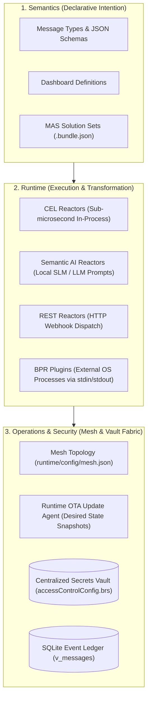
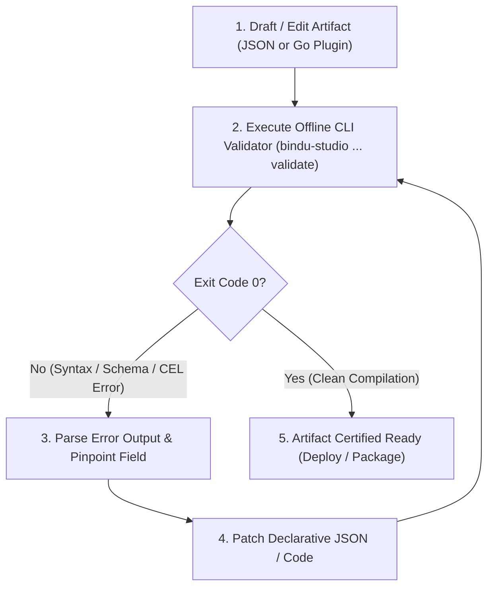
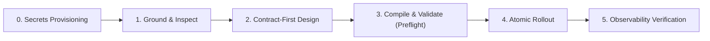
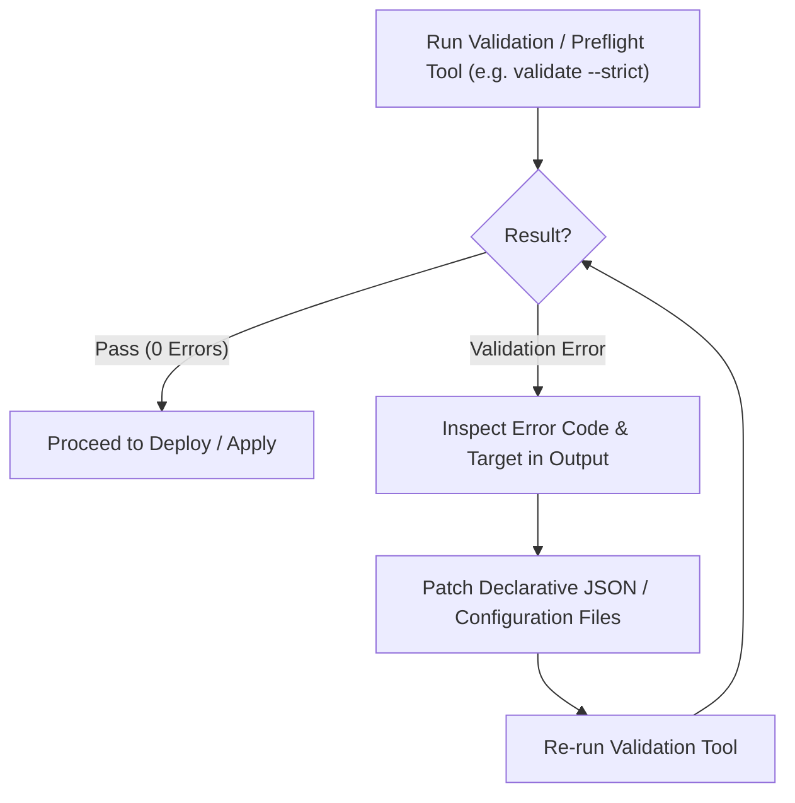

# 🤖 BINDU.md — The AI Architect & Solution Creator Handbook for Bindu MAS

> [!IMPORTANT]
> **CANONICAL SPECIFICATION FOR ALL AI AGENTS**:
> This document is the single, authoritative, and model-agnostic architectural specification governing how **Autonomous AI Agents (Google Gemini, Google Antigravity `agy`, OpenAI Codex/ChatGPT, Anthropic Claude Code, Cursor, Windsurf, and Local SLMs)** design, validate, package, certify, and deploy Multi-Agent System (MAS) solutions in the Bindu ecosystem.
> 
> *Environment Adapters:* For IDE and agent toolchains that automatically discover specific filenames, lightweight entrypoint adapters are maintained in [`AGENTS.md`](./AGENTS.md) (Codex/ChatGPT), [`GEMINI.md`](./GEMINI.md) (Gemini/Antigravity), and [`CLAUDE.md`](./CLAUDE.md) (Claude Code), all delegating directly to this canonical specification.

Welcome to **Bindu**. This handbook is the definitive operational and architectural guide for **Autonomous AI Models, AI Agents (Google Gemini, Antigravity, Claude, Codex/GPT), and Multi-Agent Orchestrators** tasked with building, configuring, debugging, and operating solutions in the Bindu ecosystem without requiring access to internal Go engine source code.

Everything you need to design, validate, package, deploy, and verify industrial Multi-Agent Systems (MAS) is fully accessible through declarative semantic schemas, the [`public/console/docs/`](./) documentation library, and the `bindu-studio` CLI toolchain.

---

## 🧭 Table of Contents

1. [The AI Architect Mental Model (3-Layer Invariants & Zero-Plaintext Wire Guarantee)](#1-the-ai-architect-mental-model-3-layer-invariants--zero-plaintext-wire-guarantee)
2. [The Law of Artifact Compilation (Validation-First Invariant)](#2-the-law-of-artifact-compilation-validation-first-invariant)
3. [Whitelisted Curriculum & Scope Boundary for MAS Solution Creators](#3-whitelisted-curriculum--scope-boundary-for-mas-solution-creators)
4. [Mastering the `bindu-studio` CLI Interface](#4-mastering-the-bindu-studio-cli-interface)
5. [The Artifact Compilation & Offline Validation Matrix](#5-the-artifact-compilation--offline-validation-matrix)
6. [The Problem-to-Artifacts Solution Decomposition Matrix & Completeness Checklist](#6-the-problem-to-artifacts-solution-decomposition-matrix--completeness-checklist)
7. [The 5-Phase Agent Workflow & The Preflight Secret Gate](#7-the-5-phase-agent-workflow--the-preflight-secret-gate)
8. [The Mandatory Preflight Validation Gate in Deployment Scripts](#8-the-mandatory-preflight-validation-gate-in-deployment-scripts)
9. [Deep Dive: In-Process CEL vs External BPR Plugins](#9-deep-dive-in-process-cel-vs-external-bpr-plugins)
10. [Semantic State & Retention Partition Contract (`$producer`)](#10-semantic-state--retention-partition-contract-producer)
11. [The Top 15 Critical Pitfalls & Golden Rules](#11-the-top-15-critical-pitfalls--golden-rules)
12. [CLI Command Matrix & Agent Cheat Sheet](#12-cli-command-matrix--agent-cheat-sheet)
13. [Autonomous Error Handling & Self-Correction Loops](#13-autonomous-error-handling--self-correction-loops)

---

## 1. The AI Architect Mental Model (3-Layer Invariants & Zero-Plaintext Wire Guarantee)

Bindu enforces a strict **3-Layer Separation of Concerns**. As an AI model, you must never mix execution logic with semantic intent.



### 🔒 Architectural Invariants (Agreed Principles — Do Not Violate)

* **MQTT-Only Message Ingress:** All sensor data, external events, and telemetry must enter the engine through MQTT (`bindu/in` with TLS & auth). **There is NO HTTP POST ingestion endpoint (`/api/v1/publish` does NOT exist)**. HTTP endpoints are strictly reserved for query inspection (`/api/v1/messages/sql`), lifecycle management, and UI dashboards.
* **Native REST SQL Query Layer for Observability (No Direct Database Hacking):** Cluster ledger inspection, event validation, and verification MUST be performed strictly through Bindu's native HTTP SQL endpoint (`/api/v1/messages/sql` using `curl`) or `bindu-studio mesh health`. AI agents and models must NEVER query raw SQLite `.db` files directly on disk or write ad-hoc Python/Bash database inspection scripts, which risks locking database files, reading stale disk copies, or failing on internal schema mappings.
* **The Zero-Plaintext Wire Guarantee (Centralized Secrets Vault):** Sensitive credentials—including cloud AI API keys (e.g. `TYPESAFE_API_KEY`, OpenAI, Anthropic), webhook tokens (Slack, Discord, PagerDuty), object storage keys (MinIO/S3 `access_key`, `secret_key`), database connection passwords, and SMTP mail credentials—**MUST NEVER appear in plaintext anywhere in the system**:
  - Never in solution manifests (`solution.json`, `solution.bundle.json`)
  - Never on the MQTT wire (`bindu/in` message envelopes or telemetry)
  - Never in declarative reactor definitions (`poc_semantic_reactor_config.json`, `poc_rest_reactor_config.json`)
  - Never in Git repositories or shared export bundles.
  
  All sensitive credentials are encrypted at rest in the node's local Centralized Secrets Vault (`runtime/config/accessControlConfig.brs`) using **AES-256-GCM** with dynamic PBKDF2 salting derived from the local node's cryptographic installation identity. Declarative definitions reference vault secrets strictly by declarative pointer:
  - `"api_key_secret": "secret:TYPESAFE_API_KEY"` (in `AISemanticReactorSet`)
  - `"Authorization": "'Bearer ' + secret('SLACK_TOKEN')"` (in `RESTReactorSet` CEL headers)
  - `"secret_key": "secret:MINIO_SECRET_KEY"` (in `MediaStorageSet`)
  - `"password": "secret:SMTP_PASSWORD"` (in `binduConfig.json` / `SMTPConfig`)
  
  The Bindu runtime engine, reactor bridges, and BPR plugins resolve these pointers **in-memory at execution time** on the local node. Plaintext secrets are NEVER transmitted across mesh hops, stored in SQLite ledger tables (`v_messages`), or leaked into logs.
* **Mesh is the Source of Topology Truth:** Node addresses, TLS endpoints, parent/child relationships, and plugin assignments live in `runtime/config/mesh.json`.
* **Zero Hardcoding in Logic:** Plugins and reactors must NEVER hardcode camera RTSP URLs, device paths, thresholds, or frame rates. All dynamic knobs must be read from input configuration messages (e.g. `EdgeCVSet`, `FreezerConfig`) or queried from local state.
* **Process Isolation for External Plugins (BPR):** Plugins run as independent OS processes communicating strictly via framed JSON over `stdin/stdout`. No background HTTP daemons or hidden sockets.
* **Event-Driven Horn Clause Deductive Engine Contract ($P_1 \land P_2 \dots \rightarrow Q$):** Bindu MAS solutions are formal **Event-Driven Horn Clause Deductive Ensembles**, NOT probabilistic "RAG + classifier + LLM" plumbing. Google CEL reactors execute real-time propositional and Datalog Horn clauses ($P_1 \land P_2 \land \dots \rightarrow Q$) in sub-microsecond Go memory (< 2 µs) with deterministic forward-chaining across the reactor DAG, writing an immutable derivation proof tree into the SQLite WAL ledger (`v_messages`). AI models (SLMs, VLMs, TypeSafe `Jev`, ONNX) MUST NEVER evaluate business logic, safety thresholds, or domain invariants; they are strictly **Ground Term Extractors** (translating noisy analog streams into typed scalar facts $P_1$) or **Bounded Synthesizers** (generating operator text strictly over context already deduced and proven by the Horn layer). Never let an LLM "guess" an operational decision.
* **The Deterministic Sandwich Contract (`CEL -> AI -> CEL`):**
  - **Inbound Guardrail ($P_1$):** Sub-microsecond Google CEL Horn clauses evaluate input triggers and invariants, short-circuiting routine telemetry (~90%–95%) at zero token cost.
  - **Grammar-Guided Inference:** AI models (SLMs, VLMs, TypeSafe System 1) are executed strictly under grammar-constrained decoding (CFG) or native RLCD decision auto-compilation (`noul`, `choice`, `score`), guaranteeing 100% structural schema compliance on the first forward pass.
  - **Outbound Blast Radius Clamping ($P_2 \land \dots \rightarrow Q$):** Outbound CEL mapping templates and confidence threshold checks verify mathematical invariants and calibrated confidence probabilities before downstream emission or hardware actuation, algebraically bounding the blast radius to zero.
* **Distributed Edge Node Sovereignty & Idempotent Mechanics:**
  - **Sovereign SQLite WAL:** Every node maintains an autonomous SQLite WAL database backed by an in-memory BadgerDB write spooler. There are NO distributed database locks or cross-node Raft consensus over SQLite; each edge cell operates independently.
  - **Delivery & Idempotency:** Transport over the mTLS mesh is at-least-once. The runtime achieves effectively-once execution through a rolling 24-hour deduplication ledger (`sql_seen` index on `$id`).
  - **Partition Independence & Chronological Reconvergence:** Nodes maintain split-brain immunity during network disconnections. Upon WAN reconnection, state transitions reconcile hierarchically via chronological timestamps (`$when`) and monotonic sequence counters (`$seq`).
  - **Schema Evolution:** MessageTypes are versioned (`version: "1.0.0"`). Edge nodes reflect active types via `schema.*`. Schema synchronization (`poc_message_types.json`) propagates non-breaking additions dynamically, while invalid schemas trigger typed `ErrorEvent` rejections without crashing the core runtime.

---

## 2. The Law of Artifact Compilation (Validation-First Invariant)

> [!IMPORTANT]
> **THE LAW OF ARTIFACT COMPILATION:**
> In Bindu, **declarative JSON files and BPR plugins ARE SOURCE CODE**.
> 
> Writing a JSON definition is only the drafting phase. An artifact is **NEVER finished, complete, or ready for deployment** until it has passed through its native `bindu-studio` compiler/validator.
>
> Just as a Go developer cannot commit code that fails `go build`, an AI Agent MUST NOT present an artifact to the user or attempt a rollout without executing its local validation command to confirm clean compilation with exit code `0`.

### The AI Developer Inner Compilation Loop

Whenever an AI model authors or edits any artifact (even an isolated single dashboard or reactor), it MUST execute this continuous compilation loop:



---

## 3. Whitelisted Curriculum & Scope Boundary for MAS Solution Creators

> [!IMPORTANT]
> **ROLE & AUDIENCE DECLARATION (BLACK-BOX MAS SOLUTION CREATOR)**:
> You are acting as an **Autonomous Multi-Agent System (MAS) Solution Creator & Application Architect**.
> - **Your Domain:** Declarative JSON schemas, CEL kinetics, AI semantic prompt rules, dashboard views, external Go BPR plugins (via `docs/sdk/`), the `bindu-studio` CLI, and MQTT ingress (`bindu/in`).
> - **Forbidden Scope (Do NOT Read or Edit):** You MUST NOT read or edit internal Bindu Go source code (`bindu/`, `routingeng/`, `executioneng/`, `sqlstorage/`, `cmd/`). You MUST NOT read low-level node OS installation guides, SSH sysadmin docs, or internal Go dispatcher log triage files. Bindu is an immutable, deterministic operating platform.
>
> **THE 6-TIER WHITELISTED CURRICULUM (READ ONLY THESE DOCUMENTS):**
> When building or operating a MAS solution, your information universe is strictly defined by these 6 canonical tiers:

| Curriculum Tier | Canonical Reference Documents | Key Concepts & Operational Responsibilities |
| :--- | :--- | :--- |
| **Tier 1: Methodology & Deployment Governance** | • [`AGENTS.md`](./AGENTS.md) / [`GEMINI.md`](./GEMINI.md) / [`CLAUDE.md`](./CLAUDE.md)<br>• [`mas-deployment-guide.md`](./mas-deployment-guide.md)<br>• [`how-to-build-a-bindu-solution.md`](./how-to-build-a-bindu-solution.md)<br>• [`Bindu Access Control User Manual.md`](./Bindu%20Access%20Control%20User%20Manual.md) | The 3-layer architecture, Zero-Plaintext Wire Guarantee, Encrypted Secrets Vault (`accessControlConfig.brs`), 6 required artifacts, Artifact DAG (Level 0), and the Universal 5-Phase Deployment Pipeline (`baseline` $\rightarrow$ `desired` $\rightarrow$ `wizard`). |
| **Tier 2: Level 0 Ontology, Routing & Retention** | • [`message_types_user_guide.md`](./message_types_user_guide.md)<br>• [`Message Types for AI Agents.md`](./Message%20Types%20for%20AI%20Agents.md)<br>• [`routing_and_directionality_guide.md`](./routing_and_directionality_guide.md)<br>• [`retention_policies_guide.md`](./retention_policies_guide.md) | Declarative schema authoring (`properties[]`), 5-axis semantic reasoning, Bottom-Up telemetry (`["local", "parent"]`, NEVER `child`), Top-Down commands (`["local", "child"]` + `$node-dest`), sliding window retention (`count: 20..100`), and `$producer` partition keys. |
| **Tier 3: Level 1 Hardware BPR Plugins** | • [`bindu-bpr-go-sdk-developer-manual.md`](./bindu-bpr-go-sdk-developer-manual.md)<br>• [`bindu-studio-plugin-user-guide.md`](./bindu-studio-plugin-user-guide.md) | Standalone Go process SDK (`sdk.Connect()`, `OnMessage`, `Emit`), framed JSON via `stdin/stdout`, binary certification (`bindu-studio plugin certify`), and staging (`plugin apply`). |
| **Tier 4: Level 2 Logic, AI & Dashboards** | • [`cel_reactor_user_guide.md`](./cel_reactor_user_guide.md)<br>• [`cel_context_and_functions_guide.md`](./cel_context_and_functions_guide.md)<br>• [`semantic_reactor_user_guide.md`](./semantic_reactor_user_guide.md)<br>• [`prompting_strategies_local_llms.md`](./prompting_strategies_local_llms.md)<br>• [`rest-reactor-user-manual.md`](./rest-reactor-user-manual.md)<br>• [`dashboards_user_guide.md`](./dashboards_user_guide.md)<br>• [`viewer_user_manual.md`](./viewer_user_manual.md)<br>• [`scheduled_events_user_guide.md`](./scheduled_events_user_guide.md)<br>• [`media_storage_user_guide.md`](./media_storage_user_guide.md) | Sub-microsecond CEL kinetics (`CELReactorSet`), dynamic secrets resolution via CEL `secret('KEY')`, local SLM cognitive reasoning (`AISemanticReactorSet`) with `"api_key_secret"`, webhooks (`RESTReactorSet`), SQL-driven HTMX dashboards (`DashboardDefinition`), standalone kiosk viewers (`/viewer`), crons, and media object tracking. |
| **Tier 5: Level 3 & 4 Packaging & Execution** | • [`bindu_studio_solution_user_guide.md`](./bindu_studio_solution_user_guide.md)<br>• [`publish_message_user_guide.md`](./publish_message_user_guide.md)<br>• [`queries_user_guide.md`](./queries_user_guide.md)<br>• [`Bindu-Integration-User-Manual.md`](./Bindu-Integration-User-Manual.md)<br>• [`mobile_and_leaf_client_guide.md`](./mobile_and_leaf_client_guide.md)<br>• [`Bindu Studio — User Guide (Command Overview).md`](./Bindu%20Studio%20%E2%80%94%20User%20Guide%20(Command%20Overview).md) | Packaging manifests into self-contained bundles (`solution export` $\rightarrow$ `solution validate --strict` $\rightarrow$ `solution apply`), MQTT publishing on `bindu/in`, SQL inspection via `/api/v1/messages/sql`, mobile leaf clients (Android/iOS with `$where` GPS projection), and canonical interface selection (MQTT vs REST Query vs BPR). |
| **Tier 6: Canonical Production Reference Solutions** | • [`potato-processing-pipeline-tutorial/`](./potato-processing-pipeline-tutorial/)<br>• [`edge-cv-tutorial/`](./edge-cv-tutorial/)<br>• [`rfid-epc-tutorial/`](./rfid-epc-tutorial/)<br>• [`media-storage-cleanup-tutorial/`](./media-storage-cleanup-tutorial/)<br>• [`rest-reactor-tutorial/`](./rest-reactor-tutorial/)<br>• [`semantic-ai-reactor-tutorial/`](./semantic-ai-reactor-tutorial/) | Complete, working gold-standard implementations demonstrating the Rule of 6 Artifacts and the 5-phase deployment pipeline. |

---

## 4. Mastering the `bindu-studio` CLI Interface

As an AI agent, **`bindu-studio` is your primary toolchain**. It is located at `./bin/bindu-studio` or built via `go run ./cmd/bindu-studio`.

### 💡 The Dynamic Self-Discovery Pattern (`--help`)
When you are unsure about command syntax or available flags, **always explore with `--help`**:
```bash
./bin/bindu-studio --help
./bin/bindu-studio plugin --help
./bin/bindu-studio cel-reactor --help
./bin/bindu-studio solution --help
./bin/bindu-studio runtime --help
./bin/bindu-studio access-control secrets --help
```

### 🔑 Essential CLI Flags for Autonomous AI Execution
Every AI agent must supply these flags to guarantee deterministic, non-interactive execution:

1. **`--auth <user:pass>` or `export BINDU_STUDIO_AUTH="console:StrongPass123"`:** Authenticates with the control plane.
2. **`--yes` / `-y`:** Bypasses interactive TTY prompts. **MANDATORY**: Without `--yes`, automated CLI execution will block waiting for stdin.
3. **`--all` / `-a`:** Selects all matching entities when importing, merging, or certifying.
4. **`--json`:** Emits structured JSON output rather than human-oriented tables, perfect for agent parsing.
5. **`--strict`:** Enforces deep semantic and dependency checks during validation.
6. **`--dry-run`:** Previews execution plans without modifying disk or cluster state.

---

## 5. The Artifact Compilation & Offline Validation Matrix

Every single Bindu declarative artifact has a dedicated offline compiler/validator in `bindu-studio`. **You must run the validator for the corresponding artifact before considering your task finished**:

| Artifact Category | Target File / Directory | Mandatory Compilation / Validation Command | What is Verified by the Compiler |
|---|---|---|---|
| **1. Message Types** | `poc_message_types.json` | `go run ./cmd/bindu-studio solution validate --file ./solution.json`<br>`message-types gen-go --config <path>`<br>`message-types gen-examples --config <path>` | Validates schema conformance against `https://bindunet.io/schema/messageTypeItem.json`, semantic field types, `persist`, `retentionMode`, and `"routing"`. Use `gen-go` to generate strongly-typed Go structs (`types_gen.go`) shifting validation to compile time. Use `gen-examples` to generate valid JSON fixtures (`examples/out/*.json`). |
| **2. CEL Stream Reactors** | `poc_cel_reactor_config.json` | `go run ./cmd/bindu-studio cel-reactor validate --file <path>`<br>`cel-reactor dry-run --file <path> --payload <json>` | Compiles CEL AST syntax, verifies `trigger_condition`, SQL `context_query`, and `ai.clamp` bounds. `dry-run` executes the real CEL core engine with mock payloads and DB rows to verify deterministic kinetics before deploy. |
| **3. Semantic AI Reactors** | `poc_semantic_reactor_config.json` | `go run ./cmd/bindu-studio semantic-ai-reactor validate --file <path>`<br>`semantic-ai-reactor dry-run --file <path> --payload <json>` | Validates `AISemanticReactorSet` structure, prompt templates, and output JSON schemas. **Mandatory `dry-run`**: executes the real inference engine against the LLM endpoint (Ollama), confirming model availability (catches missing model 404s) and schema coercion. |
| **4. REST Call Reactors** | `poc_rest_reactor_config.json` | `go run ./cmd/bindu-studio rest-reactor validate --file <path>`<br>`rest-reactor dry-run --file <path> --payload <json>` | Validates `RESTReactorSet` schema, CEL `secret('KEY')` headers, and endpoint URLs. `dry-run` executes the real HTTP egress bridge against mock payloads to test webhook reachability, response status handling, and output message mapping. |
| **5. Dashboard Definitions** | `poc_dashboards.json` | `go run ./cmd/bindu-studio dashboard validate --file <path>` | Validates `DashboardDefinition` schema, unique `$producer` slug alignment, SQL queries against SQLite `v_messages` view, widget configurations (telemetry, gauges, logs, charts), and grid coordinates. |
| **6. Native Go BPR Plugins** | `bindu-<name>-plugin/` | `go run ./cmd/bindu-studio plugin certify --source <dir> --dry-run` | Validates `plugin.json` schema, semantic closure against message schemas, Go compilation of `types_gen.go`, automatic validation of `examples/out/*.json` fixtures, cross-compilation capability (`linux/amd64`, `linux/arm64`), and confirms strict stdio isolation. |
| **7. MAS Solution Bundles** | `solution.json`<br>`solution.bundle.json` | `go run ./cmd/bindu-studio solution validate --file <path> --strict` | **Full graph closure validator**: Validates that all consumed/produced message types exist, all reactor rules are syntactically valid, all referenced plugins are packaged, all target `mesh_nodes` exist in topology, and role assignments are correct. |
| **8. Centralized Secrets Vault** | `runtime/config/accessControlConfig.brs` | `go run ./cmd/bindu-studio access-control secrets validate`<br>`access-control secrets get <KEY>` | Validates vault file encryption integrity (AES-256-GCM), header format (`v2:`), and secret key references across configured semantic reactors, REST bridges, and storage sets. Ensures zero dangling `secret:KEY` pointers before deployment. |

### 📖 The Ground-Truth Contract Oracle (`public/console/schema/`)

When generating JSON declarative artifacts, the machine-readable metaschemas located at `public/console/schema/` serve as the **authoritative syntactic ground truth**:
- `messageTypeItemSchema.json` ➔ Contract for individual message type definitions in `poc_message_types.json`.
- `dashboardDefinitionSchema.json` ➔ Contract for widgets, chart types, coordinate mappings, and fields in `poc_dashboards.json`.
- `genericMessageSchema.json` ➔ Contract for standard Bindu message envelopes (`$type`, `$when`, `$where`, `$producer`, `$user`, `$id`).
- `meshSchema.json` ➔ Contract for mesh topologies, gateway nodes, and reference planes in `mesh.json`.

> [!CAUTION]
> **Black-Box Rules for Schema Consumption**:
> 1. **Read-Only Inspection**: Use these files strictly to inspect allowed `enum` values (e.g. chart types in dashboards), field types, and `additionalProperties` constraints whenever a CLI validator reports a syntax or schema rejection.
> 2. **Never Edit Metaschemas**: MAS solution creators MUST NEVER edit or create files in `public/console/schema/`. These files belong to the core platform engine.
> 3. **Autonomous Validation via CLI**: Do not search for underlying Go source code or trace how schemas are consumed in Go. The **only authorized consumption and validation interface** for a MAS Solution Creator is the `bindu-studio` CLI (`bindu-studio dashboard validate`, `bindu-studio message-types merge`, `bindu-studio solution validate`).
> 4. **Selective Scope**: Only message types, dashboards, envelopes, and mesh topologies use JSON Schema files in this directory. Reactor sets (`CELReactorSet`, `AISemanticReactorSet`, `RESTReactorSet`) are compiled and validated against Go ASTs and internal validators directly by their respective `bindu-studio <primitive> validate` commands.

---

## 6. The Problem-to-Artifacts Solution Decomposition Matrix & Completeness Checklist

When tasked with building a Multi-Agent System (MAS), IoT pipeline, or edge automation solution in Bindu, an AI agent must never guess or omit required artifacts. Follow this systematic decomposition methodology:

### 🧭 Step 1: The 5-Question Problem Mapping Heuristic
Before creating files, answer these 5 core architectural questions:

1. **Origin of Reality (Ingress):**
   * *Question:* What physical device, scanner, sensor, or user initiates the telemetry?
   * *Output:* Declare an Ingress MessageType in `poc_message_types.json` with payload schema, published to `bindu/in` via MQTT.
2. **Perception & Unstructured Data (Vision / NLP):**
   * *Question:* Does the input contain images, video frames, audio, free-form text, or fuzzy anomaly signals?
   * *Output:* Define an `AISemanticReactorSet` in `poc_semantic_reactor_config.json` with a local SLM/LLM model (`llava-phi3:latest`, `moondream:latest`, `qwen2.5:0.5b`), strict JSON output schema, and prompt template.
3. **Physical Invariants, Math & Rules (Deterministic Logic):**
   * *Question:* Are there differential equations, physical laws, safety thresholds, or discrete boolean branches?
   * *Output:* Define a `CELReactorSet` in `poc_cel_reactor_config.json` evaluating formulas deterministically in $<1\mu\text{s}$ with `ai.clamp(..., min, max)` to guarantee hardware safety envelopes.
4. **Time-Based State Evolution (Future Intentions):**
   * *Question:* Does the business process require a delay, quarantine countdown, settling time, or scheduled awakening?
   * *Output:* CEL Reactor emits `SystemScheduledEvent` targeting the Go Core Min-Heap scheduler; downstream CEL Reactor intercepts `SystemCronJob` to awaken the digital twin.
5. **Physical Actuation & System Integration (Egress / IO):**
   * *Question:* Does the solution write to industrial PLCs, serial buses, cameras, or external cloud webhooks?
   * *Output:* BPR Plugin for hardware protocols (Modbus TCP/RTU, BLE, V4L2) OR `RESTReactorSet` for cloud REST webhooks (ERP/MES/Slack).

---

### 📐 Step 2: The 5-Paradigm Decision Matrix

Use this matrix to select the exact execution primitive for each subtask:

| Execution Paradigm | Engine | Latency / Throughput | When Recommended to Use | Architectural Constraints |
|---|---|---|---|---|
| **Google CEL Reactor (`CELReactorSet`)** | In-Process Google CEL (Go) | Sub-microsecond ($< 1\mu\text{s}$) | • Arithmetic & kinetic formulas<br>• Threshold filtering & state branching<br>• Safety bounding (`ai.clamp`)<br>• Spatial overlap arbitration | Pure deterministic in-memory execution; no network I/O; bounded complexity. |
| **Semantic AI Reactor (`AISemanticReactorSet`)** | Local SLM / LLM (Ollama) or TypeSafe System One (`Jev` via `/v1/systemone`) | Fast–Medium (~70–500 ms) | • Multimodal image/frame analysis (System-2 VLM)<br>• Calibrated parallel `noul`/`choice`/`score` decisions (System-1 `Jev`)<br>• Unstructured text & anomaly classification | System-2 uses grammar-guided JSON decoding; System-1 auto-compiles `MessageType` properties into `noul`/`choice`/`score` with mathematically calibrated `confidence_threshold`. Bind credentials via `"api_key_secret": "secret:TYPESAFE_API_KEY"`. |
| **REST Reactor (`RESTReactorSet`)** | In-Process HTTP Egress Bridge | Network-dependent | • External ERP/MES synchronization<br>• Cloud webhooks (Slack, Discord, PagerDuty)<br>• Periodic cloud weather/pricing polling | Strictly outbound egress; configurable timeouts and retry policies. Dynamic secrets in headers via CEL `secret('KEY')`. Never used for message ingestion. |
| **BPR Native Plugin (OS Process)** | Standalone Go Binary (`bindunet/sdk`) | Native OS speed | • Industrial PLCs (Modbus TCP/RTU, CAN)<br>• Video capture pipelines (RTSP, V4L2 USB)<br>• BLE beacon scanning & Serial/UART IO | Isolated OS process; stdio JSON lines (`stdin/stdout`) only; zero embedded HTTP servers. |
| **Distributed Time State Machine (`SystemScheduledEvent`)** | Go Core Min-Heap + SQLite Ledger | Nanosecond timer precision | • Quarantine & reconditioning countdowns<br>• Reboot-resilient digital twin awakening<br>• Warmup delays & inactivity timeouts | Native Go core feature; persists intentions across node reboots; preserves `$producer = <lot_id>`. |

---

### ✅ Step 3: The Non-Negotiable "Rule of 6 Artifacts" Checklist

Every complete MAS tutorial, PoC, or production solution directory MUST contain all 6 standard declarative artifacts:

- [ ] **1. `poc_message_types.json`:** Declarative application schemas (`properties`, `persist: true`, `retentionMode`, `retentionValue`, `routing`).
- [ ] **2. `poc_semantic_reactor_config.json`:** Multi-modal AI vision / NLP configuration (`AISemanticReactorSet`) targeting local SLMs (`llava-phi3:latest`, `moondream:latest`) with `"api_key_secret": "secret:KEY_NAME"`.
- [ ] **3. `poc_cel_reactor_config.json`:** Deterministic kinetic rules, threshold conditions, and safety clamping (`CELReactorSet`).
- [ ] **4. `poc_dashboards.json`:** Declarative UI views (`DashboardDefinition`) for Ingress Telemetry, Active Schedules/Timers, and Hardware Actuations.
- [ ] **5. `bindu-<name>-plugin/`:** Isolated Go BPR plugin (`main.go`, `plugin.json`, `go.mod`, `README.md`) if hardware I/O (Modbus, BLE, Camera) is involved.
- [ ] **6. `solution.bundle.json` + `deploy_mas_solution.sh`:** Consolidated `MASSolutionSet` with Step 0 Preflight Validation Gate deployed via the **Universal Runtime OTA Triptych**.

> [!IMPORTANT]
> **🔐 Zero-Plaintext Credential Binding Convention Across Artifacts**:
> Whenever an artifact interacts with an external service (LLM endpoints, cloud webhooks, S3/MinIO buckets, SMTP servers), AI agents must enforce declarative secret pointers:
> - **`AISemanticReactorSet`**: Bind using `"api_key_secret": "secret:KEY_NAME"` (never hardcode plaintext API keys).
> - **`RESTReactorSet`**: Inject credentials dynamically via CEL expressions in headers or URLs: `"Authorization": "'Bearer ' + secret('KEY_NAME')"` or `secret('KEY_NAME')`.
> - **`MediaStorageSet`**: Bind storage credentials using `"secret_key": "secret:KEY_NAME"` and `"access_key": "secret:KEY_NAME"`.
> - **System BPR Plugins & `binduConfig.json`**: Bind passwords using `"password": "secret:KEY_NAME"`.
> - **The Encrypted Vault**: All keys are stored encrypted at rest in `runtime/config/accessControlConfig.brs` and resolved dynamically in-memory at execution time.

---

## 7. The 5-Phase Agent Workflow & The Preflight Secret Gate

Whenever you are assigned a Bindu task, follow this exact workflow loop:



### Phase 0: Provision Encrypted Secrets (Zero-Plaintext Gate)
Before writing or executing solutions that connect to external LLMs, webhooks, or cloud services:
```bash
# Verify if required secrets are already configured in the local vault (masked output)
./bin/bindu-studio access-control secrets get TYPESAFE_API_KEY

# If missing, provision securely into the encrypted vault (AES-256-GCM)
./bin/bindu-studio access-control secrets set TYPESAFE_API_KEY --value "ts_live_abcdef123" --yes --auth console:StrongPass123

# Tip: To prevent secret leakage in Bash history, pipe via stdin:
echo "ts_live_abcdef123" | ./bin/bindu-studio access-control secrets set TYPESAFE_API_KEY --stdin --yes

# Validate vault file integrity, encryption header (v2:), and reactor bindings
./bin/bindu-studio access-control secrets validate
```

### Phase 1: Ground & Inspect Live State
Before writing code or JSON:
```bash
# Check existing message types
./bin/bindu-studio message-types list --auth console:StrongPass123

# Check active MAS solutions
./bin/bindu-studio solution list --auth console:StrongPass123

# Check deployed CEL reactors
./bin/bindu-studio cel-reactor list --auth console:StrongPass123

# Check installed BPR plugins
./bin/bindu-studio plugin list --auth console:StrongPass123
```

### Phase 2: Contract-First Declarative Design
Define your contracts in JSON before implementing runtime logic:
1. **Message Types (`./poc_message_types.json`):** Declare schema fields, types, retention, and routing.
   * *Telemetry & Sensor Events (Bottom-Up)*: Physical tag reads, antenna telemetry, camera detections, sensor measurements MUST use `"routing": ["local", "parent"]`. NEVER include `"child"` in telemetry (child nodes do NOT need sensor telemetry from other nodes, and adding `"child"` causes infinite forwarding error loops).
   * *Control Commands & Configurations (Top-Down)*: Only downstream commands targeted at edge nodes (e.g., `EdgeCVSet`, `RfidReaderConfig`, `SystemNodeReset`) should include `"child"` (`"routing": ["local", "child"]`).
   * *Routing Reasoning*: Consult [`routing_and_directionality_guide.md`](./routing_and_directionality_guide.md) for the canonical decision tree across the 4 flow archetypes.
   * *Retention Semantics*: Streams of events must use `retentionMode: "count"` (20-100), NEVER large calendar days (14-30 days) which bloat edge SQLite databases. Consult [`retention_policies_guide.md`](./retention_policies_guide.md) for the 5 retention archetypes.
2. **Reactor Intent (`./poc_cel_reactor_config.json`):** Define input trigger, sliding SQL window, and output transformation.
3. **Solution Manifest (`./solution_<slug>.json`):** Link all schemas, reactors, dashboards, plugins, and target `mesh_nodes`.

### Artifact Dependency Graph (Artifact DAG) & The Iron Law of Level 0
Every artifact in a Multi-Agent System has a strict dependency level in the execution graph:
- **Level -1 (Prerequisite: Encrypted Vault Credentials):** Centralized Secrets Vault (`runtime/config/accessControlConfig.brs`). External cloud API keys (`TYPESAFE_API_KEY`), webhook tokens, S3/MinIO keys, and SMTP credentials must be securely provisioned into the local node's encrypted vault before reactors or plugins depending on them can execute.
- **Level 0 (Ontology & Contracts — Zero Dependencies):** `poc_message_types.json`. In Bindu, nothing can be validated, compiled, routed, or evaluated without message schemas registered first.
- **Level 1 (Code Compilation — Isolated SDK):** Standalone Go BPR Plugin (`bindu-studio plugin certify`). Depends only on OS target and Bindu SDK.
- **Level 2 (Logic & Kinetics — Depends on Level 0 and Level -1):** `poc_cel_reactor_config.json`, `poc_semantic_reactor_config.json`, `poc_dashboards.json`. Validators (`cel-reactor validate`, `semantic-ai-reactor validate`, `dashboard validate`) verify against the schemas registered in `--base-dir`. They will FAIL if Level 0 is not ingested first.
- **Level 3 (Declarative Graph Closure — Depends on Levels 0, 1, 2):** `solution export` $\rightarrow$ `solution validate --file <bundle.json> --strict` $\rightarrow$ `solution apply`.
- **Level 4 (Physical OS Delivery — Depends on Level 3):** The Universal Runtime OTA Triptych (`baseline accept` $\rightarrow$ `desired commit` $\rightarrow$ `update wizard`).

### The Canonical Deployment Pipeline (with Preflight Secret Gate)
When deploying a MAS solution or rolling out updates across a live Bindu mesh, NEVER run individual reactor validators before Level 0 schemas are merged, and NEVER stop at `solution apply` alone if BPR plugins or edge gateway nodes are involved. Always execute the canonical pipeline:

#### **Phase 0: Centralized Secrets Vault Provisioning (The Preflight Secret Gate)**
```bash
# 1. Verify if required secrets are already configured in the local vault (masked output)
./bin/bindu-studio access-control secrets get TYPESAFE_API_KEY

# 2. If missing, provision securely into the encrypted vault (AES-256-GCM)
./bin/bindu-studio access-control secrets set TYPESAFE_API_KEY --value "ts_live_abcdef123" --yes --auth console:StrongPass123

# Tip: To prevent secret leakage in Bash history, pipe via stdin:
echo "ts_live_abcdef123" | ./bin/bindu-studio access-control secrets set TYPESAFE_API_KEY --stdin --yes

# 3. Validate vault encryption header (v2:) and cross-reactor references
./bin/bindu-studio access-control secrets validate
```

#### **Phase 1: Ontology & Schema Ingestion (Level 0 - Schemas First)**
```bash
# 1. Non-destructively merge message types into live in-memory registry FIRST
./bin/bindu-studio message-types merge --in-path ./poc_message_types.json --all --yes --auth console:StrongPass123
```

#### **Phase 2: Binary Certification & Native Packaging (Level 1)**
```bash
# 1. (Recommended) Generate strongly-typed Go structs & validation helpers
# Moves payload schema validation to compile-time (go build) to prevent runtime SCHEMA_INVALID errors
./bin/bindu-studio message-types gen-go --config ./poc_message_types.json --out ./my-plugin/types_gen.go --package main

# 2. (Recommended) Generate compliant sample JSON fixtures for Level 1 certification
./bin/bindu-studio message-types gen-examples --config ./poc_message_types.json --out ./my-plugin/examples/out

# 3. Certify native package for target CPU architecture (e.g. linux/amd64 or linux/arm64)
# Validates manifest, Go build, and verifies examples/out/*.json against message schemas
./bin/bindu-studio plugin certify --source ./my-plugin --out ./my-plugin.tar.gz --target linux/amd64 --config ./poc_message_types.json
```

#### **Phase 3: Preflight Validation of Logic & Dashboards (Level 2)**
*(Now schemas are registered in the cluster registry, so validators can resolve all types!)*

> [!IMPORTANT]
> **The Iron Law of Reactor Verification: Syntactic `validate` vs In-Engine `dry-run`**
> - **Syntactic `validate`:** Checks AST syntax, JSON formatting, and schema existence offline. However, `validate` **CANNOT** detect runtime template mismatches (`<no value>`), missing schema field mappings, or external endpoint failures (such as a nonexistent LLM model or unreachable REST webhook).
> - **In-Engine `dry-run`:** Runs the **REAL execution core** in-process or against live `root`. It performs real template hydration (`state`), compiles hybrid System One `questions` (`noul`, `choice`, `score`), executes real Google CEL formulas, sends real HTTP requests to LLM/System One/webhook endpoints, measures latencies, and validates output schema coercion.
> - **Mandatory Rule for AI Agents & Developers:** NEVER consider a CEL, Semantic AI, REST reactor, or BPR Plugin complete without executing `dry-run` with a representative `--payload` (and `--config ./poc_message_types.json` when running pre-deployment). Even when a cloud API key (e.g. `TYPESAFE_API_KEY`) is not yet exported in the local shell, `semantic-ai-reactor dry-run` MUST still be executed to verify that the hydrated prompt contains zero `<no value>` placeholders and that all System One questions compile cleanly from the target `MessageType` schema!

```bash
# 1. Syntactic AST Validation (Offline)
./bin/bindu-studio cel-reactor validate --file ./poc_cel_reactor_config.json --config ./poc_message_types.json
./bin/bindu-studio semantic-ai-reactor validate --file ./poc_semantic_reactor_config.json --config ./poc_message_types.json
./bin/bindu-studio rest-reactor validate --file ./poc_rest_reactor_config.json --config ./poc_message_types.json
./bin/bindu-studio dashboard validate --file ./poc_dashboards.json --config ./poc_message_types.json

# 2. In-Engine Execution Simulation (Dry-Run against Real Engines & Endpoints - MANDATORY)
# a. Verify Google CEL formula evaluation & kinetic clamping:
./bin/bindu-studio cel-reactor dry-run \
  --file ./poc_cel_reactor_config.json \
  --config ./poc_message_types.json \
  --reactor-id <reactor_id> \
  --payload '{"temperature": -3.5, "door_open": true}'

# b. Verify Semantic AI / System One prompt hydration, compiled questions, and endpoint reachability:
./bin/bindu-studio semantic-ai-reactor dry-run \
  --file ./poc_semantic_reactor_config.json \
  --config ./poc_message_types.json \
  --reactor-id <reactor_id> \
  --payload '{"$producer": "freezer_madrid_01", "$where": "ES-MD-CHAMBER-01", "fields": {"temperature": -12.4, "door_open": true, "compressor_current_amps": 14.2}}'

# c. Verify REST outbound webhook connectivity and payload mapping:
./bin/bindu-studio rest-reactor dry-run \
  --file ./poc_rest_reactor_config.json \
  --config ./poc_message_types.json \
  --reactor-id <reactor_id> \
  --payload '{"order_id": "ORD-123", "status": "APPROVED"}'

# d. Verify BPR Plugin process startup, handshake, schema validation and clean shutdown:
./bin/bindu-studio plugin dry-run \
  --source ./plugins/my-plugin \
  --trigger scan-antenna \
  --timeout 5s
```

#### **Phase 4: Declarative Application & Solution Bundling (Level 3)**
```bash
# 1. Import certified package into root cluster registry and assign target
./bin/bindu-studio plugin apply --bundle ./my-plugin.tar.gz --target node-1 --auth console:StrongPass123

# 2. Ingest reactors & dashboards into cluster
./bin/bindu-studio cel-reactor merge --file ./poc_cel_reactor_config.json --yes --auth console:StrongPass123
./bin/bindu-studio dashboard import --file ./poc_dashboards.json --all --auth console:StrongPass123

# 3. Export consolidated bundle & validate full graph closure
./bin/bindu-studio solution export --file ./solution_<slug>.json --out ./bundles/solution.bundle.json --auth console:StrongPass123
./bin/bindu-studio solution validate --file ./bundles/solution.bundle.json --strict

# 4. Apply the self-contained solution bundle (activates MASSolutionSet)
./bin/bindu-studio solution apply --file ./bundles/solution.bundle.json --yes --auth console:StrongPass123
```

#### **Phase 5: The Universal Runtime OTA Triptych (Level 4 - Mandatory for Edge Nodes)**
> [!IMPORTANT]
> **Why `runtime update wizard` is mandatory:** `solution apply` and `plugin apply` register the declarative intent in the central registry and mesh topology, but **do not physically transmit binaries or boot processes on remote edge nodes**. To physically deliver plugin binaries OTA and boot supervised processes on edge gateways (preventing `plugin_drift`), you **MUST** run the 3-step runtime cadence:
```bash
# 1. Acknowledge and freeze approved baseline state
./bin/bindu-studio runtime baseline accept --yes

# 2. Package versioned desired state snapshot with staged plugins
./bin/bindu-studio runtime desired commit --note "Deploy MAS solution release"

# 3. Enqueue and execute OTA rollout across mesh gateways
./bin/bindu-studio runtime update wizard --yes --auth console:StrongPass123
```

### Phase 5: Observability & Self-Verification
Never assume a deployment succeeded without verifying ledger state. Always query via Bindu's native REST SQL endpoint (`/api/v1/messages/sql` using `curl`) or check cluster health with `bindu-studio mesh health`. **NEVER query raw SQLite `.db` files directly on disk.**

```bash
# 1. Query recent ledger events via SQL API (v_messages view)
curl -u console:StrongPass123 -s http://127.0.0.1:38080/api/v1/messages/sql \
  -H "Content-Type: application/json" \
  -d '{"sql": "SELECT \"$id\", \"$type\", \"$producer\", \"$when\", fields FROM v_messages ORDER BY \"$when\" DESC LIMIT 5"}'

# 2. Query specific payload fields using SQLite json_extract()
curl -u console:StrongPass123 -s http://127.0.0.1:38080/api/v1/messages/sql \
  -H "Content-Type: application/json" \
  -d '{"sql": "SELECT \"$id\", \"$type\", \"$producer\", json_extract(fields, '\''$.bpr_plugins'\'') FROM v_messages WHERE \"$type\" = '\''MessageState'\'' ORDER BY \"$when\" DESC LIMIT 1"}'

# 3. Check cluster mesh health, presence, versions, and plugin alignment
./bin/bindu-studio mesh health --auth console:StrongPass123
```

---

## 8. The Mandatory Preflight Validation Gate in Deployment Scripts

Every `deploy_mas_solution.sh` automation script MUST start with a dedicated **Step 0: Preflight Validation Gate** that compiles and validates all 6 artifacts offline before any network or mutating commands are executed:

```bash
# =================================================================
# STEP 0: MANDATORY OFFLINE PREFLIGHT VALIDATION GATE
# =================================================================
echo "🔍 Step 0: Running Offline Preflight Validation Gate on all artifacts..."

# 0. Check Required Integration Secrets in Encrypted Vault
echo "🔒 Checking required secrets in Centralized Secrets Vault (accessControlConfig.brs)..."
REQUIRED_SECRETS="TYPESAFE_API_KEY SLACK_WEBHOOK_TOKEN"
for secret_key in $REQUIRED_SECRETS; do
    if ! go run "$ROOT_DIR/cmd/bindu-studio" access-control secrets get "$secret_key" >/dev/null 2>&1; then
        echo "⚠️ Warning: Secret '$secret_key' not found in vault. Provision via 'bindu-studio secrets set $secret_key'."
    fi
done
go run "$ROOT_DIR/cmd/bindu-studio" access-control secrets validate || true

# 1. Validate Plugin Manifest & Code
if [ -d "$SCRIPT_DIR/bindu-my-plugin" ]; then
    go run "$ROOT_DIR/cmd/bindu-studio" plugin certify --source "$SCRIPT_DIR/bindu-my-plugin" --dry-run
fi

# 2. Validate CEL Reactors (Syntax & Mandatory Kinetics Dry-Run)
if [ -f "$SCRIPT_DIR/poc_cel_reactor_config.json" ]; then
    go run "$ROOT_DIR/cmd/bindu-studio" cel-reactor validate --file "$SCRIPT_DIR/poc_cel_reactor_config.json" --config "$SCRIPT_DIR/poc_message_types.json"
    go run "$ROOT_DIR/cmd/bindu-studio" cel-reactor dry-run --file "$SCRIPT_DIR/poc_cel_reactor_config.json" --config "$SCRIPT_DIR/poc_message_types.json" --payload '<mock_json>'
fi

# 3. Validate Semantic AI Reactors (Syntax & Mandatory In-Engine Dry-Run)
if [ -f "$SCRIPT_DIR/poc_semantic_reactor_config.json" ]; then
    go run "$ROOT_DIR/cmd/bindu-studio" semantic-ai-reactor validate --file "$SCRIPT_DIR/poc_semantic_reactor_config.json" --config "$SCRIPT_DIR/poc_message_types.json"
    go run "$ROOT_DIR/cmd/bindu-studio" semantic-ai-reactor dry-run --file "$SCRIPT_DIR/poc_semantic_reactor_config.json" --config "$SCRIPT_DIR/poc_message_types.json" --payload '<mock_json>'
fi

# 4. Validate REST Reactors (Syntax & Mandatory Webhook Dry-Run)
if [ -f "$SCRIPT_DIR/poc_rest_reactor_config.json" ]; then
    go run "$ROOT_DIR/cmd/bindu-studio" rest-reactor validate --file "$SCRIPT_DIR/poc_rest_reactor_config.json" --config "$SCRIPT_DIR/poc_message_types.json"
    go run "$ROOT_DIR/cmd/bindu-studio" rest-reactor dry-run --file "$SCRIPT_DIR/poc_rest_reactor_config.json" --config "$SCRIPT_DIR/poc_message_types.json" --payload '<mock_json>'
fi

# 5. Validate Dashboards
if [ -f "$SCRIPT_DIR/poc_dashboards.json" ]; then
    go run "$ROOT_DIR/cmd/bindu-studio" dashboard validate --file "$SCRIPT_DIR/poc_dashboards.json"
fi

# 6. Validate Solution Manifest Graph Closure (Strict Mode)
if [ -f "$SCRIPT_DIR/solution.json" ]; then
    go run "$ROOT_DIR/cmd/bindu-studio" solution validate --file "$SCRIPT_DIR/solution.json" --strict
fi

echo "✅ Preflight Validation Gate Passed: All artifacts certified clean."
```

---

## 9. Deep Dive: In-Process CEL vs External BPR Plugins

Choosing the right execution paradigm is vital for performance and stability:

| Dimension | Common Expression Language (CEL Reactor) | Bindu Plugin Runtime (BPR Plugin) |
|---|---|---|
| **Execution Domain** | **In-Process** inside Bindu Go core | **External Subprocess** via OS fork/exec |
| **Latency** | **Sub-microsecond** ($\approx 10-50\,\mu\text{s}$) | Milliseconds ($\approx 1-5\,\text{ms}$) |
| **State & Context Access** | Direct access to SQLite (`db.rows`, `db.scalar`), time, math | Access via SQLite queries or ingress streams |
| **Primary Use Cases** | Spatial authority arbitration, threshold alerts, multi-camera overlap, state machines | Hardware I/O (`/dev/video0`, Serial, GPIO), neural inference (YOLO ONNX), heavy compute |
| **Memory Isolation** | Sandboxed CEL environment | Full OS process & virtual memory isolation |
| **Language** | Declarative CEL Expressions | Native Compiled Go (Pure Go SDK) |

---

## 10. Semantic State & Retention Partition Contract (`$producer`)

Bindu's retention and state engine prunes historical records based on the triplet:
$$\big(\mathbf{\$type},\, \mathbf{\$group},\, \mathbf{\$producer}\big)$$

When crafting message generators or reactor transformations, follow these rules:

1. **Discrete Multi-Instance Definitions (`retentionValue: 1`):**
   * Types: `DashboardDefinition`, `MASSolutionSet`.
   * Rule: **`$producer` MUST match the unique entity slug identifier** (e.g. `fields.id`, `fields.solution_id`).
   * *Never* use generic names like `"root"`, `"bindu-studio"`, or `"console"` as `$producer` on multi-instance definitions, or you will overwrite other instances!
2. **Node-Scoped Aggregated Sets:**
   * Types: `CELReactorSet`, `AISemanticReactorSet`, `RESTReactorSet`.
   * Rule: **`$producer` MUST be the target `gateway_node_id`** (e.g. `"root"`, `"node-1"`).
3. **Telemetry & Sensor Streams:**
   * Types: `AppearedClass`, `DisappearedClass`, `FreezerTelemetry`.
   * Rule: **`$producer` MUST be the camera or sensor hardware identifier** (e.g. `"cam-usb-root"`, `"sensor-fridge-01"`).

---

## 11. The Top 15 Critical Pitfalls & Golden Rules

```
+-----------------------------------------------------------------------------------+
|                           THE AI AGENT'S GOLDEN RULES                             |
+-----------------------------------------------------------------------------------+
| 1. ALWAYS VALIDATE BEFORE COMMIT: In Bindu, declarative JSON is source code.      |
|    Never present or deploy an artifact without running its CLI validator.        |
| 2. ALWAYS include Step 0 (Preflight Validation Gate) in all deployment scripts.   |
| 3. NEVER blind overwrite: Use `cel-reactor merge`, not destructive `import`.     |
| 4. NEVER duplicate reactors: Arbitrators run on ONE designated node only.         |
| 5. NEVER hardcode hardware: Read RTSP/V4L2 paths dynamically from config.         |
| 6. NEVER add "child" to telemetry (use "local", "parent"). Only use "child" for downstream commands.|
| 7. ALWAYS supply `--yes` / `-y` and `--all` to prevent interactive CLI hangs.     |
| 8. ALWAYS publish telemetry via MQTT (`bindu/in`), NEVER HTTP POST.               |
| 9. ALWAYS specify `--target linux/amd64` (or arm64) when certifying CGo/ONNX.   |
| 10. ALWAYS run `plugin certify --dry-run` and `solution validate --strict`.       |
| 11. ALWAYS declare all participating edge nodes in `solution.json` `mesh_nodes`.   |
| 12. NEVER stop after `solution apply` when edge plugins/nodes are involved:       |
|     ALWAYS complete the Runtime OTA Triptych (`baseline` -> `desired` -> `wizard`).|
| 13. NEVER query SQLite .db files on disk or write ad-hoc Python inspection scripts:|
|     ALWAYS inspect cluster state via the native REST API (/api/v1/messages/sql    |
|     using curl) or `bindu-studio mesh health`.                                    |
| 14. NEVER EMIT PLAINTEXT SECRETS ON WIRE OR IN MANIFESTS:                         |
|     ALWAYS reference secrets via "secret:KEY" or CEL secret('KEY') and            |
|     store encrypted in the Centralized Secrets Vault (accessControlConfig.brs).   |
| 15. NEVER DELEGATE BUSINESS POLICIES OR SAFETY THRESHOLDS TO AI PROMPTS:          |
|     ALWAYS execute business logic via CEL reactors as formal Horn clauses         |
|     (P₁ ∧ P₂ → Q). AI models are strictly Ground Term Extractors (P₁) or          |
|     bounded synthesizers operating on already-proven facts.                       |
+-----------------------------------------------------------------------------------+
```

---

## 12. CLI Command Matrix & Agent Cheat Sheet

### 🔐 Centralized Secrets Vault (`accessControlConfig.brs`)
```bash
# List all configured secret keys (values are masked)
./bin/bindu-studio access-control secrets list --auth console:StrongPass123

# Store or update an encrypted secret in the vault
./bin/bindu-studio access-control secrets set TYPESAFE_API_KEY --value "ts_live_abcdef123" --yes --auth console:StrongPass123

# Read secret from stdin (prevents secret leakage in Bash history)
echo "ts_live_abcdef123" | ./bin/bindu-studio access-control secrets set TYPESAFE_API_KEY --stdin --yes

# Inspect or retrieve a secret (for automated preflight gates)
./bin/bindu-studio access-control secrets get TYPESAFE_API_KEY
./bin/bindu-studio access-control secrets get TYPESAFE_API_KEY --reveal

# Delete a secret from the vault
./bin/bindu-studio access-control secrets delete TYPESAFE_API_KEY --yes --auth console:StrongPass123

# Validate vault file integrity, encryption header (v2:), and cross-reactor references
./bin/bindu-studio access-control secrets validate
```

### 📦 Solution Packaging & Lifecycle
```bash
# Register solution manifest
./bin/bindu-studio solution register ./solution.json --force --auth console:StrongPass123

# Export complete self-contained bundle
./bin/bindu-studio solution export --file ./solution.json --out ./solution.bundle.json --auth console:StrongPass123

# Deep strict validation
./bin/bindu-studio solution validate --file ./solution.bundle.json --strict

# Deploy solution bundle atomically
./bin/bindu-studio solution apply --file ./solution.bundle.json --yes --auth console:StrongPass123
```

### 🚀 Runtime OTA Mesh Lifecycle (Mandatory for Edge Delivery)
```bash
# 1. Acknowledge baseline state
./bin/bindu-studio runtime baseline accept --yes

# 2. Commit versioned desired runtime state with staged plugins
./bin/bindu-studio runtime desired commit --note "Deploying MAS release"

# 3. Trigger OTA rollout to remote gateways
./bin/bindu-studio runtime update wizard --yes --auth console:StrongPass123
```

### ⚡ CEL Reactors (Declarative Stream Rules)
```bash
# Validate CEL expressions offline
./bin/bindu-studio cel-reactor validate --file ./poc_cel_reactor_config.json

# Dry-run CEL transformation against test payload
./bin/bindu-studio cel-reactor dry-run --file ./poc_cel_reactor_config.json --payload '{"class_name":"person"}'

# Non-destructively merge reactors into target node
./bin/bindu-studio cel-reactor merge --file ./poc_cel_reactor_config.json --all --yes --auth console:StrongPass123

# Delete specific reactor from node
./bin/bindu-studio cel-reactor delete --node node-1 --reactor old-reactor-id --yes --auth console:StrongPass123
```

### 🔌 BPR Plugins
```bash
# Check plugin code & schema health
./bin/bindu-studio plugin doctor --source ./my-plugin --config ./poc_message_types.json

# Certify and build release package
./bin/bindu-studio plugin certify --source ./my-plugin --out ./my-plugin-1.0.0.tar.gz --target linux/amd64

# Import certified package into root cluster
./bin/bindu-studio plugin import ./my-plugin-1.0.0.tar.gz --auth console:StrongPass123

# Stage to specific edge node
./bin/bindu-studio plugin apply --bundle ./my-plugin-1.0.0.tar.gz --target node --node node-1 --auth console:StrongPass123

# Cleanly unassign and uninstall runtime from a node
./bin/bindu-studio plugin remove --plugin my-plugin --target root --uninstall --auth console:StrongPass123
```

### 📊 Querying & Verifying the Ledger
```bash
# Run raw SQL against mesh ledger
curl -u console:StrongPass123 -s http://127.0.0.1:38080/api/v1/messages/sql \
  -H "Content-Type: application/json" \
  -d '{"sql": "SELECT \"$id\", \"$type\", \"$producer\", \"$when\", fields_json FROM v_messages WHERE \"$type\" = \"WorkstationPresenceSession\" ORDER BY \"$when\" DESC LIMIT 5"}'
```

---

## 13. Autonomous Error Handling & Self-Correction Loops

When an automated tool or AI agent runs into an error during `validate`, `doctor`, or `merge`, **NEVER attempt to bypass validation by force-deploying or stripping `--strict`**. 

Always follow the **Inspect → Patch Declarative JSON → Re-validate** self-correction loop:



### 🛠️ Error Code Resolution & Self-Correction Matrix

| Error Code / Symptom | Root Cause | Agent Self-Correction Action | Re-Validation Command |
|---|---|---|---|
| **`SECRET_NOT_FOUND`**<br>`EMPTY_SECRET_KEY`<br>`ERR_SECRET_UNRESOLVED` | A reactor, storage definition, or plugin references `secret:KEY_NAME` or CEL `secret('KEY_NAME')`, but the key has not been provisioned in `accessControlConfig.brs`. | 1. Provision the missing secret into the local node vault: `./bin/bindu-studio access-control secrets set <KEY> --value "..." --yes`.<br>2. Or set the fallback environment variable for local testing.<br>3. Verify resolution with `./bin/bindu-studio access-control secrets get <KEY>`. | `./bin/bindu-studio access-control secrets validate` |
| **`MISSING_MESSAGE_TYPE`**<br>`UNREGISTERED_SCHEMA` | A CEL reactor, dashboard, or plugin consumes/produces a message type not declared in `poc_message_types.json` or not merged into mesh registry. | 1. Add the missing message type definition into `poc_message_types.json`.<br>2. Add the type name to `artifacts.message_types` in `solution.json`.<br>3. Run `./bin/bindu-studio message-types merge --in-path ./poc_message_types.json --all --yes`. | `./bin/bindu-studio solution validate --file ./bundles/solution.bundle.json --strict` |
| **`PLUGIN_DRIFT_OR_INACTIVE`**<br>(Plugin staged but not executing on edge node) | `solution apply` or `plugin import` was executed, but the Runtime OTA Triptych was not run to push binaries to the gateway. | Execute the 3-phase runtime cadence:<br>1. `./bin/bindu-studio runtime baseline accept --yes`<br>2. `./bin/bindu-studio runtime desired commit --note "Sync plugins"`<br>3. `./bin/bindu-studio runtime update wizard --yes --auth console:StrongPass123`. | `./bin/bindu-studio mesh health --base-dir ./.e2e-root/current --auth console:StrongPass123` |
| **`CEL_EXPRESSION_ERROR`**<br>`FIELD_NOT_FOUND` | A CEL transformation expression attempts to access a field without a presence check, or encounters a type mismatch. | 1. Add safety guards: `has(payload.field) ? payload.field : default`.<br>2. For SQL results: check `has(db.rows) && size(db.rows) > 0`.<br>3. Use explicit type casting: `double(...)`, `string(...)`, `int(...)`. | `./bin/bindu-studio cel-reactor validate --file ./poc_cel_reactor_config.json` |
| **`UNDECLARED_DEPENDENCY`**<br>`PLUGIN_NOT_FOUND` | `solution.json` lists a plugin (e.g. `my-plugin@1.0.0`) that has not been certified or is missing in repository artifacts. | 1. Run `./bin/bindu-studio plugin certify --source ./my-plugin --out ./my-plugin-1.0.0.tar.gz`.<br>2. Re-export the solution bundle: `./bin/bindu-studio solution export --file ./solution.json --out ./solution.bundle.json`. | `./bin/bindu-studio solution validate --file ./bundles/solution.bundle.json --strict` |
| **`ROUTING_DELIVERY_FAILURE`**<br>(Downstream commands do not reach Edge nodes) | A top-down command/configuration message only specifies `"routing": ["local"]` or `"routing": ["parent"]`, preventing forwarding to child nodes. | 1. For downstream commands ONLY (never telemetry): edit `poc_message_types.json`.<br>2. Add `"child"` to the routing array: `"routing": ["local", "child"]`.<br>3. Re-run `message-types merge`. | `./bin/bindu-studio solution validate --file ./solution.json --strict` |
| **`DUPLICATE_SESSION_EXECUTION`**<br>(Duplicate events in dashboard) | The same CEL reactor ID is active on multiple nodes (e.g. running on both `root` and `node-1`). | 1. Target the reactor strictly to the designated arbitrator node in `poc_cel_reactor_config.json` (`gateway_node_id`).<br>2. Clear duplicate reactor sets from edge nodes: `./bin/bindu-studio cel-reactor delete --node node-1 --reactor <id> --yes`. | Query SQLite ledger via `/api/v1/messages/sql` to confirm single event emission. |
| **`PLUGIN_ELF_ARCHITECTURE_MISMATCH`**<br>(Plugin crashes on remote node) | Binary or CGo shared library assets (`.so`) were built for the wrong CPU architecture (e.g. host `amd64` deployed to `arm64`). | 1. Certify explicitly for the target platform: `--target linux/arm64` or `--target linux/amd64`.<br>2. Ensure `runtime/lib/` contains matching native `.so` shared libraries. | `./bin/bindu-studio plugin certify --source ./my-plugin --dry-run` |
| **`COMMAND_HANGS_ON_INPUT`**<br>(Automation stalls indefinitely) | CLI command was invoked without non-interactive bypass flags. | 1. Always supply `--yes` / `-y` and `--all` / `-a` to all CLI invocations.<br>2. Ensure `export BINDU_STUDIO_AUTH="..."` is set in the environment. | Re-run command with `--yes --all`. |

---

*Authored for autonomous AI agents, multi-agent frameworks, and AI architects building on the Bindu Platform.*
