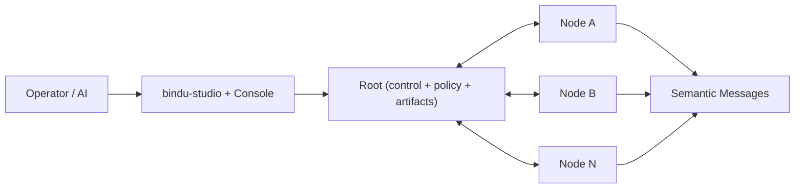

# Bindu Architecture Overview

Role of this document:

- Canonical public architecture overview
- Best first stop for understanding the system shape

For deeper code-derived detail, see the internal architecture map in
`docs/CODE_ARCHITECTURE_MAP_CURRENT.md`.

This is the shortest practical map of how Bindu is built and why it behaves differently from a generic message bus.

## 1) System Shape

Bindu has one root and many nodes, connected by a trust-aware mesh.

## 2) Three Layers (Mandala)

- Semantics: message types, routing, retention, permissions, contracts.
- Runtime: root/node engine that validates, routes, persists, and executes plugins.
- Operations: Studio/Console workflows for deployment, rollout, diagnostics, and governance.

Rule: operations do not bypass semantics/runtime contracts.

## 3) Core Runtime Loop

1. A typed message enters the system.
2. Schema and policy are validated.
3. Routing is decided from semantics + topology.
4. Message is persisted according to retention/persist rules.
5. Plugins react and emit new typed messages.

No hidden behavior: all execution is contract-driven.

## 4) Plugin Model

- Plugins are external OS processes (not in-process code injection).
- Runtime supervises lifecycle and restart behavior.
- Scheduling/triggers are declarative.
- Plugins extend behavior but do not own platform authority.

This keeps extension flexible while preserving runtime safety boundaries.

## 5) Two Update Planes (Important)

- Product plane (`lifecycle`):
  root/node binary import and activation.
- Runtime plane (`runtime` + `plugin`):
  config and plugin rollout through runtime desired snapshots and `NodeRuntimeUpdate`.

Separation avoids mixing binary lifecycle with runtime behavior rollout.

## 6) What Makes Bindu Different

- Semantic-first: messages are governed facts, not raw transport payloads.
- Identity-aware mesh: explicit node identity and topology are first-class.
- Deterministic ops: desired state + explicit artifacts + auditable transitions.
- AI-safe by design: intent can be automated without bypassing contracts.
- Plugin isolation: extension power without compromising core runtime integrity.

## 7) Mental Model in One Line

`Declare meaning -> enforce at runtime -> operate with explicit intent`

That is the architecture contract behind Bindu.
