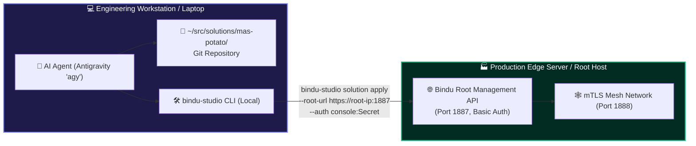
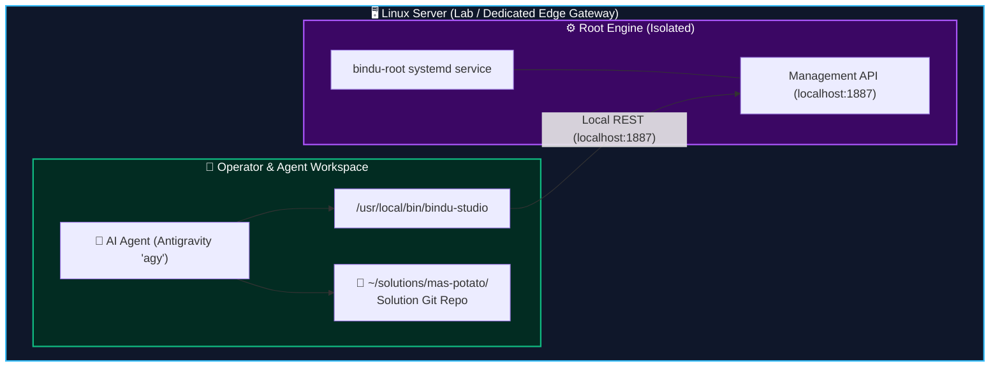

# Bindu Day 1 — Solution Workspace and AI Agent Setup Guide 🚀

> **Role & Audience**: This is the canonical Day 1 onboarding guide for **Solutions Architects, Platform Engineers, and Human Developers** who have just completed the installation of **Bindu Root** and need to initialize their first Multi-Agent System (MAS) solution and configure their AI Software Agent (Antigravity `agy`, Gemini Code Assist, Claude Code, Cursor, Windsurf).

---

## 🎯 The Cold-Start Dilemma (Day 1)

In the exact second that `bindu-install-root` completes, **the AI Agent is not yet active in your project**. 

As a human operator sitting at the terminal, you must answer two immediate architectural questions before any code or declarative schema is written:
1. **Where should my solution's Git repository live on the filesystem?**
2. **Where and how do I run my AI Software Agent (Agy) so it can build solutions without compromising the runtime engine?**

This guide provides the deterministic, step-by-step Day 1 procedure.

---

## 🧱 The Fundamental Separation: Engine Runtime vs. Solutions

> [!CAUTION]
> **CRITICAL ARCHITECTURAL BOUNDARY:**  
> **NEVER** clone your solution Git repositories, create project files, or run AI agents inside the Bindu engine directory (`/opt/bindu/root/`, `~/.bindu/root/`, or `runtime/`).  
> The Bindu engine is operating system infrastructure (managed by `systemd`); your MAS solutions are versioned, independent business applications.

### Canonical Filesystem Hierarchy

```text
/opt/bindu/root/ (or ~/.bindu/root/)          <-- 1. THE ENGINE RUNTIME (Managed by Systemd)
  ├── bindu-root                              <-- Launcher process supervisor
  ├── bin/bindu-studio                        <-- Studio CLI (Symlink to /usr/local/bin)
  ├── releases/<version>/                     <-- Immutable engine executables & assets
  └── runtime/                                <-- Active config, TLS certs, SQLite ledger
        ├── config/ (mesh.json)
        ├── data/   (v_messages, ledger.db)   <-- ❌ ZERO-TOUCH BY AGENTS OR SCRIPTS
        └── tls/    (ca.crt, root.crt)

/home/<user>/solutions/                       <-- 2. THE SOLUTION WORKSPACE (Independent Git Repos)
  ├── mas-potato-factory/                     <-- Solution A (AI Agent Workspace Lives Here)
  │     ├── .git/                             <-- Versioned independently in GitHub / GitLab
  │     ├── poc_message_types.json            <-- Level 0 Data Contracts
  │     ├── poc_cel_reactor_config.json       <-- Level 1 Kinetic Rules
  │     ├── poc_semantic_reactor_config.json  <-- Level 2 Cognitive Intelligence
  │     ├── poc_rest_reactor_config.json      <-- Level 2 External Webhooks
  │     ├── dashboard_definition.json         <-- Level 2 Visualizations
  │     ├── solution.json                     <-- Level 3 Graph Manifest
  │     └── bundles/                          <-- Level 4 Sealed Deployment Packages
  └── mas-smart-coldchain/                    <-- Solution B
```

---

## 🛠️ Step-by-Step Day 1 Setup

### Step 1: Make `bindu-studio` Globally Accessible

The Root installer places the `bindu-studio` binary in `/opt/bindu/root/bin/bindu-studio`. Make it available system-wide in your `$PATH`:

```bash
# If installed as root (/opt/bindu/root):
sudo ln -sf /opt/bindu/root/bin/bindu-studio /usr/local/bin/bindu-studio

# If installed as non-root (~/.bindu/root):
mkdir -p ~/.local/bin
ln -sf ~/.bindu/root/bin/bindu-studio ~/.local/bin/bindu-studio
export PATH="$HOME/.local/bin:$PATH"

# Verify global installation
bindu-studio -v
```

---

### Step 2: Initialize Your Solution Git Repository

Create an isolated directory for your new solution and initialize Git:

```bash
# 1. Create your solutions parent directory
mkdir -p ~/solutions/my-first-mas-solution
cd ~/solutions/my-first-mas-solution

# 2. Initialize a dedicated Git repository
git init
echo "# My First Bindu MAS Solution" > README.md
git add README.md && git commit -m "chore: initial solution workspace"
```

---

### Step 3: Launch Your AI Software Agent in the Workspace

Open your AI coding assistant **inside the root directory of your solution repository**:

* **If using Google Antigravity CLI (`agy`):**
  ```bash
  cd ~/solutions/my-first-mas-solution
  agy
  ```
* **If using Gemini Code Assist / Google Antigravity IDE / Cursor / VS Code:**
  ```bash
  cd ~/solutions/my-first-mas-solution
  code .
  ```
* **If using Claude Code:**
  ```bash
  cd ~/solutions/my-first-mas-solution
  claude
  ```

---

### Step 4: Accelerate with Golden Reference Tutorials (The Archetype Library)

> [!TIP]
> **Few-Shot Grounding for AI Agents and Developers:**  
> Authoring a Multi-Agent System from an empty JSON template is an anti-pattern. Bindu includes production-grade, end-to-end reference tutorials in `public/console/docs/*-tutorial/`.
> 
> When your AI Software Agent (Agy) inspects these reference implementations, it achieves **Few-Shot Grounding with Zero Hallucinations**: it reuses tested CEL functions (such as `ai.clamp`), proven prompt templates, System-1 evaluation questions, and working deployment scripts.

#### The Archetype Catalog

| Industrial Archetype / Pattern | Reference Tutorial Directory | Architectural Blueprint Provided |
| :--- | :--- | :--- |
| **Complete MAS Lifecycle (Baseline)** | [`mas-complete-lifecycle-tutorial/`](./mas-complete-lifecycle-tutorial/) | The canonical "Hello World" MAS: All 6 standard artifacts, minimal BPR plugin, CEL, AI, REST reactors, and automated `deploy`/`purge` scripts. |
| **MAS Solution Packaging** | [`mas-solution-tutorial/`](./mas-solution-tutorial/) | Manifest schemas (`solution.json`), multi-artifact versioning, and bundle distribution. |
| **Industrial Control & PLCs** | [`potato-processing-pipeline-tutorial/`](./potato-processing-pipeline-tutorial/) | **The Industrial Masterpiece:** Ingress $\to$ CEL Reactor $\to$ Semantic AI Reactor (thermodynamic prediction) $\to$ BPR Plugin driving a **Modbus PLC** $\to$ Real-time telemetry dashboard. |
| **Edge Computer Vision** | [`edge-cv-tutorial/`](./edge-cv-tutorial/) | Multimodal edge CV, multi-camera frame acquisition, local SLM/YOLO inference via BPR plugins, and semantic event bridging. |
| **Cognitive Semantic AI Reasoning** | [`semantic-ai-reactor-tutorial/`](./semantic-ai-reactor-tutorial/) | Industrial cold-chain monitoring with Ollama / TypeSafe, dynamic context hydration (`state`), and System-1 evaluation questions (`noul`, `score`, `choice`). |
| **High-Frequency Sensors (RFID)** | [`rfid-epc-tutorial/`](./rfid-epc-tutorial/) | Massive EPC tag ingestion, sliding-window retention (`count: 100`), temporal deduplication, and sensor aggregation. |
| **Beacons & Telemetry (BLE)** | [`ble-tutorial/`](./ble-tutorial/) | Bluetooth Low Energy sensor integration, binary advertisement parsing, and proximity event routing. |
| **Mining & Heavy Asset Health (CBM)** | [`mining-heavy-equipment-tutorial/`](./mining-heavy-equipment-tutorial/) | Non-invasive bolt-on BLE triaxial vibration telemetry, drive-by store-and-forward ring buffer timeline reconstruction, Crest Factor + Kurtosis CEL gating, and SLM predictive maintenance RUL orders. |
| **Airborne Forestry & Carbon Auditing** | [`amazon-suzano-carbon-tutorial/`](./amazon-suzano-carbon-tutorial/) | Autonomous drone data-mule fly-by harvesting, sub-canopy solar BLE sentinel stations, stoichiometric CEL Horn clauses, and verifiable ESG proof trees for 1.6M hectares. |
| **Declarative REST Webhooks** | [`rest-reactor-tutorial/`](./rest-reactor-tutorial/) | Zero-code HTTP/REST egress bridges to enterprise ERPs/CRMs triggered by ledger events. |
| **Critical Alarms & Email** | [`system-email-bpr-tutorial/`](./system-email-bpr-tutorial/) | Secure SMTP delivery via BPR plugin when CEL detects critical operational anomalies. |
| **Object Storage Lifecycle (S3)** | [`media-storage-tutorial/`](./media-storage-tutorial/) & [`cleanup`](./media-storage-cleanup-tutorial/) | MinIO/S3 photographic evidence storage, metadata linking, and automated time-based retention pruning. |

---

### Step 5: The Day 1 AI Onboarding Prompt

Once your AI Agent starts inside `~/solutions/my-first-mas-solution`, copy and paste the following canonical initialization prompt. This immediately grounds the agent in the Bindu specification and points it to the tutorial library:

```text
Hello Agy! I have just installed Bindu Root on this server (Management API at http://localhost:1887).

We are working in an isolated solution repository for a new Multi-Agent System (MAS).
Please consult the canonical Black-Box Solution Creator specification in public/console/docs/BINDU.md (and adapters AGENTS.md / GEMINI.md / CLAUDE.md).

Before authoring from scratch, inspect the golden reference tutorials in <bindu-install-path>/public/console/docs/*-tutorial/ to identify the closest architectural archetype (e.g. potato-processing-pipeline-tutorial for industrial/PLC, semantic-ai-reactor-tutorial for cold-chain cognitive monitoring, rfid-epc-tutorial for sensor streams). Reuse tested CEL expressions, prompts, and deployment scripts.

Here is my business problem / use case:
[DESCRIBE YOUR PROBLEM HERE, e.g.:
"We need to monitor 4 industrial cold rooms. Each room has a temperature/humidity sensor publishing telemetry.
 If temperature exceeds -15°C for more than 3 minutes, we must trigger an AI risk evaluation (SLM),
 calculate a mitigation setpoint via CEL, and alert field technicians via email."]

Please lead this project following the 5-Stage Lifecycle:
1. Identify the closest reference tutorial archetype and reuse verified design patterns.
2. Deconstruct the problem into the required artifacts using the Problem-to-Artifacts Matrix.
3. Define the Level 0 Message Types in poc_message_types.json and validate them.
4. Construct the CEL kinetics, AI Semantic Reactors, and Dashboards.
5. Validate all artifacts offline using `bindu-studio ... dry-run`.
6. Package the solution manifest into solution.bundle.json and deploy it to Root.
```

The agent will immediately:
1. Recognize that it is operating within an authorized solution workspace.
2. Inspect the closest reference tutorial to borrow proven schemas, CEL filters, and prompt designs.
3. Apply the **Zero-Plaintext Wire Guarantee** and **Anti-Recursion Safety Invariant**.
4. Use `bindu-studio` strictly as its CLI compiler and validation gate.
5. Never attempt to inspect or modify raw database files in `/opt/bindu/root/runtime/data/`.

---

## 🌐 The Two Deployment Topologies

Depending on your enterprise architecture, choose the topology that matches your operational environment:

### Topology A: Remote Engineering Workstation (Recommended for Production & CI/CD)
The developer and AI Agent work on a separate laptop or engineering workstation. The solution repository lives on GitHub/GitLab.



* **Workflow:**
  - AI Agent designs and validates schemas 100% offline on the laptop using `bindu-studio <artifact> dry-run`.
  - Solutions are packaged into `solution.bundle.json`.
  - Deployment is dispatched over HTTPS to Root's Management Plane:
    ```bash
    bindu-studio solution apply \
      --file ./bundles/solution.bundle.json \
      --root-url https://10.0.5.10:1887 \
      --auth console:StrongPass123
    ```
* **Benefit:** Maximum production security. The production Root server does not need AI compilers, Python scripts, or development tools installed.

---

### Topology B: Local Co-Pilot on the Edge / Gateway Server (Ideal for Lab & Rapid Prototyping)
The developer and AI Agent operate directly on the Linux server where `bindu-root` is installed.



* **Workflow:**
  - The AI Agent runs in `~/solutions/mas-potato/`.
  - Uses the globally symlinked `bindu-studio` in `/usr/local/bin`.
  - Deploys locally against `http://localhost:1887`.
* **Benefit:** Zero network latency, instant iteration, and immediate feedback during field PoCs.

---

## 🚫 Day 1 Anti-Patterns (What NOT to do)

| Anti-Pattern | Why It Breaks the Platform | Correct Day 1 Practice |
| :--- | :--- | :--- |
| **Cloning solutions inside `/opt/bindu/root/`** | Overwrites runtime paths, risks deletion during updates, and creates permissions collisions with systemd. | Always place solutions in `~/solutions/<name>` or `/opt/solutions/<name>`. |
| **Editing `runtime/config/mesh.json` manually with `nano`** | Bypasses atomic schema validation, creates operational star violations, and causes runtime crashes. | Always edit topology via `bindu-studio mesh edit/add` and commit with `mesh apply`. |
| **Directly querying SQLite `.db` files on disk** | Causes database lock contention (`database is locked`) and bypasses the in-memory write engine. | Always inspect the ledger using `POST /api/v1/messages/sql` or `bindu-studio query`. |
| **Deploying without `dry-run` verification** | Undetected `<no value>` prompt template placeholders and unvalidated CEL functions cause silent runtime rejection. | Always run `bindu-studio <cel|semantic-ai|rest>-reactor dry-run` with a representative payload first. |

---

## 📚 Where to Go Next

Once your Day 1 workspace is initialized and your AI Agent is active:
1. Follow the canonical **[5-Stage Solution Lifecycle Guide](./how-to-build-a-bindu-solution.md)** to author your first message types.
2. Review the **[Black-Box MAS Specification (`BINDU.md`)](./BINDU.md)** for full Level 0-4 contract rules.
3. Access your live cluster via the Web Console at `http://localhost:8080/console/`.
