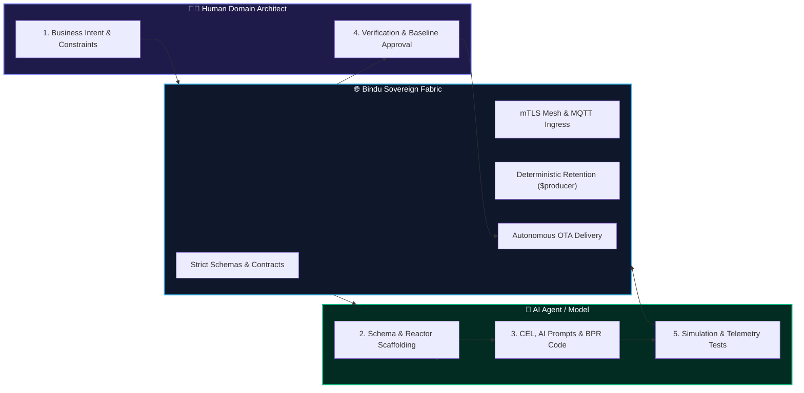
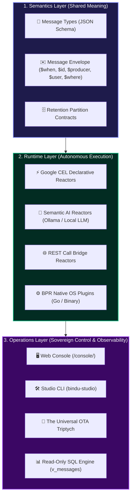
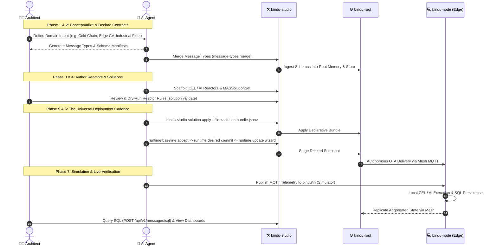

# 🤝 Human & AI Co-Creation Guide in Bindu
### The Master Blueprint for Autonomous AI Agents, Solutions Architects, and Edge Engineers

Welcome to the **Bindu Co-Creation Guide**.

Bindu is a **sovereign, distributed Edge AI fabric** designed from first principles for **human-machine co-creation**. In Bindu, humans (domain experts, systems architects, and operators) and AI models (LLMs, code generation agents, and autonomous reasoning loops) collaborate within a mathematically governed semantic environment.

This guide defines the foundational mental model, the architectural contracts, the step-by-step creation lifecycle, and the non-negotiable guardrails for co-creating industrial-grade Multi-Agent Systems (MAS) on the Bindu mesh.

---

## 🧭 The Philosophy of Co-Creation in Bindu

Traditional software architectures force AI agents to guess hidden side effects, manage low-level network topologies, or parse unstructured code. **Bindu eliminates ambiguity through strict declarative semantics.**



### The 3 Core Tenets of Co-Creation:
1. **Nothing Happens Unless Declared**: If a behavior cannot be pointed to in a schema, policy, reactor configuration, or manifest, it does not exist.
2. **Messages Are Immutable Facts**: Telemetry and state updates are historical statements of reality, never imperative commands.
3. **Deterministic Governance**: AI reasoning is bounded by sub-microsecond CEL mathematical clamping, schema validation, and sandboxed OS execution.

---

## 🏛️ The 3-Layer Architecture of Co-Creation

Every capability in Bindu belongs strictly to one of three layers. When co-creating with an AI, never mix execution logic with semantic intent.



---

## ⚡ The 5 Edge Processing Paradigms

When designing a MAS solution, choose the right execution paradigm for each task:

| Paradigm | Engine | Execution Speed | When Recommended to Use | Safety / Constraints |
| :--- | :--- | :--- | :--- | :--- |
| **CEL Reactor (`CELReactorSet`)** | Native Google CEL (In-Process) | Sub-microsecond (< 1 µs) | • Arithmetic & kinetic formulas<br>• Threshold filtering & state branching<br>• Safety bounding (`ai.clamp`)<br>• Spatial overlap arbitration | Purely deterministic; in-memory only; no network I/O; bounded execution complexity. |
| **Semantic AI Reactor (`AISemanticReactorSet`)** | Local SLM / LLM (Ollama) | Medium (~100–500 ms) | • Multimodal image/frame analysis<br>• Unstructured text & anomaly classification<br>• Contextual natural language summaries | Must return structured raw JSON; numerical outputs must be clamped downstream by CEL. |
| **REST Reactor (`RESTReactorSet`)** | HTTP Egress Bridge (In-Process) | Network-dependent | • External ERP/MES synchronization<br>• Cloud webhooks (Slack, Discord, PagerDuty)<br>• Periodic cloud weather/pricing polling | Strictly outbound egress; configurable timeouts and retry policies. Never used for inbound ingestion. |
| **BPR Native Plugin (OS Process)** | Standalone Binary (`bindunet/sdk`) | Native binary speed | • Industrial PLCs (Modbus TCP/RTU, CAN)<br>• Video capture pipelines (RTSP, V4L2 USB)<br>• BLE beacon scanning & Serial/UART IO | Isolated OS process; stdio JSON communication (`stdin/stdout`) only; zero hidden HTTP servers. |
| **Distributed Time State Machine (`SystemScheduledEvent`)** | Go Core Min-Heap + SQLite Ledger | Nanosecond timer precision | • Quarantine & reconditioning countdowns<br>• Reboot-resilient digital twin awakening<br>• Warmup delays & inactivity timeouts | Native Go core feature; survives power outages and restarts; preserves `$producer = <entity_id>`. |

---

## 🧭 The Problem-to-Artifacts Solution Decomposition Matrix & Checklist

Before authoring a solution, human architects and AI models must execute this 3-step decomposition algorithm:

### 1. The 5-Question Problem Mapping Heuristic
1. **Origin of Reality (Ingress):** What device or scanner initiates telemetry? $\rightarrow$ Ingress MessageType in `poc_message_types.json` via MQTT (`bindu/in`).
2. **Perception & Vision (AI):** Does input contain images, video frames, or fuzzy signals? $\rightarrow$ `AISemanticReactorSet` in `poc_semantic_reactor_config.json` (`llava-phi3:latest`).
3. **Physical Invariants & Kinetics (CEL):** Are there equations, formulas, or thresholds? $\rightarrow$ `CELReactorSet` in `poc_cel_reactor_config.json` with `ai.clamp(..., min, max)`.
4. **Time Evolution (State Machine):** Does the process require delayed awakening or countdowns? $\rightarrow$ CEL emits `SystemScheduledEvent` $\rightarrow$ Core Scheduler $\rightarrow$ `SystemCronJob`.
5. **Physical Actuation (IO):** Does the process command physical PLCs or cloud webhooks? $\rightarrow$ Go BPR Plugin (`ModbusSet`) or `RESTReactorSet`.

### 2. The Non-Negotiable "Rule of 6 Artifacts" Checklist
Every MAS solution directory MUST contain all 6 standard declarative artifacts:
- [ ] **1. `poc_message_types.json`:** Declarative application schemas.
- [ ] **2. `poc_semantic_reactor_config.json`:** Multimodal AI vision configuration (`AISemanticReactorSet`).
- [ ] **3. `poc_cel_reactor_config.json`:** Deterministic kinetic rules and safety clamping (`CELReactorSet`).
- [ ] **4. `poc_dashboards.json`:** Declarative UI views (`DashboardDefinition`) for Ingress, Active Schedules, and Actuation.
- [ ] **5. `bindu-<name>-plugin/`:** Isolated Go BPR plugin if hardware I/O is involved.
- [ ] **6. `solution.bundle.json` + `deploy_mas_solution.sh`:** Consolidated `MASSolutionSet` with the Universal OTA Triptych.

---

## 🚀 The 7-Step Co-Creation Master Workflow

Follow this universal sequence when designing, implementing, and deploying any edge solution on Bindu.



---

### Step 1: Declare Strict Message Types (Application Data Contracts)

> [!NOTE]
> **System vs Application Schemas:**
> * **⚙️ System Message Types** (`MessageState`, `NodePresence`, `SystemAlert`, `SystemScheduledEvent`, `SystemCronJob`, `SystemNodeReset`): Built directly into the Go source code (`messagetypes/messagetypes.go`) and deployed across the mesh via **Binary Release Updates** (`binduUpdate`, `binduNodeLauncherUpdate`).
> * **📦 Application Message Types** (`MachineTelemetry`, `MachineAnomalyAlert`): Custom domain contracts authored by developers/AI in JSON, hot-reloaded dynamically, and synchronized to edge nodes via the **Universal Runtime OTA Triptych**.

Create declarative JSON definitions for incoming sensor telemetry and outgoing analytical events:

```json
{
  "message_types": [
    {
      "name": "MachineTelemetry",
      "description": "Physical sensor readings from edge machine",
      "emoji": "⚙️",
      "version": "1.0.0",
      "persist": true,
      "retentionMode": "count",
      "retentionValue": 100,
      "routing": ["local", "parent"],
      "properties": [
        { "name": "machine_id", "type": "string", "required": true },
        { "name": "rpm", "type": "number", "required": true },
        { "name": "vibration_g", "type": "number", "required": true }
      ]
    },
    {
      "name": "MachineAnomalyAlert",
      "description": "Derived anomaly alert generated by Edge AI Reactor",
      "emoji": "🚨",
      "version": "1.0.0",
      "persist": true,
      "retentionMode": "count",
      "retentionValue": 50,
      "routing": ["local", "parent"],
      "properties": [
        { "name": "machine_id", "type": "string", "required": true },
        { "name": "severity", "type": "string", "required": true },
        { "name": "risk_score", "type": "number", "required": true },
        { "name": "rationale", "type": "string", "required": true }
      ]
    }
  ]
}
```

---

### Step 2: Ingest Schemas & Plugins
Always ingest schemas and import plugins into the root runtime before applying solution manifests.

```bash
# 1. Ingest message schemas
bindu-studio message-types merge --in-path message_types.json --all --auth console:StrongPass123 --root-url http://127.0.0.1:8080

# 2. Import any compiled BPR plugin binaries (if applicable)
bindu-studio plugin import my-plugin.tar.gz --auth console:StrongPass123 --root-url http://127.0.0.1:8080
```

---

### Step 3: Author Declarative Reactors & Bundles
Combine your message types, reactors, dashboards, and plugin assignments into a single declarative `MASSolutionSet` bundle.

```json
{
  "$type": "MASSolutionSet",
  "$id": "solution-machine-health-v1",
  "$group": "mesh",
  "$producer": "machine-health-solution",
  "$user": "console",
  "fields": {
    "solution_id": "machine-health-solution",
    "name": "Predictive Machine Health Monitor",
    "version": "1.0.0",
    "description": "Autonomous CEL filtering and local LLM vibration classification",
    "target_nodes": ["node-1", "dell-debian1"],
    "reactors": [
      {
        "reactor_id": "vibration_filter",
        "type": "cel",
        "input_type": "MachineTelemetry",
        "condition": "double(msg.fields.vibration_g) > 2.5",
        "output_type": "MachineAnomalyAlert",
        "mapping": {
          "machine_id": "msg.fields.machine_id",
          "severity": "msg.fields.vibration_g > 4.0 ? 'CRITICAL' : 'WARNING'",
          "risk_score": "ai.clamp((double(msg.fields.vibration_g) - 2.0) / 3.0, 0.0, 1.0)",
          "rationale": "'Vibration threshold exceeded on edge gateway'"
        }
      }
    ]
  }
}
```

---

### Step 4: Validate & Apply Declarative Solutions
Validate the bundle structure and apply it to the root control plane:

```bash
# Validate solution bundle against active schemas
bindu-studio solution validate --file machine_health_bundle.json

# Apply solution to Bindu Root
bindu-studio solution apply --file machine_health_bundle.json --yes --auth console:StrongPass123 --root-url http://127.0.0.1:8080
```

---

### Step 5: The Universal Runtime OTA Triptych (Mandatory for Edge Delivery)
Deploying the bundle to Root does not automatically change edge node memory. You must execute the **Mandatory OTA Triptych**:

> [!IMPORTANT]
> **THE UNIVERSAL RUNTIME OTA TRIPTYCH**:
> ```bash
> # 1. Accept the new baseline
> bindu-studio runtime baseline accept --yes --auth console:StrongPass123
>
> # 2. Commit the desired snapshot
> bindu-studio runtime desired commit --note "Rollout Machine Health MAS Solution" --auth console:StrongPass123
>
> # 3. Deliver OTA update across all mesh nodes
> bindu-studio runtime update wizard --yes --auth console:StrongPass123
> ```

---

### Step 6: Simulate Ingress via MQTT (`bindu/in`)
External sensors, hardware bridges, and simulators must publish strictly via MQTT to `bindu/in`:

```bash
# Example Go/Python simulator publishing to MQTT bindu/in
# Envelope strictly requires: $type, $id, $when, $producer, $user, $group, $node-dest
```

```json
{
  "$type": "MachineTelemetry",
  "$id": "sim-msg-94819",
  "$when": "2026-10-03T16:50:00Z",
  "$group": "mesh",
  "$producer": "sensor-vib-01",
  "$user": "simulator",
  "$node-dest": "node-1",
  "fields": {
    "machine_id": "cnc-lathe-04",
    "rpm": 3200.0,
    "vibration_g": 3.8
  }
}
```

---

### Step 7: Verify with SQL & Live Observability
Audit the distributed state across the mesh using read-only SQL queries on `v_messages`:

```sql
SELECT 
    "$id",
    "$when",
    "$producer",
    json_extract(raw_json, '$.fields.machine_id') AS machine_id,
    json_extract(raw_json, '$.fields.severity') AS severity,
    json_extract(raw_json, '$.fields.risk_score') AS risk_score
FROM v_messages 
WHERE "$type" = 'MachineAnomalyAlert'
ORDER BY "$when" DESC 
LIMIT 10;
```

---

## 🛡️ Critical Guardrails for AI Agents & Engineers

> [!CAUTION]
> ### 🚫 The Non-Negotiable Guardrails:
> 
> 1. **❌ Ingress is strictly MQTT (`bindu/in`)**: There is **NO** HTTP POST endpoint for message ingestion (`/api/v1/publish` does NOT exist). HTTP is strictly reserved for management and SQL querying (`/api/v1/messages/sql`).
> 2. **❌ Schema Propagation First**: Message types must be synchronized to edge nodes before deploying reactors to those nodes.
> 3. **❌ Mathematical Clamping (`ai.clamp`)**: Always clamp LLM/AI floating-point outputs in CEL mappings to guarantee bounding constraints (e.g. probabilities strictly between `0.0` and `1.0`).
> 4. **❌ Semantic Partition Contract (`$producer`)**:
>    * For discrete multi-instance entities (`MASSolutionSet`, `DashboardDefinition`) where `retentionValue: 1`, `$producer` **MUST** match the entity slug identifier (`fields.solution_id`, `fields.id`). Never use generic strings like `"root"` or `"console"`.
>    * For node-scoped aggregations (`CELReactorSet`, `AISemanticReactorSet`, `RESTReactorSet`), `$producer` is the target `gateway_node_id`.
>    * For hardware sensors, `$producer` is the physical sensor ID.
> 5. **❌ BPR Plugins use Standard I/O**: Plugins communicate strictly via JSON over `stdin/stdout`. Never open background HTTP servers or RPC ports inside a plugin.

---

## 🔄 Edge Lifecycle & Remote Service Maintenance

When edge nodes require maintenance or service restarts after updating configuration:

* **From Web Console**: Navigate to **Mesh Config** (`/console/mesh-config`), locate the target gateway node, and click the **`🔄 Restart`** action button (protected by confirmation prompt).
* **From Studio CLI**:
  ```bash
  bindu-studio mesh node-restart node-1 --reason "Applying MAS pipeline update" --yes --auth console:StrongPass123
  ```
* **Message Protocol**: Emits a `SystemNodeReset` system message (`routing: ["child", "local"]`). The node's internal `MeshNodeResetPlugin` flushes diagnostic alerts and gracefully terminates, allowing `systemd` to perform a clean restart.

---

## 🎯 Summary: The Co-Creation Formula

$$\text{Human Domain Intent} + \text{AI Declarative Scaffolding} + \text{Bindu Sovereign Governance} = \text{Deterministic Edge Intelligence}$$

By adhering to this guide, human architects and AI assistants build robust, self-healing, and fully auditable edge multi-agent ecosystems with complete sovereign data ownership.
