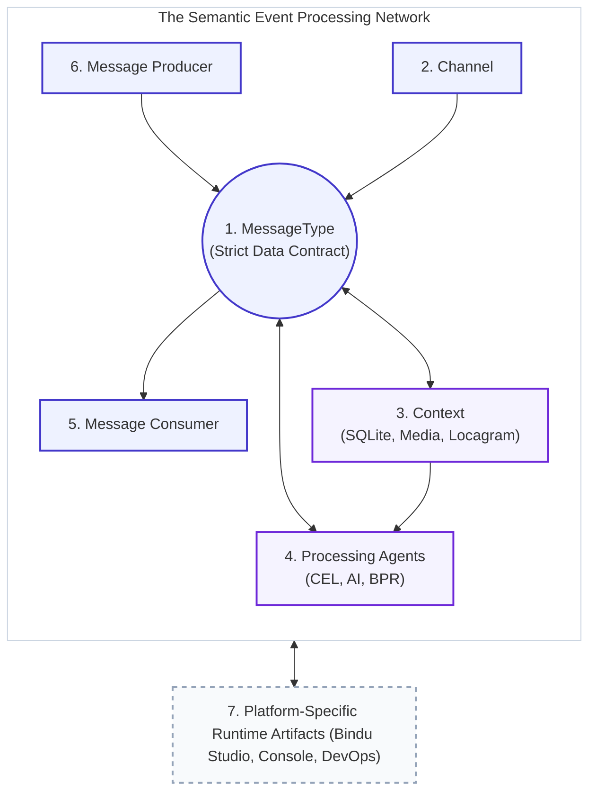
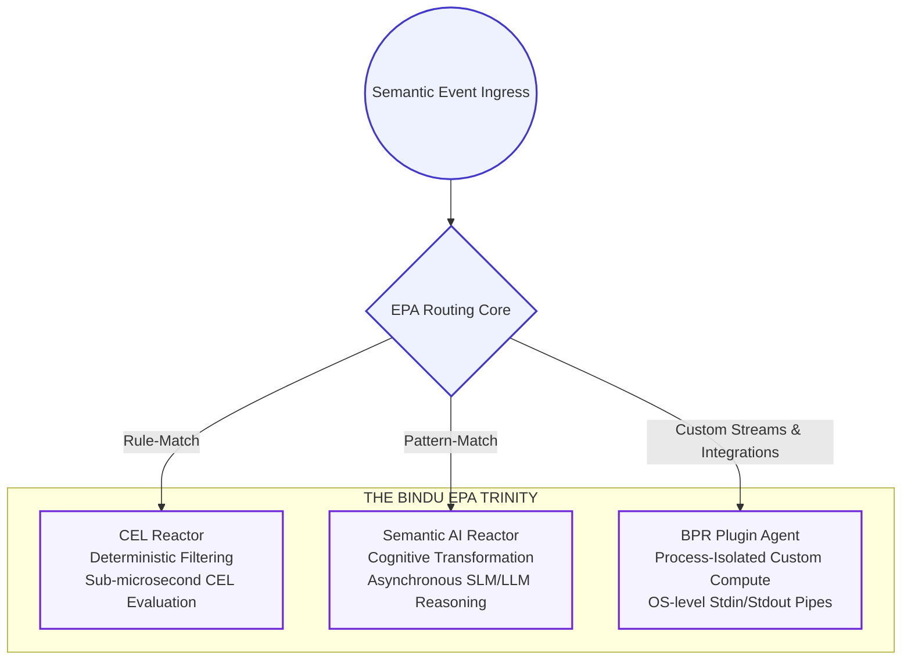
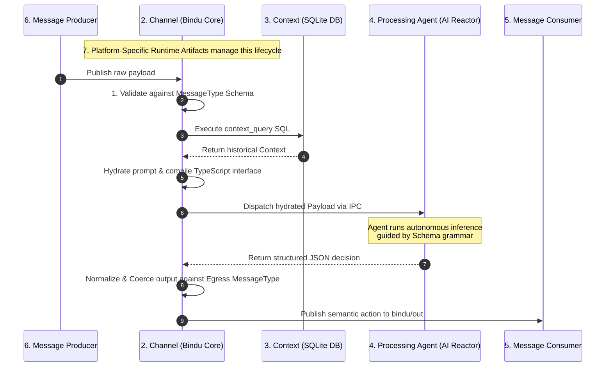

# What is Bindu? — The Semantic Event Processing Network for Multi-Agent Systems (MAS)

*Última revisión: 2026-08-16*

---

### **1. Message Type**

While classic Event Processing Networks route abstract "events" as blind bytes without understanding their payload, Bindu uses the term **MessageType** because it enforces a strict, mathematical data contract right at the physical boundary. It shifts the focus from a loose logical concept that "something happened" to a structurally validated payload (via JSON Schema) anchored in the reality of the underlying MQTT transport. In short, an event is just an abstract idea, but a message is a physical law—and Bindu only allows data into the mesh if its meaning and structure are explicitly proven by obeying that contract.

In Bindu, every valid MessageType inherently carries three fundamental dimensions of context:

* **$when**: The exact chronological timestamp of the occurrence.
* **$who ($producer)**: The explicit, cryptographically backed identity of the entity that generated the message.
* **$where**: The spatial boundaries or location where the data originated.

By structurally enforcing these dimensions, Bindu materializes strict **Data Governance** directly at ingress. Furthermore, the MessageType governs its own lifecycle. Upon entering the network, it dictates its own persistence and retention rules, ensuring the message is automatically saved into the local state and pruned when no longer necessary.

### **2. Channel**

The Channel represents the routing engine and the active mesh fabric of Bindu. Unlike traditional brokers where channels are opaque pipes, Bindu’s topics are natively semantic and explicitly structured (e.g., `bindu/in` and the fully qualified `$type/$group/$producer`).

All routing and mesh propagation rules are defined directly within the MessageType contract itself. By declaring a simple routing array in the schema—such as `"routing": ["local", "parent"]`—the network instantly knows whether a message should remain isolated on the current edge node, or if it must automatically traverse the mutual TLS (mTLS) mesh to reach the parent cloud coordinator. The semantic contract inherently defines the physical network path.

Furthermore, this semantic control over the mesh extends to Presence and Longevity within the channel. Instead of relying on fragile, continuous connections or heavy state machines, Bindu utilizes lightweight semantic presence triggers (such as NodePresence or ParentPresence) to dynamically awaken and re-open routing lanes. If a network disconnects, messages safely wait in durable queues. Their longevity in the channel is strictly governed by the retention rules embedded directly within their MessageType contract, guaranteeing absolute Data Governance and an autonomous lifecycle even during asynchronous delivery.

### **3. Context**

Context is the local, persistent memory that groups and gives historical meaning to incoming messages. In Bindu, this is natively realized through the relational SQLite ledger (the v_messages view), which persists every validated message while perfectly maintaining its three dimensions ($when, $who, $where).

Context extends beyond simple text logs:

* **Geo-Locagrams:** Provide precise hierarchical location trees to define the $where boundary. Geo-Locagram is Bindu's spatial authoring surface that also accepts longitude and latitude (geographic coordinates), integrating directly with the map via the NodeGeoLocation (for world space) and NodeLocalGeometry (for local planes) Message Types. It inherently materializes the $where dimension, facilitating seamless integration with spatial-temporal database queries and the operational map dashboards.
* **Out-of-Band Media-Storage:** Links heavy, unstructured data (images, video frames, PDFs) directly to the semantic context of a MessageType via lightweight URIs (e.g., MinIO/S3 buckets).
* **Dashboards & REST APIs:** Act as the direct visual and programmatic windows into this context, allowing administrators or external systems to execute SQL queries and analyze the historical state of the Digital Twins in real-time.
* **Context Hydration (The Zero-RAG Architecture):** This is one of the primary reasons the Context block exists. In traditional AI deployments, retrieving historical data requires heavy Vector Databases and RAG (Retrieval-Augmented Generation) pipelines that fail to scale in dynamic physical environments. Bindu bypasses this completely. By leveraging SQLite's JSON SQL extensions—which allow querying the nested semantic JSON payloads directly, avoiding the rigidity of traditional raw SQL—Bindu executes ultra-fast, deterministic queries to extract the exact historical facts needed. The AI model is fed a pristine, lightweight payload containing the precise operational narrative, entirely eliminating the need for expensive, cloud-dependent vector searches and guaranteeing millisecond responsiveness at the edge.

### **4. Processing Agents**

When a message enters the network, it is evaluated by Event Processing Agents (EPAs). Bindu specializes these blocks into a Cognitive Trinity: CEL Reactors, Semantic AI Reactors, and BPR Plugins. These agents act as the active reasoning layer of the system. Crucially, Bindu uses deterministic filters (CELReactorSet) and process-isolated plugins (BPR) to execute dozens of high-speed data normalization and filtering routines before any AI is invoked. This ensures that expensive Large/Small Language Models are not burdened with unnecessary executions. When cognitive reasoning is actually required, the Semantic AI Reactor executes three critical optimizations to guarantee high-fidelity and cost-efficiency:

*   **Context Hydration:** It queries the SQLite database to feed the model a perfectly structured historical narrative, driving down structural token costs while unlocking immediate, high-fidelity real-time reasoning.
*   **TypeScript Compression Bridge (Token Efficiency):** Instead of injecting verbose JSON Schemas into the prompt, the reactor dynamically compresses the contract into a compact TypeScript interface. This provides a 3x to 4x reduction in structural token consumption, dramatically cutting token costs and protecting the model's context window.
*   **Grammar-Guided Decoding (High-Fidelity):** To eliminate AI hallucinations on the edge, the reactor forces the model to strictly output matching JSON properties. Because the model only processes pristine, pre-validated facts and outputs strict schemas, it remains ultra-fast, predictable, and highly accurate.

#### **Triggering Dualism (Reactive & Proactive Execution)**
Agents in Bindu are not strictly bound to reactive data streams. By simply assigning a standard cron string (e.g., `@every 5m` or `@daily`) to an agent's configuration, it transitions into a proactive mode. Managed entirely by the platform's native Go scheduler, the agent awakens automatically at the specified interval, performs Context Hydration from the SQLite ledger, and executes preventative maintenance, compliance audits, or continuous learning workflows. This native proactive capability completely eliminates the need for fragile external polling scripts or dummy MQTT message injections.

### **5. Message Consumer**

Message Consumers act as the hands and external observers of the system. Like Producers, they are independent entities—such as external ERPs, third-party monitoring applications, or physical actuators—that subscribe to the mesh's semantic topics. They consume the validated and reasoned messages emitted by the network via MQTT, WebSockets, or REST API queries. By treating Consumers as independent, external components, Bindu remains technologically agnostic at its boundaries. It effortlessly delivers autonomous intelligence and real-time state changes directly into a client's existing operational stack, proving that Bindu orchestrates current technology rather than forcing you to replace it.

### **6. Message Producer**

Message Producers act as the sensory organs of the network. They are often third-party applications, legacy systems, or custom scripts (like Python or Node.js) that live entirely outside the Bindu mesh. Although Bindu does not compile or manage these external components, they are a fundamental part of the end-to-end solution. Their only requirement is to respect the strict physical law of the MessageType contract when publishing data into the network's channels (e.g., the `bindu/in` topic) via standard protocols like MQTT or WebSockets. This makes Producers the ultimate universal integration bridge, allowing a client's existing enterprise technology to seamlessly feed data into the cognitive fabric without requiring a system overhaul.

### **7. Platform-Specific Runtime Artifacts (The Control Plane & Lifecycle)**

While Blocks 1 through 6 describe the universal anatomy of a Semantic Event Processing Network, Block 7 is the proprietary Bindu Control Plane that brings the theory to physical life. It encapsulates all the DevOps tooling, including the Bindu Console (Web UI), Bindu Studio (CLI), and a natively embedded distributed Cron Engine, which administrators use to author, monitor, and command the network.

* **Operational Symmetry (The Single Native Binary):** A defining characteristic of this lifecycle management is its absolute operational symmetry. Unlike traditional systems that require fragmented tech stacks for the cloud versus the edge, Bindu utilizes the exact same natively compiled Go binary for both central Cloud coordinators (root) and remote Edge sensors (node). Whether deployed on a massive public cloud cluster, an air-gapped field drone, or a constrained embedded device like a Raspberry Pi, the runtime artifact is identical. The physical behavior changes solely through declarative configuration, allowing administrators to manage the entire edge-to-cloud deployment lifecycle seamlessly without container bloat or fragmented codebases.
* **Autonomous Self-Governance:** Crucially, Bindu governs itself using its own EPN principles: system configurations and Over-The-Air (OTA) updates are simply broadcasted as native System Message Types. Whether you are executing bulk node bootstrapping, triggering a seamless OTA update, orchestrating time-based scheduled jobs, or performing automated Backup and Restore routines, the Studio CLI and Console translate your commands into semantic artifacts. The platform then dynamically propagates and materializes these artifacts across the entire mesh, managing the complete lifecycle of the agents, types, and channels with zero operational downtime.

### **Economic & Organizational Impact (The Shift to Stewardship)**

By collapsing the traditional multi-tier architectural stack into a single, cohesive, meaning-governed runtime, Bindu completely flips the financial reality of enterprise engineering. In typical distributed deployments, organizations expend 70% to 85% of their total engineering capacity on infrastructure survival—maintaining connectors, building fragile "code glue," and managing manual context-gathering mechanisms just to let a model reason for a split second. Bindu collapses this hidden operational tax down to 25% to 45%, redirecting the vast majority of engineering capital (55% to 75%) toward high-value solution logic and true AI autonomy. Technical effort dedicated to infrastructure survival drops to a minimal fraction, freeing the engineering team to step back into true stewardship. They simply declare spatial boundaries, token limits, and operational intent—Bindu handles the execution.

### **The Ultimate Architectural Vision: AI-Native Autonomy**

To truly understand the essence of this platform, one must look at its origin: from idea zero and code line zero, Bindu has been co-authored by AI models. Its entire architecture—the design, documentation, CLI interfaces, and APIs—was not merely built *for* humans to integrate AI, but built specifically *for* AI to operate infrastructure. Bindu places AI models on deterministic "rails" that safely guide and constrain them, enabling them to build, deploy, and orchestrate complex Multi-Agent Systems (MAS) with 100% autonomy and zero human intervention. In this new paradigm, human engineers no longer write fragile integration code; they simply declare a clear intention of the expected result, and the AI inherently uses the Bindu fabric to manifest it.
