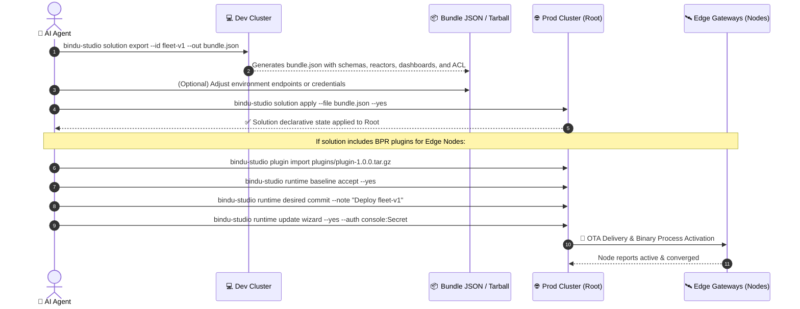

# Bindu Studio — MAS Solution Management & AI Cloner User Guide

The `bindu-studio solution` subcommand (aliases: `mas`, `project`) provides a 100% declarative, atomic, and **AI-First** interface for defining, packaging, cloning, migrating, and deploying complete **Multi-Agent System (MAS)** solutions across the Bindu edge-mesh platform.

---

## 🎯 1. Objective & Philosophy

### 1.1 Everything is a Semantic Message
In the Bindu architecture, system intentions and state definitions do not reside in opaque proprietary configurations or isolated silos. Every MAS solution is modeled as an official **System Message Type**: `MASSolutionSet`.

When published through the MQTT broker (`bindu/in`):
- It is immutably stored in `v_messages`.
- It is queryable via native SQL (`/api/v1/messages/sql` or SQLite).
- It propagates across the mesh topology according to its routing policies (`local`, `parent`).
- It supports declarative lifecycle tracking and retirement via *tombstones* (`status: "deleted"`).

### 1.2 Selective Export & Multi-Project Modularity
In development environments or shared clusters where multiple solutions coexist, `bindu-studio solution` precisely scopes and isolates which artifacts belong to a specific project.

The solution manifest lists exact dependencies, allowing an AI model or human operator to export only what that solution requires without dragging unrelated artifacts or configurations.

---

## 🧩 2. Structure of the `MASSolutionSet` Manifest

A solution manifest defines the project identity, semantic components, routing policies, and infrastructure bindings that comprise the system:

```json
{
  "$type": "MASSolutionSet",
  "$group": "solution",
  "$producer": "bindu-studio",
  "$user": "admin",
  "$when": "2026-09-16T18:00:00Z",
  "fields": {
    "solution_id": "fleet-management-v1",
    "name": "Fleet Telemetry MAS",
    "version": "1.0.0",
    "description": "Multi-Agent System for real-time vessel tracking, speed alerts, and live operational dashboards.",
    "status": "active",
    "artifacts": {
      "mesh_nodes": ["fleet-gateway-1", "vessel-42"],
      "message_types": ["VesselTelemetry@1.0.0", "FleetAlert@1.0.0"],
      "cel_reactors": ["vessel-speed-monitor"],
      "rest_reactors": ["fleet-http-webhook"],
      "semantic_ai_reactors": ["incident-analyst"],
      "plugins": ["gps-tracker-plugin@1.0.0"],
      "media_storage_providers": ["fleet-minio"],
      "access_users": ["fleet-operator"],
      "access_roles": ["application"],
      "dashboards": ["fleet-live-monitor"],
      "system_config_keys": ["security.enforce_tls"]
    }
  }
}
```

### Manifest Fields

| Field | Type | Required | Description |
| :--- | :--- | :---: | :--- |
| `solution_id` | `string` | **Yes** | Unique logical identifier for the solution (slug). |
| `name` | `string` | No | Human-readable descriptive name for consoles and reporting. |
| `version` | `string` | No | Semantic version of the solution package (e.g., `1.0.0`). |
| `description` | `string` | **Yes** | Architectural summary and purpose of the multi-agent system. |
| `status` | `string` | No | Lifecycle status (`active` or `deleted` for tombstones). |
| `artifacts` | `object` | **Yes** | Catalog of components and dependencies comprising the solution. |

### Component Categories in `artifacts`

- **`message_types`**: Semantic data contracts (`$type`, JSON Schemas, retention, and routing policies).
- **`cel_reactors`**: High-performance, in-memory declarative event transformation rules evaluated on the CEL engine.
- **`rest_reactors`**: Outbound HTTP/REST webhook integrations and API dispatches.
- **`semantic_ai_reactors`**: Cognitive inference loops powered by LLM/VLM models (OpenAI, Gemini, Ollama, Qwen).
- **`dashboards`**: Real-time visual monitoring definitions (`DashboardDefinition`).
- **`plugins`**: Native OS binary extensions supervised under the Bindu Plugin Runtime (BPR).
- **`media_storage_providers`**: S3/MinIO storage configurations for out-of-band binary telemetry.
- **`access_users` & `access_roles`**: RBAC identities and authorization permissions required by the solution.
- **`mesh_nodes`**: Gateways and edge nodes required in the mesh topology.
- **`system_config_keys`**: Global `binduConfig.json` runtime parameters associated with the solution.

---

## 🛠️ 3. Command-Line Reference (`bindu-studio solution`)

### 3.1 `validate` — Deep Semantic & Platform Validation
Validates JSON syntax, presence of required fields, **semantic schema closure** (ensuring all trigger and emitted message types are declared), node containment in the active mesh topology (`mesh.json`), and BPR binary platform availability **completely offline**:

```bash
# Standard validation
bindu-studio solution validate --file ./fleet-solution.json

# Strict validation for production release packaging
bindu-studio solution validate --file ./fleet-bundle.json --strict

# Structured JSON output (for AI agents and CI/CD automation)
bindu-studio solution validate --file ./fleet-bundle.json --json
```

**Console Output:**
```text
✅ Solution bundle "fleet-management-v1" is valid.
   Name:        Fleet Telemetry MAS
   Version:     1.0.0
   Description: Multi-Agent System for real-time vessel tracking, speed alerts, and live operational dashboards.
   Artifacts:   2 message types, 1 CEL reactors, 1 REST reactors, 1 AI reactors, 1 dashboards, 1 plugins, 1 storage providers, 2 nodes
```

**Standard Diagnostic Codes:**
| Code | Severity | Description |
| :--- | :---: | :--- |
| `E_SCHEMA_MISSING_DEPENDENCY` | Error | A CEL, REST, or AI reactor, dashboard, or plugin consumes or emits a `$type` not declared in `artifacts.message_types`. |
| `E_REACTOR_RECURSIVE_LOOP` | Error | A reactor declares identical input and output message types, risking infinite feedback loops. |
| `E_NODE_NOT_IN_MESH` | Error | A node declared in `artifacts.mesh_nodes` is missing from the active mesh topology (`mesh.json`). |
| `E_PLUGIN_UNRESOLVED_PLATFORM` | Error | A BPR plugin assigned to a node architecture (e.g., ARM64) lacks a certified compiled binary. |
| `E_SOLUTION_ID_INVALID` | Error | The solution identifier contains invalid characters or formats. |
| `W_REACTOR_INACTIVE_RUNTIME` | Warning | A reactor declared in the solution is not currently active in local runtime (will be provisioned on target edge node). |

> [!IMPORTANT]
> **Regla de Autocontención (Self-Containment Rule):**
> Un MAS desplegado en un nodo remoto o edge solo tiene garantizados los esquemas que están **explícitamente declarados en `fields.artifacts.message_types`** dentro del propio MAS (o esquemas del sistema). 
> La validación de dependencias de esquemas (`E_SCHEMA_MISSING_DEPENDENCY`) para todos los reactores (CEL, REST, AI), dashboards y plugins se evalúa estrictamente contra los esquemas declarados en el MAS, garantizando que el paquete sea 100% autónomo y portable, sin depender de esquemas residuales o preexistentes en el entorno de desarrollo local.

---

### 3.2 `register` — Semantic Publication of Manifest
Registers the solution on the active cluster by publishing the `MASSolutionSet` message to the MQTT broker (`bindu/in`):

```bash
bindu-studio solution register --file ./fleet-solution.json --auth console:SuperSecret1
```

**Non-Interactive Mode (for autonomous AI agents):**
```bash
bindu-studio solution register --file ./fleet-solution.json --yes --auth console:SuperSecret1
```

---

### 3.3 `list` — Querying Active Solutions
Queries `v_messages` and lists active solutions deployed across the mesh:

```bash
bindu-studio solution list --auth console:SuperSecret1
```

**Tabular Output:**
```text
SOLUTION ID            NAME                  VERSION   ARTIFACTS SUMMARY                                   CONFIGURED AT
fleet-management-v1    Fleet Telemetry MAS   1.0.0     2 nodes, 2 types, 3 reactors, 1 dashboards, 1 acl   2026-09-16T18:00:00Z
```

**JSON Output (for AI introspection):**
```bash
bindu-studio solution list --json --auth console:SuperSecret1
```

---

### 3.4 `export` — Packaging to JSON Bundle
Extracts complete, concrete JSON definitions for every artifact referenced in the manifest, generating a self-contained `.json` bundle file:

```bash
# Export by registered solution ID
bindu-studio solution export --id fleet-management-v1 --out ./fleet-bundle.json --auth console:SuperSecret1

# Export from a local manifest file
bindu-studio solution export --file ./fleet-manifest.json --out ./fleet-bundle.json --auth console:SuperSecret1
```

---

### 3.5 `pack` (aliases: `package`, `release`) — Commercial Release Archive (.tar.gz)
Assembles a complete, production-ready commercial distribution package (`<solution_id>-<version>.tar.gz`).

Unlike `export` (which generates only the declarative JSON bundle), `pack`:
1. Executes **strict deep validation** (semantic closure, mesh topology, and BPR binary availability).
2. Generates `solution-bundle.json` inside the staging workspace.
3. Filters and exports `mesh.json` containing only the Root node and nodes declared in the solution.
4. Packages certified **BPR plugin binaries and metadata** (`plugins/*.tar.gz`) for target node architectures.
5. Generates a self-contained, executable `deploy.sh` installer script pre-configured for the target solution.
6. Compresses the staging directory into a release `.tar.gz` archive with SHA-256 integrity checksums (`.sha256`).

```bash
# Pack solution by active ID with strict validation
bindu-studio solution pack --id fleet-management-v1 --auth console:SuperSecret1

# Pack from a local manifest or bundle file
bindu-studio solution pack --file ./fleet-manifest.json --out ./dist/fleet-1.0.0.tar.gz

# Structured JSON output
bindu-studio solution pack --file ./fleet-manifest.json --json
```

**Internal Structure of the Release Archive (`.tar.gz`):**
```text
fleet-management-v1-1.0.0.tar.gz
├── solution-bundle.json      # Schemas, CEL/REST/AI reactors, dashboards, ACL
├── mesh.json                 # Filtered mesh topology for project nodes
├── deploy.sh                 # Self-contained executable installer script (0755)
└── plugins/                  # Certified BPR plugin packages
    └── gps-tracker-plugin-1.0.0.tar.gz
```

---

### 3.6 `apply` (aliases: `import`, `deploy`) — Deployment & Activation on Target Cluster
Ingests, extracts, merges, and atomically activates all solution components from a **commercial release archive (`.tar.gz`)**, an **extracted directory**, or a **JSON bundle (`solution-bundle.json`)**:

```bash
# 1. Direct deployment from commercial release archive (.tar.gz)
bindu-studio solution apply --file ./fleet-management-v1-1.0.0.tar.gz --auth console:SuperSecret1

# 2. Deployment with automated edge node tarball generation (--build-nodes)
bindu-studio solution apply --file ./fleet-management-v1-1.0.0.tar.gz --yes --build-nodes --auth console:SuperSecret1

# 3. Deployment from declarative JSON bundle
bindu-studio solution apply --file ./fleet-bundle.json --yes --auth console:SuperSecret1

# 4. Structured JSON output (for DevOps pipelines)
bindu-studio solution apply --file ./fleet-management-v1-1.0.0.tar.gz --yes --json
```

**Key Flags:**
- `--file`: Path to `.tar.gz` archive, extracted directory, or `.json` bundle (required).
- `--yes` (`-y`): Confirms deployment without interactive prompts.
- `--import-mesh` (default: `true`): Imports the `mesh.json` topology included in the package.
- `--build-nodes`: Automatically invokes edge node packaging (`mesh node-deploy --all`).
- `--json`: Returns structured deployment summary in JSON format.

**Atomic Operations Executed by `apply`:**
1. **Mesh Topology**: If present in the package, imports and validates topology into `runtime/config/mesh.json`.
2. **BPR Plugins**: Extracts and registers certified packages into `runtime/plugins.d/bpr/` from `plugins/*.tar.gz`.
3. **Message Types**: Idempotently merges semantic schemas into `messageTypesConfiguration.json`.
4. **Security & RBAC**: Securely merges users, roles, and permissions into `accessControlConfig.brs`.
5. **Reactors & Dashboards**: Deploys and activates CEL rules, REST webhooks, Semantic AI loops, and dashboard visualizers.
6. **Out-of-Band Media Storage**: Configures `MediaStorageSet` providers for S3/MinIO.
7. **Solution Activation**: Publishes the `MASSolutionSet` manifest (`status: "active"`) to `v_messages`.
8. **Edge Node Generation** (optional): With `--build-nodes`, packages ready-to-flash tarballs for remote hardware.

---

### 3.7 `delete` — Declarative & Immutable Tombstoning
Retires a solution from the cluster by publishing an immutable *tombstone* message (`status: "deleted"`):

```bash
bindu-studio solution delete fleet-management-v1 --auth console:SuperSecret1 --yes
```

---

## 🖥️ 4. Graphical MAS Solutions Module in the Web Console

The Bindu Web Administration Console (`/console/`) includes a comprehensive graphical suite for visual authoring, real-time diagnostic validation, inspection, and packaging of MAS solutions, accessible directly from the sidebar navigation link **📦 MAS Solutions**.

### 4.1 Dashboard & Solutions Catalog
The main MAS Solutions dashboard provides a real-time operational overview of projects and multi-agent systems:
- **KPI Summary Cards**: Live aggregates for Active Solutions, Linked Message Schemas, Assigned Reactors, and Operational Dashboards.
- **Dynamic Search**: Instant filtering by `solution_id`, name, or description.
- **Status Filter**: Rapid toggle between active (`active`) and retired (`deleted`) solutions.
- **Management Table**: Comprehensive view displaying artifact counts, lifecycle status badges, and contextual action buttons:
  - **🔍 Inspect**: View full declarative JSON manifest, audit metadata, and artifact breakdown.
  - **📦 Download Release (.tar.gz)**: Streams on-the-fly commercial distribution packages with SHA-256 integrity verification.
  - **📄 Export Bundle (.json)**: Downloads the declarative self-contained JSON bundle for version control.
  - **🗑️ Retire**: Safely publishes an immutable *tombstone* (`status: "deleted"`).

### 4.2 6-Step Visual Interactive Wizard
Clicking **✨ Create Solution (Wizard)** opens an interactive multi-step wizard with cascading filters, node scoping, and live validation:

```text
┌────────────────────────────────────────────────────────────────────────────────────────────────────────┐
│ ✨ MAS Solution Studio — Step by Step                                                                  │
│ [1. Identity] ── [2. Mesh Nodes] ── [3. Schemas] ── [4. Reactors & Artifacts] ── [5. Verification] ── [6. Review & Export] │
└────────────────────────────────────────────────────────────────────────────────────────────────────────┘
```

1. **Step 1: Identity & Metadata**:
   - `solution_id`: Unique identifier in slug format (e.g., `albarino-vineyard-mas`).
   - `name`: Human-friendly name (e.g., `Albariño Smart Vineyard MAS`).
   - `version`: Semantic version (e.g., `1.0.0`).
   - `description`: Architectural summary and multi-agent intent.

2. **Step 2: Target Mesh Nodes & Topology Hierarchy**:
   - **Structured Network Nodes**: Live discovery of execution nodes queried via `/console/solutions/mesh-nodes`.
   - **Full Branch URL / Slug Hierarchy**: Displays each target node with its complete path within the mesh topology (e.g., `💠 node-1 (/warehouse-a/warehouse-a-aisle-1/warehouse-a-aisle-1-rack-1)` vs `💠 root (/ - Root Coordinator)`).
   - Physical intermediate reference locations are preserved in the path slug rather than cluttering the selection as disconnected nodes.

3. **Step 3: Message Types & Schema Contracts**:
   - **Category Filter Tabs with Live Counters**:
     - `📱 Application Schemas (N)`: Displays user and domain application contracts (selected by default to eliminate visual clutter).
     - `⚙️ System Schemas (N)`: Infrastructure schemas (`SystemPresence`, `SystemAlert`, `SystemVersion`).
     - `🌐 All (N)`: Complete catalog view.
   - Version badges (`v1.0.0`), category tags (`app` / `system`), and semantic descriptions for every message type.

4. **Step 4: Reactors, Intelligence, Dashboards & Plugins (Strict Cascading Eligibility)**:
   - **Dual Gate Filtering (Mesh Node Scope & Schema Scope)**:
     - **CEL & REST Reactors**: Only displays reactors deployed on the selected mesh nodes in Step 2 whose input (`input_message_type`) and output (`output_message_type`) schemas are included in the Step 3 schema selection.
     - **Semantic AI Reactors**: Only displays cognitive reactors deployed on the selected mesh nodes whose triggers (`trigger_message_types`) and response (`response_message_type`) schemas are satisfied by the Step 3 selection.
     - **Operational Dashboards**: Only displays dashboards whose referenced message types in SQL queries and visual widgets are fully satisfied by the Step 3 selection, preventing runtime query errors.
     - **BPR Plugins**: Only displays plugins configured on the selected mesh nodes in Step 2 whose ingress (consumed) and egress (produced) message types are satisfied by the Step 3 selection.
   - **Automatic Artifact Pruning**: Navigating backward/forward or unchecking nodes or schemas dynamically prunes invalid artifact selections from the solution state, ensuring zero invalid selections.
   - **Mesh Singleton Media Storage**: Dedicated card for the single active mesh `MediaStorageSet` (`retentionValue: 1`, LWW) with `🌐 Mesh Singleton Provider` badge, endpoint URL, and bucket details.

5. **Step 5: Semantic Verification & Dependency Closure**:
   - **Real-Time Graph Validation**: Automatically queries `/console/solutions/validate`.
   - **Visual Anomaly Detection & Diagnostic Codes**:
     - `E_SCHEMA_MISSING_DEPENDENCY`: Errors when any reactor, dashboard, or plugin dependency is missing from `message_types`.
     - `W_REACTOR_INACTIVE_RUNTIME`: Informative advisory warning when a declared reactor or dashboard is not yet active in local runtime (will be provisioned on edge deployment).
     - `E_REACTOR_RECURSIVE_LOOP`: Infinite recursion detection (identical input and output schema).
     - `E_NODE_NOT_IN_MESH`: Node topology containment check against `mesh.json`.
   - **🪄 Auto-Add Required Schemas**: Automatically includes missing schema dependencies in `message_types` with one click.

6. **Step 6: Review, Manifest Preview & Release Actions**:
   - **Live Manifest Preview**: Real-time JSON preview of the complete `MASSolutionSet`.
   - **💾 Save Solution**: Publishes directly to the MQTT broker (`bindu/in`).
   - **📦 Download Package (.tar.gz)**: Builds and downloads the complete commercial archive with binaries and `deploy.sh`.
   - **📄 Export Bundle (.json)**: Downloads the declarative JSON bundle for Git version control and CI/CD pipelines.

### 4.3 Drag-and-Drop Release Ingestion
The **📤 Ingest Package / Bundle** button opens a drag-and-drop dropzone:
- **Universal Format Support**: Accepts both commercial `.tar.gz` release archives and declarative `.json` bundles.
- **Atomic Execution**: Unpacks BPR plugins, merges schemas and RBAC permissions, configures media storage, and activates reactors and dashboards.
- **Real-Time Progress & Feedback**: Displays interactive progress bars and notification toasts with a breakdown of imported components.

---

## 🚀 5. End-to-End Workflow for Autonomous AI Agents & Commercial Release

Autonomous AI agents can clone, migrate, and deploy complete solutions following this deterministic pattern:



### 5.1 Universal 3-Phase Deployment Protocol for AI Models & DevOps

When deploying MAS solutions or rolling out updates across a live Bindu mesh, adhere strictly to the **3-Phase Deployment Protocol**:

1. **Phase 1: Declarative Ingestion & Schema Synchronization (Root Core)**
   ```bash
   bindu-studio solution apply --file bundles/solution.bundle.json --yes --auth console:StrongPass123
   ```
   * *What it does:* Registers MessageType schemas into memory, sets up security ACLs, deploys CEL/REST/AI reactors, and writes dashboards to `v_messages`.

2. **Phase 2: BPR Native Plugin Certification & Import (If Applicable)**
   ```bash
   bindu-studio plugin import dist/plugins/my-plugin-1.0.0-linux-amd64.tar.gz --auth console:StrongPass123
   ```
   * *What it does:* Verifies cryptographic attestations and stages the candidate binary package in the cluster release registry.

3. **Phase 3: The Universal Runtime OTA Triptych (Mandatory for Edge Nodes)**
   ```bash
   # 1. Acknowledge baseline state
   bindu-studio runtime baseline accept --yes

   # 2. Commit new desired runtime state with staged plugins
   bindu-studio runtime desired commit --note "Deploying MAS solution release"

   # 3. Trigger OTA rollout to remote gateways
   bindu-studio runtime update wizard --yes --auth console:StrongPass123
   ```
   * *What it does:* Propagates desired state to remote nodes, transmits plugin tarballs over TLS, validates checksums, and launches supervised BPR processes on edge hardware.

---

## 🛡️ 6. Invariants & Best Practices

1. **Anti-Recursion in Reactors**: Every reactor referenced by the solution must satisfy the `E_REACTOR_RECURSIVE_LOOP` invariant (output message type cannot match input message type).
2. **MAS Schema Self-Containment**: An edge or remote execution node is only guaranteed to possess schemas explicitly declared in the MAS (`fields.artifacts.message_types`). Verification strictly evaluates reactor and dashboard contracts against MAS-declared schemas rather than local deployment caches.
3. **Idempotency**: All `apply` and `merge` operations are idempotent; executing them multiple times does not duplicate entities or corrupt unrelated configurations.
4. **RBAC Security**: Plaintext passwords provided during cloning or deployment are converted to secure bcrypt hashes before persistence.

