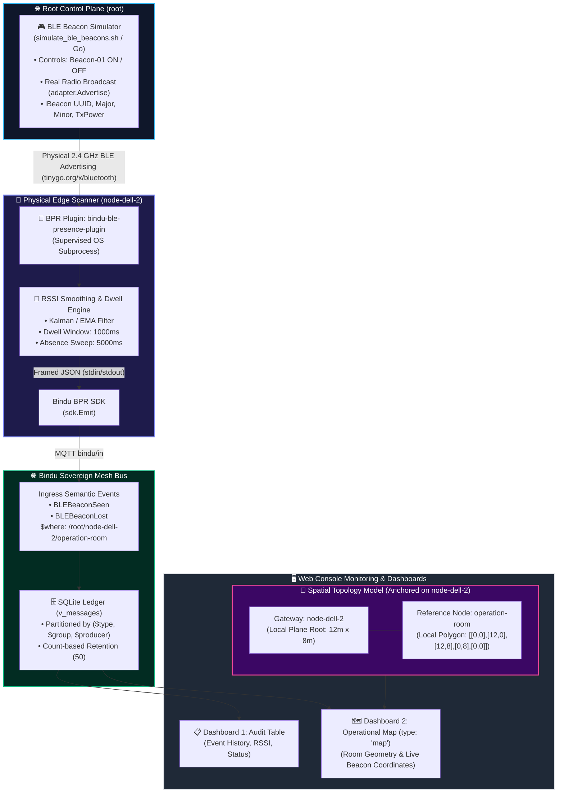
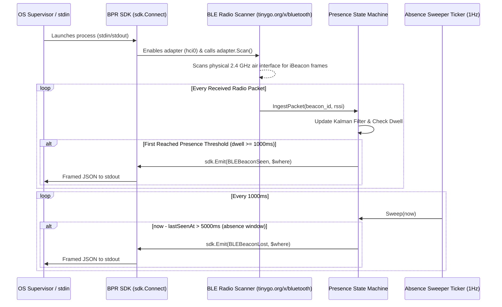

# 📡 Tutorial Plan: Bluetooth Low Energy (BLE) Multi-Agent System & Spatial Geo-Locagram Context
### Real-Time BLE Beacon Presence State Machine, Local Cartesian Reference Nodes, `$where` Spatial Context & Operational Dashboards

---

## 🧭 1. Executive Summary & Engineering Objective

This document defines the comprehensive engineering specification, spatial mechanics, ontology contracts, and implementation roadmap for the **Bluetooth Low Energy (BLE) Indoor Tracking & Spatial Geo-Locagram Multi-Agent System (MAS)** in Bindu.

The solution demonstrates how an edge gateway (`node-dell-2`) running a supervised BPR plugin captures physical BLE advertising frames, computes deterministic presence/absence states (`BLEBeaconSeen` vs. `BLEBeaconLost`), and enriches every semantic event with spatial context (`$where`) projected onto a local Cartesian reference plane anchored directly to **`node-dell-2`** and its spatial child reference node (**`operation-room`**).

### Core Architectural Pillars Demonstrated in this MAS:
1. **Black-Box Platform Consumer Contract (`public/console/docs/AGENTS.md`):** The entire solution is authored strictly using the declarative tools and public interfaces of Bindu (`bindu-studio`, JSON manifests, BPR SDK in `docs/sdk/`, and MQTT `bindu/in`), without modifying or reading internal Bindu Go core source code.
2. **Deterministic BLE Presence State Machine (`bindu-ble-presence-plugin`):** A standalone Go BPR worker process deployed to **`node-dell-2`** executing continuous Bluetooth Low Energy scanning via native Linux Bluetooth (`tinygo.org/x/bluetooth` / `hci0`), RSSI smoothing, candidate dwell verification, and silence absence sweeping.
3. **Interactive Root BLE Beacon Simulator (`ble-beacon-simulator`):** A standalone operator tool executed on **`root`** that broadcasts real physical iBeacon advertising frames over the 2.4 GHz air interface (`tinygo.org/x/bluetooth`), allowing the operator to turn tags ON and OFF interactively.
4. **Spatial Localization via Reference Nodes & Local Planes:** Physical signal acquisition happens on `node-dell-2`, and spatial semantic context (`$where`) is projected onto **`operation-room`**, a reference node child of **`node-dell-2`** defined by a metric local polygon ($12\,\text{m} \times 8\,\text{m}$).
5. **Level 0 Semantic Ontology:** Strictly typed, schema-validated events (`BLEBeaconSeen`, `BLEBeaconLost`) configured with Bottom-Up ingress routing (`["local", "parent"]`, NEVER `"child"`), sliding-window count retention (`count: 50`), and unique digital twin partitioning (`$producer: <beacon_id>`).
6. **Dual High-Fidelity Dashboards:**
   - **Audit Trail Data Table (`type: "table"`):** Real-time ledger tracking every transition event (`SEEN` vs. `LOST`), timestamp, digital twin identity, smoothed RSSI, and locagram path.
   - **Operational Map (`type: "map"`, `chart_type: "map"`):** Live interactive 2D spatial map rendering the `operation-room` boundary and dynamically updating the room's occupancy status and beacon coordinate markers.
7. **The Universal 5-Phase Deployment Pipeline:** Self-contained bundle deployment governed by the Iron Law of Level 0 and executed via the Universal Runtime OTA Triptych.



---

## 🧭 2. Demystifying the Spatial Model: Gateway Nodes, Local Planes & `$where` Mechanics

A common point of confusion when designing edge spatial systems is:
> *"How does a physical gateway node anchor its local spatial zones, and how is that represented mathematically and hierarchically in Bindu?"*

Having **`operation-room`** be a child reference node of **`node-dell-2`** provides immediate conceptual and operational clarity:
1. **The Physical Edge Unit (`node-dell-2`):** A physical gateway compute node installed in the hospital facility running the BLE scanner BPR plugin.
2. **The Spatial Reference Subtree (`operation-room`):** A reference node child representing the physical room monitored by that gateway.

Here is the exact architectural mechanics according to [`Geo-locagram-User-Guide.md`](../Geo-locagram-User-Guide.md), [`bindu-studio-geo-locagram-user-guide.md`](../bindu-studio-geo-locagram-user-guide.md), and [`Bindu Studio Mesh User Manual.md`](../Bindu%20Studio%20Mesh%20User%20Manual.md):

### 2.1 The Two Kinds of Mesh Nodes: Gateway vs. Reference
1. **Gateway Nodes (`connectivity_kind: "gateway"`):**
   - Physical compute units running operating system processes (`bindu-root` or `bindu-node`).
   - In our setup: `root` (control plane) and `node-dell-2` (edge gateway scanner).
   - Gateways communicate directly over mTLS and execute supervised plugins.
2. **Reference Nodes (`connectivity_kind: "reference"`):**
   - Structural, spatial, or organizational entities in the mesh hierarchy (e.g. facilities, wings, floors, rooms, racks).
   - They **do NOT execute software** and **do NOT host plugins**.
   - They define semantic identity and spatial boundaries.
   - In our setup: **`operation-room`** is a reference node created as a child of **`node-dell-2`**.
   - Its canonical Locagram path is: `/root/.../node-dell-2/operation-room`.

### 2.2 The Two Coordinate Spaces: World (WGS84) vs. Local Cartesian Plane
Bindu strictly separates macroscopic planetary geography from microscopic facility geometry:
- **World Space (WGS84 GPS):** Latitude/Longitude coordinates (`NodeGeoLocation`). Used to locate `node-dell-2` on the planet (e.g. Hospital Medical Center at `40.748817, -73.985130`).
- **Local Cartesian Plane (`NodeLocalGeometry`):** A 2D metric grid ($X, Y$) rooted at the physical gateway node (`plane_root`).
  - When `node-dell-2` is declared as the plane root with `units: meters` and `scale: 1.0`, **1 local coordinate unit equals exactly 1.0 meter** in the physical room.

### 2.3 Geometric Definition of `operation-room`
The `operation-room` is defined as a closed Cartesian Polygon inside the local plane of `node-dell-2`:
- **Dimensions:** Width = 12 meters, Height = 8 meters ($12\,\text{m} \times 8\,\text{m} = 96\,\text{m}^2$).
- **Polygon Coordinates:**
  ```json
  {
    "type": "Polygon",
    "coordinates": [
      [
        [0.0, 0.0],
        [12.0, 0.0],
        [12.0, 8.0],
        [0.0, 8.0],
        [0.0, 0.0]
      ]
    ]
  }
  ```
- **Local Role:** `"asset"` (defines a physical zone or room that can be occupied).
- **Color:** `#3B82F6` (Medical Blue).

### 2.4 How `$where` Gives Spatial Context to Messages
When `bindu-ble-presence-plugin` running on `node-dell-2` detects a beacon in the Operation Room, it stamps the message envelope with `$where`:
```json
{
  "$type": "BLEBeaconSeen",
  "$group": "mesh",
  "$producer": "beacon-cardiac-monitor-01",
  "$node-origin": "node-dell-2",
  "$when": "2026-10-12T14:30:00Z",
  "$where": {
    "locagram": "/root/node-dell-2/operation-room",
    "coordinates": [6.0, 4.0]
  },
  "fields": {
    "beacon_id": "beacon-cardiac-monitor-01",
    "status": "SEEN",
    "zone_id": "operation-room",
    "rssi_filtered": -62.5,
    "distance_estimate_m": 2.1
  }
}
```

#### Why This Design is Simple and Powerful:
1. **Self-Contained Edge Unit:** `node-dell-2` acts as both the physical scanner host and the local plane root. The student sees an intuitive 1:1 match between the physical machine and the monitored room.
2. **Universal Querying:** Downstream systems (dashboards, SQL queries, CEL kinetic guards) do not need custom parsers. They read `$where.locagram` to immediately know the physical location of the tag.
3. **Native Map Rendering:** The `map` dashboard widget draws the `operation-room` polygon and plots the dynamic beacon coordinates at $(6.0, 4.0)$ automatically.

---

## 🏷️ 3. Semantic Message Types (Level 0 Contracts)

In accordance with the **Iron Law of Level 0**, all message types must be registered and synchronized before plugins or dashboards are validated.

### 3.1 `BLEBeaconSeen` (Tag Presence Declared)
Emitted by the plugin on `node-dell-2` when a beacon candidate has been continuously observed for longer than the candidate dwell window (`presence_window_ms = 1000ms`).

- **Archetype:** Bottom-Up Telemetry Ingress.
- **`routing`:** `["local", "parent"]` (**NEVER `"child"`** to prevent mesh rejection loops).
- **`retentionMode`:** `"count"`
- **`retentionValue`:** `50` (Sliding audit window).
- **`$producer`:** The canonical beacon identifier (e.g. `beacon-cardiac-monitor-01`).
- **`properties[]`:**
  - `beacon_id` (`string`, required): Unique identity of the BLE tag.
  - `protocol` (`string`): `"ibeacon"` or `"eddystone"`.
  - `ibeacon_uuid` (`string`): 128-bit Proximity UUID.
  - `ibeacon_major` (`integer`): Major grouping number.
  - `ibeacon_minor` (`integer`): Minor individual number.
  - `rssi_raw` (`integer`): Raw RSSI from latest packet (dBm).
  - `rssi_filtered` (`number`): Smoothed RSSI from Kalman/EMA filter (dBm).
  - `tx_power` (`integer`): Measured/calibrated power at 1 meter.
  - `distance_estimate_m` (`number`): Calculated log-distance path loss estimate (meters).
  - `zone_id` (`string`, required): Assigned reference zone (`"operation-room"`).
  - `status` (`string`, required): `"SEEN"`.
  - `seen_at` (`string`, required): RFC3339 timestamp when presence became stable.
  - `observation_count` (`integer`): Number of packets accumulated during dwell.

### 3.2 `BLEBeaconLost` (Tag Absence Declared)
Emitted by the plugin on `node-dell-2` when an active beacon has not emitted an advertisement packet for longer than the absence window (`absence_window_ms = 5000ms`).

- **Archetype:** Bottom-Up Telemetry Ingress.
- **`routing`:** `["local", "parent"]` (**NEVER `"child"`**).
- **`retentionMode`:** `"count"`
- **`retentionValue`:** `50`.
- **`$producer`:** The canonical beacon identifier.
- **`properties[]`:**
  - `beacon_id` (`string`, required): Unique identity of the BLE tag.
  - `protocol` (`string`): `"ibeacon"`.
  - `zone_id` (`string`, required): Last known reference zone (`"operation-room"`).
  - `status` (`string`, required): `"LOST"`.
  - `last_seen_at` (`string`, required): Timestamp of the last received packet.
  - `lost_at` (`string`, required): Timestamp when absence threshold expired.
  - `absence_window_ms` (`integer`): Configured absence window in milliseconds.
  - `last_rssi_filtered` (`number`): Last known filtered signal strength.
  - `reason` (`string`): Semantic reason (`"ABSENCE_TIMEOUT"`).

### 3.3 `BLEPluginConfig` (Declarative Plugin Bootstrap)
- **Archetype:** Top-Down Control / Setting.
- **`routing`:** `["local", "child"]` + `$node-dest: "node-dell-2"`.
- **`retentionMode`:** `"count"`
- **`retentionValue`:** `1` (Latest state only).
- **`properties[]`:**
  - `gateway_node_id` (`string`): `"node-dell-2"`.
  - `adapter` (`string`): Bluetooth HCI adapter (e.g. `"hci0"`).
  - `scanner_backend` (`string`): Driver backend (`"tinygo"` for physical Bluetooth radio, `"mock"` for virtualized CI fallback).
  - `presence_window_ms` (`integer`): Minimum dwell time (`1000`).
  - `absence_window_ms` (`integer`): Silence timeout (`5000`).
  - `reference_zone` (`string`): Target zone node ID (`"operation-room"`).
  - `reference_locagram` (`string`): Target locagram (`"/root/node-dell-2/operation-room"`).
  - `zone_center_coordinates` (`array` of numbers): `[6.0, 4.0]`.

---

## 🔌 4. Hardware BPR Plugin Architecture (`bindu-ble-presence-plugin`)

The plugin executes as a dedicated, supervised native OS worker process on `node-dell-2`.

### 4.1 Internal Lifecycle & Goroutine Architecture


### 4.2 Signal Smoothing & Mathematical Distance Estimation
1. **Exponential Moving Average (EMA) / Kalman Smoothing:**
   $$\text{RSSI}_{\text{filtered}} = \alpha \cdot \text{RSSI}_{\text{raw}} + (1 - \alpha) \cdot \text{RSSI}_{\text{filteredPrev}}$$
   *(With $\alpha = 0.25$, isolating transient multipath fading and body-shielding fluctuations).*
2. **Log-Distance Path Loss Model:**
   $$d = 10^{\frac{\text{TxPower} - \text{RSSI}_{\text{filtered}}}{10 \cdot n}}$$
   *(Where $\text{TxPower} = -59\,\text{dBm}$ at 1 meter, and $n = 2.0$ for indoor line-of-sight).*

---

## 🎮 5. The Root BLE Tag Simulator (`ble-beacon-simulator`)

To satisfy requirement 4, an interactive simulation CLI tool will run on `root`. This tool enables manual testing of the complete lifecycle by broadcasting genuine Bluetooth Low Energy advertising packets into the physical 2.4 GHz spectrum using the host Bluetooth adapter (`tinygo.org/x/bluetooth`), mirroring Bindu's canonical `ble-beacon-simulator`.

### 5.1 Simulator Capabilities
- **Binary & Protocol:** Encodes valid 30-byte iBeacon advertising frames:
  - Apple Company ID: `0x004C`
  - iBeacon Type & Length: `0x02, 0x15`
  - Proximity UUID: `E2C56DB5-DFFB-48D2-B060-D0F5A71096E0`
  - Major: `100` (Building Wing)
  - Minor: `1` (Asset ID, e.g. Cardiac Monitor)
  - Measured TxPower: `-59` dBm
- **Radio Advertising Engine:** Dispatches real physical Bluetooth advertising packets into the air via `adapter.Advertise(...)` using the local Bluetooth controller (`hci0`).
- **Interactive Operator Modes:**
  1. `start-tag --id beacon-01 --rate 2hz`: Begins broadcasting 2.4 GHz iBeacon packets at 2 Hz. The physical Bluetooth scanner on `node-dell-2` captures the radio packets over the air, detects consistent dwell ($\ge 1000\,\text{ms}$), and declares `BLEBeaconSeen`.
  2. `stop-tag --id beacon-01`: Instantly calls `adapter.StopAdvertise()`, cutting the physical radio transmission. After 5 seconds of radio silence, the scanner on `node-dell-2` declares `BLEBeaconLost`.
  3. `toggle-tag --id beacon-01`: Toggles the tag broadcast on and off.
  4. `walk-in` / `walk-out`: Predefined operational macro routines demonstrating physical ingress and egress.
- **Dual-Backend Support (Clean Fallback):**
  - `--backend ble` (**Default / Canónico**): Transmits real 2.4 GHz radio packets via `tinygo.org/x/bluetooth`.
  - `--backend dry-run` / `--backend mock`: Fallback for headless cloud/VM environments without physical Bluetooth hardware.

---

## 📊 6. Observability: The Two Declarative Dashboards

Dashboards in Bindu are saved as declarative `DashboardDefinition` messages.

### 6.1 Dashboard 1: Audit Table (`type: "table"`)
- **Producer:** `ble-presence-audit-log`
- **Title:** `📋 BLE Beacon Presence & Absence Audit Log`
- **SQL Query:**
  ```sql
  SELECT 
    "$when" AS event_time,
    json_extract(raw_json, '$.fields.beacon_id') AS beacon_id,
    json_extract(raw_json, '$.fields.status') AS status,
    json_extract(raw_json, '$.fields.zone_id') AS zone,
    ROUND(CAST(json_extract(raw_json, '$.fields.rssi_filtered') AS REAL), 1) AS rssi_dbm,
    ROUND(CAST(json_extract(raw_json, '$.fields.distance_estimate_m') AS REAL), 2) AS distance_m,
    json_extract(raw_json, '$.fields.reason') AS trigger_reason
  FROM v_messages
  WHERE "$type" IN ('BLEBeaconSeen', 'BLEBeaconLost')
  ORDER BY "$when" DESC
  LIMIT 30;
  ```
- **Visualization:** Formatted grid table displaying the transition history.

### 6.2 Dashboard 2: Operational Map (`type: "map"`)
- **Producer:** `ble-operation-room-spatial-map`
- **Title:** `🗺️ Operation Room BLE Beacon Spatial Occupancy Map`
- **SQL Query:**
  ```sql
  SELECT 
    "$when" AS timestamp, 
    json_extract(raw_json, '$.fields.beacon_id') AS entity_id, 
    json_extract(raw_json, '$.fields.status') AS status, 
    json_extract(raw_json, '$.fields.zone_id') AS zone, 
    CAST(json_extract(raw_json, '$.fields.coordinates_x') AS REAL) AS pos_x, 
    CAST(json_extract(raw_json, '$.fields.coordinates_y') AS REAL) AS pos_y, 
    json_extract(raw_json, '$.fields.where_locagram') AS geom 
  FROM v_messages 
  WHERE "$type" IN ('BLEBeaconSeen', 'BLEBeaconLost') 
  ORDER BY "$when" DESC 
  LIMIT 20
  ```
- **View Configuration:**
  ```json
  {
    "type": "map",
    "title": "Operation Room Real-Time 2D BLE Spatial Tracker",
    "chart_type": "map",
    "x": "pos_x",
    "y": [
      "pos_y"
    ]
  }
  ```
- **Visualization:** Interactive 2D operational map rendering dynamic beacon coordinates and GeoJSON polygon boundaries.

---

## 🚀 7. The Universal 5-Phase Deployment Pipeline

Following the **Universal 5-Phase Deployment Pipeline** documented in [`mas-deployment-guide.md`](../mas-deployment-guide.md):

### Phase 1: Level 0 Ontology Ingestion (Schemas First)
```bash
./bin/bindu-studio message-types merge \
  --in-path ./poc_message_types.json \
  --all --yes \
  --auth console:StrongPass123
```

### Phase 2: Level 1 BPR Plugin Simulation & Certification
```bash
# 1. Simulate and test plugin handshake, stimulus injection, and clean shutdown
./bin/bindu-studio plugin dry-run \
  --source ./bindu-ble-presence-plugin \
  --timeout 3s

# 2. Certify and package native bundle
./bin/bindu-studio plugin certify \
  --source ./bindu-ble-presence-plugin \
  --out ./bindu-ble-presence-plugin.tar.gz \
  --target linux/amd64
```

### Phase 3: Spatial Topology & Reference Node Definition
```bash
# 1. Ensure operation-room exists as a reference node child of node-dell-2
./bin/bindu-studio mesh add \
  --id operation-room \
  --parent node-dell-2 \
  --kind reference \
  --name "Operation Room 1"

# 2. Configure node-dell-2 as a metric Cartesian local plane root
./bin/bindu-studio geo-locagram local-plane \
  --node node-dell-2 \
  --units meters \
  --scale 1.0

# 3. Publish the 12m x 8m rectangular geometry for operation-room
./bin/bindu-studio geo-locagram local-set \
  --node operation-room \
  --plane node-dell-2 \
  --role asset \
  --geometry '{"type":"Polygon","coordinates":[[[0,0],[12,0],[12,8],[0,8],[0,0]]]}' \
  --color "#3B82F6"
```

### Phase 4: Level 3 Declarative Solution Application & Bundling
```bash
# 1. Assign certified plugin to target node node-dell-2
./bin/bindu-studio plugin apply \
  --bundle ./bindu-ble-presence-plugin.tar.gz \
  --target node \
  --node node-dell-2 \
  --auth console:StrongPass123

# 2. Import declarative dashboards
./bin/bindu-studio dashboard import \
  --file ./poc_dashboards.json \
  --all \
  --auth console:StrongPass123

# 3. Export consolidated solution bundle and validate graph closure
./bin/bindu-studio solution export \
  --file ./ble_mas_solution.json \
  --out ./bundles/ble_mas.bundle.json \
  --auth console:StrongPass123

./bin/bindu-studio solution validate \
  --file ./bundles/ble_mas.bundle.json \
  --strict

# 4. Apply solution bundle (registers MASSolutionSet)
./bin/bindu-studio solution apply \
  --file ./bundles/ble_mas.bundle.json \
  --yes \
  --auth console:StrongPass123
```

### Phase 5: Level 4 Universal Runtime OTA Triptych
```bash
# 1. Freeze baseline state
./bin/bindu-studio runtime baseline accept --yes

# 2. Commit desired state
./bin/bindu-studio runtime desired commit \
  --note "Deploy BLE Presence MAS on node-dell-2"

# 3. Execute transactional rollout wizard to push binary to node-dell-2
./bin/bindu-studio runtime update wizard \
  --yes \
  --auth console:StrongPass123
```

---

## 📂 8. Directory Structure for `public/console/docs/ble-tutorial/`

When approved to implement, the tutorial directory will contain:
```text
public/console/docs/ble-tutorial/
├── ble_tutorial_plan.md                     # This architectural specification & plan
├── tutorial_guide.md                        # Step-by-step operator walkthrough with terminal commands
├── poc_message_types.json                   # Level 0 Schemas: BLEBeaconSeen, BLEBeaconLost, BLEPluginConfig
├── poc_dashboards.json                      # Level 2 Dashboards: Audit Table & Operational Map (type: "map")
├── ble_mas_solution.json                    # Level 3 Declarative MAS Solution Manifest
├── deploy_mas_solution.sh                   # Fully automated, idempotent 5-phase deployment script
├── bindu-ble-presence-plugin/               # Level 1 BPR Plugin source code (Go)
│   ├── main.go                              # Plugin entrypoint: tinygo Bluetooth scanner, state machine, BPR SDK emitter
│   ├── presence_engine.go                   # Kalman smoothing, dwell window, and absence sweeper
│   └── plugin.json                          # Plugin manifest specification
└── simulator/                               # Root-side manual simulator
    ├── simulate_ble_beacons.go              # Standalone interactive iBeacon generator & Bluetooth radio broadcaster
    └── simulate_ble_beacons.sh              # Bash CLI helper wrapper for operator testing
```

---

## 🔒 9. Confirmed Architectural Decisions

The architectural parameters for this MAS solution are formally agreed and locked in:

1. **Physical Transport:**
   - **Primary / Canónico:** Genuine 2.4 GHz Bluetooth Low Energy radio advertising and scanning via `tinygo.org/x/bluetooth` accessing the local Linux Bluetooth controller (`hci0`).
   - **CI / Virtual Fallback:** Clean `--backend dry-run` / `--scanner mock` driver abstraction for headless environments without physical Bluetooth hardware.
2. **Presence Dwell & Absence Grace Timeouts:**
   - **Candidate Dwell Window:** `1000ms` (requires 1 second of stable advertisements before declaring `BLEBeaconSeen`).
   - **Absence Timeout Window:** `5000ms` (5 seconds of silence before declaring `BLEBeaconLost`).
3. **Reference Node Placement & Spatial Anchor:**
   - In `mesh.json`, `operation-room` is configured as a child of `node-dell-2` with connectivity kind `reference`.
   - The local Cartesian plane is rooted at `node-dell-2` ($12\text{m} \times 8\text{m}$).
   - The Operational Map dashboard uses standard `"type": "map"` and `"chart_type": "map"` with `x: "pos_x"` and `y: ["pos_y"]`.
