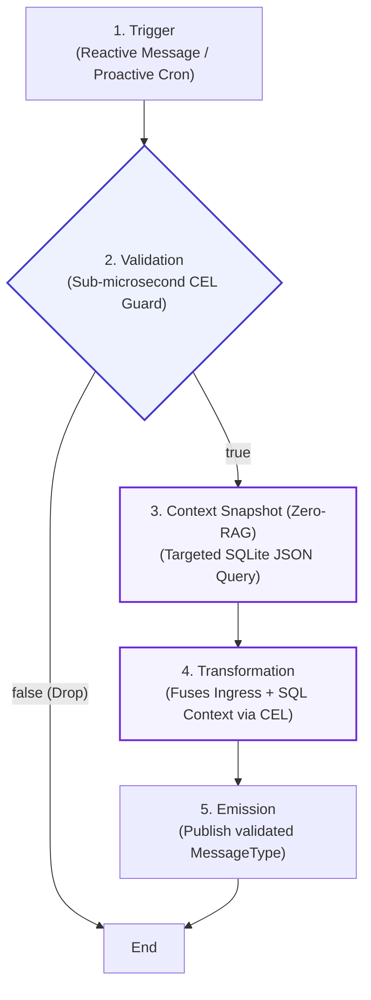

# CEL Declarative Reactor & Message Transformer User Guide

The **CEL Declarative Reactor & Message Transformer** is a Go-native, high-performance, in-process stream processor. It allows edge nodes and the root server to automatically intercept incoming mesh messages, validate or query database context, evaluate conditional guards, transform payloads, and publish new structured events in real-time.

All evaluation is done using **Google Common Expression Language (CEL)**, which is compiled and cached in memory for sub-millisecond execution with zero garbage collection overhead.

---

## ⚙️ The CEL Reactor: A 5-Step Deterministic State Machine

Unlike heavy cloud rule engines, Bindu executes declarative state transformations directly at the edge in sub-microseconds. The execution flow operates as follows:

1. **Trigger:** Initiated reactively by an incoming MessageType or proactively via the native Go scheduler (e.g., `@cron`).
2. **Validation:** A sub-microsecond Common Expression Language (CEL) evaluation is applied to filter the ingress payload.
3. **Context Snapshot (Zero-RAG):** If validated, it executes a targeted SQLite query (using JSON2 extensions) to pull the exact historical context associated with the event's parameters.
4. **Transformation:** A CEL expression logically fuses the ingress payload with the historical context to compute the new state without requiring external scripts.
5. **Emission:** The reactor emits the resulting decision as a new, structurally validated MessageType back into the channel.



---

## 🧬 Key Configuration Parameters

Each CEL Reactor instance consists of:
1. **Reactor ID**: A unique string identifying this transformation rule.
2. **Input Message Type**: The type of message that triggers the evaluation (optional if Cron is configured).
3. **Cron Trigger Schedule**: An optional cron schedule expression (e.g. `*/5 * * * * *` or `@every 5m`) to trigger the reactor periodically (optional if Input Message Type is configured). For syntax rules, see the [Plugin Dev — Cron Strings](Cron_Job_Strings_user_guide.md) manual.
4. **Output Message Type**: The type of message to build and publish upon successful trigger (e.g., `FreezerStatusUpdate`).
5. **Trigger Condition (CEL)**: A boolean expression that must evaluate to `true` to execute the transformation. If empty, it defaults to `true`.
6. **Context Query (SQL)**: A read-only SQLite query to fetch historical context. **This query is mandatory when using a Cron trigger** since there is no triggering event payload. The query binds the local node ID to the first parameter (`?`).
7. **Transformation Expressions (JSON Map)**: A map of output field names to CEL expressions that generate values matching the output message type's schema properties.

### ⚠️ Validation Constraints & Architectural Invariants

> [!CAUTION]
> **🚫 Anti-Recursion Safety Invariant (`E_REACTOR_RECURSIVE_LOOP`):**
> The `output_message_type` **CANNOT be identical to the `input_message_type`** (or match any entry in a comma-separated list of trigger types).
> 
> * **Why this is strictly forbidden**: Emitting the same message type that triggered the reactor creates an infinite feedback loop ($T_{in} \to \text{Reactor} \to T_{out} \to \text{Reactor} \to \dots$) that saturates CPU, flooding the mesh and exhausting SQLite storage.
> * **Correct Pattern**: A reactor must advance the semantic pipeline state by emitting a distinct, downstream message type (e.g. `SensorReading` ➔ `FreezerStatusUpdate`, or `MeshAuditTrigger` ➔ `MeshTopologyInspection`).
> * **Enforcement**: This rule is validated statically via `bindu-studio cel-reactor validate`, in the Console UI modal, and at runtime configuration ingestion. Violations return error code `E_REACTOR_RECURSIVE_LOOP`.

> [!WARNING]
> **At least one trigger is required**
> Every CEL reactor configuration must declare either an `input_message_type` or a `cron` trigger schedule (or both).
>
> **Cron triggers require Context Queries**
> If you configure a `cron` trigger schedule, you **must** configure a `context_query` SQL statement. Since cron-triggered executions do not have an incoming message event, the context query is the only way to retrieve database state to evaluate expressions. In a cron execution, `payload` and `head` variables are populated as empty maps.

---

## 🧠 Google Common Expression Language (CEL) Deep-Dive

### What is Google CEL?
Google Common Expression Language (CEL) is a fast, safe, and lightweight expression evaluation engine. In Bindu, it compiles directly to in-memory program instructions and executes in sub-milliseconds with zero garbage collection overhead. Inside the CEL Declarative Reactor, it is used to evaluate trigger conditions and transform event payloads.

For official specifications and tutorials, see:
*   [Google CEL Language Definition](https://github.com/google/cel-spec/blob/master/doc/langdef.md)
*   [Google CEL Specifications & Design](https://github.com/google/cel-spec)
*   [CEL Go Engine Repository](https://github.com/google/cel-go)

### Why Use CEL?
1.  **Safety & Sandboxing:** CEL expressions are non-Turing complete and cannot loop infinitely, make network calls, or access the operating system, guaranteeing safe execution on edge gateway nodes.
2.  **Ultra-low Latency:** Compiles once at start/deployment and executes local checks at sub-millisecond speeds.
3.  **High Throughput:** Replaces heavy processes (such as BPR plugins or LLMs) for simple Boolean filters and deterministic transformations.

### Evaluation Context & Available Variables
CEL expressions inside all Bindu reactor engines have read-only access to standard message payloads as well as live in-memory runtime topology, configuration, and message schemas:

#### Standard Message & Database Context
*   **`head`**: The message header map (`head["$producer"]`, `head["$user"]`, `head["$where"]["locagram"]`, etc.).
*   **`payload`**: The message payload map containing custom telemetry fields (e.g., `payload.temperature`, `payload.door_open`).
*   **`db`**: Context query results populated by the SQLite `context_query` execution:
    *   `db.rows`: List of objects representing database rows (`db.rows[i].fields.<column_name>`).
    *   `db.scalar`: The first field value of the first row of the query results.

#### Live Mesh Topology (`mesh.*`)
Reflects the live in-memory `mesh.json` topology without disk I/O:
*   **`mesh.local_id`**: Current node ID (e.g. `'node-dell-2'`).
*   **`mesh.root_id`**: Root gateway node ID (e.g. `'root'`).
*   **`mesh.self`**: Object containing self node metadata:
    *   `mesh.self.id`: Current node ID.
    *   `mesh.self.locagram`: Current node locagram path (e.g. `'/galicia-dell-2'`).
    *   `mesh.self.is_root`: Boolean (`true` if current node is mesh root).
    *   `mesh.self.connectivity_kind`: Node connectivity kind (`'gateway'`, `'reference'`, etc.).
    *   `mesh.self.plugins`: List of active plugin names on this node.
*   **`mesh.nodes`**: Map of all nodes in topology indexed by node ID (e.g. `mesh.nodes['root'].locagram`).

#### Custom Mesh Extension Functions:
*   **`mesh.locagram(node_id)`**: Returns the locagram string for a given node ID (e.g. `mesh.locagram('node-dell-2')` $\rightarrow$ `"/galicia-dell-2"`).
*   **`mesh.is_parent(node_id)`**: Returns `true` if the given `node_id` is the operational parent of the local node.
*   **`mesh.is_root(node_id)`**: Returns `true` if the given `node_id` is the mesh root.
*   **`mesh.has_plugin(node_id, plugin_name)`**: Returns `true` if the specified node has the given plugin assigned.

#### Live System Configuration (`config.*`)
Reflects safe, non-sensitive runtime parameters loaded from `binduConfig.json`:
*   **`config.server.producer_id`**: Logical producer ID configured for this instance.
*   **`config.server.description`**: Description of the node/server.
*   **`config.logging.level`**: Current log level (`'DEBUG'`, `'INFO'`, etc.).
*   **`config.time.ntp_server`**: Configured NTP time sync server.
*   **`config.maintenance_cron`**: Active maintenance cron schedule string.
*   **`config.maintenance_reset`**: Boolean toggle indicating whether clean post-maintenance service restart is enabled (true/false).

#### Live Message Type Registry (`schema.*`)
Reflects in-memory schema metadata loaded from `messageTypesConfiguration.json`:
*   **`schema.types`**: Map of registered message types (e.g. `schema.types['RawMarineData'].emoji`, `schema.types['RawMarineData'].version`).
*   **`schema.is_registered(type_name)`**: Function returning `true` if the given message type is registered.
*   **`schema.has_property(type_name, prop_name)`**: Function returning `true` if the registered type declares the given property.
*   **`schema.property_names(type_name)`**: Returns complete list of property names for the schema.
*   **`schema.as_typescript(type_name)`**: Generates compact TypeScript interface matching the schema.
*   **`schema.as_json_sample(type_name)`**: Generates sample JSON object with typed defaults.

#### Google Standard CEL Extensions (`ext.*`)
Bindu equips the reactor engine with the complete suite of Google Standard CEL extension libraries:
*   **Strings (`ext.Strings`)**: Method-based string manipulation (`.contains()`, `.split()`, `.substring()`, `.indexOf()`, `.replace()`, `.trim()`, `.lowerAscii()`, `.upperAscii()`, `.join()`, `.format()`).
*   **Encoders (`ext.Encoders`)**: Base64 encoding/decoding (`base64.encode(bytes)`, `base64.decode(string)`).
*   **Math (`ext.Math`)**: Bounding and numeric operations (`math.greatest()`, `math.least()`, `math.ceil()`, `math.floor()`, `math.round()`, `math.abs()`).
*   **Lists & Sets (`ext.Lists`, `ext.Sets`)**: Collection transformations (`list.distinct()`, `list.sort()`, `list.flatten()`, `sets.contains()`, `sets.intersects()`, `sets.equivalent()`).
*   **Bindings (`ext.Bindings`)**: `cel.bind(var, expr, body)` macro to create local scoped variables.
*   **Two-Variable Comprehensions (`ext.TwoVarComprehensions`)**: `list.all(i, v, ...)`, `map.exists(k, v, ...)`.
*   **Regex (`ext.Regex`)**: `regex.replace()`, `regex.extractAll()`.

> [!TIP]
> For the complete reference of all standard and custom variables, functions, signatures, and recipes, see the comprehensive [Google CEL Context & Functions Reference Guide](cel_context_and_functions_guide.md).

---

## 📝 Common Expression Language (CEL) Syntax Examples

### 1. Basic Booleans and Conditionals
* **Simple comparison**:
  ```javascript
  payload.temperature > -5.0
  ```
* **String comparisons**:
  ```javascript
  head.$user == "console" || head.$producer != "root"
  ```
* **String inspection (Google Standard CEL Method Syntax)**:
  ```javascript
  string(payload.media_uri).contains('://') && string(payload.media_uri).endsWith('.jpeg')
  ```
* **Ternary Operator (Conditional)**:
  ```javascript
  payload.door_open ? 'ALERT_OPEN' : 'NORMAL'
  ```

### 2. Accessing Database Context
* **Retrieving scalar value**:
  ```javascript
  db.scalar
  ```
* **Safe row inspection**:
  ```javascript
  has(db.rows) && size(db.rows) > 0 ? db.rows[0].fields.motor_temperature : -1.0
  ```
* **Complex guard involving SQL results**:
  ```javascript
  payload.temperature > -5.0 && (has(db.rows) && size(db.rows) > 0 && double(db.rows[0].fields.motor_temperature) > 75.0)
  ```

### 3. Polymorphic Triggering & Rules (Multi-Input)
CEL Reactors can listen to multiple event types by declaring a comma-separated list of types in `input_message_type` (e.g., `CountFlowersByColor,ManualGardenSurvey`). Because these events have different structures, you must write polymorphic CEL expressions:
*   **Checking Message Type**: Use `head["$type"]` to run type-specific checks.
*   **Safe Presence Checks**: Use the `has()` macro or presence checks (`in`) to verify if fields exist before evaluating them, avoiding runtime type evaluation exceptions.

**Example Polymorphic CEL Filter**:
```javascript
(head["$type"] == "CountFlowersByColor" && has(payload.yellow_flowers) && payload.yellow_flowers > 5) ||
(head["$type"] == "ManualGardenSurvey" && has(payload.yellow_count) && payload.yellow_count > 5)
```

**Example Polymorphic Transformation Expression**:
```json
{
  "reason": "head[\"$type\"] == \"CountFlowersByColor\" ? \"Automated vision threshold exceeded\" : \"Manual human count threshold exceeded\"",
  "flower_count": "head[\"$type\"] == \"CountFlowersByColor\" ? payload.yellow_flowers : payload.yellow_count"
}
```

---

## 🛡️ Built-in System Watchdog CEL Reactor (Unified Telemetry)

The Go core of Bindu includes a pre-compiled built-in system watchdog reactor called `system_hardware_monitor`. This reactor serves as an advanced example of a **unified Event Processing Agent (EPA)**.

### Unified Design (Single Input)
Under the modern Bindu architecture, all node health, hardware resources, and process statuses are unified into the periodic `MessageState` heartbeat message:

*   **`MessageState`:** Emitted periodically, containing CPU, memory, and disk usage (`payload.cpu.usage_pct`, etc.) along with the active process status lists for all BPR plugins (`payload.bpr_plugins`), AI reactors (`payload.ai_reactors`), and system plugins (`payload.system_plugins`).

By consolidating process health inside the periodic heartbeat, the watchdog reactor triggers immediately upon any process crash or resources threshold infraction using a single, cohesive message type.

### Watchdog CEL Expressions

#### 1. Trigger Condition
Evaluates to `true` if any hardware threshold is exceeded (CPU > 90%, memory > 90%, disk > 95%) OR if any BPR plugin, AI reactor, or system plugin is reported as unhealthy (status != `"running"` or `"active"/"sleeping"`):

```cel
(("cpu" in payload && "usage_pct" in payload.cpu && payload.cpu.usage_pct > 90.0) ||
 ("memory" in payload && "used_pct" in payload.memory && payload.memory.used_pct > 90.0) ||
 ("disk" in payload && "used_pct" in payload.disk && payload.disk.used_pct > 95.0) ||
 ("bpr_plugins" in payload && dyn(payload.bpr_plugins).exists(p, p.status != "running")) ||
 ("ai_reactors" in payload && dyn(payload.ai_reactors).exists(r, r.status != "active" && r.status != "sleeping")) ||
 ("system_plugins" in payload && dyn(payload.system_plugins).exists(sp, sp.status != "running")))
```

#### 2. Transformation Expressions
Constructs a standard system `ErrorEvent` alert dynamically depending on the event origin:

*   **`group_id`**: `"mesh"`
*   **`client_id`**: `head["$producer"]`
*   **`username`**: `"system"`
*   **`origin_producer`**: `head["$producer"]`
*   **`topic`**: `head["$type"]`
*   **`reason`**:
    ```cel
    (("cpu" in payload && payload.cpu.usage_pct > 90.0) ||
     ("memory" in payload && payload.memory.used_pct > 90.0) ||
     ("disk" in payload && payload.disk.used_pct > 95.0)) ? 
      "Host hardware resource threshold exceeded" : 
      "Core system plugin or BPR process failure detected"
    ```
*   **`payload`**: `head["$type"]`
*   **`error_type`**:
    ```cel
    ("cpu" in payload && payload.cpu.usage_pct > 90.0) ? "SYSTEM_HIGH_CPU" :
    (("memory" in payload && payload.memory.used_pct > 90.0) ? "SYSTEM_HIGH_MEM" :
    (("disk" in payload && payload.disk.used_pct > 95.0) ? "SYSTEM_HIGH_DISK" :
    (("bpr_plugins" in payload && dyn(payload.bpr_plugins).exists(p, p.status != "running")) ? "BPR_PLUGIN_CRASH" :
    (("ai_reactors" in payload && dyn(payload.ai_reactors).exists(r, r.status != "active" && r.status != "sleeping")) ? "AI_REACTOR_CRASH" :
    "SYSTEM_PLUGIN_CRASH"))))
    ```
```

---

## 🚀 Deployment Instructions

### Method 1: Console UI Wizard (Recommended)
1. Navigate to the **🔀 CEL Reactor** tab in the sidebar.
2. Select the target **Mesh Node** to configure.
3. Click **Add CEL Reactor** to open the wizard form.
4. Input the routing properties and write your CEL expressions.
5. *(Optional)* Click **Dry-Run Test** to simulate evaluations in memory using mock payloads.
6. Click **Apply Changes** to save the rule locally in the active list.
7. Click **🚀 Deploy Node Configuration** to broadcast the configurations to the target node.

### Method 2: Command Line (CLI)
* **List active rules**:
  ```bash
  bindu-studio cel-reactor list --auth console:password
  ```
* **Export configurations**:
  ```bash
  bindu-studio cel-reactor export --out ./my-rules.json --auth console:password
  ```
* **Validate syntax offline**:
  ```bash
  bindu-studio cel-reactor validate --file ./my-rules.json
  ```
* **Import and replace (Full Overwrite)**:
  ```bash
  bindu-studio cel-reactor import --file ./my-rules.json --auth console:password --yes
  ```
* **Merge and deploy incrementally (Safe Merge)**:
  ```bash
  bindu-studio cel-reactor merge --file ./my-rules.json --auth console:password --yes
  ```
