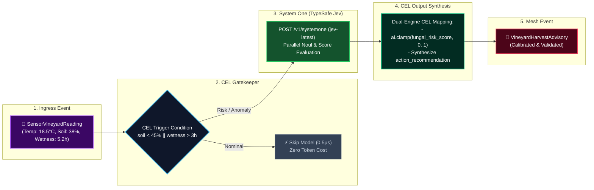

# Hands-On Tutorial: CEL-Powered Semantic AI Reactors — The Albariño Smart Vineyard AI 🍇🍷⚡

Welcome to the **CEL-Powered Semantic AI Reactor Tutorial** for Bindu!

In this hands-on guide, you will learn how to combine **Google Common Expression Language (CEL / `pkg/celext`)** with **TypeSafe AI (`System One` / `jev-latest`)** to build an autonomous, zero-defect agricultural intelligence agent for the vineyards of Rías Baixas, Galicia.

---

## 1. 🧠 Why CEL + TypeSafe AI (System One) is a Superpower

In industrial and agricultural telemetry, you need **both** deterministic microsecond math and calibrated probabilistic judgement:
* **Google CEL** is deterministic, strictly typed, sandboxed, and executes in sub-microseconds ($<1\,\mu\text{s}$).
* **TypeSafe AI (`Jev` / System One)** is a decision-native model trained via *Reinforcement Learning for Calibrated Decisions (RLCD)* that evaluates parallel typed questions (`noul` booleans, `choice` enums, and `score` metrics) in milliseconds with **0.00% structural hallucinations** and mathematically calibrated confidence probabilities.

Because System One models do **not** generate free-form text, **Google CEL in `mapping_template` completes the cognitive loop** by synthesizing human-readable agronomic recommendations directly from Jev's typed decisions!



### The 3 Pillars of CEL + System One in Semantic AI:
1. **Pre-Inference Gating (`trigger_condition`)**: Evaluates incoming telemetry against CEL predicates in $<1\mu\text{s}$. If vineyard conditions are nominal, the AI model is never invoked, saving 90%+ of API calls.
2. **Hybrid Schema Auto-Compilation (`questions`)**: Bindu introspects `VineyardHarvestAdvisory` and auto-compiles `frost_alert` (`noul`) and `botanical_health_score` (`score` `0.0..1.0`), while merging explicit domain rubrics for `fungal_risk_score` (`noul`) and `harvest_readiness_index` (`score` `0..100`).
3. **Post-Inference CEL Synthesis & Clamping (`mapping_template`)**: Uses native CEL functions (`ai.clamp()`, `ai.round()`, and conditional ternary synthesis) to generate `action_recommendation` and preserve `vineyard_id` from `payload.vineyard_id`.

---

## 2. 🍇 Step 1: Import the Tutorial Message Types

First, merge the two message type schemas (`SensorVineyardReading` and `VineyardHarvestAdvisory`) into your Bindu cluster:

```bash
./bin/bindu-studio message-types merge \
  --in-path ./public/console/docs/cle-for-ai-reactor/poc_message_types.json \
  --base-dir ./.e2e-root/current \
  --auth console:StrongPass123 --all --yes
```

### Schema Architecture:
* **`SensorVineyardReading` (`🍇`)**:
  Captures real-time microclimate conditions: `ambient_temp_c`, `humidity_pct`, `soil_moisture_pct`, `solar_radiation_w_m2`, and `leaf_wetness_hours`.
  * *Retention*: `count: 50` (Sliding memory window for real-time MAS state).
* **`VineyardHarvestAdvisory` (`🍷`)**:
  The emitted intelligence message carrying:
  * `botanical_health_score` (`0.0..1.0` $\rightarrow$ System One **`score`**)
  * `fungal_risk_score` (`0.0..1.0` $\rightarrow$ System One **`noul`** probability)
  * `frost_alert` (`boolean` $\rightarrow$ System One **`noul`**)
  * `harvest_readiness_index` (`0.0..100.0` $\rightarrow$ System One **`score`**)
  * `action_recommendation` (`string` $\rightarrow$ synthesized deterministically via **Google CEL**)

---

## 3. ⚙️ Step 2: Deep-Dive into the CEL + TypeSafe AI Reactor

### 3.0 🔐 Step 0: Provisioning Centralized Cloud Secrets (Zero-Plaintext Wire Guarantee)
Under the Bindu Multi-Agent System (MAS) architecture, secrets like cloud LLM API tokens must **never** be hardcoded in plaintext within distributed deployment manifests or JSON configuration files.

Instead, Bindu employs the **Zero-Plaintext Wire Guarantee**:
1. Cloud credentials are encrypted locally in the node's AES-GCM vault (`accessControlConfig.brs`) using the `bindu-studio access-control secrets` CLI.
2. Deployment manifests store only the reference URI: `"api_key_secret": "secret:TYPESAFE_API_KEY"`.
3. The running BPR plugin worker dynamically resolves `secret:TYPESAFE_API_KEY` at runtime directly from the encrypted vault.

```bash
# Provision TypeSafe AI API key into encrypted vault
go run ./cmd/bindu-studio access-control secrets set TYPESAFE_API_KEY \
  --value "YOUR_ACTUAL_TYPESAFE_API_KEY" \
  --yes

# Verify vault status
go run ./cmd/bindu-studio access-control secrets validate
```

---

Open and inspect [`poc_ai_reactor_config.json`](./poc_ai_reactor_config.json):

```json
{
  "$type": "AISemanticReactorSet",
  "$node-dest": "node-1",
  "$group": "mesh",
  "$producer": "node-1",
  "$user": "admin",
  "$when": "2026-10-23T12:00:00Z",
  "fields": {
    "gateway_node_id": "node-1",
    "reactors": [
      {
        "reactor_id": "albarino-vintage-brain",
        "provider": "typesafe",
        "api_endpoint": "https://api.typesafe.ai/v1/systemone",
        "api_key_secret": "secret:TYPESAFE_API_KEY",
        "model_id": "jev-latest",
        "max_concurrency": 4,
        "trigger_message_types": [
          "SensorVineyardReading"
        ],
        "trigger_condition": "payload.soil_moisture_pct < 45.0 || payload.leaf_wetness_hours > 3.0 || payload.ambient_temp_c < 6.0",
        "history_count": 0,
        "context_query": "",
        "response_message_type": "VineyardHarvestAdvisory",
        "confidence_threshold": 0.80,
        "cognitive_profile": true,
        "questions": {
          "fungal_risk_score": {
            "type": "noul",
            "instructions": "Evaluate the probability (0.0 to 1.0) of Plasmopara viticola (downy mildew) or Botrytis cinerea fungal infection given current humidity and continuous leaf wetness hours (>3.0h)."
          },
          "harvest_readiness_index": {
            "type": "score",
            "instructions": "Evaluate the sugar/acid maturation balance index of the Albariño parcel (scaled 0.0 to 100.0).",
            "criteria": [
              "0-20: Severe thermal or hydric stress blocking phenolic maturation",
              "25-45: Early veraison or suboptimal photosynthetic activity",
              "50-70: Moderate maturation with elevated humidity/disease pressure",
              "75-90: Strong aromatic development with minor environmental stress",
              "95-100: Optimal diurnal thermal range and sugar/malic-acid balance for harvest"
            ]
          }
        },
        "mapping_template": {
          "vineyard_id": "string(payload.vineyard_id)",
          "botanical_health_score": "ai.clamp(ai.round(double(resp.botanical_health_score), 2), 0.0, 1.0)",
          "fungal_risk_score": "ai.clamp(ai.round(double(resp.fungal_risk_score), 2), 0.0, 1.0)",
          "frost_alert": "bool(resp.frost_alert)",
          "harvest_readiness_index": "ai.round(double(resp.harvest_readiness_index), 2)",
          "action_recommendation": "bool(resp.frost_alert) ? 'CRITICAL FROST ALERT: Activate thermal heaters and wind turbines immediately' : (double(resp.fungal_risk_score) > 0.60 ? 'HIGH MILDEW RISK: Deploy targeted copper/sulfur fungicide treatment' : (payload.soil_moisture_pct < 45.0 ? 'DROUGHT STRESS: Initiate precision drip irrigation cycle' : 'Photosynthetic activity optimal. High diurnal thermal range preserving aromatic acidity'))"
        },
        "system_instruction": "You are an expert viticulturist and precision agronomy System One decision evaluator advising the Albariño wine estates of Rías Baixas, Galicia.",
        "semantic_prompt_template": "Analyze telemetry for vineyard '{{index .trigger_event \"vineyard_id\"}}' (Parcel: {{index .trigger_event \"parcel_name\"}}).\n\nSensor Readings:\n- Ambient Temperature: {{index .trigger_event \"ambient_temp_c\"}} °C\n- Atmospheric Humidity: {{index .trigger_event \"humidity_pct\"}} %\n- Soil Moisture: {{index .trigger_event \"soil_moisture_pct\"}} %\n- Solar Radiation: {{index .trigger_event \"solar_radiation_w_m2\"}} W/m²\n- Continuous Leaf Wetness: {{index .trigger_event \"leaf_wetness_hours\"}} hours"
      }
    ]
  }
}
```

### 🔍 Anatomy of the CEL Expressions:
* **`trigger_condition`**:
  ```javascript
  payload.soil_moisture_pct < 45.0 || payload.leaf_wetness_hours > 3.0 || payload.ambient_temp_c < 6.0
  ```
  Only engages TypeSafe AI (`jev-latest`) if there is drought stress ($<45\%$), prolonged leaf moisture indicating fungal risk ($>3\text{h}$), or frost hazard ($<6^\circ\text{C}$).
* **Where the Model Does NOT Generate Text, CEL Synthesizes the Meaning (`action_recommendation`)**:
  Because System One evaluates mathematical decisions (`frost_alert`, `fungal_risk_score`) without generating prose, the CEL ternary expression in `mapping_template` deterministically synthesizes the exact agronomic instruction based on Jev's calibrated decisions and sensor readings.

---

## 4. 🔍 Step 3: Validate & Dry-Run with `bindu-studio`

Before deploying, run both `validate` and `dry-run` to verify AST compilation, schema alignment, prompt hydration (`state`), and compiled System One `questions`:

```bash
# 1. Static AST & Schema Validation
./bin/bindu-studio semantic-ai-reactor validate \
  --file ./public/console/docs/cle-for-ai-reactor/poc_ai_reactor_config.json \
  --config ./public/console/docs/cle-for-ai-reactor/poc_message_types.json

# 2. In-Engine Dry-Run Simulation (Hydrates State & Compiles Hybrid System One Questions)
./bin/bindu-studio semantic-ai-reactor dry-run \
  --file ./public/console/docs/cle-for-ai-reactor/poc_ai_reactor_config.json \
  --config ./public/console/docs/cle-for-ai-reactor/poc_message_types.json \
  --payload '{"vineyard_id": "VAL-DO-SALNES-01", "parcel_name": "Finca Pazo Baión", "ambient_temp_c": 18.5, "humidity_pct": 92.5, "soil_moisture_pct": 38.0, "solar_radiation_w_m2": 210.0, "leaf_wetness_hours": 5.2}'
```

**Expected Validation Output:**
```text
🔍 Validating AISemanticReactorSet for target node "node-1"...
  - Reactor "albarino-vintage-brain" (Model: jev-latest, Triggers: [SensorVineyardReading] -> Response: VineyardHarvestAdvisory):
    ✅ Valid syntax & zero lint warnings

🎉 All 1 reactor configuration(s) validated with ZERO errors and ZERO warnings!
```

---

## 5. 🚀 Step 4: Deploy and Run Live Simulations

### 1. Import and Deploy the Reactor to Node:
```bash
./bin/bindu-studio semantic-ai-reactor merge \
  --file ./public/console/docs/cle-for-ai-reactor/poc_ai_reactor_config.json \
  --base-dir ./.e2e-root/current \
  --auth console:StrongPass123 --yes
```

### 2. Simulate Scenario A: Fungal Mildew Risk (High Humidity & Wetness)
Run the bundled simulation script:
```bash
./public/console/docs/cle-for-ai-reactor/simulate_vineyard_reading.sh --scenario mildew_risk
```

### 3. Simulate Scenario B: Frost Risk
```bash
./public/console/docs/cle-for-ai-reactor/simulate_vineyard_reading.sh --scenario frost_risk
```

### 4. Simulate Scenario C: Nominal Conditions (CEL Gating Proof)
```bash
./public/console/docs/cle-for-ai-reactor/simulate_vineyard_reading.sh --scenario nominal
```
*Conditions are optimal (`temp: 22.5°C`, `moisture: 55%`, `wetness: 0.5h`). CEL evaluates to **FALSE** and drops the event in $0.5\mu\text{s}$ at zero token cost.*

---

## 6. 🎓 Summary & Best Practices

| Capability | Traditional Generative LLM Pipelines | Bindu CEL + TypeSafe AI (System One) |
| :--- | :--- | :--- |
| **Trigger Execution** | Invokes model on every reading | Sub-microsecond CEL Gating (Drops ~90% of nominal noise) |
| **Inference Paradigm** | Autoregressive text generation (slow, prone to JSON errors) | Parallel RLCD evaluation (`noul`, `choice`, `score`) in ms |
| **Confidence Gating** | Uncalibrated or hallucinated self-scores | Mathematically calibrated probabilities (`confidence_threshold`) |
| **Text Synthesis** | Free-form LLM prose (variable & costly) | Deterministic Google CEL synthesis in `mapping_template` |
| **Developer Experience**| Proprietary SDK glue code | Zero-config `MessageType` auto-compilation + optional overrides |
