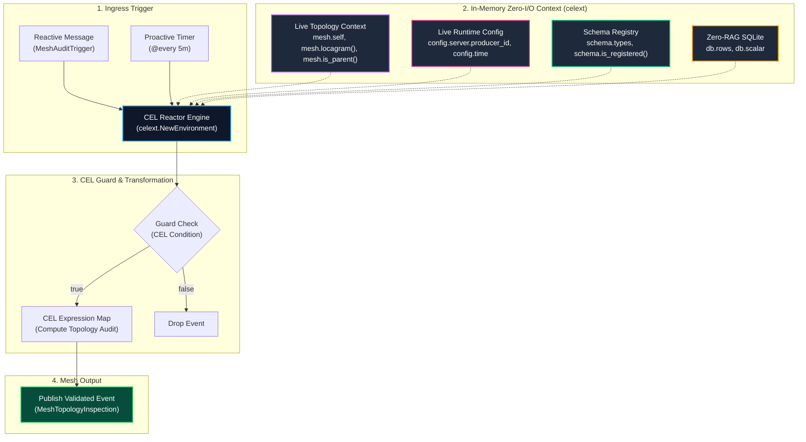

# Hands-On Tutorial: CEL & celext Extensions — Mesh Topology & Fleet Inspection 🧭⚡🛰️

Welcome to the **Google CEL & celext Extensions Tutorial** for Bindu! 

This guide demonstrates how to build intelligent, context-aware Event Processing Agents (EPAs) in Bindu without writing external scripts. By leveraging **Google Common Expression Language (CEL)** and Bindu's in-memory runtime extensions (**`pkg/celext`**), your edge nodes can dynamically introspect their **mesh topology**, inspect **system configurations**, verify **schema contracts**, and transform payloads in sub-microseconds with zero disk I/O.

---

## 1. 🌐 The Power of CEL & celext in Bindu

Standard CEL gives you sandboxed, deterministic mathematical and boolean transformations. Bindu's **`celext`** extension suite empowers your expressions with live runtime awareness:



---

## 2. 🧬 Step 1: Import the Tutorial Message Types

First, import the required schemas (`MeshAuditTrigger`, `MeshTopologyInspection`, and `MeshTopologyCloudSync`) into your Bindu mesh:

```bash
bindu-studio message-types import \
  --in-path ./public/console/docs/cleext-for-cle/poc_message_types.json \
  --auth console:StrongPass123 --all
```

### Schema Summary:
1. **`MeshAuditTrigger`** (`🛰️`): The trigger event carrying parameters such as `audit_level` (`STANDARD`, `DEEP`, `SECURITY`) and `check_compliance` (`boolean`).
   - **Retention**: `count: 1` — As an on-demand command trigger, it only requires the latest event in memory for real-time MAS evaluation.
2. **`MeshTopologyInspection`** (`🧭`): The comprehensive output audit event populated with node metadata, active plugins, parent ID, locagram, and a calculated health score.
   - **Retention**: `count: 10` — Bounded sliding window for real-time inspection state (respecting Bindu's MAS limit of $\le 100$ items).
3. **`MeshTopologyCloudSync`** (`☁️`): The cloud synchronization event emitted by the REST Call Reactor after enriching the inspection payload with upstream HTTP acknowledgment.
   - **Retention**: `count: 10` — Prevents feedback loops while tracking upstream synchronization status across the mesh.

> [!NOTE]
> **Real-Time MAS Principle**: Bindu is an edge Multi-Agent System designed for real-time decentralized decisions, not an analytical BI data warehouse. Historical long-term data belongs in external BI systems, which can feed aggregated models back into Bindu as message producers.

---

## 3. ⚡ Step 2: Deep-Dive into the CEL Reactor Configuration

The configuration file `poc_cel_reactor_config.json` defines two complementary reactors:

### A. Reactive Auditor (`mesh-topology-auditor`)
Triggered automatically whenever a `MeshAuditTrigger` arrives:

```json
{
  "reactor_id": "mesh-topology-auditor",
  "input_message_type": "MeshAuditTrigger",
  "output_message_type": "MeshTopologyInspection",
  "trigger_condition": "payload.check_compliance == true && mesh.self.id != '' && schema.is_registered('MeshTopologyInspection')",
  "transformation_expression": {
    "auditor_node_id": "mesh.self.id",
    "auditor_locagram": "mesh.locagram(mesh.self.id)",
    "is_root_gateway": "mesh.is_root(mesh.self.id)",
    "parent_gateway_id": "mesh.is_parent('root') ? 'root' : (mesh.self.is_root ? 'mesh-root' : 'mesh-isolated')",
    "active_plugins": "mesh.self.plugins",
    "runtime_producer": "config.server.producer_id",
    "runtime_log_level": "config.logging.level",
    "time_ntp_server": "config.time.ntp_server != '' ? config.time.ntp_server : 'system-local'",
    "schema_marine_registered": "schema.is_registered('RawMarineData')",
    "marine_schema_badge": "schema.is_registered('RawMarineData') ? schema.types['RawMarineData'].emoji : '⚠️'",
    "audit_summary": "'Node [' + mesh.self.id + '] at locagram ' + mesh.self.locagram + ' verified: parent=' + (mesh.is_parent('root') ? 'root' : (mesh.self.is_root ? 'self' : 'none')) + ', ntp=' + (config.time.ntp_server != '' ? config.time.ntp_server : 'local')",
    "health_score": "(mesh.self.id != '' ? 40 : 0) + (config.logging.level != '' ? 30 : 10) + (schema.is_registered('MeshTopologyInspection') ? 30 : 0)"
  }
}
```

### B. Proactive Sentinel (`proactive-mesh-sentinel`)
Runs on a cron schedule (`@every 5m`) combining **Zero-RAG SQLite hydration** (`db.scalar`) with live topology metadata:

```json
{
  "reactor_id": "proactive-mesh-sentinel",
  "input_message_type": "",
  "cron": "@every 5m",
  "output_message_type": "MeshTopologyInspection",
  "context_query": "SELECT COUNT(*) AS total_messages FROM v_messages",
  "trigger_condition": "mesh.self.id != '' && schema.is_registered('MeshTopologyInspection')",
  "transformation_expression": {
    "auditor_node_id": "mesh.self.id",
    "auditor_locagram": "mesh.locagram(mesh.self.id)",
    "is_root_gateway": "mesh.is_root(mesh.self.id)",
    "parent_gateway_id": "mesh.is_parent('root') ? 'root' : (mesh.self.is_root ? 'mesh-root' : 'mesh-isolated')",
    "active_plugins": "mesh.self.plugins",
    "runtime_producer": "config.server.producer_id",
    "runtime_log_level": "config.logging.level",
    "time_ntp_server": "config.time.ntp_server != '' ? config.time.ntp_server : 'system-local'",
    "schema_marine_registered": "schema.is_registered('RawMarineData')",
    "marine_schema_badge": "schema.is_registered('RawMarineData') ? schema.types['RawMarineData'].emoji : '⚠️'",
    "audit_summary": "'Proactive Sentinel on [' + mesh.self.id + ']: ' + string(db.scalar) + ' total messages processed in local SQLite database'",
    "health_score": "(mesh.self.id != '' ? 50 : 0) + (has(db.rows) && size(db.rows) > 0 ? 50 : 20)"
  }
}
```

---

## 4. 🌐 Step 3: Deep-Dive into the REST Reactor Bridge

In `poc_rest_reactor_config.json`, the REST Call Reactor consumes the local audit event (`MeshTopologyInspection`) and emits a distinct downstream synchronization event (`MeshTopologyCloudSync`), preventing recursive feedback loops while bridging edge telemetry to cloud endpoints.

It demonstrates how `celext` enables dynamic URL path generation and HTTP request header injection based on node topology:

* **Pipeline Flow**: `MeshTopologyInspection` ➔ **REST Call Bridge** ➔ `MeshTopologyCloudSync`
* **Dynamic URL Target** (using `httpbin.org` for functional live testing):
  ```javascript
  'https://httpbin.org/anything/fleet/nodes' + (mesh.self.locagram == '/' ? '' : mesh.self.locagram) + '/inspection'
  ```
* **Dynamic Origin Headers**:
  ```json
  "headers": {
    "X-Producer-Origin": "config.server.producer_id",
    "X-Mesh-Root": "mesh.root_id",
    "X-Schema-Version": "schema.types['MeshTopologyInspection'].version"
  }
  ```
* **Response Mapping with Cloud Acknowledgment**:
  ```javascript
  resp.status_code == 200 ? ('Cloud ack: ' + string(payload.audit_summary)) : ('Local fallback: ' + string(payload.audit_summary))
  ```

---

## 5. 🚀 Step 4: Validate and Deploy the Reactors

### 1. Validate Configurations Offline
Before sending configurations to running nodes, validate the CEL syntax and schemas locally:

```bash
# Validate CEL Reactor
bindu-studio cel-reactor validate \
  --file ./public/console/docs/cleext-for-cle/poc_cel_reactor_config.json

# Validate REST Reactor
bindu-studio rest-reactor validate \
  --file ./public/console/docs/cleext-for-cle/poc_rest_reactor_config.json
```

### 2. Deploy to the Mesh
Merge and deploy the reactor configurations to your target node:

```bash
# Merge into active CEL reactors on root node
bindu-studio cel-reactor merge \
  --file ./public/console/docs/cleext-for-cle/poc_cel_reactor_config.json \
  --auth console:StrongPass123 --yes
```

---

## 6. 🧪 Step 5: Simulate and Observe the Execution

Run the provided simulation script to trigger the audit event via MQTT:

```bash
./public/console/docs/cleext-for-cle/simulate_audit.sh
```

### Expected Output Payload:
```json
{
  "$type": "MeshTopologyInspection",
  "$producer": "node-dell-2",
  "$when": "2026-09-12T12:00:00Z",
  "fields": {
    "auditor_node_id": "node-dell-2",
    "auditor_locagram": "/galicia-dell-2",
    "is_root_gateway": false,
    "parent_gateway_id": "root",
    "active_plugins": [
      "hello-world-plugin",
      "bindu-cv"
    ],
    "runtime_producer": "node-dell-2",
    "runtime_log_level": "INFO",
    "time_ntp_server": "pool.ntp.org",
    "schema_marine_registered": true,
    "marine_schema_badge": "🌊",
    "audit_summary": "Node [node-dell-2] at locagram /galicia-dell-2 verified: parent=root, ntp=pool.ntp.org",
    "health_score": 100
  }
}
```

---

## 📚 7. Master CEL & celext Reference Cheat-Sheet

| Context Variable / Function | Return Type | Description |
| :--- | :--- | :--- |
| `mesh.local_id` | `string` | Local node identifier (`"node-dell-2"`). |
| `mesh.root_id` | `string` | Root gateway node identifier (`"root"`). |
| `mesh.self.id` | `string` | Local node ID. |
| `mesh.self.locagram` | `string` | Hierarchical locagram path (`"/galicia-dell-2"`). |
| `mesh.self.is_root` | `bool` | `true` if node is root gateway. |
| `mesh.self.connectivity_kind` | `string` | Node kind (`"gateway"`, `"reference"`). |
| `mesh.self.plugins` | `list(string)` | List of active plugins on this node. |
| `mesh.locagram(node_id)` | `string` | Resolves locagram for any node ID. |
| `mesh.is_parent(node_id)` | `bool` | `true` if `node_id` is parent of local node. |
| `mesh.is_root(node_id)` | `bool` | `true` if `node_id` is mesh root. |
| `mesh.has_plugin(node_id, plugin)` | `bool` | `true` if node runs specified plugin. |
| `config.server.producer_id` | `string` | Configured producer ID from `binduConfig.json`. |
| `config.server.description` | `string` | Descriptive name of node/server. |
| `config.logging.level` | `string` | System logging level (`"DEBUG"`, `"INFO"`, etc.). |
| `config.time.ntp_server` | `string` | Configured NTP time sync server. |
| `config.maintenance_cron` | `string` | Active maintenance schedule. |
| `config.maintenance_reset` | `bool` | Automated post-maintenance service reset toggle (`true`/`false`). |
| `schema.types[type].emoji` | `string` | Emojis / visual contract badge of MessageType. |
| `schema.types[type].version` | `string` | Semantic schema version string. |
| `schema.is_registered(type)` | `bool` | `true` if MessageType is active in registry. |
| `schema.has_property(type, prop)` | `bool` | `true` if property is declared on MessageType. |
| `db.rows` | `list(object)` | SQLite rows from `context_query` (`db.rows[0].fields.col`). |
| `db.scalar` | `any` | First scalar value from `context_query` first row. |
