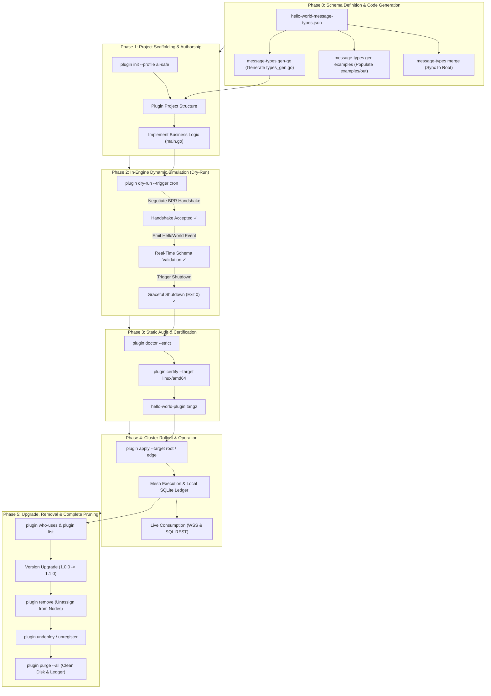

# Master Tutorial Plan: End-to-End BPR Plugin Lifecycle (Hello World)

> **Audience**: BPR Plugin Developers, Multi-Agent System (MAS) Solution Creators, and Autonomous AI System Agents.  
> **Scope**: Canonical & Pedagogical Specification of the Complete Lifecycle of a Binary Plugin Runtime (BPR) Plugin on the Bindu Platform.

---

## 1. Executive Summary & Educational Objectives

The **Hello World Tutorial** serves as the foundational, canonical reference for developing external plugins on the Bindu Platform. Its purpose is to demonstrate—in a clean, reproducible, and verifiable manner—how to design, generate, verify, package, deploy, update, and prune a native **Binary Plugin Runtime (BPR)** plugin interacting with the mesh cluster.

### Technical & Pedagogical Goals
1. **Schema-First Engineering (Level 0)**:
   - Declare formal message types and contracts in [`hello-world-message-types.json`](./hello-world-message-types.json).
   - Use `bindu-studio message-types gen-examples` to automatically populate `examples/out/` with compliant mock JSON messages.
   - Use `bindu-studio message-types gen-go` to generate strongly-typed Go structures ([`types_gen.go`](./hello-world-plugin/types_gen.go)), eliminating human typo errors (`SCHEMA_INVALID`).
2. **Standardized Scaffolding & Authorship (Level 1)**:
   - Scaffold new projects using `bindu-studio plugin init` with the `ai-safe` profile and `hello-world-dual-cron` template.
   - Understand the [`plugin.json`](./hello-world-plugin/plugin.json) manifest contract, including input triggers, output types, and multi-cron schedules (`cron` and `cron.2`).
3. **In-Engine Dynamic Simulation (Level 2 - Dry-Run)**:
   - Execute `bindu-studio plugin dry-run` in-process against the plugin source code.
   - Inject schedule triggers (`cron`) and verify real-time emission of `HelloWorld` telemetry.
   - Validate that emitted payloads pass strict schema validation against the cluster catalog before creating any deployment bundles.
   - Verify graceful process shutdown (`Exit Code: 0`) and proper handling of stdin EOF / shutdown signals.
4. **Static Sanity Audit & Multi-Architecture Certification (Level 3)**:
   - Run `bindu-studio plugin doctor` for project consistency and contract compliance.
   - Package production-grade `.tar.gz` distribution bundles using `bindu-studio plugin certify`.
5. **Cluster Rollout & Telemetry Consumption (Level 4)**:
   - Deploy plugins directly to the central root (`plugin apply`) or distribute across edge gateways using the OTA Runtime Triptych (`baseline accept` $\rightarrow$ `desired commit` $\rightarrow$ `update wizard`).
   - Consume live telemetry in a standalone Single Page Application ([`hello-world-spa`](./hello-world-spa)) via WebSockets (WSS) and read-only SQL queries over REST (`/api/v1/messages/sql`).
6. **Advanced Lifecycle: In-Place Updates, Decommissioning & Deep Purge (Level 5 - Teardown)**:
   - Perform seamless in-place version upgrades (`1.0.0` $\rightarrow$ `1.1.0`) with zero cluster downtime.
   - Inspect cluster usage with `plugin who-uses` and `plugin list`.
   - Execute the complete teardown cadence: node unassignment (`plugin remove`), cluster undeployment (`plugin undeploy`), candidate unregistration (`plugin unregister`), and physical artifact cache pruning (`plugin purge --all`).

---

## 2. Complete Lifecycle Architecture & Flow



---

## 3. Message Types & Semantic Contract Matrix

The tutorial employs 3 discrete message archetypes defined in [`hello-world-message-types.json`](./hello-world-message-types.json):

| Message Type | Direction & Routing | Retention Policy | Description & Operational Purpose |
| :--- | :--- | :--- | :--- |
| **`HelloWorldConfig`** | Top-Down (`local`, `child`) | `count: 1` | Downstream configuration envelope containing `greeting_text`. Allows operators to dynamically change the greeting at runtime without restarting the plugin process. |
| **`HelloWorld`** | Bottom-Up (`local`, `parent`) | `count: 1`, `PT1H` | Real-time telemetry emitted periodically containing the current `greeting`. Driven by the primary `cron` trigger (e.g. every 2 or 5 minutes). |
| **`HelloWorldStats`** | Bottom-Up (`local`, `parent`) | `count: 1`, `PT6H` | Aggregated metrics calculated via read-only SQL queries over the local SQLite ledger (`count`, `since`, `until`). Driven by the secondary `cron.2` trigger (e.g. every 15 minutes). |

---

## 4. Artifact Inventory

```text
public/console/docs/hello-world-tutorial/
├── tutorial-plan.md                 # Master Lifecycle Specification (this document)
├── tutorial_guide.md                # Step-by-Step Developer Walkthrough with exact CLI commands
├── hello-world-message-types.json   # JSON Schema definitions for all 3 message types
├── poc_dashboards.json              # Console Dashboard definitions for greeting metrics
├── deploy_plugin_lifecycle.sh       # Automated, end-to-end executable lifecycle runner
├── hello-world-plugin/              # BPR Go Plugin Project
│   ├── plugin.json                  # Manifest declaring inputs, outputs, and schedules
│   ├── main.go                      # Core Go runtime implementing the BPR SDK contract
│   ├── types_gen.go                 # Strongly-typed Go structs generated by message-types gen-go
│   ├── go.mod                       # Go module dependencies
│   ├── examples/                    # Validated envelope fixtures
│   │   ├── in/                      # Mock input payloads (HelloWorldConfig.json)
│   │   └── out/                     # Mock output payloads (HelloWorld.json, HelloWorldStats.json)
│   └── sdk/                         # BPR Transport and Context bindings
└── hello-world-spa/                 # Standalone Single Page Application
    ├── index.html                   # Interactive browser UI with Leaflet geographic maps
    ├── app.js                       # Real-time WebSocket subscriber & REST SQL client
    ├── styles.css                   # Glassmorphic layout styling
    └── queries/                     # Production SQL queries for v_messages ledger
```

---

## 5. Detailed Step-by-Step Milestones

### Milestone 0: Semantic Schema Registry & Code Generation
1. **Schema Synchronization**:
   ```bash
   bindu-studio message-types merge \
     --config ./hello-world-message-types.json \
     --all \
     --auth console:StrongPass123
   ```
2. **Fixture Generation (`gen-examples`)**:
   Automatically populate `examples/out/` with compliant mock envelopes derived directly from the JSON schemas:
   ```bash
   bindu-studio message-types gen-examples \
     --config ./hello-world-message-types.json \
     --out ./hello-world-plugin/examples/out
   ```
3. **Strongly-Typed Go Generation (`gen-go`)**:
   Compile JSON schemas into Go structs with helper serializers:
   ```bash
   bindu-studio message-types gen-go \
     --config ./hello-world-message-types.json \
     --out ./hello-world-plugin/types_gen.go \
     --package main
   ```

### Milestone 1: Plugin Scaffolding & Business Logic Implementation
1. **Scaffold Generation**:
   ```bash
   bindu-studio plugin init \
     --profile ai-safe \
     --template hello-world-dual-cron \
     --id hello-world-plugin \
     --outdir ./hello-world-scaffold
   ```
2. **Type Binding in `main.go`**:
   Import generated structs (`HelloWorldFields`, `HelloWorldStatsFields`) inside `OnTrigger()` and `OnEvent()`.

### Milestone 2: In-Process Dynamic Simulation (`plugin dry-run`)
Execute the plugin binary in-process using the real BPR supervisor engine:
```bash
bindu-studio plugin dry-run \
  --source ./hello-world-plugin \
  --config ./hello-world-message-types.json \
  --trigger cron \
  --timeout 4s
```
**Verification Assertions**:
* Mutual security token handshake verified within 5 seconds.
* `cron` stimulus successfully delivered over stdin.
* `HelloWorld` event captured over stdout and validated against `hello-world-message-types.json`.
* Stdin EOF / shutdown signal handled gracefully with `Exit Code: 0`.

### Milestone 3: Project Audit & Multi-Architecture Packaging
1. **Project Sanity Audit**:
   ```bash
   bindu-studio plugin doctor --source ./hello-world-plugin --strict
   ```
2. **Multi-Target Bundling**:
   ```bash
   bindu-studio plugin certify \
     --source ./hello-world-plugin \
     --out ./hello-world-plugin.tar.gz \
     --target linux/amd64
   ```

### Milestone 4: Cluster Rollout & Application Consumption
1. **Direct Root Deployment**:
   ```bash
   bindu-studio plugin apply \
     --bundle ./hello-world-plugin.tar.gz \
     --target root \
     --auth console:StrongPass123
   ```
2. **Mesh Edge Rollout (OTA Triptych)**:
   For remote edge gateways, commit the desired state:
   ```bash
   bindu-studio runtime baseline accept --yes
   bindu-studio runtime desired commit --note "Rollout hello-world-plugin v1.0.0"
   bindu-studio runtime update wizard --yes --auth console:StrongPass123
   ```
3. **SPA Dashboard Verification**:
   Launch `hello-world-spa/index.html` to confirm live WebSocket streaming and historical SQL query rendering.

### Milestone 5: Full Lifecycle Maintenance, Update & Deep Pruning
1. **Cluster Inspection**:
   ```bash
   bindu-studio plugin who-uses --plugin hello-world-plugin
   bindu-studio plugin list
   ```
2. **Seamless Version Upgrade (`1.0.0` $\rightarrow$ `1.1.0`)**:
   Bump version in `plugin.json`, re-certify, and re-apply without downtime.
3. **Unassignment & Decommissioning**:
   ```bash
   # Remove from target node
   bindu-studio plugin remove --plugin hello-world-plugin --target root --yes

   # Undeploy bundle from cluster registry
   bindu-studio plugin undeploy --plugin hello-world-plugin --yes
   ```
4. **Deep Cache & Artifact Pruning**:
   ```bash
   bindu-studio plugin purge --plugin hello-world-plugin --all --yes
   ```
   *Guarantee*: Completely wipes all `.tar.gz` bundle archives, staged candidates, and runtime artifacts from cluster disks.

---

## 6. Success Metrics & Reliability Guarantees

1. **Zero Runtime Schema Errors**: Using `gen-go` + `gen-examples` + `plugin dry-run` eliminates `SCHEMA_INVALID` and `UNKNOWN_TYPE` errors prior to production deployment.
2. **Clean Lifecycle Accounting**: Post-purge verification ensures zero orphaned processes, sockets, or SQLite metadata rows remain on cluster nodes.
3. **Deterministic Multi-Agent Execution**: AI coding agents following this plan can independently build, verify, deploy, and decommission plugins without manual intervention.
