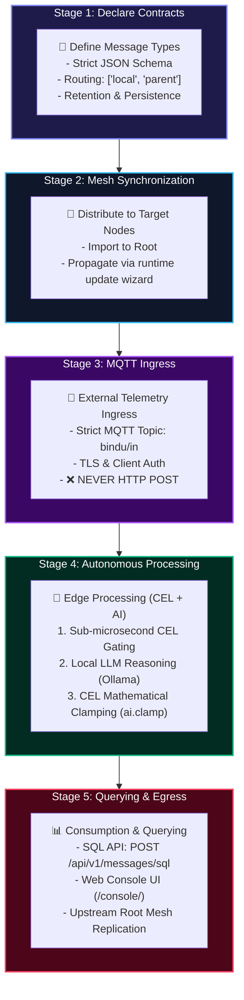

# 🏗️ How to Build an End-to-End Bindu Solution
### The Canonical Blueprint for Solutions Architects, Developers, and AI Agents

Welcome to the **Bindu Solutions Architecture Guide**.

Whether you are a human developer, an IoT systems architect, or an **autonomous AI coding agent**, this document defines the exact, non-negotiable contract for creating, deploying, ingesting, reasoning over, and querying data within the **Bindu Sovereign Edge AI Fabric**.

---

## 🧭 The 5-Stage Solution Lifecycle

Every solution built on Bindu follows a strict 5-stage pipeline:



---

## 🚫 The "Never Do" List for AI Agents & Integrators

> [!CAUTION]
> **CRITICAL ARCHITECTURAL GUARDRAILS:**
> 1. **❌ NEVER use HTTP POST for event ingestion:** Bindu does **NOT** expose `/api/v1/publish`, `/api/v1/events`, or `/api/v1/telemetry`. All external event ingress enters strictly through the **MQTT broker** (`bindu/in`).
> 2. **❌ NEVER deploy an AI Reactor to a node before synchronizing its Message Types:** Edge nodes validate incoming reactor configurations against their local in-memory registry. If the schema is missing on that node, the reactor is rejected with `REACTOR_CONFIG_INVALID`.
> 3. **❌ NEVER omit CEL output clamping:** Raw LLM outputs are non-deterministic and can hallucinate out-of-bounds floats (e.g., `1.35` for a $[0.0, 1.0]$ probability). Always bound numerical values using `ai.clamp(double(resp.field), min, max)` in the `mapping_template`.
> 4. **❌ NEVER invent envelope metadata:** All incoming events must strictly follow the Bindu Message Envelope with `$type`, `$id`, `$when`, `$where`, `$producer`, `$user`, and `$group: "mesh"`.
> 5. **❌ NEVER deploy artifacts without offline CLI validation:** In Bindu, declarative JSON files are source code. Always run `bindu-studio <artifact> validate`, `bindu-studio plugin certify --dry-run`, and `bindu-studio solution validate --strict` as a mandatory preflight compilation step.

---

## 0. 🚀 Stage 0: Initialize Solution Workspace & Launch AI Agent

Before creating schemas or writing configuration files, you must establish an isolated solution workspace:

> [!IMPORTANT]
> **Workspace Isolation Rule:**  
> **NEVER** build your solution inside the Bindu engine directory (`/opt/bindu/root/` or `~/.bindu/root/`).  
> Create an independent, dedicated Git repository for your Multi-Agent System (MAS) solution.

### Day 1 Quickstart Setup:
```bash
# 1. Expose bindu-studio globally in your PATH
sudo ln -sf /opt/bindu/root/bin/bindu-studio /usr/local/bin/bindu-studio

# 2. Initialize your isolated solution repository
mkdir -p ~/solutions/my-mas-solution && cd ~/solutions/my-mas-solution
git init

# 3. Launch your AI Software Agent (Antigravity 'agy', Gemini, Claude, Cursor)
agy   # or open in your IDE: code .
```

*For complete Day 1 procedures, onboarding prompts, and topology options, consult the canonical [Bindu Day 1 — Solution Workspace and AI Agent Setup Guide](./Bindu%20Day%201%20%E2%80%94%20Solution%20Workspace%20and%20AI%20Agent%20Setup%20Guide.md).*

### 📚 The Golden Reference Archetype Library

Before authoring contracts from scratch, inspect the working reference implementations in `public/console/docs/*-tutorial/`. Using an existing archetype as a starting point eliminates errors, prevents hallucination by AI coding agents, and provides battle-tested templates:

* **Baseline MAS Lifecycle**: [`mas-complete-lifecycle-tutorial/`](./mas-complete-lifecycle-tutorial/) & [`mas-solution-tutorial/`](./mas-solution-tutorial/) — All 6 artifacts, BPR plugin, CEL, AI, REST, and deploy/purge scripts.
* **Industrial Control & PLCs (Modbus)**: [`potato-processing-pipeline-tutorial/`](./potato-processing-pipeline-tutorial/) — Full factory pipeline: ingress $\to$ CEL $\to$ AI prediction $\to$ Modbus PLC dispatch.
* **Edge Computer Vision & Multimodal SLM**: [`edge-cv-tutorial/`](./edge-cv-tutorial/) — Multicamera streaming, local SLM/YOLO inference via BPR plugins, and semantic event bridging.
* **Cognitive Semantic AI Reasoning**: [`semantic-ai-reactor-tutorial/`](./semantic-ai-reactor-tutorial/) — Cold-chain monitoring with Ollama / TypeSafe, dynamic context hydration (`state`), and System-1 questions.
* **High-Frequency Sensor Ingress (RFID/EPC)**: [`rfid-epc-tutorial/`](./rfid-epc-tutorial/) — Massive EPC tag ingestion, sliding-window retention (`count: 100`), and sensor deduplication.
* **BLE Beacons & Telemetry**: [`ble-tutorial/`](./ble-tutorial/) — Bluetooth Low Energy sensor integration, binary packet parsing, and proximity routing.
* **Mining & Heavy Asset Health (CBM)**: [`mining-heavy-equipment-tutorial/`](./mining-heavy-equipment-tutorial/) — Non-invasive bolt-on BLE triaxial vibration telemetry, drive-by ring buffer timeline reconstruction, Crest Factor + Kurtosis CEL gating, and SLM predictive maintenance orders.
* **Airborne Forestry & Carbon Auditing**: [`amazon-suzano-carbon-tutorial/`](./amazon-suzano-carbon-tutorial/) — Autonomous drone data-mule fly-by harvesting, sub-canopy solar BLE sentinel stations, stoichiometric CEL Horn clauses, and verifiable ESG proof trees for 1.6M hectares.
* **Declarative REST Webhooks**: [`rest-reactor-tutorial/`](./rest-reactor-tutorial/) — Zero-code HTTP/REST egress bridges to enterprise ERPs/CRMs triggered by ledger events.
* **Critical Alerts & Email BPR**: [`system-email-bpr-tutorial/`](./system-email-bpr-tutorial/) — Secure SMTP delivery via BPR plugin when CEL detects critical operational anomalies.
* **Object Storage & Retention**: [`media-storage-tutorial/`](./media-storage-tutorial/) & [`cleanup`](./media-storage-cleanup-tutorial/) — MinIO/S3 photo evidence lifecycle and automated pruning.

---

## 1. 📜 Stage 1: Declare Data Contracts (`Message Types`)

In Bindu, nothing happens without an explicit semantic contract. Create a JSON file (e.g., `my_solution_message_types.json`) declaring:
1. **The Ingress Telemetry Message** (Physical fact from sensor/device).
2. **The Intelligence / Response Message** (Derived fact produced by the AI reactor).

### Canonical Example:
```json
{
  "message_types": [
    {
      "name": "SensorTelemetryReading",
      "description": "Physical sensor readings from industrial field equipment",
      "emoji": "🌡️",
      "version": "1.0.0",
      "persist": true,
      "retentionMode": "count",
      "retentionValue": 50,
      "routing": [
        "local",
        "parent"
      ],
      "properties": [
        {
          "name": "device_id",
          "type": "string",
          "required": true,
          "description": "Unique hardware device identifier"
        },
        {
          "name": "temperature_c",
          "type": "number",
          "required": true,
          "description": "Measured ambient temperature in Celsius"
        },
        {
          "name": "pressure_bar",
          "type": "number",
          "required": true,
          "description": "Hydraulic pressure in bar"
        }
      ]
    },
    {
      "name": "OperationalHealthAdvisory",
      "description": "Autonomous risk evaluation produced by Semantic AI Reactor",
      "emoji": "🧠",
      "version": "1.0.0",
      "persist": true,
      "retentionMode": "count",
      "retentionValue": 20,
      "routing": [
        "local",
        "parent"
      ],
      "properties": [
        {
          "name": "device_id",
          "type": "string",
          "required": true,
          "description": "Target equipment identifier"
        },
        {
          "name": "failure_probability",
          "type": "number",
          "required": true,
          "description": "Calculated failure probability clamped between 0.0 and 1.0"
        },
        {
          "name": "emergency_shutdown",
          "type": "boolean",
          "required": true,
          "description": "True if immediate safety cutoff is required"
        },
        {
          "name": "action_summary",
          "type": "string",
          "required": true,
          "description": "LLM generated maintenance recommendation"
        }
      ]
    }
  ]
}
```

### 🎯 The Routing Rules:
* `["local", "parent"]`: **Standard for edge telemetry & AI output.** Evaluates locally on the edge node, persists locally, and replicates up to Root for central monitoring.
* `["local", "child"]`: **Standard for central commands.** Sent by Root to cascade down to all edge child nodes.

---

## 2. 🔄 Stage 2: Mesh Deployment & Node Synchronization

In a distributed mesh (Root + Node-1 + Remote Gateways), the Message Types must be loaded into the registry of the nodes where the reactor will run.

### Step-by-Step CLI Commands:
```bash
# 1. Import schemas into Root
bindu-studio message-types import \
  --in-path ./my_solution_message_types.json \
  --auth console:StrongPass123 --all

# 2. Sync and commit desired baseline to Edge Nodes
bindu-studio runtime baseline accept --yes --note "sync solution schemas"
bindu-studio runtime desired commit --note "commit solution schemas"
bindu-studio runtime update wizard --nodes "node-1" --yes --auth console:StrongPass123
```

*(In local development / E2E environments, you can also copy `messageTypesConfiguration.json` directly to `<node_dir>/runtime/config/` and restart the node service).*

---

## 3. 📡 Stage 3: Event Ingress (Strictly MQTT)

External devices, edge daemons, or simulation scripts send events into Bindu by establishing an **MQTT client connection** to the node's `mqtt_integration` broker port (defined in `mesh.json`).

### Standard Bindu Message Envelope:
```json
{
  "$id": "evt-unique-uuid-1234",
  "$type": "SensorTelemetryReading",
  "$when": "2026-09-13T12:00:00Z",
  "$producer": "sensor-station-alpha",
  "$user": "console",
  "$group": "mesh",
  "$where": {
    "locagram": "/plant-madrid/line-1"
  },
  "fields": {
    "device_id": "PUMP-401",
    "temperature_c": 94.5,
    "pressure_bar": 18.2
  }
}
```

### Canonical Go Publisher Template (`publish_event.go`):
```go
package main

import (
	"crypto/tls"
	"encoding/json"
	"fmt"
	"time"
	mqtt "github.com/eclipse/paho.mqtt.golang"
)

func PublishBinduEvent(host string, port int, user, pass, topic string, event map[string]any) error {
	opts := mqtt.NewClientOptions()
	opts.AddBroker(fmt.Sprintf("ssl://%s:%d", host, port))
	opts.SetTLSConfig(&tls.Config{InsecureSkipVerify: true})
	opts.SetUsername(user)
	opts.SetPassword(pass)
	opts.SetClientID(fmt.Sprintf("bindu-pub-%d", time.Now().UnixNano()))

	client := mqtt.NewClient(opts)
	if token := client.Connect(); token.Wait() && token.Error() != nil {
		return fmt.Errorf("MQTT connect failed: %w", token.Error())
	}
	defer client.Disconnect(250)

	payload, _ := json.Marshal(event)
	token := client.Publish(topic, 1, false, payload)
	token.Wait()
	return token.Error()
}
```

---

## 4. 🧠 Stage 4: Autonomous Processing with CEL & Edge AI

Deploy the **Semantic AI Reactor** to orchestrate local LLMs (via Ollama or llama.cpp) safely with **Google CEL**:

```json
{
  "$type": "AISemanticReactorSet",
  "$node-dest": "node-1",
  "$group": "mesh",
  "$producer": "root",
  "$user": "admin",
  "$when": "2026-09-13T12:00:00Z",
  "fields": {
    "gateway_node_id": "node-1",
    "reactors": [
      {
        "reactor_id": "pump-failure-predictor",
        "api_endpoint": "http://localhost:11434/v1/chat/completions",
        "model_id": "qwen2.5-coder:0.5b",
        "max_concurrency": 1,
        "trigger_message_types": [
          "SensorTelemetryReading"
        ],
        "trigger_condition": "payload.temperature_c > 85.0 || payload.pressure_bar > 15.0",
        "response_message_type": "OperationalHealthAdvisory",
        "confidence_threshold": 0.75,
        "mapping_template": {
          "device_id": "has(resp.device_id) && resp.device_id != '' ? string(resp.device_id) : string(payload.device_id)",
          "failure_probability": "ai.clamp(ai.default(double(resp.failure_probability), 0.5), 0.0, 1.0)",
          "emergency_shutdown": "bool(resp.emergency_shutdown)",
          "action_summary": "string(resp.action_summary)"
        },
        "system_instruction": "You are a mechanical reliability engineer AI. Output strictly valid JSON conforming to OperationalHealthAdvisory.",
        "semantic_prompt_template": "Analyze telemetry for device '{{index .trigger_event \"device_id\"}}': Temp={{index .trigger_event \"temperature_c\"}}°C, Pressure={{index .trigger_event \"pressure_bar\"}} bar.\n\nOutput JSON matching:\n{\n  \"device_id\": \"PUMP-401\",\n  \"failure_probability\": 0.88,\n  \"emergency_shutdown\": true,\n  \"action_summary\": \"Critical overheating detected.\"\n}"
      }
    ]
  }
}
```

### 🛡️ Why the 3-Step CEL Pipeline is Essential:
1. **Pre-Inference Gating (`trigger_condition`)**: Evaluates `payload.temperature_c > 85.0` in $<1\mu\text{s}$. If nominal, the LLM is skipped, saving 100% GPU memory.
2. **Deterministic Context Fallback**: If LLM forgets `device_id`, CEL smoothly extracts it from `payload.device_id`.
3. **Mathematical Interval Clamping**: `ai.clamp(double(resp.failure_probability), 0.0, 1.0)` guarantees mathematical safety against LLM hallucinations.

---

## 5. 📊 Stage 5: Querying & Observability (Egress)

Once events are ingested and processed, they are stored in Bindu's embedded database and replicated to Root.

### Querying via REST SQL API:
Bindu exposes an enterprise-grade SQL query endpoint at `POST https://<root-ip>:38450/api/v1/messages/sql` (or `http://127.0.0.1:38080/api/v1/messages/sql`):

```bash
curl -k -u console:StrongPass123 \
  -X POST "https://127.0.0.1:38450/api/v1/messages/sql" \
  -H "Content-Type: application/json" \
  -d '{
    "sql": "SELECT \"$id\", \"$type\", \"$producer\", \"$when\", fields FROM v_messages WHERE \"$type\" = '\''OperationalHealthAdvisory'\'' ORDER BY \"$when\" DESC LIMIT 10"
  }'
```

**JSON Response:**
```json
{
  "success": true,
  "message": "OK",
  "details": {
    "columns": ["$id", "$type", "$producer", "$when", "fields"],
    "rows": [
      {
        "$id": "adv-9a8b7c6d",
        "$type": "OperationalHealthAdvisory",
        "$producer": "node-1",
        "$when": "2026-09-13T22:48:55Z",
        "fields": "{\"action_summary\":\"Critical overheating detected.\",\"device_id\":\"PUMP-401\",\"emergency_shutdown\":true,\"failure_probability\":0.88}"
      }
    ]
  }
}
```

---

## 🤖 AI Agent Verification Checklist

Before generating code or configuration for Bindu, verify these 6 points:

- [ ] **1. Ingress**: Is telemetry sent via MQTT to `bindu/in` (and NOT HTTP POST)?
- [ ] **2. Routing**: Are edge message types configured with `"routing": ["local", "parent"]`?
- [ ] **3. Envelope**: Does every payload contain `$type`, `$id`, `$when`, `$where`, `$producer`, `$user`, `$group: "mesh"`, and `fields: {...}`?
- [ ] **4. Clamping**: Are all numerical LLM outputs bounded with `ai.clamp()` in `mapping_template`?
- [ ] **5. Mesh Sync**: Are message types imported and committed to the target node prior to reactor deployment?
- [ ] **6. Query**: Are queries directed to `/api/v1/messages/sql` using `{"sql": "..."}`?

Following this blueprint guarantees zero runtime crashes, instant schema validation, and flawless end-to-end sovereign edge execution! 🍇⚡🛡️
