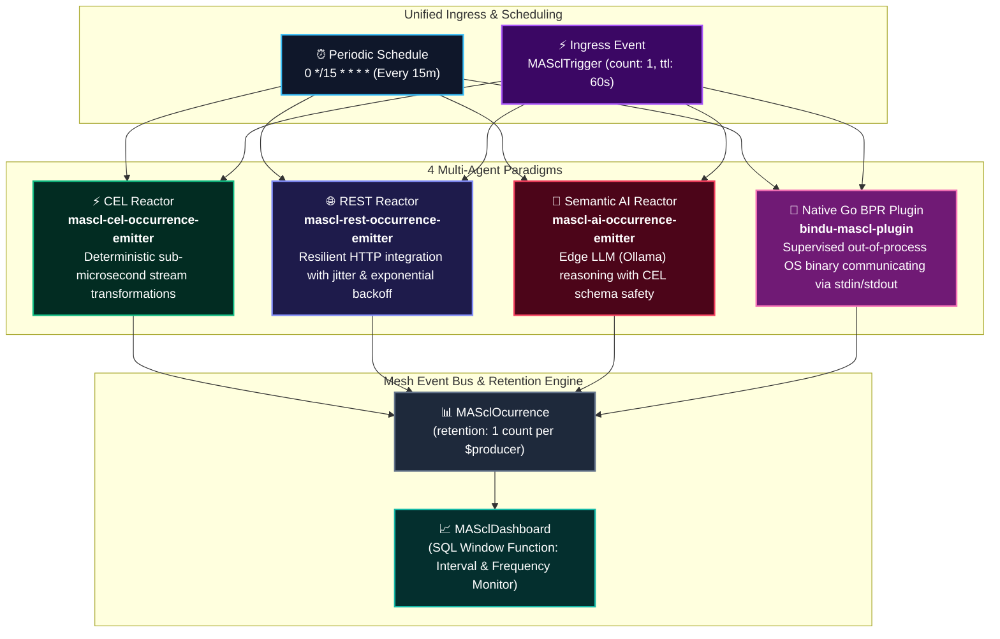
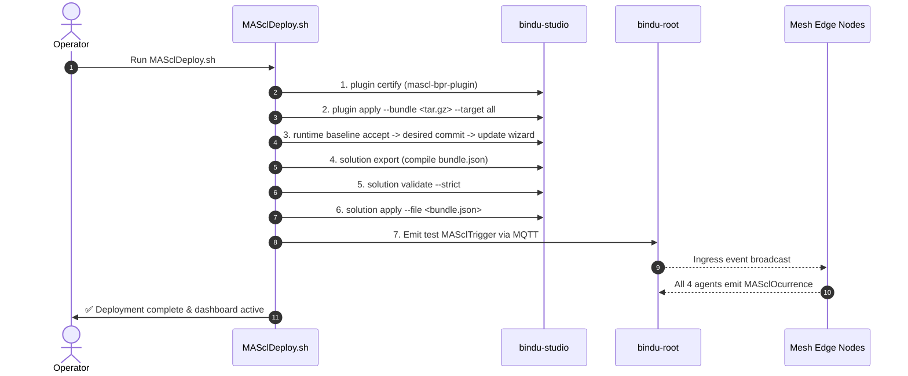
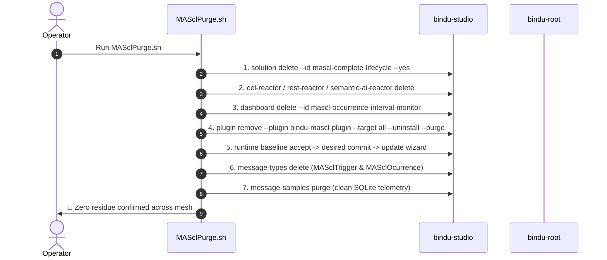

# Hands-On Tutorial: Multi-Agent System (MAS) Complete Lifecycle — 4-Paradigm Fleet Deployment & Zero-Residue Purge 🚀🔄⚡

Welcome to the **Multi-Agent System (MAS) Complete Lifecycle Tutorial** for Bindu!

In this tutorial, you will master the full lifecycle of a distributed Multi-Agent System operating across a multi-node Bindu mesh. You will deploy, validate, monitor, and cleanly purge a synchronized fleet comprising **all 4 agent paradigms supported by Bindu**:

1. ⚡ **Declarative Stream Processing**: Google CEL Reactor (`CELReactorSet`)
2. 🌐 **External Webhook & API Bridge**: REST Call Reactor (`RESTReactorSet`)
3. 🧠 **Autonomous Edge Cognition**: Semantic AI Reactor (`AISemanticReactorSet`)
4. 🦀 **High-Performance Native Worker**: Bindu Plugin Runtime (`bindu-mascl-plugin` Go BPR Plugin)

---

## 1. 🏗️ The 4 Multi-Agent Paradigms & Unified Contract

Bindu enables operators and AI orchestrators to choose the exact runtime model best suited for each task without sacrificing unified governance, schema enforcement, or event telemetry.



### The Unified Execution Contract:
* **Periodic Cron Execution**: Every 15 minutes (`0 */15 * * * *`).
* **Reactive Event Execution**: Upon receiving the universal trigger message **`MASclTrigger`**.
* **Output Occurrence**: All 4 agents emit **`MASclOcurrence`** with their corresponding `agent_type` (`CEL`, `REST`, `AI`, `BPR`), execution mode (`CRON` or `TRIGGER`), latency, and execution metadata.
* **Mesh Fleet Scope**: Agents are distributed across **all configured nodes** in the active root mesh (e.g. `root`, `node-1`).

---

## 2. 📦 Solution Artifacts Specification

The tutorial contains all required definitions self-contained in `public/console/docs/mas-complete-lifecycle-tutorial/`:

| Artifact File | Entity Type | Purpose |
| :--- | :--- | :--- |
| [`poc_message_types.json`](./poc_message_types.json) | `MessageType` Registry | Defines `MASclTrigger` (retention: 1 count, ttl: 60s) and `MASclOcurrence` (retention: 1 count). |
| [`poc_cel_reactor_config.json`](./poc_cel_reactor_config.json) | `CELReactorSet` | Google CEL declarative stream processing agent. |
| [`poc_rest_reactor_config.json`](./poc_rest_reactor_config.json) | `RESTReactorSet` | REST Webhook integration agent with resilient retries. |
| [`poc_ai_reactor_config.json`](./poc_ai_reactor_config.json) | `AISemanticReactorSet` | Local Edge LLM agent with CEL fallback clamping. |
| [`poc_dashboards.json`](./poc_dashboards.json) | `DashboardDefinition` | SQL interval and execution frequency bar chart. |
| [`solution_mascl_lifecycle.json`](./solution_mascl_lifecycle.json) | `MASSolutionSet` | Top-level declarative solution manifest bundling all components. |
| [`mascl-bpr-plugin/`](./mascl-bpr-plugin/) | Go BPR Plugin | Source code, `plugin.json`, `go.mod`, and tests for the native plugin. |
| [`MASclDeploy.sh`](./MASclDeploy.sh) | Automated Script | One-command deployment, BPR certification, and verification pipeline. |
| [`MASclPurge.sh`](./MASclPurge.sh) | Automated Script | One-command complete zero-residue teardown and purge pipeline. |
| [`simulate_trigger.sh`](./simulate_trigger.sh) | Test Emitter | MQTT publisher sending test `MASclTrigger` events. |

---

## 3. ⏱️ Interval & Frequency Analytics Query

The dashboard **`mascl-occurrence-interval-monitor`** executes an advanced SQL window query over SQLite `v_messages` to compute real-time interval metrics across all agent instances:

```sql
WITH ordered_presence AS (
  SELECT 
    "$producer" AS producer, 
    CAST(strftime('%s', "$arriveTime") AS REAL) AS current_epoch
  FROM v_messages 
  WHERE "$type" = 'MASclOcurrence'
),
time_deltas AS (
  SELECT 
    producer, 
    current_epoch - LAG(current_epoch) OVER (
      PARTITION BY producer 
      ORDER BY current_epoch ASC
    ) AS delta_seconds
  FROM ordered_presence
)
SELECT 
  producer AS "$producer", 
  COUNT(delta_seconds) AS total_intervals,
  ROUND(AVG(delta_seconds), 2) AS avg_interval_seconds,
  ROUND(AVG(delta_seconds) / 60.0, 2) AS avg_interval_minutes
FROM time_deltas 
WHERE delta_seconds IS NOT NULL 
GROUP BY producer;
```

---

## 4. 🚀 Automated Deployment Pipeline (`MASclDeploy.sh`)

### 4.0 🔐 Step 0: Centralized Secrets Provisioning (Zero-Plaintext Wire Guarantee)
Under the Bindu Multi-Agent System (MAS) architecture, secrets like LLM API tokens must **never** be hardcoded in plaintext within distributed deployment manifests or `.bundle.json` files. Staging or replicating plaintext keys exposes credentials across edge gateways, SQLite message ledgers (`v_messages`), and git commits.

Instead, Bindu employs the **Zero-Plaintext Wire Guarantee**:
1. Credentials are encrypted locally in the node's AES-GCM vault (`accessControlConfig.brs`) using the `bindu-studio access-control secrets` CLI.
2. Deployment manifests store only the reference URI: `"api_key_secret": "secret:OLLAMA_API_KEY"`.
3. The running BPR plugin worker dynamically resolves `secret:OLLAMA_API_KEY` at runtime directly from the encrypted vault.

```bash
# Provision Ollama API key into encrypted vault
go run ./cmd/bindu-studio access-control secrets set OLLAMA_API_KEY \
  --value "ollama-local" \
  --yes

# Verify vault status
go run ./cmd/bindu-studio access-control secrets validate
```

---

Deploying the entire 4-paradigm MAS fleet takes a single command:

```bash
./public/console/docs/mas-complete-lifecycle-tutorial/MASclDeploy.sh --yes
```



### What Happens Behind the Scenes:
1. **Plugin Certification (`plugin certify`)**: Compiles and packages `mascl-bpr-plugin` into a multi-architecture tarball (`bundles/bindu-mascl-plugin-1.0.0.tar.gz`).
2. **Plugin Mesh Staging (`plugin apply`)**: Distributes the BPR plugin bundle to `root` and edge gateway nodes.
3. **Runtime Desired State Convergence**: Executes `runtime baseline accept` $\rightarrow$ `runtime desired commit` $\rightarrow$ `runtime update wizard` to activate the plugin across all target nodes.
4. **Bundle Compilation (`solution export`)**: Merges message schemas, CEL reactors, REST reactors, AI reactors, dashboards, and role permissions into a single self-contained JSON bundle (`bundles/solution_mascl_lifecycle.bundle.json`).
5. **Strict Validation (`solution validate --strict`)**: Verifies that all referenced message types and schemas match required inputs and outputs with zero missing dependencies.
6. **Mesh Ingestion (`solution apply`)**: Ingests the solution and automatically publishes reactor configurations and dashboards to the active cluster.
7. **Verification Trigger**: Sends a real-time `MASclTrigger` to test reactive execution across the fleet.

---

## 5. 🔬 Granular Step-by-Step Operator Walkthrough

If you prefer to execute each operational step manually using the `bindu-studio` CLI:

### Step 5.1: Build and Certify the Native BPR Plugin
```bash
bindu-studio plugin certify \
  --source ./public/console/docs/mas-complete-lifecycle-tutorial/mascl-bpr-plugin \
  --out ./public/console/docs/mas-complete-lifecycle-tutorial/bundles/bindu-mascl-plugin-1.0.0.tar.gz \
  --targets-from-mesh
```

### Step 5.2: Apply Plugin to All Nodes & Converge Desired State
```bash
# Apply plugin
bindu-studio plugin apply \
  --bundle ./public/console/docs/mas-complete-lifecycle-tutorial/bundles/bindu-mascl-plugin-1.0.0.tar.gz \
  --target all --yes --auth console:StrongPass123

# Converge desired runtime state
bindu-studio runtime baseline accept --yes --auth console:StrongPass123 --note "Accept MAScl plugin"
bindu-studio runtime desired commit --auth console:StrongPass123 --note "Commit MAScl plugin"
bindu-studio runtime update wizard --yes --auth console:StrongPass123
```

### Step 5.3: Compile and Validate the MAS Solution Bundle
```bash
# Export / Compile Bundle
bindu-studio solution export \
  --file ./public/console/docs/mas-complete-lifecycle-tutorial/solution_mascl_lifecycle.json \
  --out ./public/console/docs/mas-complete-lifecycle-tutorial/bundles/solution_mascl_lifecycle.bundle.json

# Validate Strict
bindu-studio solution validate \
  --file ./public/console/docs/mas-complete-lifecycle-tutorial/bundles/solution_mascl_lifecycle.bundle.json \
  --strict
```

### Step 5.4: Ingest and Deploy Solution to Mesh
```bash
bindu-studio solution apply \
  --file ./public/console/docs/mas-complete-lifecycle-tutorial/bundles/solution_mascl_lifecycle.bundle.json \
  --auth console:StrongPass123 \
  --yes
```

### Step 5.5: Emit Test Ingress Trigger
```bash
./public/console/docs/mas-complete-lifecycle-tutorial/simulate_trigger.sh \
  --source "operator-step-verification" \
  --notes "Testing fleet activation"
```

---

## 6. 📊 Real-Time Operational Monitoring

### 6.1 Inspect Emitted Occurrences via SQL API
Run the following SQL query against the Bindu Root endpoint (`/api/v1/messages/sql`):

```bash
curl -s -X POST http://127.0.0.1:8080/api/v1/messages/sql \
  -u console:StrongPass123 \
  -H "Content-Type: application/json" \
  -d '{"sql": "SELECT \"$when\", \"$producer\", json_extract(raw_json, '\''$.fields.agent_type'\'') AS agent_type, json_extract(raw_json, '\''$.fields.execution_mode'\'') AS mode, json_extract(raw_json, '\''$.fields.latency_ms'\'') AS latency_ms FROM v_messages WHERE \"$type\" = '\''MASclOcurrence'\'' ORDER BY \"$when\" DESC LIMIT 10"}' | jq .
```

Expected output showing occurrences from all 4 agent paradigms:
```json
[
  {
    "$producer": "mascl-cel-occurrence-emitter",
    "agent_type": "CEL",
    "mode": "TRIGGER",
    "latency_ms": 0.45
  },
  {
    "$producer": "mascl-rest-occurrence-emitter",
    "agent_type": "REST",
    "mode": "TRIGGER",
    "latency_ms": 142.3
  },
  {
    "$producer": "mascl-ai-occurrence-emitter",
    "agent_type": "AI",
    "mode": "TRIGGER",
    "latency_ms": 180.0
  },
  {
    "$producer": "root",
    "agent_type": "BPR",
    "mode": "TRIGGER",
    "latency_ms": 1.15
  }
]
```

### 6.2 View in Web Console
1. Navigate to `http://localhost:8080/console/`.
2. Open the **Dashboards** tab and select **⏱️ MAS Agent Execution & Interval Monitor**.
3. Observe the real-time bar chart illustrating the interval spacing and average latency for each agent.

---

## 7. 🧹 Automated Zero-Residue Purge Pipeline (`MASclPurge.sh`)

When the multi-agent system has reached the end of its lifecycle, execute the complete teardown and purge pipeline:

```bash
./public/console/docs/mas-complete-lifecycle-tutorial/MASclPurge.sh --yes
```



### Zero-Residue Purge Guarantees:
* **Manifests**: The `MASSolutionSet` record is cleanly removed.
* **Reactors**: CEL, REST, and Semantic AI reactor sets are removed across all nodes.
* **Plugins**: `bindu-mascl-plugin` is unassigned, stopped, and removed from filesystem and staged artifacts.
* **Runtime Sync**: Desired state is committed and converged to ensure edge nodes reflect unassignment.
* **Schemas**: `MASclTrigger` and `MASclOcurrence` schemas are deregistered from the active registry.
* **Historical Telemetry**: SQLite sample entries are purged, leaving zero dangling records in the database.

---

## 8. 🎓 Key Architectural Takeaways

1. **Multi-Paradigm Coexistence**: A single Multi-Agent System can seamlessly combine sub-microsecond deterministic CEL rules, resilient HTTP webhooks, local Edge LLMs, and compiled native Go plugins under one solution envelope.
2. **Deterministic Retention Partitioning**: By setting `$producer` to the unique agent identifier on definitions and telemetry, Bindu's retention engine prevents race conditions and ensures clean pruning.
3. **Zero-Defect Schema Safety**: Even non-deterministic agents (like LLMs or third-party REST APIs) are guarded by Google CEL mapping templates to guarantee that emitted events always conform 100% to registered schemas.
4. **Symmetric Lifecycle**: Bindu's declarative solution architecture provides full symmetry: any multi-agent system that can be deployed can be audited, validated, migrated, or completely purged with zero residue.
