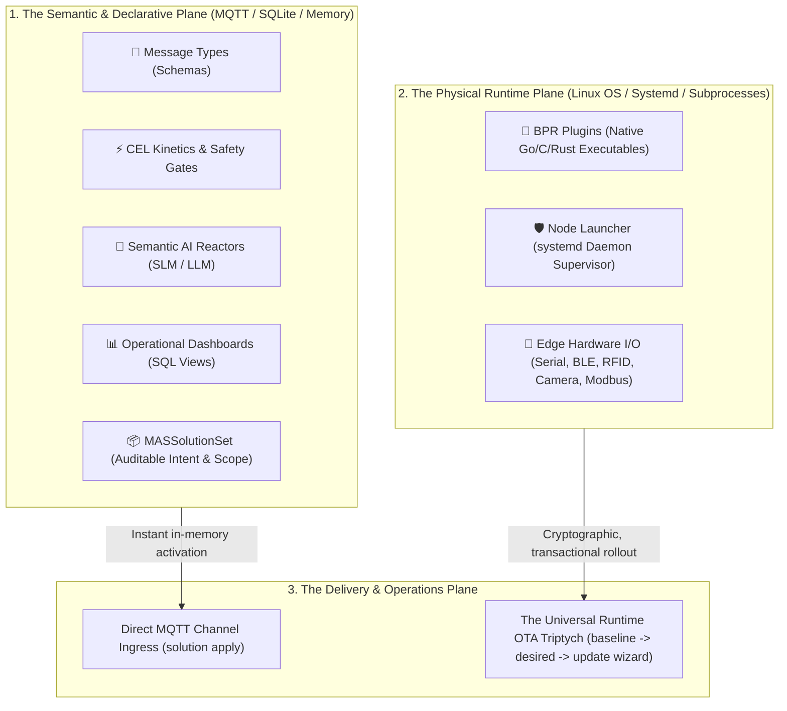
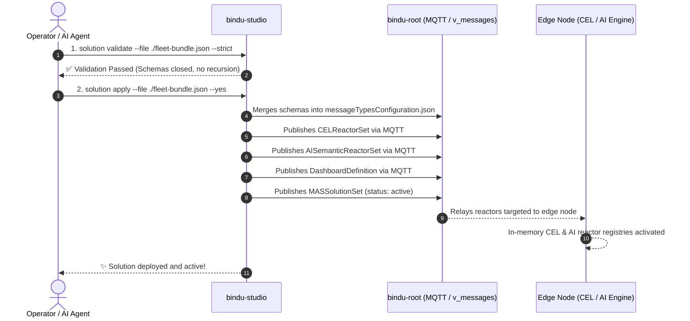
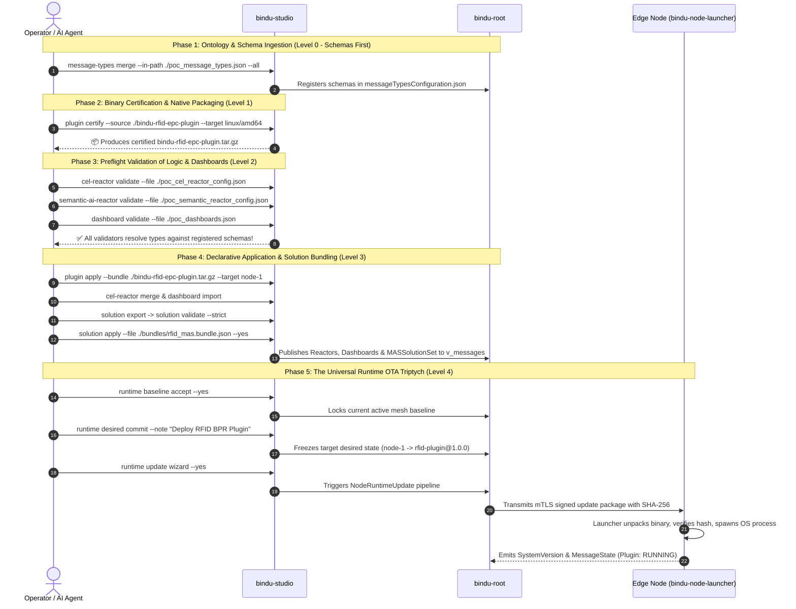

# 🚀 MAS Solution Deployment & Rollout Guide
### The Canonical Blueprint for Deploying Multi-Agent Systems across the Bindu Edge Fabric

**Document Version:** 1.0.0  
**Date:** October 11, 2026  
**Audience:** Solutions Architects, Edge DevOps, Systems Integrators, and Autonomous AI Coding Agents  

---

## 🧭 Executive Overview & Architectural Rationale

In the **Bindu Sovereign Edge Fabric**, a Multi-Agent System (MAS) is not a loose collection of scripts or disconnected microservices. It is a unified, versioned, and auditable semantic entity governed by the **`MASSolutionSet`** system message contract.

However, deploying a MAS in Bindu involves understanding a fundamental architectural separation:



### The Core Principle: Declarative State vs. Physical OS Binaries

1. **Declarative Entities** (Schemas, CEL Rules, AI Prompts, Dashboards) live in memory and the embedded SQLite ledger (`v_messages`). They are activated **in milliseconds** simply by publishing messages over the secure MQTT bus (`bindu/in`).
2. **Physical Binaries** (BPR Plugins) are compiled machine-code programs (`ELF` binaries) running directly under the host operating system kernel. They interact with physical hardware buses (BLE controllers, cameras, LLRP RFID readers). **They cannot and must not be launched ad-hoc by a simple MQTT message**. Edge nodes demand cryptographic validation, SHA-256 verification, process supervision, and zero-downtime rollback capabilities.

This distinction defines the **Two Canonical Deployment Archetypes**:

| Solution Archetype | Components Involved | Deployment Mechanism | Execution Time |
| :--- | :--- | :--- | :--- |
| **Archetype A: Purely Declarative MAS** | Schemas + CEL Reactors + AI Reactors + Dashboards + ACL | **Single Step:** `bindu-studio solution apply` | $< 2$ seconds |
| **Archetype B: Hybrid Physical MAS** | Schemas + CEL/AI Reactors + Dashboards + **BPR Native Plugins** | **Canonical Cadence:** Preflight $\rightarrow$ Catalog Ingest $\rightarrow$ `solution apply` $\rightarrow$ **Universal Runtime OTA Triptych** | Guided rollout |

---

## 📦 Anatomy of Solution Artifacts

When working with MAS solutions, you will encounter three distinct artifact representations:

```text
📁 Artifact Evolution in Bindu:
1. Manifest (Catalog of Names)  -->  2. Bundle (Self-Contained JSON)  -->  3. Release Package (.tar.gz)
   [rfid_mas_solution.json]            [solution.bundle.json]              [solution-1.0.0.tar.gz]
```

### 1. The Semantic Manifest (`solution_manifest.json`)
* **What it is:** A lightweight declaration of identity, metadata, and string lists of required component names (`artifacts.message_types`, `artifacts.cel_reactors`, `artifacts.plugins`).
* **Role:** Acts as the **Identity Card** and the **Virtual Scope Filter** for the Web Console. It does *not* contain executable code or reactor logic.

### 2. The Solution Bundle (`solution.bundle.json`)
* **What it is:** A single, self-contained JSON document generated via `bindu-studio solution export`.
* **Role:** Embeds the complete JSON definitions of every schema, CEL rule, AI prompt, SQL dashboard, and ACL permission into the `artifacts` payload. Highly portable for CI/CD pipelines and version control.

### 3. The Standalone Release Package (`<solution_id>-<version>.tar.gz`)
* **What it is:** A commercial distribution tarball produced by `bindu-studio solution pack`.
* **Role:** Contains `solution-bundle.json`, filtered `mesh.json`, precompiled certified platform binaries in `plugins/*.tar.gz`, and an automated `deploy.sh` script with SHA-256 integrity verification.

---

## 🛣️ Workflow A: Deploying a 100% Declarative MAS

Use this workflow for intelligence, monitoring, alerting, or analytics solutions that **do not require custom native OS hardware drivers** (e.g., Vessel Speed Monitoring, Financial Fraud Detection, Environmental Sensor Gating).



### Step 1: Mandatory Offline Preflight Validation
Always validate the bundle before touching the cluster:
```bash
bindu-studio solution validate \
  --file ./fleet-management-v1.bundle.json \
  --strict
```
*Checks performed:* Semantic closure (all emitted types declared), absence of recursive loops (`trigger_type != emitted_type`), and mesh node containment.

### Step 2: Atomic Deployment
Deploy the entire solution in a single command:
```bash
bindu-studio solution apply \
  --file ./fleet-management-v1.bundle.json \
  --yes \
  --auth console:StrongPass123 \
  --root-url http://127.0.0.1:8080
```

### Step 3: Verification
Verify that the solution is registered and active:
```bash
bindu-studio solution list --auth console:StrongPass123
```

---

## 🏭 Workflow B: Deploying a Hybrid Physical MAS (With BPR Plugins)

Use this workflow whenever the solution involves **physical device I/O** via native operating system subprocesses (e.g., Industrial RFID LLRP Gateways, BLE Beacon Scanners, Camera Computer Vision, Modbus RTU).

> [!IMPORTANT]
> **Why `solution apply` alone is not enough:**  
> `solution apply` stages plugin tarballs in Root's storage repository, but **it never compiles Go code, never transmits binaries over the wire to remote running nodes, and never starts operating system processes**. Delivery to physical edge runtimes must proceed through the **Universal Runtime OTA Triptych**.

### The Artifact Dependency Graph (Artifact DAG) & The Iron Law of Level 0
In Bindu, artifacts adhere to a strict topological ordering:
- **Level 0 (Ontology & Contracts — Zero Dependencies):** `poc_message_types.json`. In Bindu, nothing can be validated, compiled, routed, or evaluated without message schemas registered first.
- **Level 1 (Code Compilation — Isolated SDK):** Standalone Go BPR Plugin (`bindu-studio plugin certify`). Depends only on OS target and Bindu SDK.
- **Level 2 (Logic & Kinetics — Depends on Level 0):** `poc_cel_reactor_config.json`, `poc_semantic_reactor_config.json`, `poc_dashboards.json`. Validators (`cel-reactor validate`, `semantic-ai-reactor validate`, `dashboard validate`) verify against the schemas registered in `--base-dir`. They will FAIL if Level 0 is not ingested first.
- **Level 3 (Declarative Graph Closure — Depends on Levels 0, 1, 2):** `solution export` $\rightarrow$ `solution validate --file <bundle.json> --strict` $\rightarrow$ `solution apply`.
- **Level 4 (Physical OS Delivery — Depends on Level 3):** The Universal Runtime OTA Triptych (`baseline accept` $\rightarrow$ `desired commit` $\rightarrow$ `update wizard`).



### Phase 1: Ontology & Schema Ingestion (Level 0 - Schemas First)
**The Iron Law of Level 0:** Always merge schemas before anything else. Individual validators require the schemas to be present in the registry:
```bash
bindu-studio message-types merge \
  --in-path ./poc_message_types.json \
  --all \
  --auth console:StrongPass123
```

### Phase 2: Binary Certification & Native Packaging (Level 1)
Compile and certify the BPR Plugin from source Go code for the target CPU architecture:
```bash
bindu-studio plugin certify \
  --source ./bindu-rfid-epc-plugin \
  --out ./bindu-rfid-epc-plugin.tar.gz \
  --target linux/amd64
```

### Phase 3: Preflight Validation of Logic & Dashboards (Level 2)
Now that schemas are registered in the cluster registry, validators can resolve all input/output types and SQL columns without error:
```bash
bindu-studio cel-reactor validate --file ./poc_cel_reactor_config.json
bindu-studio semantic-ai-reactor validate --file ./poc_semantic_reactor_config.json
bindu-studio dashboard validate --file ./poc_dashboards.json
```

### Phase 4: Declarative Application & Solution Bundling (Level 3)
Assign the plugin to the target node, merge declarative rules, and export/apply the self-contained solution bundle:
```bash
# 1. Assign plugin to target node in desired runtime
bindu-studio plugin apply \
  --bundle ./bindu-rfid-epc-plugin.tar.gz \
  --target node-1 \
  --auth console:StrongPass123

# 2. Ingest reactors & dashboards into cluster
bindu-studio cel-reactor merge --file ./poc_cel_reactor_config.json --yes --auth console:StrongPass123
bindu-studio dashboard import --file ./poc_dashboards.json --all --auth console:StrongPass123

# 3. Export consolidated bundle & validate full graph closure
bindu-studio solution export \
  --file ./rfid_mas_solution.json \
  --out ./bundles/rfid_mas.bundle.json \
  --auth console:StrongPass123

bindu-studio solution validate \
  --file ./bundles/rfid_mas.bundle.json \
  --strict

# 4. Apply declarative bundle (activates MASSolutionSet manifest)
bindu-studio solution apply \
  --file ./bundles/rfid_mas.bundle.json \
  --yes \
  --auth console:StrongPass123
```

### Phase 5: The Universal Runtime OTA Triptych (Level 4 - Mandatory for Physical Activation)
This three-step cadence executes the transactional rollout across the host systemd service and remote edge nodes:

1. **Accept Baseline:** Synchronizes Root with the current mesh configuration:
   ```bash
   bindu-studio runtime baseline accept --yes
   ```
2. **Commit Desired State:** Freezes the new desired state version with an audit note:
   ```bash
   bindu-studio runtime desired commit \
     --note "Deploy Industrial RFID LLRP Plugin & EPC Digital Twin to node-1"
   ```
3. **Execute Update Wizard:** Dispatches the signed OTA update across the mesh:
   ```bash
   bindu-studio runtime update wizard --yes --auth console:StrongPass123
   ```

> [!TIP]
> **OTA Transport Architecture (Dual-Plane Decoupling)**:
> The update wizard transmits an orchestration command (`NodeRuntimeUpdate` / `NodeUpdate`) through the **MQTT control plane** over mTLS. This command directs edge nodes to securely fetch their required binary tarballs (`/artifacts/...`) directly from Root's endpoint via the **HTTPS data plane** over mTLS with automatic resume and SHA-256 verification. Large binary bundles (20–50 MB) **never travel over MQTT**, keeping message broker queues completely free for high-frequency telemetry.

---

## 🔍 Day-1 Provisioning vs. Day-2 Fleet Updates

| Scenario | When to Use | Execution Command |
| :--- | :--- | :--- |
| **Day-1: First-Time Edge Node Installation** | Setting up a brand-new, unpowered, or fresh Raspberry Pi / IPC edge machine. | `bindu-studio mesh node-deploy --all`<br>*(Generates `dist/nodes/bindu-node-*.tar.gz` for offline installation via `./install-node`)* |
| **Day-2: Live Fleet Update (OTA)** | Edge nodes are already powered on, connected to the mesh, and actively streaming telemetry. | **The Universal Runtime OTA Triptych**<br>`baseline accept` $\rightarrow$ `desired commit` $\rightarrow$ `update wizard` |

---

## 🎯 The Role of the MAS Scope (Virtual Filter) in Web Console

In Bindu, **all Multi-Agent Systems share the same underlying ledger (`v_messages`) and MQTT broker**. There are no isolated databases or artificial silos.

To prevent cognitive overload where dashboards, schemas, and queries from multiple unrelated projects collide on screen, Bindu implements the **MAS Scope Engine** (`mas-scope.js`):

```text
┌────────────────────────────────────────────────────────────────────────────────────────┐
│ 🍇 BINDU CONSOLE   [ 📦 MAS Scope: Industrial RFID Dock Portal (v1.0.0) ▼ ]  [ ✖ Clear ] │
├────────────────────────────────────────────────────────────────────────────────────────┤
│ • Dashboards Tab:   Filters to show ONLY the 3 RFID Transit & RF Health dashboards.    │
│ • Queries Tab:      Limits schema dropdown to the 15 RFID EPC Message Types.          │
│ • Reactors Tab:     Displays ONLY the 3 spatial CEL and SLM manifest reactors.         │
│ • Mesh Monitor Tab: Highlights the gateway nodes assigned to this solution.           │
└────────────────────────────────────────────────────────────────────────────────────────┘
```

* **Client-Side Lens (Zero-Backend-Mutation):** Selecting a solution in the top bar creates a presentation-layer filter in your browser without altering backend routing or data storage.
* **Driven by the Manifest:** The filter matches artifacts strictly against the IDs declared in `MASSolutionSet.fields.artifacts`.

---

## 🩺 Operational Verification & Health Diagnostics

After deploying your solution, verify system health using Bindu Studio's diagnostic suite:

### 1. Verify Solution Manifest Registration
```bash
bindu-studio solution list --auth console:StrongPass123
```
*Expected Output:*
```text
SOLUTION ID                  NAME                                  VERSION  ARTIFACTS SUMMARY                  CONFIGURED AT
rfid-dock-portal-solution    Industrial RFID LLRP Dock Portal      1.0.0    1 nodes, 15 types, 4 reactors      2026-10-11T12:00:00Z
```

### 2. Verify Overall Mesh Health
```bash
bindu-studio mesh health --base-dir /opt/bindu/runtime
```
*Expected Output:*
```text
NODE ID           CONNECTIVITY  ROLE         PRESENCE   PLUGINS HEALTH   MSGS IN/OUT   STATUS
root              root          bindu_root   ACTIVE     -                1420 / 1420   HEALTHY
node-1            gateway       bindu_node   ACTIVE     1/1 RUNNING      850 / 850     HEALTHY
```

### 3. Verify Live Process PID on Target Node
```bash
bindu-studio mesh node-status node-1 --auth console:StrongPass123
```
*Expected Output:*
```text
📊 Node Status: node-1 (role: node)
[BPR Plugins]
  ID                     VERSION  STATUS   PID    CPU%  MEMORY   UPTIME    ERROR
  bindu-rfid-epc-plugin  1.0.0    running  18492  0.6%  14.2 MB  0h 15m    -
```

### 4. Verify Component Binary Hashes
```bash
bindu-studio mesh node-version node-1 --auth console:StrongPass123
```
*Expected Output:*
```text
COMPONENT              VERSION  COMMIT   BUILD DATE            OS/ARCH      SHA256
bindu-node             0.0.160  abc1234  2026-10-11T08:00:00Z  linux/amd64  e3b0c44298fc...
bindu-rfid-epc-plugin  1.0.0    8f29d10  2026-10-11T12:00:00Z  linux/amd64  a47b29e01f5c...
```

---

## 📋 Comprehensive Decision Matrix

```text
Do I have native OS BPR plugins in my solution?
  ├── NO  ──>  100% Declarative Solution
  │             1. bindu-studio solution validate --file <bundle.json> --strict
  │             2. bindu-studio solution apply --file <bundle.json> --yes
  │             └── DONE! 🚀
  │
  └── YES ──>  Hybrid Physical Solution
                1. bindu-studio plugin certify --source <dir> --target <arch>
                2. bindu-studio message-types merge --in-path <schemas.json> --all
                3. bindu-studio plugin apply --bundle <tar.gz> --target <node>
                4. bindu-studio solution apply --file <bundle.json> --yes
                5. bindu-studio runtime baseline accept --yes
                6. bindu-studio runtime desired commit --note "<msg>"
                7. bindu-studio runtime update wizard --yes
                └── DONE! 🍇⚡🛡️
```

Following this guide ensures deterministic, zero-downtime, and 100% verifiable deployments across any sovereign edge mesh.
