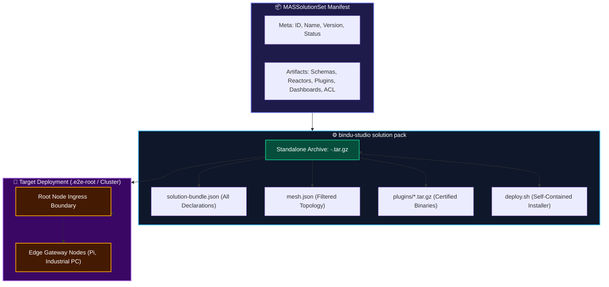

# Multi-Agent System (MAS) Solution Tutorial & Domain Manifests 📦🤖🌐

Welcome to the **Master Multi-Agent System (MAS) Solution Tutorial** for the Bindu distributed operating fabric!

This comprehensive tutorial guides you through creating, packaging, validating, and deploying declarative **`MASSolutionSet`** solutions across your Bindu mesh. It includes ready-to-deploy solutions for all **10 canonical domains and tutorials** in the platform, ranging from precision viticulture and cold-chain compliance to multimodal vision AI, marine fisheries, and military-grade threat fusion.

---

## 1. 🧠 Understanding MAS Solutions in Bindu

In modern distributed computing, complex autonomous systems are rarely composed of a single script or microservice. Instead, they operate as a **Multi-Agent System (MAS)**—a coordinated collective of:
- **Strict Data Contracts (`MessageType`)**: Validated event schemas for sensor telemetry, alerts, and actuation commands.
- **Deterministic Gatekeepers (`CELReactorSet`)**: Google CEL rules executing in sub-microseconds for pre-inference filtering, safety clamping, and threshold alerting.
- **External Harvesters & Webhooks (`RESTReactorSet`)**: Asynchronous HTTP pollers and webhook emitters interacting with external cloud APIs.
- **Cognitive Edge AI Agents (`AISemanticReactorSet`)**: Local LLMs (e.g., Ollama `qwen2.5-coder`, `mistral`, `moondream`) providing autonomous reasoning, structured analysis, and synthesis.
- **Native OS Plugins (`BPR Plugin`)**: Sandboxed, deterministic binaries executing via standard `stdin/stdout` JSON IPC.
- **Out-of-Band Media Storage (`MediaStorageProvider`)**: S3/MinIO presigned storage integration for high-resolution vision payloads.
- **Access Control Policies (`User` & `Role`)**: Cryptographic credentials and granular topic permissions.
- **Operational Dashboards (`Dashboard`)**: Real-time SQL-backed telemetry visualizations.

A **`MASSolutionSet`** is Bindu's declarative manifest that unifies all these distributed artifacts into a single, versioned, portable project package.



---

## 2. 🏛️ The 10 Canonical Domain Solutions

This tutorial provides complete, production-validated `MASSolutionSet` manifests for all 10 platform domains:

| # | Solution ID | Project Name | Primary Capabilities | Manifest File |
|---|-------------|--------------|----------------------|---------------|
| **01** | `albarino-vineyard-ai` | **The Albariño Smart Vineyard AI 🍇🍷** | Microclimate soil/wetness sensing, CEL pre-gating, edge LLM harvest risk advisories. | [`solution_01_albarino_vineyard.json`](./solution_01_albarino_vineyard.json) |
| **02** | `coldchain-watchdog` | **Cold-Chain System Watchdog & Anomaly Guard 🧊🛡️** | Sub-microsecond temperature threshold validation, defrost cycle anomaly detection, watchdog auditing. | [`solution_02_coldchain_watchdog.json`](./solution_02_coldchain_watchdog.json) |
| **03** | `financial-audit-fx` | **Financial Auditing & FX Rate Compliance MAS 💶📈** | Real-time transaction auditing, European Central Bank FX polling via REST, compliance reporting. | [`solution_03_financial_audit.json`](./solution_03_financial_audit.json) |
| **04** | `hello-world-bpr` | **Hello World BPR Native Plugin & SPA 🌍⚡** | Multi-arch BPR native binary process execution, JSON stdio IPC, dual-cron scheduling, live SPA. | [`solution_04_hello_world.json`](./solution_04_hello_world.json) |
| **05** | `patio-media-vision` | **S3/MinIO Media Inspection & Vision AI 📷🔍** | Out-of-band camera uploads, presigned S3 URLs, multimodal Vision LLM (Moondream) quality inspection. | [`solution_05_patio_media_vision.json`](./solution_05_patio_media_vision.json) |
| **06** | `marine-fisheries-harvester` | **Marine Fisheries & Oceanic REST Data Harvester 🐟🌊** | Vessel GPS tracking, Copernicus satellite SST polling via REST, catch quota enforcement. | [`solution_06_marine_fisheries.json`](./solution_06_marine_fisheries.json) |
| **07** | `pharma-coldchain-incident-ai` | **Pharma Cold-Chain Spoilage Incident AI Analyst 💊❄️** | FDA 21 CFR cold-chain telemetry tracking, excursion analysis, automated LLM incident synthesis. | [`solution_07_pharma_coldchain_ai.json`](./solution_07_pharma_coldchain_ai.json) |
| **08** | `system-email-bpr-gateway` | **System Security Alert Email BPR Gateway 🛡️✉️** | Cluster security alarm evaluation via CEL, background SMTP dispatching via isolated BPR plugin. | [`solution_08_system_email_gateway.json`](./solution_08_system_email_gateway.json) |
| **09** | `fishing-poc-autonomous-fleet` | **FISHING_POC: Autonomous Marine Fishery Cluster 🚢🗺️** | Multi-vessel fleet telemetry, satellite oceanography fusion, catch logging, AI zone recommendations. | [`solution_09_fishing_poc.json`](./solution_09_fishing_poc.json) |
| **10** | `sentinel-threat-intelligence` | **Project SENTINEL: Multi-Domain Threat Fusion & Decay MAS 🛰️⚡** | Exponential temporal decay math in CEL, multi-signal sensor fusion, real-time cognitive threat synthesis. | [`solution_10_sentinel.json`](./solution_10_sentinel.json) |

---

## 3. 📄 The `MASSolutionSet` Declarative Manifest Schema

Every solution manifest adheres to the native `$type: "MASSolutionSet"` message specification. Here is the structure breakdown using the **Albariño Smart Vineyard AI** solution as an archetype:

```json
{
  "$type": "MASSolutionSet",
  "$group": "solution",
  "$producer": "albarino-vineyard-ai",
  "$user": "console",
  "$when": "2026-09-18T12:00:00Z",
  "fields": {
    "solution_id": "albarino-vineyard-ai",
    "name": "The Albariño Smart Vineyard AI 🍇🍷",
    "version": "1.0.0",
    "description": "Autonomous viticulture microclimate sensing, soil moisture monitoring, and AI-driven harvest risk advisory.",
    "status": "active",
    "artifacts": {
      "mesh_nodes": ["root"],
      "message_types": [
        "VineyardTelemetry@1.0.0",
        "VineyardAlert@1.0.0"
      ],
      "cel_reactors": [],
      "rest_reactors": [],
      "semantic_ai_reactors": [
        "albarino-smart-vineyard-ai"
      ],
      "plugins": [],
      "media_storage_providers": [],
      "access_users": [
        "vineyard-manager"
      ],
      "access_roles": [
        "operator"
      ],
      "dashboards": [
        "albarino-microclimate-monitor"
      ],
      "system_config_keys": []
    }
  }
}
```

### Manifest Fields Description:
- **`solution_id`** *(string, required)*: Unique slug identifier for the solution (e.g., `coldchain-watchdog`, `sentinel-threat-intelligence`).
- **`name`** *(string, required)*: Human-readable display title.
- **`version`** *(string, required)*: Semantic version string (e.g., `1.0.0`).
- **`description`** *(string)*: High-level architectural purpose of the multi-agent system.
- **`status`** *(string)*: Lifecycle status (`"active"`, `"staged"`, `"deprecated"`).
- **`artifacts`** *(object)*:
  - **`mesh_nodes`**: Target gateway nodes where components are provisioned.
  - **`message_types`**: List of versioned message types (`Name@Version`) required by the solution.
  - **`cel_reactors`**: IDs of deterministic CEL rule sets deployed to the mesh.
  - **`rest_reactors`**: IDs of REST webhook reactors polling or pushing external APIs.
  - **`semantic_ai_reactors`**: IDs of cognitive Edge LLM reactors performing structured inference.
  - **`plugins`**: BPR native plugin names bundled with the solution.
  - **`media_storage_providers`**: S3/MinIO bucket configurations for out-of-band media.
  - **`access_users` & `access_roles`**: Security credentials and RBAC profiles.
  - **`dashboards`**: Real-time console UI telemetry dashboards.
  - **`system_config_keys`**: Global runtime configuration keys.

---

## 4. 🛠️ CLI Operations with `bindu-studio solution`

Bindu Studio provides a full suite of subcommands under `bindu-studio solution` to manage the entire MAS lifecycle from your terminal or CI/CD pipelines:

```
Available Commands:
  validate    Validate a MAS solution manifest or bundle offline with deep dependency checking
  register    Register a declarative MAS solution manifest via MQTT
  pack        Package a MAS solution into a standalone distribution release archive (.tar.gz)
  apply       Apply a MAS solution release archive (.tar.gz), directory, or bundle JSON
  export      Export a MAS solution and its referenced artifacts into a bundle JSON
  list        Show active MAS solutions deployed in the mesh
  delete      Delete an active MAS solution by publishing a tombstone via MQTT
```

### 1. Offline Validation (`validate`)
Validate manifests or standalone bundle JSON files offline before deployment:
```bash
bindu-studio solution validate \
  --file ./public/console/docs/mas-solution-tutorial/solution_01_albarino_vineyard.json
```
*Output:*
```
✅ Solution manifest "albarino-vineyard-ai" is valid.
   Name:        The Albariño Smart Vineyard AI 🍇🍷
   Version:     1.0.0
   Description: Autonomous viticulture microclimate sensing, soil moisture monitoring...
   Artifacts:   2 message types, 0 CEL reactors, 0 REST reactors, 1 AI reactors, 1 dashboards, 0 plugins, 0 storage providers, 1 nodes
```

### 2. Direct Mesh Registration (`register`)
Publish the `MASSolutionSet` message directly to the cluster over TLS-secured MQTT:
```bash
bindu-studio solution register \
  --file ./public/console/docs/mas-solution-tutorial/solution_02_coldchain_watchdog.json \
  --auth console:StrongPass123 \
  --yes
```

### 3. Package into a Release Archive (`pack`)
Bundle all referenced schemas, reactors, dashboards, access controls, and compiled BPR plugin binaries into a self-contained `.tar.gz` distribution package:
```bash
bindu-studio solution pack \
  --file ./public/console/docs/mas-solution-tutorial/solution_04_hello_world.json \
  --out ./dist/hello-world-bpr-1.0.0.tar.gz \
  --base-dir ./.e2e-root/current \
  --auth console:StrongPass123
```
## 4. 📦 Solution Bundles vs. Standalone Manifests: The Canonical Standard

In Bindu, Multi-Agent System solutions exist in two distinct formats:

1. **Standalone Unbundled Manifest (`solution_XX_<slug>.json`)**:
   - A single `MASSolutionSet` message declaring metadata and arrays of artifact string identifiers (`"albarino-microclimate-monitor"`, `"albarino-vintage-brain"`).
   - Serves as an **orchestration contract / architectural blueprint**.
2. **Self-Contained Solution Bundle (`bundles/solution_XX_<slug>.bundle.json`)**:
   - The **canonical source of truth for deployment and distribution**.
   - Contains the `MASSolutionSet` manifest AND the full embedded definitions of all child artifacts:
     - `artifacts.message_types`: Full `MessageTypeConfig` schemas with data types.
     - `artifacts.cel_reactors`: Complete CEL rules and threshold expressions.
     - `artifacts.rest_reactors`: Complete REST poller endpoints and header configurations.
     - `artifacts.semantic_ai_reactors`: Complete LLM prompts, model IDs, and mapping templates.
     - `artifacts.dashboards`: Complete `DashboardDefinition` SQL queries, labels, and charts.
     - `artifacts.media_storage_providers`: Complete `MediaStorageSet` endpoint and bucket configs.

> [!IMPORTANT]
> **Canonical Deployment Contract for AI Models & DevOps Engineers**:
> Never deploy a bare unbundled manifest into a clean Root unless its child artifacts have already been published. **Always deploy the Self-Contained Solution Bundle (`.bundle.json` or `.tar.gz`)** using `bindu-studio solution apply`. This guarantees that Root ingests all schemas into the Core registry and saves all reactors and dashboards into SQLite (`v_messages`).

---

## 5. 🛠️ Canonical `bindu-studio solution` CLI Tooling Matrix

The `bindu-studio solution` command suite is the official toolchain for managing MAS solutions throughout their entire lifecycle:

| Operation | CLI Command | What It Executes |
|---|---|---|
| **1. Validate** | `bindu-studio solution validate --file <bundle.json> --strict` | Performs deep offline/online validation of schema dependencies, SQL queries, and recursion prevention. |
| **2. Export / Assemble** | `bindu-studio solution export --file <manifest.json> --out <bundle.json>` | Gathers all child artifact JSONs from disk/runtime and compiles a standalone `.bundle.json`. |
| **3. Pack Release** | `bindu-studio solution pack --file <bundle.json> --out <dist.tar.gz> --strict` | Compiles a distribution release `.tar.gz` with `solution-bundle.json`, `mesh.json`, `plugins/`, and `deploy.sh`. |
| **4. Apply / Ingest** | `bindu-studio solution apply --file <bundle.json> --base-dir <dir> --yes` | Atomically ingests schemas, deploys CEL/REST/AI reactors, saves dashboards to `v_messages`, and activates the MAS. |
| **5. Inspect / List** | `bindu-studio solution list --base-dir <dir>` | Lists all active MAS solutions and displays live artifact summary counts. |
| **6. Delete / Tombstone** | `bindu-studio solution delete <solution_id> --yes` | Publishes a `status: "deleted"` tombstone to cleanly deactivate the solution. |

### CLI Usage Examples:

```bash
# Validate a solution bundle strictly
go run ./cmd/bindu-studio solution validate \
  --file ./public/console/docs/mas-solution-tutorial/bundles/solution_01_albarino_vineyard.bundle.json \
  --strict

# Apply a complete solution bundle to the live Root runtime
go run ./cmd/bindu-studio solution apply \
  --file ./public/console/docs/mas-solution-tutorial/bundles/solution_01_albarino_vineyard.bundle.json \
  --base-dir ./.e2e-root/current \
  --auth console:StrongPass123 \
  --yes

# Package a solution into a commercial tar.gz release
go run ./cmd/bindu-studio solution pack \
  --file ./public/console/docs/mas-solution-tutorial/bundles/solution_01_albarino_vineyard.bundle.json \
  --out ./dist/albarino-smart-vineyard-ai-1.0.0.tar.gz \
  --strict
```

### 5.1 Edge Node OTA Delivery (The Runtime Triptych)

When an applied MAS solution bundles or references BPR native plugins destined for edge gateway nodes (e.g. `node-1`, `node-dell-1`), executing `solution apply` stages the intent. To physically deliver the binaries and trigger process activation across edge nodes, you must execute the **Runtime Triptych**:

```bash
# 1. Acknowledge the current baseline
go run ./cmd/bindu-studio runtime baseline accept --yes

# 2. Commit the new desired runtime state with staged plugins
go run ./cmd/bindu-studio runtime desired commit --note "Deploy MAS solution plugins"

# 3. Enqueue and execute the OTA rollout across the mesh
go run ./cmd/bindu-studio runtime update wizard --yes --auth console:StrongPass123
```

---

## 6. 🖥️ Web Console: 6-Step Solution Deployment Wizard

For operations teams, the Bindu Web Console provides an intuitive, browser-based **6-Step Solution Studio Wizard** accessible at `http://localhost:8080/console/solutions`:

```
┌────────────────────────────────────────────────────────────────────────────────────────────────────────┐
│  BINDU CONSOLE > MAS SOLUTIONS > STUDIO WIZARD                                                         │
├────────────────────────────────────────────────────────────────────────────────────────────────────────┤
│                                                                                                        │
│  [1. Identity] ──▶ [2. Mesh Nodes] ──▶ [3. Schemas] ──▶ [4. Artifacts] ──▶ [5. Validate] ──▶ [6. Release]   │
│                                                                                                        │
│  Step 1: Identity & Metadata (solution_id, name, version, description)                                 │
│  Step 2: Target Mesh Nodes & Topology Hierarchy (Structured discovery & full branch slugs)             │
│  Step 3: Message Types & Schema Contracts (Application vs System tabs with live counts)                │
│  Step 4: Reactors, Intelligence, Dashboards & Plugins (Node-scoped reactors, schema-filtered dash)     │
│  Step 5: Semantic Verification & Dependency Closure (Deep graph validation & auto-fix)                │
│  Step 6: Review, Manifest Preview & Release Actions (Save to mesh, download .tar.gz / .json)           │
│                                                                                                        │
└────────────────────────────────────────────────────────────────────────────────────────────────────────┘
```

1. **Step 1 — Identity & Metadata**: Define the unique project slug, display name, version, and architecture summary.
2. **Step 2 — Target Mesh Nodes & Topology**: Select execution nodes (`root` and edge gateways) displaying full branch URL/slug paths (e.g. `💠 node-1 (/warehouse-a/warehouse-a-aisle-1/warehouse-a-aisle-1-rack-1)`).
3. **Step 3 — Semantic Contracts**: Choose required data contracts with dedicated tabs for `📱 Application Schemas` and `⚙️ System Schemas`.
4. **Step 4 — Scoped Artifacts & Visualizations**: Assemble CEL/REST/AI reactors and BPR plugins dynamically filtered by selected nodes, dashboards filtered by selected schemas, and the mesh singleton media store.
5. **Step 5 — Semantic Verification & Closure**: Automated validation against schema dependencies (`E_SCHEMA_MISSING_DEPENDENCY`), runtime advisories (`W_REACTOR_INACTIVE_RUNTIME`), recursion loops, and one-click auto-fix.
6. **Step 6 — Release & Activation**: Save live to MQTT broker (`bindu/in`), download ready-to-deploy commercial `.tar.gz` packages, or export `.json` bundles.

---

## 7. 🚀 Automated 3-Stage Pipeline Script (`deploy_all_solutions.sh`)

To compile, validate, and deploy all 10 domain solutions into your local E2E cluster (`./.e2e-root/current`) or any remote production mesh in one seamless execution, use the automated script:

```bash
./public/console/docs/mas-solution-tutorial/deploy_all_solutions.sh
```

### Pipeline Stages Executed for Each Solution:
1. **[1/3] Compile & Export Bundle (`bindu-studio solution export`)**:
   Assembles child artifact files (MessageTypes, CEL/REST/AI Reactors, Dashboards, ACL) into the self-contained `.bundle.json`.
2. **[2/3] Deep Semantic Validation (`bindu-studio solution validate --strict`)**:
   Validates schema closures, dashboard SQL queries, and recursion prevention rules offline.
3. **[3/3] Apply & Ingest to Mesh Runtime (`bindu-studio solution apply`)**:
   Merges schemas into `messageTypesConfiguration.json`, registers users/roles in `accessControlConfig.brs`, publishes reactors and dashboards to SQLite/MQTT (`v_messages`), and marks the `MASSolutionSet` active.

### Script Execution Options:
```
Options:
  --base-dir <dir>       Bindu base directory (default: auto-detected ./.e2e-root/current)
  --root-url <url>       Bindu Root HTTP/API endpoint (default: http://127.0.0.1:8080)
  --auth <user:pass>     Basic auth credentials (default: console:StrongPass123 or report.txt)
  --solution <id_or_num> Process only a specific solution (e.g. 01, sentinel, albarino)
  --build-only           Export and compile solution bundles only without validating or deploying
  --validate-only        Build and run validation checks only without publishing to the mesh
  --skip-build           Skip bundle compilation and use existing bundles in bundles/ directory
  -y, --yes              Skip interactive confirmation prompts
  -h, --help             Show command line help
```

### Example: Build and Validate All Solutions Offline
```bash
./public/console/docs/mas-solution-tutorial/deploy_all_solutions.sh --validate-only
```

### Example: Compile, Validate, and Deploy to Running E2E Cluster
```bash
./public/console/docs/mas-solution-tutorial/deploy_all_solutions.sh --base-dir ./.e2e-root/current --yes
```

---

## 8. 🔍 SQL Verification & Event Stream Auditing

Because Bindu treats solutions as first-class semantic messages, all deployed solutions are immutably recorded in SQLite storage (`v_messages`).

### 1. Query Active Solutions via SQL Endpoint
```bash
curl -s -u console:StrongPass123 "http://127.0.0.1:8080/api/v1/messages/sql" \
  -H "Content-Type: application/json" \
  -d '{"query": "SELECT msg_id, json_extract(payload, \"$.fields.solution_id\") as solution_id, json_extract(payload, \"$.fields.name\") as name, json_extract(payload, \"$.fields.version\") as version, json_extract(payload, \"$.fields.status\") as status FROM v_messages WHERE msg_type = '\''MASSolutionSet'\'' ORDER BY timestamp_utc DESC LIMIT 10;"}' | jq .
```

### 2. Query Active Solutions via Studio CLI
```bash
go run ./cmd/bindu-studio solution list --base-dir ./.e2e-root/current --auth console:StrongPass123
```

---

## 9. 🛡️ Production Governance & Best Practices

1. **Strict Versioning**: Always increment the `version` field (e.g., `1.0.0` -> `1.1.0`) when adding message types or modifying reactor CEL logic.
2. **Deterministic Gatekeeping**: Ensure AI reactors are paired with CEL pre-filtering rules to protect edge gateway compute resources.
3. **MAS Schema Self-Containment**: A MAS deployed on remote/edge nodes is only guaranteed to possess schemas explicitly declared in `fields.artifacts.message_types` (or system schemas). Validation evaluates all CEL, REST, AI reactors, dashboards, and plugins strictly against MAS-declared schemas, ensuring 100% portable, air-gapped autonomy.
4. **Air-Gapped Distribution**: For remote edge gateways with intermittent connectivity, generate packaged release archives using `bindu-studio solution pack` and distribute via `mesh node-deploy`.
5. **Least-Privilege RBAC**: Bind dedicated `access_users` and `access_roles` to each solution to isolate message namespaces.


---

*Multi-Agent System Solutions represent the pinnacle of declarative, zero-defect orchestration on the Bindu distributed operating fabric.* 📦🤖🚀
