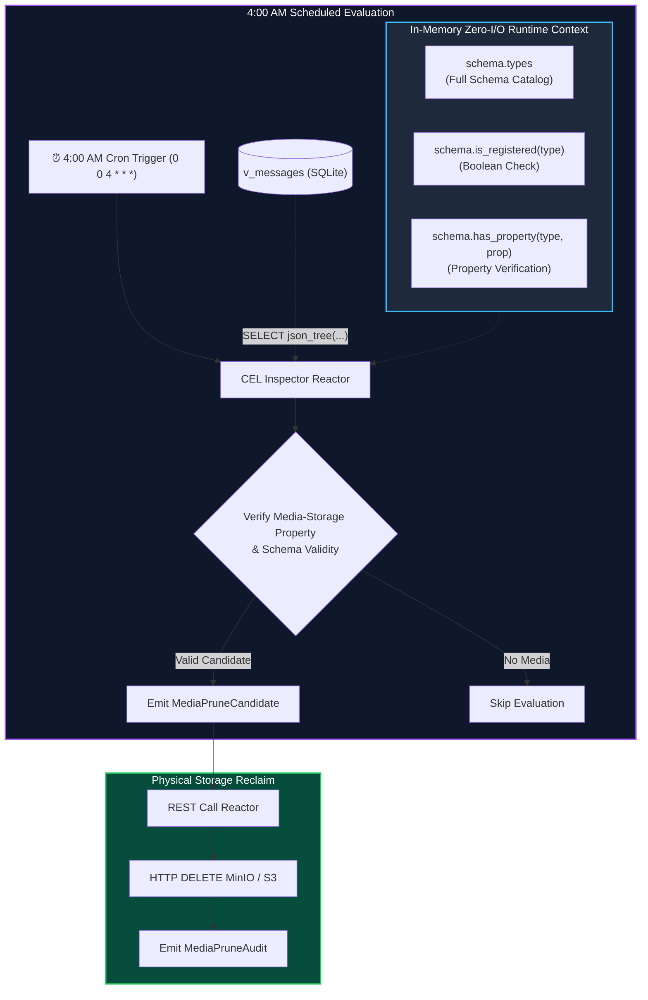

# **Media Storage Retention & Orphan Pruning: Engineering Analysis & Tutorial Plan** 🧹📸⚡

## **1. Executive Summary & Problem Formulation**

In Bindu's Semantic Event Processing Network (SEPN), high-volume sensory data containing heavy binary payloads (images, video clips, sensor waveforms, inspection PDFs) is decoupled through **Out-of-Band Media-Storage**. Instead of congesting the MQTT mesh and SQLite ledger with multi-megabyte binary blobs, producers upload the files directly to an S3-compatible object store (such as **MinIO**) and emit lightweight metadata events referencing the object via canonical **Semantic URIs**:
$$\text{URI} = \texttt{minio\_local://raw/PatioMonitorMedia/patio-sensor-1/plant-1.jpeg}$$
$$\text{S3 Object Key} = \texttt{PatioMonitorMedia/patio-sensor-1/plant-1.jpeg}$$

### **The Canonical Lifecycle & Referential Consistency Contract**

1. **Active Message Lifetime (Referential Integrity):**  
   While a message remains valid within its retention window, its corresponding binary asset in MinIO is guaranteed to exist (zero `404 Not Found` broken links).
2. **3:00 AM — SQLite Database Maintenance (`maintenance_cron`):**  
   Bindu’s native SQLite maintenance engine runs daily at **3:00 AM**, purging expired message records according to the `retentionMode` (`count` vs `days`) and `retentionValue` defined on each `MessageType`.
3. **4:00 AM — Proactive CEL Semantic Garbage Collector (`0 0 4 * * *`):**  
   One hour *after* database maintenance, the **CEL Inspector Reactor** awakens. Using the **Semantic Object Key Pattern** (`{message_type}/{producer}/{filename}`) and in-memory schema metadata (**`celext`** `schema.types[message_type].retention_value`), it identifies expired and orphaned objects in MinIO and emits `MediaPruneCandidate`.
4. **Immediate Reactive Physical Deletion (REST Reactor):**  
   Intercepts `MediaPruneCandidate` and issues HTTP `DELETE` requests directly to MinIO's S3 API (`DELETE http://minio:9000/{bucket}/{object_key}`) with exponential backoff and jitter.
5. **Complete Telemetry & Audit (`MediaPruneAudit`):**  
   Every physical deletion produces a structured audit event in SQLite and updates real-time dashboards in the Bindu Console.

---

## **2. Architectural Design Goals & Principles**

1. **Zero-Code Operational Simplicity:** Implemented purely using Bindu's native runtime primitives (**`CELReactorSet`** and **`RESTReactorSet`**) without external Python daemons, cron scripts, or ad-hoc background processes.
2. **Semantic URL Governance:** Object keys follow `{message_type}/{producer}/{filename}`, allowing AI models and GC reactors to immediately deduce schema, device origin, and retention without file I/O.
3. **Multi-Retention Isolation:** Different MessageTypes (e.g. 3-day telemetry vs 30-day security alarms) have their retention calculated independently without cross-domain interference.
4. **Decoupled 2-Stage Pipeline (Inspection $\rightarrow$ Execution):** 
   * **Stage 1 (Cognitive/Logical Audit):** Identifies and emits prune candidates.
   * **Stage 2 (Resilient HTTP Egress):** Executes the physical REST `DELETE` call against MinIO with built-in exponential backoff and jitter.
5. **Observable Audit Trail:** Every deletion emits `MediaPruneAudit` back into the mesh, queryable via SQL and visible in the Bindu Console.

---

## **3. Semantic Schema Introspection with CEL (`celext`)**

Bindu's CEL engine has live, in-memory access to all registered schemas via **`celext`**:



---

## **4. Technical Specifications of Pipeline Components**

### **4.1 Universal SQL Query via `json_tree`**

```sql
SELECT 
  j.value AS media_uri,
  v."$type" AS source_type,
  v."$when" AS msg_when
FROM v_messages v, json_tree(v.raw_json, '$.fields') j
WHERE j.type = 'text' 
  AND (j.value LIKE 'minio_%://%' OR j.value LIKE 's3_%://%')
ORDER BY v."$when" ASC 
LIMIT 1;
```

### **4.2 CEL Transformation Expression (`poc_cel_reactor_config.json`)**

```json
{
  "reactor_id": "minio-orphan-media-inspector",
  "cron": "0 0 4 * * *",
  "output_message_type": "MediaPruneCandidate",
  "context_query": "SELECT j.value AS media_uri, v.\"$type\" AS source_type, v.\"$when\" AS msg_when FROM v_messages v, json_tree(v.raw_json, '$.fields') j WHERE j.type = 'text' AND (j.value LIKE 'minio_%://%' OR j.value LIKE 's3_%://%') ORDER BY v.\"$when\" ASC LIMIT 1",
  "trigger_condition": "has(db.rows) && size(db.rows) > 0 && schema.is_registered(string(db.rows[0].fields.source_type))",
  "transformation_expression": {
    "media_uri": "has(db.rows) && size(db.rows) > 0 ? string(db.rows[0].fields.media_uri) : 'minio_local://raw/PatioMonitorMedia/plant-1/plant-1.jpeg'",
    "provider": "has(db.rows) && size(db.rows) > 0 ? (string(db.rows[0].fields.media_uri).contains('://') ? string(db.rows[0].fields.media_uri).split('://')[0] : 'minio_local') : 'minio_local'",
    "bucket": "has(db.rows) && size(db.rows) > 0 ? (string(db.rows[0].fields.media_uri).contains('://') ? string(db.rows[0].fields.media_uri).split('://')[1].split('/')[0] : 'raw') : 'raw'",
    "object_key": "has(db.rows) && size(db.rows) > 0 ? (string(db.rows[0].fields.media_uri).contains('://') ? string(db.rows[0].fields.media_uri).split('://')[1].substring(string(db.rows[0].fields.media_uri).split('://')[1].indexOf('/') + 1) : 'PatioMonitorMedia/plant-1/plant-1.jpeg') : 'PatioMonitorMedia/plant-1/plant-1.jpeg'",
    "source_message_type": "has(db.rows) && size(db.rows) > 0 ? string(db.rows[0].fields.source_type) : 'UnknownMediaType'",
    "reason": "'SEMANTIC_TTL_POST_MAINTENANCE_PRUNING'"
  }
}
```

### **4.3 REST Call Egress Reactor (`poc_rest_reactor_config.json`)**

```json
{
  "reactor_id": "minio-media-http-pruner",
  "input_message_type": "MediaPruneCandidate",
  "context_query": "SELECT json_extract(raw_json, '$.fields.endpoint_url') AS endpoint_url FROM v_messages WHERE \"$type\" = 'MediaStorageSet' AND json_extract(raw_json, '$.fields.provider_id') = 'minio_local' ORDER BY \"$when\" DESC LIMIT 1",
  "trigger_condition": "has(db.rows) && size(db.rows) > 0 && has(payload.bucket) && size(string(payload.bucket)) > 0 && has(payload.object_key) && size(string(payload.object_key)) > 0",
  "output_message_type": "MediaPruneAudit",
  "request": {
    "method": "DELETE",
    "url": "string(db.rows[0].fields.endpoint_url) + '/' + string(payload.bucket) + '/' + string(payload.object_key)",
    "timeout": "5s"
  },
  "retry_policy": {
    "max_retries": 3,
    "initial_interval": "500ms",
    "backoff_multiplier": 2.0,
    "jitter": true
  },
  "response_map": {
    "media_uri": "string(payload.media_uri)",
    "bucket": "string(payload.bucket)",
    "object_key": "string(payload.object_key)",
    "http_status": "resp.status_code",
    "execution_status": "resp.status_code in [200, 204, 404] ? 'SUCCESS' : 'FAILED'",
    "freed_at": "'$when' in head ? string(head['$when']) : now()"
  }
}
```

### **4.4 Centralized Storage Secret Governance (`accessControlConfig.brs`)**

To guarantee zero-plaintext credentials on the network mesh and across git version control:
- The MinIO/S3 credentials are bound to `MediaStorageSet` with `"secret_key": "secret:minio_media_secret"`.
- The secret key `minio_media_secret` is sealed into the AES-256 encrypted access control vault (`accessControlConfig.brs`) via `bindu-studio access-control secrets set minio_media_secret`.
- Emitters and reactors access storage via encrypted vault references without credentials exposed in plain text.

---

## **5. Summary of Architecture Decoupling**

| Component | Responsibility | Scope |
| :--- | :--- | :--- |
| **`solution_minio_media_cleanup.bundle.json`** | Self-contained Multi-Agent System: 4:00 AM CEL Inspector + REST Reactor + Dashboards. | **Universal** (Applies across the mesh for all media schemas). |
| **`publish_media.go`** | Test harness uploading plant photos with semantic keys (`PatioMonitorMedia/plant-1/plant-1.jpeg`). | **Test Fixture** (Used exclusively for tutorial verification). |
