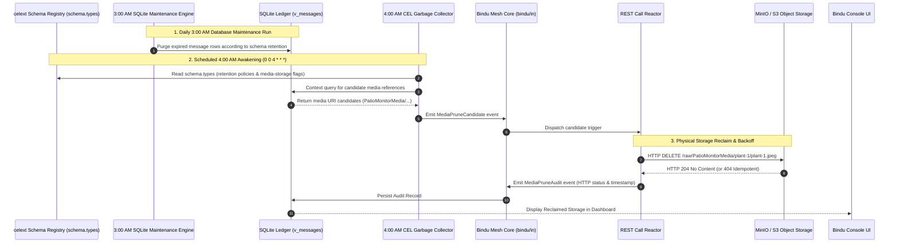

# **Tutorial: MinIO Media Storage Retention & Automated Orphan Cleanup** 🧹📸⚡

Welcome to the **Bindu Media Storage Cleanup Tutorial**. In this hands-on guide, you will learn how to design, deploy, and verify an end-to-end autonomous garbage collection pipeline for **Out-of-Band Media Storage (MinIO / S3)** using 100% native Bindu capabilities (**CEL Reactor + REST Call Reactor + `celext` Semantic URL Introspection**).

---

## **1. Architectural Overview: The Semantic URL Contract & 4:00 AM Garbage Collection**

In Bindu's Semantic Event Processing Network (SEPN), heavy binary assets (such as camera frames, video clips, or sensor audio) are stored out-of-band in MinIO/S3 and referenced inside event ledgers via **Canonical Semantic URIs**:

$$\text{Semantic URI} = \texttt{minio\_local://raw/PatioMonitorMedia/patio-sensor-1/plant-1.jpeg}$$
$$\text{S3 Object Key} = \texttt{PatioMonitorMedia/patio-sensor-1/plant-1.jpeg}$$

### **The Lifecycle & Referential Consistency Contract**

1. **Active Lifetime (Zero Broken Links / No 404s):**  
   While a message remains valid within its retention window, its media object is guaranteed to exist in MinIO. Any console operator, dashboard, or AI agent resolving the URI receives a valid presigned URL.
2. **3:00 AM — SQLite Database Maintenance (`maintenance_cron`):**  
   Every night at **3:00 AM**, Bindu's core maintenance engine evaluates each `MessageType`'s retention contract (`retentionMode: "days"` or `"count"`) and purges expired rows from the SQLite ledger (`v_messages`).
3. **4:00 AM — Proactive CEL Semantic Garbage Collector (`0 0 4 * * *`):**  
   One hour after database maintenance, our proactive **CEL Reactor** awakens. Because the object keys are structured semantically (`{message_type}/{producer}/{filename}`), the reactor inspects `schema.types[message_type].retention_value` directly in memory using **`celext`**, identifies expired/orphaned binary files in MinIO, and emits a structured `MediaPruneCandidate` event.
4. **Reactive REST Call Reactor (Physical Reclaim):**  
   Upon receiving `MediaPruneCandidate`, the **REST Call Reactor** immediately issues an HTTP `DELETE` against MinIO's S3 REST API (`DELETE http://minio:9000/{bucket}/{object_key}`) with built-in retry backoff and jitter.
5. **Audit & Observability:**  
   The REST Reactor outputs a `MediaPruneAudit` event that persists in SQLite and renders in the **Bindu Console Dashboard** for real-time storage telemetry.



---

## **2. Canonical Semantic Key & URL Architecture Pattern**

To empower autonomous AI agents and maintenance reactors with zero-overhead discovery, all media emitters in Bindu adhere to the **Semantic Key Convention**:

$$\texttt{\{provider\}://\{bucket\}/}\underbrace{\texttt{\{message\_type\}/}}_{\text{Schema Scope}}\underbrace{\texttt{\{producer\}/}}_{\text{Device Scope}}\underbrace{\texttt{\{filename\_or\_timestamp\}}}_{\text{Asset Key}}$$

### Why this pattern is essential for AI & Platform Governance:
* **Self-Describing Identity:** The object key in MinIO/S3 declares its originating schema and device without parsing raw file bytes or querying database tables.
* **Schema-Driven Multi-Retention:** Different MessageTypes can have different retention rules (e.g. `PatioMonitorMedia` $\rightarrow$ 3 days, `SecurityAlarms` $\rightarrow$ 30 days). The GC inspector looks up `schema.types[message_type].retention_value` directly from in-memory CEL.
* **Prefix-Scoped Pruning:** MinIO S3 API `ListObjectsV2(Prefix="{message_type}/")` enables instant batch pruning per domain.
* **Perfect Consistency:** Zero dangling pointers or broken links during message lifecycle.

---

## **3. Architecture: Generic MAS Solution vs Test Simulation Fixture**

To maintain a clean AI-native architecture, we separate the platform solution from the test fixture:
* **The Universal MAS Cleanup Solution (`solution_minio_media_cleanup.bundle.json`):**  
  Deploys `MediaPruneCandidate`, `MediaPruneAudit`, the Universal 4:00 AM CEL Inspector, the REST HTTP Egress Reactor, and the Console Dashboard. It works across the entire mesh for any media-producing message.
* **The Simulation Test Fixture (`publish_media.go` & `PatioMonitorMedia`):**  
  A test fixture script that uploads sample plant images using semantic keys (`PatioMonitorMedia/plant-1/plant-1.jpeg`) and publishes `PatioMonitorMedia` messages to simulate real-world telemetry.

---

## **4. Deployment Methods: 1-Click MAS Solution vs Granular Steps**

Bindu supports two deployment paradigms:
1. **The AI-Native Paradigm (Recommended for AI Models & DevOps):** Deploy the entire Multi-Agent System in a single idempotent transaction using `bindu-studio solution apply`.
2. **The Granular Step-by-Step Paradigm:** Register individual MessageTypes, Dashboards, and Reactors for deep learning and debugging.

---

### **Option A: The 1-Click MAS Solution Bundle (AI-Native)**

Autonomous AI agents and DevOps operators can deploy all MessageTypes, CEL/REST Reactors, and Dashboards with a single command:

```bash
# Execute the self-contained solution deployment
go run ./cmd/bindu-studio solution apply --file public/console/docs/media-storage-cleanup-tutorial/bundles/solution_minio_media_cleanup.bundle.json --base-dir . --yes
```
*Or execute the helper runner:*
```bash
./public/console/docs/media-storage-cleanup-tutorial/deploy_mas_solution.sh
```

---

### **Option B: Granular Step-by-Step Deployment**

If you are learning the low-level Bindu primitives step-by-step, follow the individual registration commands below:

### **Step 0: Provision Storage Secrets in Access Control Vault**
Ensure the MinIO/S3 storage secret is securely configured in the Bindu centralized vault (`accessControlConfig.brs`) to guarantee Zero-Plaintext Wire security:

```bash
# Provision MinIO storage secret in the encrypted vault
go run ./cmd/bindu-studio access-control secrets set minio_media_secret --value "bindu-media-123" --base-dir .
```

### **Step 1: Register Message Types**
Register the solution MessageTypes (`MediaPruneCandidate` and `MediaPruneAudit`) plus the optional simulation fixture (`PatioMonitorMedia`):

```bash
# Register the MAS Solution cleanup MessageTypes
go run ./cmd/bindu-studio message-type register public/console/docs/media-storage-cleanup-tutorial/poc_message_types.json --confirm-all

# Register the simulation test fixture MessageType (optional, for testing)
go run ./cmd/bindu-studio message-type register public/console/docs/media-storage-cleanup-tutorial/test_fixture_message_types.json --confirm-all
```

---

### **Step 2: Register Console Dashboards**
Register the monitoring dashboards to track physical storage reclamation in real time:

```bash
go run ./cmd/bindu-studio dashboard register public/console/docs/media-storage-cleanup-tutorial/poc_dashboards.json --force
```

---

### **Step 3: Deploy the 4:00 AM CEL Inspector Reactor**
Deploy the proactive CEL Reactor configured with cron `"0 0 4 * * *"` and semantic path extraction:

```bash
go run ./cmd/bindu-studio reactor apply public/console/docs/media-storage-cleanup-tutorial/poc_cel_reactor_config.json --yes
```

#### **How the Universal CEL Inspector Works (`poc_cel_reactor_config.json`):**
```json
{
  "reactor_id": "minio-orphan-media-inspector",
  "cron": "0 0 4 * * *",
  "output_message_type": "MediaPruneCandidate",
  "context_query": "SELECT j.value AS media_uri, v.\"$type\" AS source_type, v.\"$when\" AS msg_when FROM v_messages v, json_tree(v.raw_json, '$.fields') j WHERE j.type = 'text' AND (j.value LIKE 'minio_%://%' OR j.value LIKE 's3_%://%') ORDER BY v.\"$when\" ASC LIMIT 1",
  "trigger_condition": "has(db.rows) && size(db.rows) > 0 && schema.is_registered(string(db.rows[0].fields.source_type))",
  "transformation_expression": {
    "media_uri": "has(db.rows) && size(db.rows) > 0 ? string(db.rows[0].fields.media_uri) : 'minio_local://raw/PatioMonitorMedia/plant-1/plant-1.jpeg'",
    "provider": "has(db.rows) && size(db.rows) > 0 ? (string(db.rows[0].fields.media_uri).contains('://') ? string(db.rows[0].fields.media_uri).split('://')[0] : 'minio_local') : 'minio_local'",
    "bucket": "has(db.rows) && size(db.rows) > 0 ? (string(db.rows[0].fields.media_uri).contains('://') ? string(db.rows[0].fields.media_uri).split('://')[1].split('/')[0] : 'raw') : 'raw'",
    "object_key": "has(db.rows) && size(db.rows) > 0 ? (string(db.rows[0].fields.media_uri).contains('://') ? string(db.rows[0].fields.media_uri).split('://')[1].substring(string(db.rows[0].fields.media_uri).split('://')[1].indexOf('/') + 1) : 'PatioMonitorMedia/plant-1/plant-1.jpeg') : 'PatioMonitorMedia/plant-1/plant-1.jpeg'",
    "source_message_type": "has(db.rows) && size(db.rows) > 0 ? string(db.rows[0].fields.source_type) : 'UnknownMediaType'",
    "reason": "'SEMANTIC_TTL_POST_MAINTENANCE_PRUNING'"
  }
}
```

---

### **Step 4: Deploy the REST Call Egress Reactor**
Deploy the reactive REST Call Reactor that executes the HTTP `DELETE` calls against MinIO:

```bash
go run ./cmd/bindu-studio reactor apply public/console/docs/media-storage-cleanup-tutorial/poc_rest_reactor_config.json --yes
```

#### **How the REST Reactor Works (`poc_rest_reactor_config.json`):**
```json
{
  "reactor_id": "minio-media-http-pruner",
  "input_message_type": "MediaPruneCandidate",
  "context_query": "SELECT json_extract(raw_json, '$.fields.endpoint_url') AS endpoint_url FROM v_messages WHERE \"$type\" = 'MediaStorageSet' AND json_extract(raw_json, '$.fields.provider_id') = 'minio_local' ORDER BY \"$when\" DESC LIMIT 1",
  "trigger_condition": "has(db.rows) && size(db.rows) > 0 && has(payload.bucket) && size(string(payload.bucket)) > 0 && has(payload.object_key) && size(string(payload.object_key)) > 0",
  "output_message_type": "MediaPruneAudit",
  "request": {
    "method": "DELETE",
    "url": "string(db.rows[0].fields.endpoint_url) + '/' + string(payload.bucket) + '/' + string(payload.object_key)",
    "timeout": "5s"
  },
  "retry_policy": {
    "max_retries": 3,
    "initial_interval": "500ms",
    "backoff_multiplier": 2.0,
    "jitter": true
  },
  "response_map": {
    "media_uri": "string(payload.media_uri)",
    "bucket": "string(payload.bucket)",
    "object_key": "string(payload.object_key)",
    "http_status": "resp.status_code",
    "execution_status": "resp.status_code in [200, 204, 404] ? 'SUCCESS' : 'FAILED'",
    "freed_at": "'$when' in head ? string(head['$when']) : now()"
  }
}
```

---

### **Step 5: Run the Simulation**
Execute the automated simulation script to upload sample test images with semantic keys and publish events:

```bash
./public/console/docs/media-storage-cleanup-tutorial/simulate_media_cleanup.sh
```

---

## **5. Verification & Observability**

### **1. Check MinIO Bucket Objects**
Using the MinIO Client (`mc`) or MinIO Web Console:
```bash
# List remaining objects under the semantic namespace
mc ls local/raw/PatioMonitorMedia/
```

### **2. Check the Audit Trail in SQLite**
Query the `v_messages` view to inspect the audit telemetry:
```sql
SELECT "$when", json_extract(raw_json, '$.fields.media_uri'), json_extract(raw_json, '$.fields.execution_status'), json_extract(raw_json, '$.fields.http_status') 
FROM v_messages 
WHERE "$type" = 'MediaPruneAudit';
```

### **3. View the Bindu Console Dashboard**
Navigate to `http://localhost:8080/console/` $\rightarrow$ **Dashboards** $\rightarrow$ **🧹 MinIO Out-of-Band Media Prune & Audit Log** to visualize freed storage and execution logs in real time.

---

## **6. Summary of Key Takeaways**

* **Zero Custom Daemon Overhead:** MinIO disk space reclamation is achieved purely through declarative Bindu configuration.
* **Referential Integrity (3:00 AM $\rightarrow$ 4:00 AM):** Messages and images stay completely consistent during their operational lifetime (zero `404` errors).
* **Semantic URL Pattern:** Key paths like `{message_type}/{producer}/{filename}` allow AI models and GC reactors to immediately deduce schema, origin, and retention without file I/O.
* **Multi-Retention Support:** Different MessageTypes can have different retention rules without conflict.
* **Idempotent Safety:** S3 `204` (deleted) and `404` (already gone) statuses are handled gracefully as `SUCCESS`.
