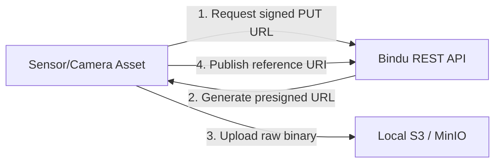

# Out-of-Band Media Storage User Guide

## 1. Overview
Bindu features a dynamic **Out-of-Band Media Storage** configuration plane. To keep message validation and MQTT transport speeds under sub-microsecond levels, large binary payloads (like videos, images, or audio captures) are uploaded directly to S3/MinIO compatible storage buckets instead of passing through the Bindu broker.

Bindu acts as a **Cryptographic Control Plane** to authorize, sign, and validate these transfers using temporal presigned URLs.



---

## 2. Configuration via MediaStorageSet
The storage configurations are dynamic system messages replicated across the mesh:
* **LWW (Latest-Write-Wins):** The system always respects the last configuration published.
* **Mesh Replication:** Applying a new configuration at the root node broadcasts it to all edge gateway nodes.
* **Auto-Hydration:** The configuration is persisted in the local SQLite database so that it loads automatically upon system restarts.
* **Encrypted Secret Enforcement:** `secret_key` is strictly enforced with semantic type `"secret"` (`"secret:KEY_NAME"`). Plain-text passwords are automatically rejected upon ingress, guaranteeing zero plain-text credential leaks across the MQTT bus or SQLite ledger. The actual password is stored encrypted in `accessControlConfig.brs` and resolved dynamically by the storage control plane.

---

## 3. Presigned URLs API Interfaces
Plugins, sensor assets, or third-party web clients can use the following HTTP REST endpoints (Basic Auth required).

### 3.1. Download/Stream URL (GET)
* **Endpoint:** `GET /api/v1/media/resolve`
* **Query Parameters:**
    * `provider` (required): S3 provider ID alias (e.g. `minio_local`)
    * `bucket` (required): S3 bucket name (e.g. `raw`)
    * `key` (required): Target S3 object key (e.g. `camera/patio-1.jpeg`)
    * `ttl` (optional): Token expiration duration (default: `15m`, e.g. `5m`, `1h`)
* **Response (JSON - 200 OK):**
  ```json
  {
    "success": true,
    "message": "Media URL resolved successfully",
    "details": {
      "url": "http://localhost:9000/raw/camera/patio-1.jpeg?X-Amz-Algorithm=AWS4-HMAC-SHA256&..."
    }
  }
  ```

### 3.2. Upload URL (GET)
* **Endpoint:** `GET /api/v1/media/upload-url`
* **Query Parameters:**
    * `provider` (required): S3 provider ID alias
    * `bucket` (required): S3 bucket name
    * `key` (required): Target S3 object key
    * `ttl` (optional): Token expiration duration (default: `15m`)
* **Response (JSON - 200 OK):**
  ```json
  {
    "success": true,
    "message": "Upload URL generated successfully",
    "details": {
      "url": "http://localhost:9000/raw/camera/patio-1.jpeg?X-Amz-Algorithm=AWS4-HMAC-SHA256&..."
    }
  }
  ```
* **Uploading via PUT:**
  Perform an HTTP PUT request directly to the returned URL containing the binary bytes of the file in the request body.

### 3.3. Delete Media Object (DELETE)
* **Endpoint:** `DELETE /api/v1/media/delete` (also supports `POST` for legacy HTTP clients)
* **Query Parameters:**
    * `provider` (required): S3 provider ID alias
    * `bucket` (required): S3 bucket name
    * `key` (required): Target S3 object key
* **Response (JSON - 200 OK):**
  ```json
  {
    "success": true,
    "message": "Media object deleted successfully"
  }
  ```

### 3.4. Dynamic Configuration (POST)
* **Endpoint:** `POST /api/v1/storage/configure`
* **Request Format:** Form-urlencoded parameters or JSON body:
    * `provider_id`: Unique target alias (e.g., `minio_local`)
    * `endpoint_url`: S3 HTTP connection endpoint (e.g., `http://localhost:9000`)
    * `access_key`: S3 user token credential (supports `"secret:KEY_NAME"` to resolve from encrypted access control)
    * `secret_key`: S3 password credential reference (strictly enforced: must match `"secret:KEY_NAME"` resolved dynamically from encrypted access control)
* **Response (JSON - 200 OK):**
  ```json
  {
    "success": true,
    "message": "Storage configuration broadcast successfully"
  }
  ```

## 4. Message Type Property Validation

To associate out-of-band files (images, audio, video) with semantic messages, you can define properties in your Message Type schema with the custom type `"media-storage"`.

### 4.1. Message Type Definition Example
```json
{
  "name": "PatioMonitorMedia",
  "properties": [
    {
      "name": "patio_view",
      "type": "media-storage",
      "required": true,
      "description": "Out-of-band media reference pointing to patio camera frame capture"
    }
  ]
}
```

### 4.2. Validation Rules & Format
When a message of this type is published, Bindu strictly enforces type validation on properties defined as `"media-storage"`:
1. **Data Type:** The value assigned to the property must be a `string`. If not, validation fails with an error (e.g., `field 'patio_view' must be string`).
2. **URI Format:** The string must match the exact regular expression:
   `^[a-zA-Z0-9_-]+://[a-zA-Z0-9_-]+/.+$`
   This guarantees the reference URI is in the canonical format:
   `provider_id://bucket/key`

#### Valid Examples:
* `minio_local://raw/camera/patio-1.jpeg`
* `aws_s3_prod://telemetry/recordings/video_001.mp4`

#### Invalid Examples (will fail validation):
* `http://localhost:9000/raw/camera/patio-1.jpeg` (HTTP URL references are not allowed; use the canonical scheme)
* `camera/patio-1.jpeg` (missing provider scheme)
* `/tmp/camera/patio-1.jpeg` (local file paths are not allowed)

If validation fails, the message is rejected, returning:
`field 'patio_view' has invalid media-storage URI format; must match 'provider_id://bucket/key'`

---

## 5. Canonical Semantic Key & URL Architecture Pattern 🧭📦

To empower autonomous AI agents (such as Agy) and automated Garbage Collection pipelines with zero-overhead discovery, Bindu establishes a standard **Semantic URI & Key Convention**:

$$\text{Semantic URI} = \texttt{\{provider\}://\{bucket\}/\{message\_type\}/\{producer\}/\{filename\}}$$
$$\text{S3 Object Key} = \texttt{\{message\_type\}/\{producer\}/\{filename\}}$$

### Why this pattern is essential for AI & Platform Governance:
1. **Self-Describing Identity:** The object path in MinIO/S3 explicitly declares its originating schema (`message_type`) and device (`producer`) without reading binary bytes or querying database tables.
2. **Schema-Driven Lifecycle (TTL):** AI models and maintenance reactors read `schema.types[message_type].retention_value` directly from in-memory CEL (`celext`) and calculate the exact eviction cutoff timestamp ($T - \text{retention}$).
3. **Prefix-Scoped Pruning:** MinIO S3 API `ListObjectsV2(Prefix="{message_type}/")` enables instant, sub-millisecond targeted batch pruning per domain.
4. **Referential Integrity:** Messages in SQLite and binary assets in MinIO stay perfectly synchronized without dangling pointers or broken links.

---

## 6. End-to-End Tutorials

Learn how to build, deploy, and govern out-of-band media systems in Bindu:
* **[Out-of-Band Media & Multimodal AI Vision Tutorial](./media-storage-tutorial/tutorial_guide.md):** Demonstrates camera uploads, presigned URLs, and vision inference with Ollama.
* **[MinIO Media Storage Retention & Automatic Cleanup Tutorial](./media-storage-cleanup-tutorial/tutorial_guide.md):** Autonomous 2-stage garbage collection pipeline (4:00 AM CEL Inspector + REST Egress) using semantic URLs and TTL deduction.

