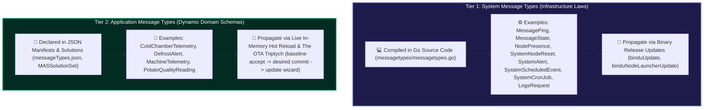

# Bindu Message Types User Guide

## Overview

A Message Type is the semantic contract for a message in Bindu. It defines:

- identity (`name`, `description`, `emoji`, optional `version`)
- payload schema (`properties[]`)
- retention behavior (`retentionMode`, `retentionValue`)
- routing behavior (`routing`)
- persistence (`persist`)

All runtime behavior starts from this contract.

The active message type registry in `root` is the single source of truth for running systems.
Repo files, plugin-local JSON files, and samples may exist as proposal or bootstrap artifacts, but the live system validates against what `root` currently has loaded.

## Core Rules

1. Every published message must use an existing `$type`.
2. `fields` in runtime messages must satisfy the Message Type schema.
3. Routing and persistence are controlled by the Message Type definition.
4. Plugins should consume and produce only declared types.

---

## 🏛️ The Two Tiers of Message Types: System vs Application

Understanding the lifecycle separation between System schemas and Application schemas is vital:



### 1. System Message Types (Tier 1)
* **Definition:** Fixed operational contracts that define the Bindu operating fabric itself (heartbeats, presence, node resets, scheduled timers, diagnostic logs, and alerts).
* **Location in Code:** Defined in Go inside `messagetypes/messagetypes.go` (`SystemMessageTypes`).
* **Distribution Across Mesh:** Shipped inside the compiled Go binaries (`bindu-node`, `bindu-root`). They evolve with **Platform Releases and Binary Updates** (`binduUpdate`, `binduNodeLauncherUpdate`). They are NOT modified or synchronized via application JSON manifests.

### 2. Application / Solution Message Types (Tier 2)
* **Definition:** Domain-specific business contracts created by developers, solutions architects, or autonomous AI agents for MAS solutions.
* **Location:** Stored dynamically in `runtime/config/messageTypesConfiguration.json` and bundled in `MASSolutionSet` manifests.
* **Distribution Across Mesh:** Hot-reloaded in memory with zero downtime via `bindu-studio message-types merge / import` and rolled out to edge nodes via the **Universal Runtime OTA Triptych** (`runtime baseline accept` $\rightarrow$ `runtime desired commit` $\rightarrow$ `runtime update wizard`).

---

## Canonical Structure

```json
{
  "name": "HelloWorld",
  "description": "Example message type",
  "emoji": "👍",
  "version": "1.0.0",
  "properties": [
    {
      "name": "greeting",
      "type": "string",
      "required": true,
      "description": "Greeting text"
    }
  ],
  "retentionMode": "count",
  "retentionValue": 1,
  "routing": ["local", "parent"],
  "persist": true
}
```

## Field Semantics

- `name`: stable semantic identifier and the main compatibility anchor.
- `version`: optional informational metadata only. It is not the primary compatibility mechanism.
- `properties[]`: payload schema defining the fields inside `fields`. Each property definition requires:
  - `name`: the field name (camelCase or snake_case).
  - `type`: one of the supported data types:
    - `"string"`: text strings.
    - `"number"` or `"integer"`: floating-point or integer numeric values.
    - `"boolean"`: boolean `true`/`false`.
    - `"date-time"`: ISO-8601 UTC timestamp string format.
    - `"media-storage"`: Out-of-band S3/MinIO binary storage reference matching `'provider_id://bucket/key'`.
    - `"secret"`: Encrypted reference pointer matching `'secret:KEY_NAME'` referring to an integration credential stored securely in `accessControlConfig.brs`. Plain-text credentials (e.g. raw API keys or passwords) are strictly rejected upon message ingress to prevent secret leaks across the MQTT bus and cluster ledger.
    - `"object"`: nested JSON object (requires `properties`).
    - `"array"`: ordered list of elements.
  - `required`: boolean indicating whether the field must be present.
  - `description`: human-readable and AI-explainable definition of the field.

> [!NOTE]
> **Array Items Contract & Supported Item Types**:
> Bindu's JSON Schema engine and runtime validator natively support strictly typed arrays for all core JSON types:
> 1. **Array of Numbers**: `"items": { "type": "number", "minimum": ..., "maximum": ... }` (e.g. 3D coordinates, raw sensor floats, FFT bins).
> 2. **Array of Integers**: `"items": { "type": "integer", "minimum": ..., "maximum": ... }` (e.g. port allocations, discrete hardware IDs).
> 3. **Array of Booleans**: `"items": { "type": "boolean" }` (e.g. multi-relay states, digital pin banks).
> 4. **Array of Strings**: `"items": { "type": "string", "pattern": "...", "enum": [...] }` (e.g. tags, category lists).
> 5. **Array of Objects**: `"items": { "type": "object", "properties": [ ... ] }` (nested structured collections).
>
> **Best Practice for Spatial Coordinates & Dashboards (Flat vs. Array)**:
> - **Flat Scalar Fields (Recommended for Zero-RAG Dashboards & CEL)**: For 2D Cartesian positions and spatial digital twins, defining discrete scalar numbers (`coordinates_x`, `coordinates_y`, `zone_center_x`, `zone_center_y`) remains the recommended pattern. This allows Dashboards (`view.x: "pos_x"`, `view.y: ["pos_y"]`) and CEL kinetics (`fields.coordinates_x > 10.0`) to query values directly without error-prone array indexing (`coordinates[0]`).
> - **Native Primitive Arrays**: Use `"type": "array"` with `"items": { "type": "number" }` when transmitting variable-length vectors, embeddings, coordinate polylines, or multi-sensor series. Bindu strictly enforces item typing and numeric boundary constraints (`minimum`/`maximum`) upon message ingress.

- `retentionMode`:
  - `none`: transient stream or passthrough (`retentionValue` must be `0`).
  - `count`: keep last N messages in local sliding window (`1 <= retentionValue <= 100`).
  - `days`: keep messages for N calendar days (`1 <= retentionValue <= 30`).
- `retentionValue`: numeric retention duration or count matching `retentionMode`.
- `routing`:
  - `local`, `parent`, `child`.
- `persist`:
  - `true`: store in local SQLite message database for the duration of the retention window.
  - `false`: transient in-memory forwarding.

## Retention Semantics & MAS Architectural Philosophy

> [!IMPORTANT]
> **Bindu is a Multi-Agent System (MAS) for Real-Time Edge Intelligence and Autonomous Decision-Making — NOT a Business Intelligence (BI) Data Warehouse, Time-Series Historian, or OLAP Lake.**

### Hard Validation Limits
The Bindu schema validator strictly enforces the following bounds:
- **`count`**: Maximum **100** items ($1 \le \text{retentionValue} \le 100$).
- **`days`**: Maximum **30** days ($1 \le \text{retentionValue} \le 30$).
- **`none`**: Must be **0**.

Any schema attempting to set `retentionValue > 100` (count) or `> 30` (days) will be rejected during cross-validation.

### Why Retention is Intentionally Bounded
1. **Real-Time Edge Context**: Retention in Bindu exists exclusively to provide **short-term sliding state** for edge agents, reactive CEL triggers, AI orchestrators, and sliding-window aggregations.
2. **Edge Hardware Footprint**: Bindu edge gateways run on resource-constrained hardware (e.g., Raspberry Pi, industrial edge gateways). Storing massive historical volumes exhausts local flash storage and degrades SQLite query latencies.
3. **Intent-Aligned Sizing**:
   - **Command & Trigger Events** (e.g., `MeshAuditTrigger`, `InitReader`): Retention should be `1` (or count `1..3`). Once delivered and evaluated by edge reactors, triggers do not require historical backlog accumulation.
   - **Operational State & Periodic Signals** (e.g., `FreezerTelemetry`, `TemperatureReading`): Retention of `count: 1..20` or `days: 1..7` is ideal for anomaly detection and baseline delta calculations.

### Handling Historical Analytics & BI
If your organization requires long-term historical analysis, multi-year reporting, or deep OLAP queries:
- **Stream Out-of-Band to BI/Data Warehouse**: Use Bindu REST Call Reactors, MQTT bridge subscribers, or export pipelines to ship real-time events to your external BI infrastructure (ClickHouse, Snowflake, Elasticsearch, TimescaleDB, BigQuery, etc.).
- **BI as a Message Producer**: When external BI systems compute heavy historical aggregations, predictive forecasts, or daily risk classifications, they publish these distilled facts **into Bindu as a Message Producer** (e.g., `DailyForecastModel`). Bindu edge agents then use these pre-calculated business insights to govern real-time operations without carrying the historical storage burden.

## Runtime Envelope vs Schema

Message Type defines the payload schema. Runtime messages include envelope + fields:

```json
{
  "$type": "HelloWorld",
  "$producer": "root",
  "$user": "bindu-system",
  "$group": "defaultGroup",
  "$when": "2026-01-01T00:00:00Z",
  "fields": {
    "greeting": "Hello World"
  }
}
```

`$type` must match the Message Type `name`.

## Compatibility Rule

Bindu should evolve message types with the simplest possible rule:

- compatible change: keep the same name
- add optional fields when possible
- add required fields only when they are truly part of the minimum contract
- incompatible semantic change: create a new message type name

This is preferred over trying to make runtime behavior depend on message type versions.

## Common Operator Tasks

### Create/update Message Types (Zero Downtime)

Use Studio/Console Message Types page or CLI import/export flows.

> [!TIP]
> **Zero Downtime Hot Reload**: Message Type modifications are **hot-reloaded in memory** with zero downtime. Neither `bindu-root` nor edge nodes require a process restart when Message Types are added, updated, or deleted.

When changes are made via Console UI or Studio CLI, the running Bindu Root automatically refreshes its active in-memory registry (`POST /api/v1/message-types/reload`).

Useful CLI distinction:

- `bindu-studio message-types import`
  - append-only
  - adds new message type names
  - refuses to overwrite an existing name
  - automatically triggers live in-memory reload on running root
- `bindu-studio message-types update-type`
  - replaces one existing message type by name
  - validates the new definition
  - revalidates the full collection before saving
  - automatically triggers live in-memory reload on running root
- `bindu-studio message-types reload`
  - explicitly triggers hot reload of `messageTypesConfiguration.json` into memory on running `bindu-root`
- `bindu-studio message-types gen-go`
  - generates strongly-typed Go structs (`types_gen.go`) mapping all message properties from JSON schemas
  - eliminates runtime `SCHEMA_INVALID` errors by moving payload validation to compile-time (`go build`)
  - generates `.ToMap()`, `.ToMessage()`, `Parse*()`, and generic `Ptr()` helper for optional fields
- `bindu-studio message-types gen-examples`
  - generates compliant sample JSON messages from schemas into `examples/out/<MessageType>.json`
  - validates generated fixtures against both dynamic schema and generic message envelope
  - pre-feeds `bindu-studio plugin certify` for automatic Level 1 verification

Examples:

```bash
# Import message types (hot-reloaded automatically)
bindu-studio message-types import \
  --in-path ./my-new-message-types.json --all

# Update a single message type (hot-reloaded automatically)
bindu-studio message-types update-type BinduCVPluginConfig \
  --in-path ./bindu-cv/bindu-cv-message-types.json

# Explicitly trigger hot-reload on live root
bindu-studio message-types reload --auth console:StrongPass123

# Generate Go structs for plugin development (compile-time safety)
bindu-studio message-types gen-go \
  --config ./poc_message_types.json \
  --out ./bindu-my-plugin/types_gen.go \
  --package main

# Generate sample JSON fixtures for Level 1 plugin certification
bindu-studio message-types gen-examples \
  --config ./poc_message_types.json \
  --out ./bindu-my-plugin/examples/out
```

### Validate compatibility before plugin deploy

- ensure all `messageTypesOut` from plugin already exist
- ensure required fields/types match plugin output

### Safe delete policy

Do not delete a Message Type if it is in active use by plugins or operations.

## Good Practices

1. Keep names stable and explicit (`NodePresence`, `HelloWorldStats`).
2. Prefer additive schema changes when possible.
3. Keep retention/routing aligned with operational intent.
4. Use descriptions for human readability and AI explainability.
5. Treat `root` as the live semantic registry.
6. If a change breaks meaning, use a new message type name instead of schema-version negotiation.

## Related Docs

- `bindu_reset_and_reload_lifecycle_guide.md`
- `publish_message_user_guide.md`
- `queries_user_guide.md`
- `bindu-studio-plugin-user-guide.md`
- `retention_policies_guide.md`
- `routing_and_directionality_guide.md`
