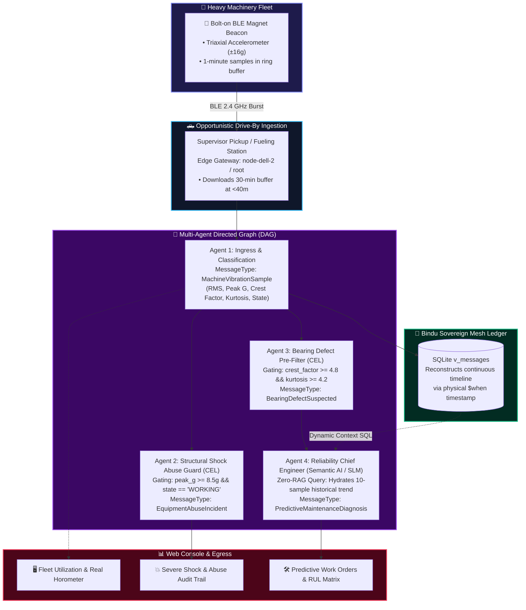

# 🚜 Heavy Equipment Non-Invasive Vibration CBM & Fleet Health Tutorial
### Bolt-on Triaxial BLE Beacons, Drive-By Store-and-Forward Timeline Reconstruction, Crest Factor + Kurtosis CEL Gating, and Cognitive SLM Maintenance Diagnoses

Welcome to the **Heavy Equipment Non-Invasive Condition-Based Monitoring (CBM) & Fleet Health MAS** tutorial.

This hands-on guide walks you step-by-step through designing, testing, deploying, and operating a distributed edge intelligence solution in Bindu for high-stakes **open-pit mining, quarrying, and heavy demolition** operations.

---

## 🧭 1. The Industrial Problem: Telemetry Friction & Warranty Lock-in

In heavy mining and demolition, excavators (e.g. Caterpillar 390F), haul trucks (Komatsu HD785), and hydraulic breakers (Epiroc HB) cost between $500,000 and $3,000,000 USD. Unscheduled mechanical breakdowns cost up to **$25,000 USD per hour** in lost production.

Yet fleet operators face three systemic roadblocks:
1. **The OEM CAN-Bus Lock-in:** Equipment manufacturers (CAT Product Link, Komatsu KOMTRAX) guard their CAN buses jealously. If an operator splices wires to install third-party IoT telemetry, distributors declare the powertrain warranty **void**.
2. **Mixed Fleet Blindness:** No mine runs a single brand. Fleet managers juggle 4 to 6 incompatible vendor portals with siloed, proprietary data.
3. **The "Blind Hour-Meter" Fraud:** Standard electrical hour meters only record if the ignition key is ON. They cannot distinguish whether a machine spent 7 hours idling (burning fuel with zero production) or working under severe strain.

### The Solution: Non-Invasive Bolt-On Triaxial BLE Beacons
By magnetically mounting an IP69K-sealed beacon with a 3-axis accelerometer ($\pm 16g$) to the external chassis or pump housing:
* **Zero Wires & Zero CAN Bus Touching:** Powertrain warranties remain 100% intact.
* **Universal Fleet Agnostic:** Installs identically on a 2024 Komatsu dumper or a 2008 Hitachi excavator.
* **Physics-Based Utilization:** Engine vibration frequency (10-30 Hz) detects engine idle, while dynamic broadband shock peaks classify real digging and rock breaking.

---

## 🏗️ 2. Architectural Overview: The Multi-Agent System (MAS) Graph

Following the [Black-Box Solution Creator specification](../BINDU.md), this MAS decomposes responsibility across 4 specialized agents:



---

## 🔬 3. Key Mechanical & Distributed System Innovations

### A. The Crest Factor + Kurtosis Dual Gating Formula
$$\text{Crest Factor} = \frac{\text{Peak G-Force}}{\text{Vibration RMS}}$$

In mechanical reliability engineering (ISO 10816 / ISO 13373), the biggest challenge is avoiding false alarms:
* **Heavy Digging in Hard Granite:** When an excavator loads massive boulders, both **Peak G** and **RMS** rise proportionally. The Crest Factor remains low ($\approx 3.0 - 3.4$).
* **Incipient Bearing Spalling (Stage 2 Defect):** When bearing balls strike micro-pits in the raceway, they emit high-amplitude transient spikes ($\text{Peak} \uparrow$) while continuous energy ($\text{RMS}$) remains normal. The Crest Factor spikes to **$5.0 - 8.5$**, and Kurtosis rises above $4.2$.

#### The Sub-Microsecond CEL Safety Valve:
Google CEL evaluates this condition in $2\,\mu\text{s}$:
```cel
has(payload.crest_factor) && has(payload.kurtosis) && 
double(payload.crest_factor) >= 4.8 && double(payload.kurtosis) >= 4.2
```
* If the machine is simply working hard, CEL evaluates to `false`. **Zero AI tokens spent. Zero false alarms.**
* If genuine micro-impact pitting is detected, CEL triggers `BearingDefectSuspected` and awakens the Cognitive SLM.

---

### B. Drive-By Store-and-Forward Timeline Reconstruction
Open-pit mines are massive canyons with zero cellular coverage. Continuous streaming is impossible.

1. **Circular Buffer in Beacon:** The beacon samples every 1 minute and stores the last 60 minutes in local Flash memory.
2. **Burst Download:** When a supervisor's truck drives past, the edge gateway downloads the 30-minute burst in 2 seconds.
3. **Temporal Fidelity in `v_messages`:**  
   * **Ingestion Time:** 10:45:00 AM (when the truck passed by).
   * **Event Time (`$when` / `sample_timestamp`):** 10:15:00, 10:16:00, 10:17:00...  
   Because Bindu indexes ledger views by `$when`, the SQL view `v_messages` seamlessly reconstructs the exact minute-by-minute operational timeline:
   ```sql
   SELECT "$when", fields.operating_state, fields.vibration_rms, fields.crest_factor 
   FROM v_messages 
   WHERE "$type" = 'MachineVibrationSample' AND "$producer" = 'CAT-390F-01' 
   ORDER BY "$when" ASC;
   ```

---

## 🛠️ 4. The 6 Standard Solution Artifacts

| Level | Artifact File | Purpose |
| :--- | :--- | :--- |
| **Level 0** | [`poc_message_types.json`](./poc_message_types.json) | Declares 5 strictly typed schemas (`MachineVibrationSample`, `EquipmentAbuseIncident`, `BearingDefectSuspected`, `PredictiveMaintenanceDiagnosis`, `MachineVibrationBatchIngress`). |
| **Level 1** | [`poc_cel_reactor_config.json`](./poc_cel_reactor_config.json) | Compiled Google CEL rules for sub-2µs abuse detection (`peak_g >= 8.5g`) and bearing defect gating (`crest >= 4.8 && kurtosis >= 4.2`). |
| **Level 2** | [`poc_semantic_reactor_config.json`](./poc_semantic_reactor_config.json) | Cognitive SLM (`qwen2.5-coder:0.5b`) with dynamic context hydration from `v_messages` producing actionable work orders and RUL estimates. |
| **Level 2** | [`poc_dashboards.json`](./poc_dashboards.json) | 3 Web Console Dashboards: Fleet Health & Real Horometer, Structural Abuse Incidents, and AI Predictive Maintenance Orders. |
| **Level 3** | [`mining_mas_solution.json`](./mining_mas_solution.json) | Master MAS Solution Manifest declaring topology, dependencies, and artifacts. |
| **Level 4** | [`deploy_mas_solution.sh`](./deploy_mas_solution.sh) | Universal deployment script for 1-click installation onto Bindu Root. |

---

## 🧪 5. Offline Preflight Verification (`dry-run`)

Before deploying to Root, you can verify all CEL rules and AI prompt hydration completely offline:

### Step 1: Verify Message Schemas
```bash
bindu-studio message-types validate --config ./poc_message_types.json
# Output: OK
```

### Step 2: Test the Structural Abuse Guard (CEL Dry-Run)
```bash
bindu-studio cel-reactor dry-run \
  --in-path ./poc_cel_reactor_config.json \
  --reactor-id mining-equipment-abuse-guard \
  --payload '{"machine_id": "KOMATSU-HD785-03", "machine_model": "Komatsu HD785 Haul Truck", "operating_state": "WORKING", "peak_g": 9.8, "vibration_rms": 1.9, "crest_factor": 5.15, "kurtosis": 3.8, "sample_timestamp": "2026-11-07T10:30:00Z"}'
```
*Expected Output:*
```text
✅ TRIGGER EVALUATION: PASSED (trigger_condition returned true)
CEL Execution: 9.987µs
Simulated Output: EquipmentAbuseIncident (severity: "SEVERE", incident_type: "ROCK_IMPACT_SHOCK_OVERLOAD")
```

### Step 3: Test the Crest Factor + Kurtosis Gating (CEL Dry-Run)
```bash
bindu-studio cel-reactor dry-run \
  --in-path ./poc_cel_reactor_config.json \
  --reactor-id mining-crest-kurtosis-gating \
  --payload '{"machine_id": "EPIROC-HB-02", "machine_model": "Epiroc HB Rock Breaker", "operating_state": "WORKING", "peak_g": 13.8, "vibration_rms": 2.3, "crest_factor": 6.0, "kurtosis": 4.85, "sample_timestamp": "2026-11-07T10:35:00Z"}'
```
*Expected Output:*
```text
✅ TRIGGER EVALUATION: PASSED
Simulated Output: BearingDefectSuspected (defect_stage: "STAGE_2_INCIPIENT_SPALLING")
```

### Step 4: Validate Semantic AI Reactor & Schema Alignment
```bash
bindu-studio semantic-ai-reactor validate \
  --file ./poc_semantic_reactor_config.json \
  --config ./poc_message_types.json
```
*Expected Output:*
```text
🎉 All 1 reactor configuration(s) validated with ZERO errors and ZERO warnings!
```

---

## 🚀 6. Deploying the MAS Solution to Root

Run the universal deployment script:

```bash
cd public/console/docs/mining-heavy-equipment-tutorial
./deploy_mas_solution.sh -y
```

This automates:
1. Merging the 5 `MessageTypes` into the active schema registry.
2. Deploying the 2 CEL kinetic reactors to the `root` node.
3. Activating the Cognitive SLM Semantic AI Reactor.
4. Materializing the 3 Web Console Dashboards.
5. Registering the MAS Solution manifest into the durable ledger.

---

## 🎮 7. Running the Fleet Simulation

Execute the Go fleet simulator:

### A. Dry-Run Mode (Inspect Generated Payloads)
```bash
go run ./simulate_mining_fleet.go --dry-run
```

### B. Live Telemetry Ingestion (Publishing to Bindu MQTT)
```bash
./simulate_mining_fleet.sh --all
```

### C. Test Drive-By Burst Mode Only
```bash
./simulate_mining_fleet.sh --burst
```

### Inspecting the Results in the Web Console:
Navigate to `http://localhost:8080/console/`:
1. **Fleet Health & Horometer:** View real-time classification showing `CAT-390F-01` transitioning from `IDLE` to `WORKING`.
2. **Abuse Incidents:** Verify that `KOMATSU-HD785-03` triggered an immediate `EquipmentAbuseIncident` when struck by a 10.4g impact.
3. **AI Predictive Maintenance:** See the `PredictiveMaintenanceDiagnosis` work order emitted by the SLM diagnosing Stage 2 bearing spalling for `EPIROC-HB-02` with an estimated 72-hour RUL.
