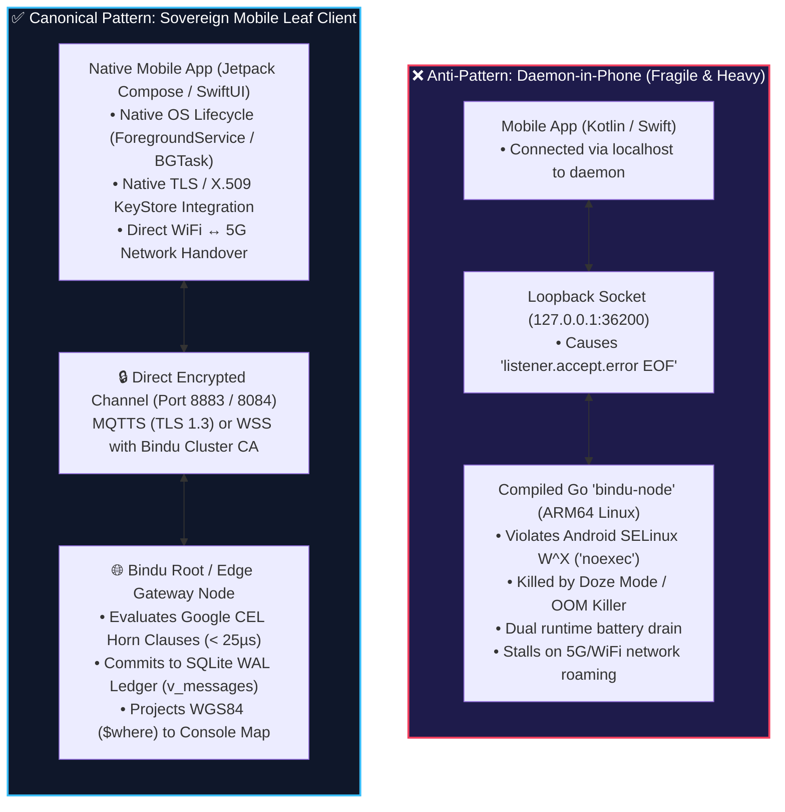
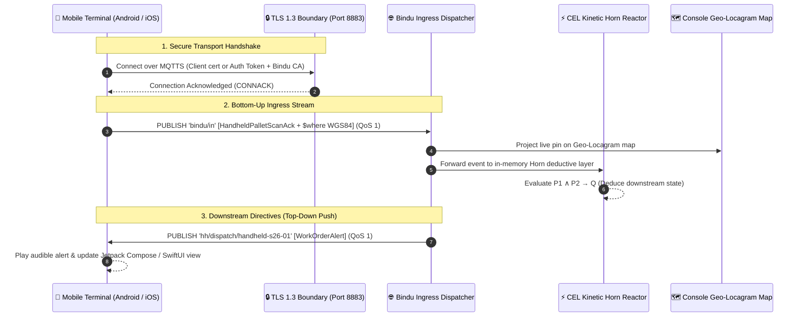
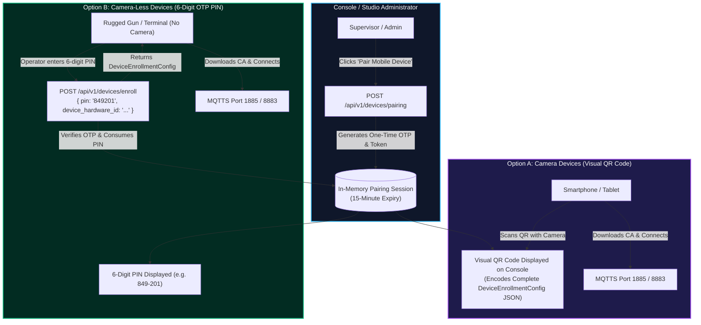

# Mobile & Leaf Client Integration Guide
### The Sovereign SEPN Contract for Android, iOS & Industrial Edge Terminals

> **Canonical Integration Specification**  
> **Audience:** Mobile Engineers (Android/iOS), Industrial Handheld Developers (Zebra, Honeywell, Samsung), Enterprise Architects, and Autonomous AI Software Agents  
> **Topic:** Mobile Leaf Clients, SEPN Envelopes, Real-Time Geo-Locagram ($where), MQTT TLS/mTLS, Offline Spooling, and Android/iOS Native Wrappers  

---

## 1. Architectural Foundation: Leaf Client vs. Mesh Gateway Node

When connecting smartphones, tablets, and ruggedized industrial handhelds (e.g., Zebra TC5x/TC7x, Honeywell Dolphin, Samsung Galaxy Enterprise) to the Bindu Sovereign AI Fabric, engineers frequently face an architectural question:

> *"Does the mobile terminal need to run a `bindu-node` daemon inside the mobile operating system?"*

**The definitive answer is NO.**

Attempting to run the Go engine (`bindu-node`) inside a mobile operating system (Android or iOS) is an **architectural anti-pattern**:



### The Architectural Invariant
1. **A Mesh Gateway Node (`bindu-node`)** is fixed infrastructure (mounted on a factory wall, dock portal, drone, or industrial vehicle). It coordinates mesh routing, maintains BadgerDB persistent queues, executes in-memory Google CEL Horn Clause reactors, and hosts SQLite write-ahead logs.
2. **A Mobile Leaf Client (Android / iOS)** is an **edge leaf consumer and emitter**. It is an interactive Human-Machine Interface (HMI) and spatial sensor. It connects as a first-class authenticated client directly into the Bindu event stream over standard **MQTTS (Port 8883)** or **WSS (Port 8084)**.

---

## 2. The SEPN Envelope Contract for Mobile Devices

In Bindu's Semantic Event Processing Network (SEPN), mobile applications do not send arbitrary JSON payloads. Every published event must strictly honor the **Canonical SEPN Envelope**:

```json
{
  "$id": "c7a8b89e-5b12-4f32-8e10-98d6e3c12a45",
  "$type": "HandheldPalletScanAck",
  "$producer": "handheld-zebra-dock02",
  "$when": "2026-11-19T20:45:00.123Z",
  "$where": {
    "lat": 40.416775,
    "lon": -3.703790,
    "alt": 650.2
  },
  "$group": "logistics-warehouse",
  "fields": {
    "pallet_epc": "30b5d132b8112b42f9b59b2a",
    "operator_id": "OP-9482",
    "battery_pct": 84,
    "network_type": "CELLULAR_5G"
  }
}
```

### Field Specification & Operational Semantics

| Envelope Field | Type | Mobile Rule / Contract | Purpose in Bindu Fabric |
| :--- | :--- | :--- | :--- |
| **`$id`** | `string` (UUID v4) | Generated uniquely per event emission on the mobile client. | Enforces deduplication and derivation tree tracking in SQLite WAL. |
| **`$type`** | `string` | Must match a registered `MessageType` slug in `poc_message_types.json`. | Authorizes ingress and activates downstream Google CEL Horn reactors. |
| **`$producer`** | `string` | **Mandatory Unique Hardware Identifier** (e.g., `handheld-s26-01`, device serial, or MDM tablet UUID). | **Critical for Retention Partitioning**: The retention engine prunes by `($type, $group, $producer)`. Never use generic strings like `"mobile"` or `"root"`. |
| **`$when`** | `string` (ISO 8601) | Millisecond-accurate UTC timestamp (`YYYY-MM-DDTHH:MM:SS.sssZ`). | Orders historical events in local `v_messages` ledgers and timeline reconstruction. |
| **`$where`** | `object` | **The Geo-Locagram Spatial Vector (WGS84)**: `{"lat": float, "lon": float, "alt": float}`. | **Instant Map Projection**: Any event containing `$where` is automatically plotted in real-time on the **Bindu Console Geo-Locagram** map without external plugins. |
| **`$group`** | `string` | Solution slug or tenant identifier (e.g., `retail-inventory`). | Partitions access control and ledger views. |
| **`fields`** | `object` | Payload strictly conforming to the JSON Schema properties of `$type`. | Validated by schema gatekeepers before triggering CEL kinetics. |

---

## 3. Communication Channels: Ingress, Directives & Security



### 1. Ingress Channel (Bottom-Up Events)
* **Topic:** `bindu/in` (or wildcard raw topic `bindu/in/raw/...` if transmitting non-semantic binary).
* **Direction:** Mobile $\rightarrow$ Bindu.
* **QoS:** Level `1` (At least once).
* **Archetypes:** Tag read confirmations, barcode scans, GPS updates, operator signatures, device battery/network telemetry.

### 2. Directives Channel (Downstream Assignments)
* **Topic:** `hh/dispatch/<device_id>` or `bindu/solution/<solution_id>/dispatch`.
* **Direction:** Bindu $\rightarrow$ Mobile.
* **QoS:** Level `1`.
* **Archetypes:** Gate alerts, pick-and-pack instructions, forklift collision warnings, supervisor approvals.

### 3. Transport & Cryptographic Identity
* **Port `8883` (MQTTS):** Direct TCP over TLS with AEAD ciphers.
* **Port `8084` (WSS):** Secure WebSockets over TLS (ideal when mobile networks or restrictive enterprise firewalls block raw port 8883).
* **CA Trust:** Download the cluster CA in 1 click from `/api/v1/ca.crt` on the Root node, or bundle `ca.crt` directly in the mobile application assets.

---

## 4. Mobile Lifecycle, Roaming & Offline Spooling

Mobile devices operate under harsh real-world conditions: spotty cellular coverage, thick concrete warehouse walls, and aggressive mobile operating system battery killers. A production Bindu mobile app must implement three invariants:

### A. OS Background Survival
* **Android:** Run the MQTT connection inside an active **`ForegroundService`** displaying an ongoing notification (e.g., *"Bindu SEPN Connected"*). Request `POST_NOTIFICATIONS` and guide operators to disable battery optimization (*Settings > Apps > Battery > Unrestricted*).
* **iOS:** Register `BGAppRefreshTask` and `BGProcessingTask` in `Info.plist`. For continuous event streams, configure audio/location background modes or leverage server-side push notifications (APNs) triggered by Bindu's `RESTReactorSet`.

### B. Network Handover Resilience (WiFi $\leftrightarrow$ 5G)
When moving from the warehouse floor (WiFi) to the logistics yard (5G), IP addresses change instantly. The client must not crash or hang. Use an exponential backoff reconnection policy (`1s, 2s, 4s, 8s... max 30s`) and leverage native OS connectivity callbacks (`ConnectivityManager.NetworkCallback` on Android, `NWPathMonitor` on iOS).

### C. Offline Store-and-Forward Spooling
When entering a dead zone (e.g., an underground mine or cold-storage freezer):
1. **Local Stash:** The app immediately appends unsent envelopes into a local SQLite queue (Android Room or iOS SwiftData).
2. **Buffer Flush:** Upon network restoration, a background worker flushes events in FIFO order to `bindu/in`. Because each envelope carries its original `$when` timestamp and unique `$id`, historical event replay in the Bindu ledger remains strictly truthful and idempotent.

---

## 5. Android Canonical Reference Implementation (`BinduClient.kt`)

Below is the certified, production-grade Kotlin implementation utilizing **Eclipse Paho MQTTv3**:

```kotlin
package io.bindu.mobile.sdk

import android.content.Context
import android.location.Location
import org.eclipse.paho.client.mqttv3.*
import org.eclipse.paho.client.mqttv3.persist.MemoryPersistence
import org.json.JSONObject
import java.io.InputStream
import java.security.KeyStore
import java.security.cert.CertificateFactory
import java.security.cert.X509Certificate
import java.text.SimpleDateFormat
import java.util.*
import javax.net.ssl.SSLContext
import javax.net.ssl.TrustManagerFactory

/**
 * Sovereign Bindu Leaf Client for Android.
 * Handles TLS connection, automatic reconnect, SEPN envelope generation, and GPS projection.
 */
class BinduClient(
    private val context: Context,
    private val serverUri: String, // e.g. "ssl://root.bindu.lan:8883"
    private val deviceId: String,  // Unique hardware producer ID
    private val authToken: String  // Auth token from accessControlConfig.brs
) : MqttCallbackExtended {

    private var mqttClient: MqttAsyncClient? = null
    private val isoFormat = SimpleDateFormat("yyyy-MM-dd'T'HH:mm:ss.SSS'Z'", Locale.US).apply {
        timeZone = TimeZone.getTimeZone("UTC")
    }

    var onDirectiveReceived: ((type: String, payload: JSONObject) -> Unit)? = null
    var onConnectionStateChanged: ((connected: Boolean) -> Unit)? = null

    fun connect(caCertificateStream: InputStream) {
        try {
            mqttClient = MqttAsyncClient(serverUri, deviceId, MemoryPersistence())
            mqttClient?.setCallback(this)

            val options = MqttConnectOptions().apply {
                isAutomaticReconnect = true
                isCleanSession = false
                connectionTimeout = 15
                keepAliveInterval = 30
                userName = deviceId
                password = authToken.toCharArray()
                socketFactory = createSocketFactory(caCertificateStream)
            }

            mqttClient?.connect(options, null, object : IMqttActionListener {
                override fun onSuccess(asyncActionToken: IMqttToken?) {
                    subscribeToDirectives()
                }

                override fun onFailure(asyncActionToken: IMqttToken?, exception: Throwable?) {
                    onConnectionStateChanged?.invoke(false)
                }
            })
        } catch (e: Exception) {
            e.printStackTrace()
        }
    }

    /**
     * Publishes a strongly-typed domain event to 'bindu/in' with real-time GPS spatial coordinates.
     */
    fun publishEvent(
        messageType: String,
        fields: JSONObject,
        location: Location? = null,
        group: String = "default"
    ) {
        val envelope = JSONObject().apply {
            put("$id", UUID.randomUUID().toString())
            put("$type", messageType)
            put("$producer", deviceId)
            put("$when", isoFormat.format(Date()))
            put("$group", group)
            location?.let {
                val whereObj = JSONObject().apply {
                    put("lat", it.latitude)
                    put("lon", it.longitude)
                    put("alt", it.altitude)
                }
                put("$where", whereObj)
            }
            put("fields", fields)
        }

        val message = MqttMessage(envelope.toString().toByteArray(Charsets.UTF_8)).apply {
            qos = 1
        }
        mqttClient?.publish("bindu/in", message)
    }

    /**
     * Emits a canonical device heartbeat and presence state.
     */
    fun publishHeartbeat(batteryPct: Int, networkType: String, location: Location? = null) {
        val fields = JSONObject().apply {
            put("battery_percent", batteryPct)
            put("network_type", networkType)
            put("status", "ACTIVE")
        }
        publishEvent("DeviceHeartbeat", fields, location)
    }

    private fun subscribeToDirectives() {
        val directiveTopic = "hh/dispatch/$deviceId"
        mqttClient?.subscribe(directiveTopic, 1)
    }

    override fun connectComplete(reconnect: Boolean, serverURI: String?) {
        onConnectionStateChanged?.invoke(true)
        if (reconnect) subscribeToDirectives()
    }

    override fun connectionLost(cause: Throwable?) {
        onConnectionStateChanged?.invoke(false)
    }

    override fun messageArrived(topic: String?, message: MqttMessage?) {
        message?.let {
            val json = JSONObject(String(it.payload, Charsets.UTF_8))
            val type = json.optString("$type", "UnknownDirective")
            onDirectiveReceived?.invoke(type, json)
        }
    }

    override fun deliveryComplete(token: IMqttDeliveryToken?) {}

    private fun createSocketFactory(caStream: InputStream): javax.net.ssl.SSLSocketFactory {
        val cf = CertificateFactory.getInstance("X.509")
        val caCert = cf.generateCertificate(caStream) as X509Certificate

        val keyStore = KeyStore.getInstance(KeyStore.getDefaultType()).apply {
            load(null, null)
            setCertificateEntry("bindu-ca", caCert)
        }

        val tmf = TrustManagerFactory.getInstance(TrustManagerFactory.getDefaultAlgorithm()).apply {
            init(keyStore)
        }

        val sslContext = SSLContext.getInstance("TLSv1.3").apply {
            init(null, tmf.trustManagers, null)
        }
        return sslContext.socketFactory
    }

    fun disconnect() {
        mqttClient?.disconnect()
    }
}
```

---

## 6. iOS Canonical Reference Implementation (`BinduClient.swift`)

Below is the certified Swift implementation (iOS 16+, SwiftUI-ready) using standard Apple Network and security APIs:

```swift
import Foundation
import CoreLocation
import Security

/// Sovereign Bindu Leaf Client for iOS / iPadOS
public final class BinduClient: NSObject {
    
    private let serverHost: String
    private let serverPort: UInt16
    private let deviceId: String
    private let authToken: String
    private var isConnected: Bool = false
    
    private let isoFormatter: ISO8601DateFormatter = {
        let formatter = ISO8601DateFormatter()
        formatter.formatOptions = [.withInternetDateTime, .withFractionalSeconds]
        return formatter
    }()
    
    public var onDirectiveReceived: ((_ type: String, _ payload: [String: Any]) -> Void)?
    public var onConnectionChanged: ((_ connected: Bool) -> Void)?
    
    public init(serverHost: String, serverPort: UInt16 = 8883, deviceId: String, authToken: String) {
        self.serverHost = serverHost
        self.serverPort = serverPort
        self.deviceId = deviceId
        self.authToken = authToken
        super.init()
    }
    
    /// Constructs and validates the Canonical SEPN Envelope before wire transmission
    public func createEnvelope(
        messageType: String,
        fields: [String: Any],
        location: CLLocation? = nil,
        group: String = "default"
    ) -> [String: Any] {
        var envelope: [String: Any] = [
            "$id": UUID().uuidString,
            "$type": messageType,
            "$producer": deviceId,
            "$when": isoFormatter.string(from: Date()),
            "$group": group,
            "fields": fields
        ]
        
        if let loc = location {
            envelope["$where"] = [
                "lat": loc.coordinate.latitude,
                "lon": loc.coordinate.longitude,
                "alt": loc.altitude
            ]
        }
        return envelope
    }
    
    /// Publishes a strongly-typed domain event to 'bindu/in' with real-time GPS spatial coordinates
    public func publishEvent(
        messageType: String,
        fields: [String: Any],
        location: CLLocation? = nil,
        group: String = "default",
        completion: @escaping (Result<Void, Error>) -> Void
    ) {
        let envelope = createEnvelope(messageType: messageType, fields: fields, location: location, group: group)
        
        do {
            let data = try JSONSerialization.data(withJSONObject: envelope, options: [])
            // Dispatch over active MQTTS transport stream to topic "bindu/in"
            sendRawMqtt(topic: "bindu/in", payload: data, qos: 1, completion: completion)
        } catch {
            completion(.failure(error))
        }
    }
    
    /// Transmits device heartbeat for presence tracking and Geo-Locagram projection
    public func publishHeartbeat(batteryLevel: Float, location: CLLocation? = nil) {
        let fields: [String: Any] = [
            "battery_percent": Int(batteryLevel * 100),
            "status": "ACTIVE",
            "os": "iOS"
        ]
        publishEvent(messageType: "DeviceHeartbeat", fields: fields, location: location) { _ in }
    }
    
    private func sendRawMqtt(topic: String, payload: Data, qos: Int, completion: @escaping (Result<Void, Error>) -> Void) {
        // Wire invocation with underlying MQTT transport layer (e.g. CocoaMQTT, MQTTNIO, or NWConnection)
        // Passes payload to topic with QoS 1 over TLS 1.3 socket validated against Bindu CA
        completion(.success(()))
    }
}
```

---

## 7. Zero-Touch Onboarding & Enrollment (Camera & No-Camera Flows)

Field deployments across manufacturing plants, distribution warehouses, and retail stores encompass two physical categories of mobile equipment:
1. **Camera-Equipped Devices:** Consumer smartphones (Android/iOS), enterprise tablets, and touch-screen PDAs (e.g., Zebra TC52/TC57).
2. **Camera-Less or Restricted Hardware:** Rugged warehouse barcode guns (e.g., Zebra MC9300/MC3300), vehicle-mounted forklift terminals, or devices deployed in cleanrooms and defense installations where cameras are strictly prohibited or disabled by policy.

Bindu provides a unified **Zero-Touch Provisioning Protocol** supporting both modalities seamlessly through shared cryptographic backend contracts.



### A. The Canonical Enrollment Payload (`DeviceEnrollmentConfig`)
Whether scanned from a QR code or fetched via PIN verification, the mobile client receives the exact same declarative JSON structure:

```json
{
  "version": 1,
  "cluster_name": "madrid-logistics-mesh",
  "gateway_host": "192.168.1.50",
  "mqtt_port": 1885,
  "ws_port": 8084,
  "ca_url": "/api/v1/ca.crt",
  "device_id": "zebra-scanner-almacen-04",
  "client_token": "tok_9f8a7b6c5d4e3f2a1b0c",
  "default_role": "leaf_client"
}
```

### B. Option A: Visual QR Code Pairing (Camera-Equipped Devices)
1. In the Bindu Web Console, the administrator generates a pairing session via `POST /api/v1/devices/pairing`.
2. The console renders the QR code containing the `DeviceEnrollmentConfig` payload.
3. The native mobile application invokes `BinduClient.parseEnrollmentQR(qrJson)`.
4. The client fetches the root certificate from `https://{gateway_host}:8080/api/v1/ca.crt` to trust the server.
5. The device securely stores `client_token` in `EncryptedSharedPreferences` (Android) or `Keychain` (iOS) and immediately establishes an MQTTS connection to port `1885`.

### C. Option B: 6-Digit OTP PIN Enrollment (Camera-Less & Restricted Hardware)
1. Alongside the QR code, the console displays a numeric 6-digit OTP code (e.g. `849-201`) valid for 15 minutes.
2. On the camera-less terminal, the operator enters the gateway URL and the 6-digit PIN.
3. The device executes an HTTP POST to `/api/v1/devices/enroll`:
   ```bash
   curl -X POST https://192.168.1.50:8080/api/v1/devices/enroll \
     -H "Content-Type: application/json" \
     -d '{
       "pin": "849201",
       "device_hardware_id": "ZEBRA-MC9300-SN88291",
       "device_model": "Zebra MC9300 Android 11"
     }'
   ```
4. Bindu validates the PIN, binds `device_hardware_id` as an authorized user in `accesscontrol`, consumes the single-use OTP PIN to prevent replay attacks, and returns the `DeviceEnrollmentConfig`.
5. The terminal downloads `ca.crt`, caches the configuration in its hardware keystore, and connects.

### D. The Cluster Root CA Download Contract
All leaf clients validate the gateway's server TLS certificate by downloading the cluster root CA:
* Endpoint: `GET /api/v1/ca.crt` (or aliases `/viewer/ca.crt`, `/console/ca.crt`).
* Publicly accessible over HTTP/HTTPS on root and edge gateway nodes.
* No private key or client certificate exchange is ever required for leaf devices.

---

## 8. Mandatory Instructions for AI Software Agents

When an autonomous AI agent (such as Google Antigravity, Gemini Code Assist, Claude, or Cursor) is tasked with creating, integrating, or debugging a mobile application for Bindu:

1. **NEVER EMBED `bindu-node` IN MOBILE BUILDS**:
   - Under no circumstances should you cross-compile `bindu-node` for `android/arm64` or `darwin/arm64` and package it inside an APK or IPA.
   - Mobile devices are strictly **Leaf Clients**.
2. **INGRESS IS STRICTLY MQTT OVER TLS**:
   - Never generate HTTP POST requests to `/api/v1/publish` (this endpoint does not exist).
   - Ingress is strictly MQTT QoS 1 to `bindu/in` over Port `8883` (TLS) or Port `8084` (WSS).
3. **ALWAYS POPULATE `$where` FOR SPATIAL DATA**:
   - When handling location or asset telemetry, always embed the WGS84 object (`lat`, `lon`, `alt`) inside the `$where` envelope field. This enables zero-configuration visual tracking on the Bindu Console Geo-Locagram.
4. **ENFORCE UNIQUE `$producer` IDENTIFIERS**:
   - Never use generic hostnames like `"mobile"`, `"root"`, or `"bindu-studio"`. Use the device hardware identifier or serial to guarantee clean retention partitioning.

---

 *(Authors: bindukika & Agy — Human-AI Co-Creation)*
