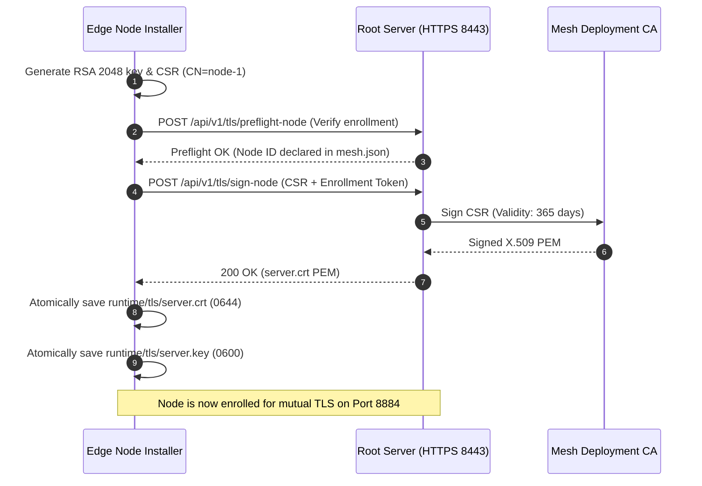

# Bindu mTLS & Certificate Lifecycle Guide
## Mesh PKI, Autonomous Renewal Policies & Operator Security Manual

This document is the authoritative guide on **mTLS (Mutual Transport Layer Security)**, Public Key Infrastructure (PKI), certificate renewal policies, and operational tooling in Bindu. It is designed for system administrators, security engineers, DevOps operators, and AI orchestrators.

---

## 1. Executive Summary & Security Philosophy

Bindu operates under a **Defense-in-Depth, Zero-Trust Execution Model**. All inter-node communication within the sovereign mesh is encrypted and mutually authenticated via **mTLS (TLS 1.2+ with AEAD ciphers)**.

```
                      ┌────────────────────────────────────────┐
                      │          Mesh Deployment CA            │
                      │  (runtime/tls/ca.crt | 10-Year Epoch)  │
                      └──────────────────┬─────────────────────┘
                                         │ Signs Leaf Certs (365 Days)
                   ┌─────────────────────┴─────────────────────┐
                   ▼                                           ▼
   ┌───────────────────────────────┐           ┌───────────────────────────────┐
   │       Root Server Cert        │           │        Node Edge Cert         │
   │    (runtime/tls/root.crt)     │           │    (runtime/tls/server.crt)   │
   │  SANs: IP, DNS:root, localhost│           │     SANs: DNS:<node_id>, IPs  │
   └───────────────────────────────┘           └───────────────────────────────┘
```

### Core Cryptographic Principles:
1. **Zero Cleartext Across the Mesh:** Port `8884` strictly requires mutual TLS (`RequireAndVerifyClientCert`). Plain TCP or unauthenticated connections are rejected at the TLS handshake level.
2. **Private Keys Never Travel:** Private keys (`*.key`) are generated locally on the respective host (Root or Edge Node) and **never leave the host filesystem**. Only Certificate Signing Requests (CSRs) and public certificates are exchanged over the wire.
3. **Strict Subject Alternative Name (SAN) Pinning:** Each node certificate contains SANs matching its immutable logical `node_id` (e.g. `DNS:node-1`, `DNS:root`) and IP bindings. The routing engine verifies certificate SANs against the topology to prevent node impersonation.
4. **POSIX Storage Hardening:** All TLS directories are locked to `0700` (`rwx------`), private keys to `0600` (`rw-------`), and public certificates to `0644` (`rw-r--r--`).

---

## 2. Certificate Hierarchy & Lifecycles

| Entity | Canonical Files | Validity Period | Managed By | Purpose |
|:---|:---|:---:|:---|:---|
| **Mesh Deployment CA** | `runtime/tls/ca.crt`<br/>`runtime/tls/ca.key` | **10 Years** | `bindu-install-root` | Single sovereign root of trust for the entire mesh deployment. |
| **Root Node Certificate** | `runtime/tls/root.crt`<br/>`runtime/tls/root.key` | **365 Days** (1 Year) | `bindu-install-root`<br/>`bindu-studio tls renew --self` | Authenticates Root server endpoints (HTTPS, MQTT mTLS, WebSocket bridges). |
| **Edge Node Certificate** | `runtime/tls/server.crt`<br/>`runtime/tls/server.key` | **365 Days** (1 Year) | `bindu-install-node`<br/>Autonomous CSR Renewal | Authenticates edge gateway nodes connecting to the Root cluster. |

---

## 3. Provisioning & First-Contact Enrollment

When a new edge node joins the mesh:

1. **Local Key Generation:** `bindu-install-node` generates an RSA 2048-bit private key on the local edge machine.
2. **Preflight Verification:** The installer communicates with Root via `POST /api/v1/tls/preflight-node` using an ephemeral enrollment token (`X-Enrollment-Token`) or admin credentials.
3. **CSR Submission:** The installer submits a Certificate Signing Request (CSR) with `CN=<node_id>` to `POST /api/v1/tls/sign-node`.
4. **Certificate Materialization:** Root signs the CSR using the Mesh Deployment CA and returns the signed X.509 certificate (`server.crt`).
5. **Secure Storage:** The edge node writes `server.crt` and `server.key` atomically to `runtime/tls/` with `0600` permissions.



---

## 4. Autonomous Background Renewal Policy

To guarantee zero downtime and eliminate operational outages caused by expired certificates:

* **Trigger Threshold (80% Lifetime):** When an active certificate reaches **80% of its validity period** (approximately **30 days remaining** before expiration), the node autonomously triggers a background renewal.
* **Mutual Authentication Re-Signing:** The node connects to `POST /api/v1/tls/renew-node` over its **existing valid mTLS connection**. Root verifies that the peer certificate's CommonName matches the requested node identity and issues a fresh 365-day certificate.
* **Atomic Disk Replacement:** The renewed certificate is written to disk atomically using temporary files and directory syncs, ensuring that partial power loss never leaves the host with corrupted TLS state.

---

## 5. Operator Command Center: `bindu-studio tls`

Operators can inspect, export, and manually trigger certificate operations using the `bindu-studio tls` command suite.

### 5.1 Inspect Certificate Health: `tls info`
Displays validity windows, days remaining, expiration status, SANs, and SHA-256 fingerprints:

```bash
bindu-studio tls info
```

*Output Example:*
```text
BINDUNET TLS CERTIFICATES
Directory: /opt/bindu/runtime/tls

📜 CA Certificate (ca.crt):
  Subject:     CN=Bindu Mesh Deployment CA, O=Bindu
  Issuer:      CN=Bindu Mesh Deployment CA, O=Bindu
  Valid From:  2026-10-06T13:00:00Z
  Expires:     2036-10-06T13:00:00Z (3650 days remaining)
  Fingerprint: a1b2c3d4e5f6...

🔒 Server Certificate (root.crt):
  Subject:     CN=root, O=Bindu
  Issuer:      CN=Bindu Mesh Deployment CA, O=Bindu
  Valid From:  2026-10-06T13:00:00Z
  Expires:     2027-10-06T13:00:00Z (365 days remaining)
  DNS SANs:    localhost, root, bindu-server
  IP SANs:     127.0.0.1, 192.168.1.50
  Fingerprint: f8e7d6c5b4a3...
```

To export as structured JSON for monitoring scripts:
```bash
bindu-studio tls info --json
```

---

### 5.2 Export Public CA Certificate: `tls export-ca`
Safely exports the public CA certificate (`ca.crt`) for distribution to new nodes, proxies, or browsers:

```bash
bindu-studio tls export-ca --out /tmp/bindu-mesh-ca.crt
```

---

### 5.3 On-Demand Certificate Renewal: `tls renew`
For security remediation, incident response, or scheduled maintenance windows, operators can force an immediate renewal without waiting for the 30-day background threshold.

#### A. Renewing Local Root Server Certificate (`--self`)
```bash
# Interactive mode (with confirmation prompt)
bindu-studio tls renew --self

# Non-interactive / CI automation mode
bindu-studio tls renew --self --yes

# Structured JSON output
bindu-studio tls renew --self --json
```

*Safety Features:*
- Verifies local node role is `root`.
- Derives all active IPv4 interfaces, loopback, and hostname SANs.
- Atomically replaces `runtime/tls/root.crt` and `runtime/tls/root.key`.

#### B. Dispatching Renewal to Edge Nodes (`--node`)
```bash
bindu-studio tls renew --node node-1 --auth console:StrongPass123
```

*Safety Features:*
- Validates that `<node-id>` is registered in `mesh.json`.
- Rejects `--node root` to avoid ambiguity (instructs operator to use `--self`).
- Dispatches a cryptographically signed renewal order over `bindu/in`.

---

## 6. Security Specialist & Compliance FAQ

### Q1: What happens if a node's private key is suspected of being compromised?
1. Execute `bindu-studio tls renew --node <node-id>` to force the node to generate a fresh private key pair and CSR.
2. If the physical hardware was stolen or decommissioned, remove the node from the active topology via `bindu-studio mesh remove <node-id>` and apply changes (`bindu-studio mesh apply`). Once removed from `mesh.json`, Root's mTLS listener and authhook reject all traffic from that node ID.

### Q2: What cipher suites are enforced on mTLS channels?
All TLS dialers and listeners enforce **TLS 1.2 minimum** and restrict cryptography to modern AEAD cipher suites:
- `TLS_ECDHE_ECDSA_WITH_AES_128_GCM_SHA256` / `TLS_ECDHE_RSA_WITH_AES_128_GCM_SHA256`
- `TLS_ECDHE_ECDSA_WITH_AES_256_GCM_SHA384` / `TLS_ECDHE_RSA_WITH_AES_256_GCM_SHA384`
- `TLS_ECDHE_ECDSA_WITH_CHACHA20_POLY1305_SHA256` / `TLS_ECDHE_RSA_WITH_CHACHA20_POLY1305_SHA256`

### Q3: How does Bindu prevent node identity spoofing?
During the mTLS handshake, Bindu's MQTT `authhook` extracts the client certificate's `CommonName` and SANs. When messages arrive on `bindu/in`, the dispatcher stamps the immutable header `$user: "mesh:<node_id>"` based strictly on the verified TLS session. Payload tampering of `$user` is ignored and normalized.

---

## 7. Operational Summary & Best Practices

| Action | Command | Typical Cadence |
|:---|:---|:---:|
| **Check Expiration** | `bindu-studio tls info` | Weekly / Automated Healthcheck |
| **Export CA for New Gateways** | `bindu-studio tls export-ca --out <path>` | During initial gateway provisioning |
| **Emergency Root Key Rotation** | `bindu-studio tls renew --self --yes` | Upon incident or pre-maintenance |
| **Emergency Node Key Rotation** | `bindu-studio tls renew --node <id>` | Upon incident or node hardware change |
| **Automatic Node Renewal** | Background daemon (`/renew-node`) | Autonomous at 80% lifetime (Day 335) |
