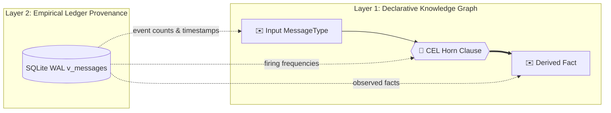

# 🧬 Bindu Ontology & Deductive Knowledge Graph User Guide

## 1. Overview & Formal Foundation

In Bindu, an **Ontology** is not an abstract, academic RDF/OWL file disconnected from operations. It is the **living, formal model of reality** running across the edge mesh:

* **Concept Nodes (Ground Terms & Invariants)**: Formally declared in `poc_message_types.json` / `MessageTypeConfig` schemas (with strict typing, retention policies, longevity, and directionality rules).
* **Deductive Horn Clauses ($P_1 \land P_2 \dots \rightarrow Q$)**: Google CEL reactors evaluating real-time propositions in sub-microsecond Go memory.
* **Ground Term Extractors**: Semantic AI reactors (SLMs, VLMs) translating analog sensor inputs into structured facts.
* **Empirical Ledger Event Activity**: The immutable SQLite WAL transaction log (`v_messages`), recording every assertion, producer, and derivation timestamp.

---

## 2. The Two Layers of Bindu's Ontology



1. **Declarative Layer (Static)**:
   - Defines what *can logically exist and be deduced* in the system before the first byte arrives.
   - Maps inputs (`input_message_type`), context queries (`context_query`), Horn rules, and deduced outputs (`output_message_type`).
2. **Empirical Layer (Dynamic Window)**:
   - Evaluates the ledger over a time interval $[t_{start}, t_{end}]$ (default: **Last 24 Hours**).
   - Annotates nodes with observed event volume, active producers (`$producer`), and first/last seen timestamps.
   - Measures edge transition frequencies.

---

## 3. Web Console `🧬 Ontology` Guide

Navigate to **`🧬 Ontology`** in the left sidebar of the Bindu Console.

### 3.1 Filtering & Scoping Controls
* **📦 Solution Filter**:
  - Automatically synchronized with the active MAS solution scope (`window.BinduMASScope`).
  - When scoped to an active solution (e.g. `potato-industrial-mas`), the graph displays **only** the MessageTypes, reactors, and plugins declared in that solution's manifest.
  - When set to `🌐 All Solutions (Global)`, the entire cluster topology is synthesized.
* **⏱️ Time Range Selector**:
  - Quick Presets: `Last 1 Hour`, `Last 24 Hours` (default), `Last 7 Days`, `Last 30 Days`, or `All Time (Declarative)`.
* **✉️ Message Types Filter**:
  - Searchable multi-select combobox allows isolating specific event chains (e.g. `PotatoRawScan`, `PotatoDefectDetected`).
* **⛶ Fullscreen Mode**:
  - Click `⛶ Fullscreen` to expand the interactive canvas into a maximized full-screen inspection workspace. Press `Esc` or click `✕ Exit Fullscreen` to return.

### 3.2 Interactive Canvas & Minimap Mirror
* **Drag & Pan**: Click and drag anywhere on the canvas to navigate large graphs.
* **Infinite Mouse-Wheel Zoom**: Scroll up/down to zoom smoothly between `0.1x` and `30.0x`. Floating buttons (`➕`, `➖`, `🔄`) provide one-click reset.
* **🗺️ Minimap Mirror**: Clones the rendered SVG into the top-right mirror box. Dragging inside the minimap window pans the main canvas view directly.
* **🎨 Deductive Legend**:
  - 🟦 `MessageType Schema`: Light blue box.
  - 🔷 `Observed Fact (Active)`: Darker blue border with observed event count.
  - 🟪 `CEL Horn Clause`: Purple hexagon ($P \land Q \rightarrow R$).
  - 🟩 `Semantic AI Grounding`: Green ellipse.
  - 🟧 `REST External Reactor`: Orange component.
  - 🟨 `BPR Hardware Plugin`: Amber folder.
  - `==>`: Forward-chaining deduction.
  - `-.->`: SQLite WAL context query dependency.

---

## 4. CLI Operation: `bindu-studio ontology`

### 4.1 Exporting the Ontology (`bindu-studio ontology export`)
Export the graph into standard industry formats:

```bash
# Export to Mermaid flowchart (.mmd) for documentation or Obsidian
bindu-studio ontology export --format mermaid --range 24h --out ./ontology.mmd

# Export to Graphviz DOT (.dot) for Gephi, Graphviz CLI, or PlantUML
bindu-studio ontology export --format dot --range 7d --out ./ontology.dot

# Export to D3/Cytoscape Node-Link JSON
bindu-studio ontology export --format json --solution potato-mas --out ./graph.json

# Export to W3C Linked Data JSON-LD (RDF/OWL standard)
bindu-studio ontology export --format json-ld --range all
```

#### Flags:
| Flag | Short | Default | Description |
| :--- | :---: | :---: | :--- |
| `--format` | `-f` | `mermaid` | Export format: `mermaid`, `dot`, `json`, `json-ld`. |
| `--range` | `-r` | `24h` | Time window preset: `1h`, `24h`, `7d`, `30d`, `all`. |
| `--start` | `-s` | `""` | RFC3339 start timestamp (e.g. `2026-11-10T00:00:00Z`). |
| `--end` | `-e` | `""` | RFC3339 end timestamp (e.g. `2026-11-10T23:59:59Z`). |
| `--types` | `-t` | `""` | Comma-separated whitelist of `MessageType` names. |
| `--solution` | | `""` | MAS Solution ID filter. |
| `--producer` | `-p` | `""` | Filter by producer ID or gateway node. |
| `--agent-type` | | `all` | Filter: `all`, `cel-reactor`, `semantic-ai-reactor`, `rest-reactor`, `bpr-plugin`. |
| `--include-properties` | | `false` | Include schema property details inside MessageType nodes. |
| `--out` | `-o` | `""` | Target output file (defaults to stdout). |

### 4.2 Inspecting Graph Integrity (`bindu-studio ontology inspect`)
Verify DAG invariants, calculate causal depths, and audit orphan schemas:

```bash
bindu-studio ontology inspect --range 24h
```

Output:
```text
💠 BINDU ONTOLOGY GRAPH SUMMARY
-------------------------------------------------------------
Scope:                Global (All MAS Solutions)
Total Message Types:  34 (9 active in observed window)
Deductive Reactors:   6
BPR Hardware Plugins: 4
Total Causal Edges:   18
Observed Event Count: 1,420
Deductive Depth:      4 levels
DAG Invariant:        Strictly Acyclic DAG (verified)
Orphan Schemas:       1
Dead-End Schemas:     3
```
