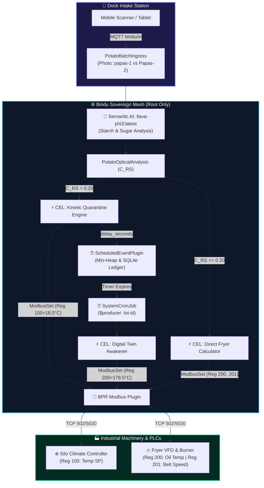

# 🥔 Tutorial Plan: Predictive Thermodynamic Control for Potato Processing Pipeline
### Distributed Time-Based State Machine, llava-phi3:latest Vision AI & Modbus PLC Actuation (Root-Only)

---

## 🎯 1. Executive Summary & Engineering Objective

This document defines the comprehensive engineering specification, mathematical derivations, architectural decisions, and contradiction analysis for the **Potato Processing Thermodynamic Pipeline & Digital Twin Awakening** Multi-Agent System (MAS) in Bindu.

The system automates the mitigation of **Cold-Induced Sweetening (CIS)** in post-harvest potato logistics and industrial chip manufacturing by synthesizing:
1. **Dockside Mobile Optical Sensing:** Ingesting raw potato slice images (`papas-1.png` vs `Papas-2.png`) and transit datalogger history via MQTT (`bindu/in`).
2. **Optical Starch & Sugar Analysis (Virtual Sensor):** Estimating the Reducing Sugar Coefficient ($C_{RS} \in [0.0, 1.0]$) using **`llava-phi3:latest`** and deterministic CEL fallback.
3. **Deterministic Thermodynamic Kinetics (CEL Reactors):** Computing first-order reconditioning times (Model A), Arrhenius frying oil temperatures (Model B), and Fickian moisture diffusion conveyor speeds (Model C).
4. **Distributed Time-Based State Machine:** Scheduling and waking up digital twins using Bindu's Go Core engine (`SystemScheduledEvent`, `SystemScheduledEventCancel`, `SystemCronJob`).
5. **Universal Modbus Hardware Actuation (BPR Plugin):** Writing holding registers to Silo climate controllers and Fryer VFDs over Modbus TCP.
6. **Root-Only Deployment:** Entire MAS executes on the `root` control plane (`target_nodes: ["root"]`), offloading edge gateways.
7. **Schedule Dashboards:** Dedicated `DashboardDefinition` entities monitoring active reconditioning timers and awakening events.
8. **Digital Twin Awakening Simulator (`simulate_cron_job.go` / `simulate_cron_job.sh`):** Dedicated CLI tool to test and demonstrate instant `SystemCronJob` dispatching and downstream Fryer PLC actuation without timer delays.



---

## 🔍 2. Analysis of Provided Specifications & Prompts: Contradictions & Improvements

| Document / Prompt | Original Proposal / Ambiguity | Bindu Architectural Conflict | Applied Improvement & Canonical Solution |
|---|---|---|---|
| **Prompt: MAS in Bindu (Step 1)** | Suggested using a cron-triggered agent dispatching `ModbusGet` to poll truck temperature. | In real agricultural intake, trucks arrive unpredictably; periodic polling disconnects temperature from batch optical slice inspection. | **Mobile Dock Ingress Event (`PotatoBatchIngress`):** The dock technician scans the batch using a mobile device/tablet, publishing an event with the optical slice photo and datalogger average transit temperature directly to `bindu/in` via MQTT. |
| **Prompt: MAS in Bindu (Step 3)** | Vaguely proposed "a dynamic scheduling agent that sets a new cron job based on calculated storage time". | Did not define persistence, reboot resilience, or digital twin partition preservation. | **Distributed Time-Based State Machine Core (`SystemScheduledEvent` & `SystemCronJob`):** Replaced with Bindu's native Min-Heap priority queue scheduler in Go core, persisting intentions to SQLite and awakening downstream CEL reactors with preserved `$producer = lot_id`. |
| **Vision Model** | Not specified in original prompts. | Need an edge-compatible, high-accuracy multimodal SLM. | **`llava-phi3:latest` via `AISemanticReactorSet`:** Local Ollama vision model analyzing starch opacity and dark translucent rings. |
| **Node Workload** | Ambiguous target nodes. | Edge gateways already burdened with other tasks. | **Root-Only Deployment (`target_nodes: ["root"]`):** Concentrates all vision analysis, kinetic modeling, and Modbus TCP bridge on `root`. |
| **Schedule Observability** | Missing UI for schedule tracking. | Operators cannot inspect scheduled timers in flight. | **Declarative Schedule Dashboards (`DashboardDefinition`):** Dedicated SQL queries monitoring active reconditioning timers and awakening events. |
| **API Keys & Credentials** | Plaintext tokens in reactor configurations (`ollama-local`). | Exposing plaintext credentials on the wire or in database ledgers violates the Zero-Plaintext Security Model. | **Centralized Secrets Vault (`accessControlConfig.brs`):** Uses canonical secret references `secret:POTATO_VISION_API_KEY` and `secret:minio_media_secret` managed via `bindu-studio access-control secrets`, guaranteeing zero plaintext in wire messages or git artifacts. |

---

## 🧪 3. Mathematical Foundations & Kinetic Models

### Model A: Tuber Reconditioning Kinetics (First-Order Decay)
$$[RS]_t = [RS]_{eq} + \left( [RS]_0 - [RS]_{eq} \right) e^{-kt} \implies t = -\frac{1}{k} \ln\left( \frac{[RS]_t - [RS]_{eq}}{[RS]_0 - [RS]_{eq}} \right)$$

### Model B: Frying Oil Temperature Adjustment (Arrhenius Equation)
$$k_{\text{color}} = A \cdot [RS]^n \cdot \exp\left( \frac{-E_a}{R \cdot T} \right) \implies T_{\text{oil}} = \text{ai.clamp}\left(185.0 - (C_{RS} \times 30.0), 165.0, 185.0\right)$$

### Model C: Conveyor Belt Speed / Frying Time (Fick’s Second Law)
$$MR = \frac{8}{\pi^2} \exp\left( \frac{-D_{\text{eff}} \cdot \pi^2 \cdot t_{\text{fry}}}{4L^2} \right) \implies v = \frac{L_{\text{fryer}}}{t_{\text{fry}}} \quad (\text{mm/s})$$

---

## 🗄️ 4. Hardware Modbus Register Allocation Map

| Block | Address | Type | Name | Scale Factor | Engineering Range | Target Machine |
|---|---|---|---|---|---|---|
| **Silo Climate** | `100` | Holding | `Silo_Temp_SP` | `10.0` | 10.0°C – 25.0°C (`100`–`250`) | Silo Heat Exchanger / Chiller |
| **Silo Climate** | `101` | Holding | `Silo_Duration_SP` | `1.0` | 0 – 30 Days | Silo Batch Controller |
| **Silo Climate** | `102` | Holding | `Silo_Fan_Speed_SP`| `1.0` | 0 – 1800 RPM | Silo Air Circulation VFD |
| **Fryer Line** | `200` | Holding | `Fryer_Oil_Temp_SP`| `10.0` | 160.0°C – 190.0°C (`1600`–`1900`) | Thermal Fluid Burner / Modulating Valve |
| **Fryer Line** | `201` | Holding | `Fryer_Belt_Speed_SP`| `1.0` | 10 – 60 mm/s | Conveyor Belt VFD Drive |
| **Fryer Line** | `202` | Holding | `Fryer_Exhaust_Blower_SP`| `1.0` | 0 – 100 % | Vapor Extraction Hood |
| **Intake / Truck**| `300` | Input | `Truck_Avg_Transit_Temp`| `10.0` | -10.0°C – 40.0°C (`-100`–`400`) | Truck Datalogger / BLE Bridge |
| **Intake / Truck**| `301` | Input | `Truck_Transit_Duration`| `1.0` | 0 – 120 Hours | Truck Datalogger / GPS Tracker |

---

## 🔐 5. Security & Integration Secrets Vault Contract (`accessControlConfig.brs`)

To satisfy the **Zero-Plaintext Wire & Ledger Guarantee**, the Potato Processing MAS strictly separates declarative schemas from sensitive third-party API credentials and storage passwords:

| Secret Key Identifier | Target Component | Default Local Value | Production Cloud Target |
|---|---|---|---|
| `POTATO_VISION_API_KEY` | `AISemanticReactorSet` (`potato-llava-optical-analyzer`) | `"ollama-local"` | `"sk-..."` (OpenAI / Anthropic / TypeSafe Vision) |
| `minio_media_secret` | Out-of-Band Media Storage (`minio_local`) | `"bindu-media-123"` | `"AWS_SECRET_ACCESS_KEY"` (S3 / Cloudian / Ceph) |

### Vault Management & Preflight Verification Commands:
```bash
# 1. Provision required integration secrets
go run ./cmd/bindu-studio access-control secrets set POTATO_VISION_API_KEY --value "ollama-local" --yes
go run ./cmd/bindu-studio access-control secrets set minio_media_secret --value "bindu-media-123" --yes

# 2. Verify registered secrets (names and metadata only, values masked)
go run ./cmd/bindu-studio access-control secrets list

# 3. Validate vault cryptographic integrity
go run ./cmd/bindu-studio access-control secrets validate
```

---

## 📊 6. Zero-RAG SQL Verification Queries

```sql
-- 1. Active Reconditioning Schedules
SELECT 
    "$when" AS scheduled_at,
    "$producer" AS lot_id,
    json_extract(raw_json, '$.fields.job_id') AS job_id,
    CAST(json_extract(raw_json, '$.fields.delay_seconds') AS INTEGER) AS duration_seconds,
    json_extract(raw_json, '$.fields.target_type') AS wakeup_target
FROM v_messages 
WHERE "$type" = 'SystemScheduledEvent'
ORDER BY "$when" DESC;

-- 2. Modbus PLC Actuations
SELECT 
    "$when",
    json_extract(raw_json, '$.fields.target_device') AS device,
    json_extract(raw_json, '$.fields.register_address') AS reg_addr,
    json_extract(raw_json, '$.fields.written_value') AS written_val,
    json_extract(raw_json, '$.fields.status') AS status
FROM v_messages 
WHERE "$type" = 'ModbusStatus'
ORDER BY "$when" DESC;
```
