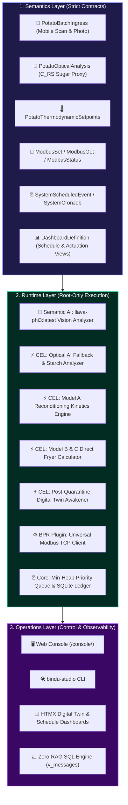

# 🥔 Potato Processing Thermodynamic Pipeline & Digital Twin Awakening Tutorial
### Co-Creating Multi-Agent Industrial Systems with Computer Vision (llava-phi3), CEL Kinetics, and Modbus PLCs

Welcome to the **Potato Processing Thermodynamic Pipeline** tutorial.

This hands-on guide walks you step-by-step through designing, deploying, and operating a distributed edge intelligence solution in Bindu. You will learn how to automate industrial potato chip manufacturing, mitigate **Cold-Induced Sweetening (CIS)**, utilize the **Distributed Time-Based State Machine** (`SystemScheduledEvent`, `SystemScheduledEventCancel`, `SystemCronJob`), inspect **Schedule Dashboards**, execute local vision reasoning using **`llava-phi3:latest`**, and interface with real-world **Modbus TCP PLCs** running entirely on the **`root`** node.

---

## 🧭 The Co-Creation Pattern & Architecture Overview

Following the principles established in the [Human & AI Co-Creation Guide](../Co-Creation%20Guide.md), this pipeline partitions responsibility across Bindu's 3 layers:



---

## 🎯 Architectural Highlights

1. **Root-Only MAS Deployment (`target_nodes: ["root"]`):** Concentrates the heavy vision inference (`llava-phi3:latest`), kinetic calculations, priority scheduling queue, and Modbus TCP communications on the `root` control plane, completely offloading busy edge nodes.
2. **Dual-Profile Mobile Ingress Simulator:** The dock scanner simulator supports preset options (`-potato 1` vs `-potato 2`) that demonstrate diametrically opposed physical and operational outcomes:
   * **Profile 1 (`papas-1.png`):** Cold-damaged tuber ($T_{\text{transit}} = 4.8^\circ\text{C} < 8.0^\circ\text{C}$) $\implies$ High sugar $C_{RS} \approx 0.41 > 0.20 \implies$ Model A triggers a 30s Silo Reconditioning Timer (`SystemScheduledEvent`) and sets Silo PLC Reg 100 to $18.0^\circ\text{C}$. When awakened via `SystemCronJob`, commands Fryer PLC Reg 200 to $178.5^\circ\text{C}$.
   * **Profile 2 (`Papas-2.png`):** Fresh, optimal harvest ($T_{\text{transit}} = 11.5^\circ\text{C} \ge 8.0^\circ\text{C}$) $\implies$ Low sugar $C_{RS} \approx 0.12 \le 0.20 \implies$ Direct fry approved! No silo quarantine needed; directly commands Fryer PLC Reg 200 to $181.4^\circ\text{C}$ and Reg 201 to $35 \text{ mm/s}$.
3. **Multimodal Vision Model (`llava-phi3:latest`):** Evaluates raw sliced potato images and transit datalogger history via local Ollama endpoints using structured JSON schemas.
4. **Dedicated Schedule Dashboards:** Live HTMX dashboards monitoring active silo quarantine timers, countdowns, awakened digital twins, and PLC register actuation history.

---

## 🧪 The Science: Cold-Induced Sweetening (CIS) & Kinetic Equations

When potatoes are transported or stored below **8°C–10°C**, the enzyme invertase catalyzes the conversion of starch into reducing sugars (glucose and fructose). Frying high-sugar potatoes at standard temperatures causes severe Maillard browning, burnt flavors, and acrylamide formation.

This system solves CIS dynamically through 3 sequential models:

### Model A: Silo Reconditioning (First-Order Kinetics)
If the optical sugar proxy $C_{RS} > 0.20$, the tuber is quarantined in a climate-controlled silo at $18.0^\circ\text{C}$:

$$[RS]_t = [RS]_{eq} + \left( [RS]_0 - [RS]_{eq} \right) e^{-kt} \implies t = -\frac{1}{k} \ln\left( \frac{[RS]_t - [RS]_{eq}}{[RS]_0 - [RS]_{eq}} \right)$$

* $[RS]_0 = C_{RS}$, $[RS]_t = 0.20\%$, $[RS]_{eq} = 0.05\%$, $k = 0.12 \text{ day}^{-1}$.
* If $C_{RS} = 0.41 \implies t = 11.5 \text{ days}$ (scaled to 30 seconds for live simulation).

### Model B: Frying Temperature Adjustment (Arrhenius Equation)
To maintain a constant Maillard reaction rate ($k_{\text{color}}$) regardless of sugar concentration:

$$k_{\text{color}} = A \cdot [RS]^n \cdot \exp\left( \frac{-E_a}{R \cdot T} \right) \implies T_{\text{oil}} = \text{ai.clamp}\left(185.0 - (C_{RS} \times 30.0), 165.0, 185.0\right)$$

### Model C: Frying Time & Conveyor Belt Speed (Fick’s Law)
Moisture removal to reach crispness ($MR = 0.02$):

$$MR = \frac{8}{\pi^2} \exp\left( \frac{-D_{\text{eff}} \cdot \pi^2 \cdot t_{\text{fry}}}{4L^2} \right) \implies v_{\text{belt}} = \frac{L_{\text{fryer}}}{t_{\text{fry}}} \approx 28 \text{–} 35 \text{ mm/s}$$

---

## 📊 1. Declarative Schedule & Actuation Dashboard Definitions

We declare two dedicated dashboards in [`poc_dashboards.json`](./poc_dashboards.json) conforming to the semantic state contract (`$group: "dashboard"`, `$producer: fields.id`):

### Dashboard 1: Silo Reconditioning & Awakening Schedules
```json
{
  "$type": "DashboardDefinition",
  "$group": "dashboard",
  "$producer": "potato-reconditioning-schedule-dashboard",
  "$id": "potato-reconditioning-schedule-dashboard",
  "fields": {
    "id": "potato-reconditioning-schedule-dashboard",
    "name": "🥔 Potato Silo Reconditioning & Awakening Schedules",
    "query": {
      "sql": "SELECT \"$when\" AS scheduled_at, \"$producer\" AS lot_id, json_extract(raw_json, '$.fields.job_id') AS job_id, CAST(json_extract(raw_json, '$.fields.delay_seconds') AS INTEGER) AS duration_seconds, json_extract(raw_json, '$.fields.target_type') AS wakeup_target, 'ACTIVE_QUARANTINE' AS status FROM v_messages WHERE \"$type\" = 'SystemScheduledEvent' ORDER BY \"$when\" DESC LIMIT 20"
    },
    "labels": {
      "scheduled_at": "Scheduled At",
      "lot_id": "Potato Batch (Lot ID)",
      "job_id": "Timer Job ID",
      "duration_seconds": "Duration (s)",
      "wakeup_target": "Wakeup Message Type",
      "status": "Quarantine Status"
    },
    "view": {
      "type": "table",
      "title": "Active Silo Reconditioning Schedules (Zero-RAG SQL)",
      "chart_type": "table",
      "x": "scheduled_at",
      "y": ["duration_seconds"]
    }
  }
}
```

---

## 🧠 2. Multimodal AI Vision Configuration (`llava-phi3:latest`)

In [`poc_semantic_reactor_config.json`](./poc_semantic_reactor_config.json), we configure the `AISemanticReactorSet` targeting the local Ollama vision endpoint:

```json
{
  "reactor_id": "potato-llava-optical-analyzer",
  "api_endpoint": "http://192.168.12.160:11434/v1/chat/completions",
  "api_key_secret": "secret:POTATO_VISION_API_KEY",
  "model_id": "llava-phi3:latest",
  "trigger_message_types": ["PotatoBatchIngress"],
  "response_message_type": "PotatoOpticalAnalysis",
  "system_instruction": "You are a specialized industrial computer vision analyzer for potato processing. Inspect raw sliced potato images and transit datalogger history to detect Cold-Induced Sweetening (CIS). Return raw JSON with: lot_id, reducing_sugar_index_crs, sugar_risk_level, starch_uniformity_score, translucent_defect_percent, optical_model_confidence, rationale."
}
```

> **🔐 Zero-Plaintext Wire Guarantee**: `api_key_secret` uses the vault reference `secret:POTATO_VISION_API_KEY`, securely resolved from `accessControlConfig.brs` at runtime. In the Bindu Console, this displays the green **🔐 Active Secret** badge, avoiding plaintext leaks across MQTT streams or SQLite audit logs.

---

## ⚡ 3. Declarative Google CEL Kinetic Reactors (`CELReactorSet`)

The deterministic mathematics (Models A, B, and C), threshold decisions, safety clamping (`ai.clamp`), and hardware command generations are defined in [`poc_cel_reactor_config.json`](./poc_cel_reactor_config.json):

```json
{
  "$type": "CELReactorSet",
  "$node-dest": "root",
  "$group": "mesh",
  "$producer": "root",
  "$user": "admin",
  "fields": {
    "gateway_node_id": "root",
    "reactors": [
      {
        "reactor_id": "potato-quarantine-scheduler",
        "input_message_type": "PotatoOpticalAnalysis",
        "trigger_condition": "has(payload.reducing_sugar_index_crs) && double(payload.reducing_sugar_index_crs) > 0.20",
        "output_message_type": "SystemScheduledEvent",
        "transformation_expression": {
          "job_id": "'silo-quarantine-' + string(payload.lot_id)",
          "delay_seconds": "30",
          "target_type": "'PotatoReconditioningWakeup'",
          "target_group": "'mesh'",
          "target_producer": "string(payload.lot_id)",
          "payload": "'{\"lot_id\":\"' + string(payload.lot_id) + '\",\"silo_id\":\"silo-01\",\"target_oil_temp\":178.5,\"target_belt_speed\":32.0}'"
        }
      },
      {
        "reactor_id": "potato-silo-climate-actuator",
        "input_message_type": "PotatoOpticalAnalysis",
        "trigger_condition": "has(payload.reducing_sugar_index_crs) && double(payload.reducing_sugar_index_crs) > 0.20",
        "output_message_type": "ModbusSet",
        "transformation_expression": {
          "target_device": "'silo_controller'",
          "register_type": "'holding'",
          "register_address": "100",
          "value": "18.0",
          "scale_factor": "10.0",
          "description": "'Silo climate reconditioning temperature setpoint (18.0 C)'"
        }
      },
      {
        "reactor_id": "potato-immediate-fryer-actuator",
        "input_message_type": "PotatoOpticalAnalysis",
        "trigger_condition": "has(payload.reducing_sugar_index_crs) && double(payload.reducing_sugar_index_crs) <= 0.20",
        "output_message_type": "ModbusSet",
        "transformation_expression": {
          "target_device": "'fryer_controller'",
          "register_type": "'holding'",
          "register_address": "200",
          "value": "ai.clamp(185.0 - (double(payload.reducing_sugar_index_crs) * 30.0), 165.0, 185.0)",
          "scale_factor": "10.0",
          "description": "'Optimal direct frying oil temperature calculated via Arrhenius kinetics'"
        }
      },
      {
        "reactor_id": "potato-silo-awakening-fryer-actuator",
        "input_message_type": "SystemCronJob",
        "trigger_condition": "has(payload.job_id) && payload.job_id.startsWith('silo-quarantine-')",
        "output_message_type": "ModbusSet",
        "transformation_expression": {
          "target_device": "'fryer_controller'",
          "register_type": "'holding'",
          "register_address": "200",
          "value": "178.5",
          "scale_factor": "10.0",
          "description": "'Post-reconditioning fryer oil temperature setpoint (178.5 C)'"
        }
      }
    ]
  }
}
```

---

## 🚀 4. The 8-Step Co-Creation Master Walkthrough

---

### Step 0: Provision Integration Secrets into the Vault (`accessControlConfig.brs`)
Before registering schemas or deploying the MAS solution, configure the required integration credentials into Bindu's encrypted access control store:

```bash
# 1. Provision the Vision AI API Key Secret (Ollama local default or cloud vision token)
go run ./cmd/bindu-studio access-control secrets set POTATO_VISION_API_KEY --value "ollama-local" --yes

# 2. Provision the Out-of-Band Media Storage (MinIO) Secret Key
go run ./cmd/bindu-studio access-control secrets set minio_media_secret --value "bindu-media-123" --yes

# 3. Verify that the required secrets exist in the vault (values masked)
go run ./cmd/bindu-studio access-control secrets list

# 4. Check specific secret metadata
go run ./cmd/bindu-studio access-control secrets get POTATO_VISION_API_KEY
go run ./cmd/bindu-studio access-control secrets get minio_media_secret

# 5. Run cryptographic vault validation
go run ./cmd/bindu-studio access-control secrets validate
```

---

### Step 1: Declare Strict Message Types
Application contracts are declared in [`potato_message_types.json`](./potato_message_types.json):
* `PotatoBatchIngress`, `PotatoOpticalAnalysis`, `PotatoThermodynamicSetpoints`, `PotatoReconditioningWakeup`, `ModbusConfig`, `ModbusSet`, `ModbusGet`, `ModbusStatus`, `ModbusData`.

---

### Step 2: Ingest Schemas & Import Plugins
```bash
# 1. Merge application schemas
go run ./cmd/bindu-studio message-types merge \
    --in-path ./public/console/docs/potato-processing-pipeline-tutorial/potato_message_types.json \
    --all \
    --auth console:StrongPass123

# 2. Package and import the Modbus BPR plugin
cd public/console/docs/potato-processing-pipeline-tutorial/bindu-modbus-plugin
GOCACHE=/tmp/gocache go build -o bindu-modbus-plugin .
tar -czf ../bindu-modbus-plugin.tar.gz bindu-modbus-plugin plugin.json
cd ../../../..

go run ./cmd/bindu-studio plugin import \
    ./public/console/docs/potato-processing-pipeline-tutorial/bindu-modbus-plugin.tar.gz \
    --auth console:StrongPass123
```

---

### Step 3, 4 & 5: Apply Root-Only Solution Bundle & Execute the OTA Triptych

Deploy everything in a single automated step using [`deploy_mas_solution.sh`](./deploy_mas_solution.sh):

```bash
./public/console/docs/potato-processing-pipeline-tutorial/deploy_mas_solution.sh
```

---

### Step 6: Run Modbus PLC Simulator & Simulate Mobile Ingress

Open two terminal windows:

#### Terminal 1: Start the Modbus PLC Simulator
```bash
cd public/console/docs/potato-processing-pipeline-tutorial/modbus-server-simulator
go run . -port 5020 -unit-id 1
```

#### Terminal 2: Test Both Mobile Scanner Profiles

**Scenario 1: Cold-Damaged Batch (`papas-1.png` - Transit: 4.8°C < 8.0°C)**
```bash
./public/console/docs/potato-processing-pipeline-tutorial/simulate_mobile_ingress.sh 1
```
* **AI Analysis:** $C_{RS} \approx 0.41 > 0.20$ (`HIGH` Risk).
* **Kinetic Schedule:** Registers 30s reconditioning timer in Go Core (`SystemScheduledEvent`).
* **Hardware Actuation 1:** Sets Silo Climate Controller Modbus Reg 100 = 180 (18.0 °C).
* **Digital Twin Awakening (30s later):** `SystemCronJob` wakes up the batch and sets Fryer Modbus Reg 200 = 1785 (178.5 °C).

**Scenario 2: Fresh Harvest Batch (`Papas-2.png` - Transit: 11.5°C >= 8.0°C)**
```bash
./public/console/docs/potato-processing-pipeline-tutorial/simulate_mobile_ingress.sh 2
```
* **AI Analysis:** $C_{RS} \approx 0.12 \le 0.20$ (`LOW` Risk).
* **Kinetic Schedule:** Direct fry approved (No silo quarantine required).
* **Hardware Actuation:** Immediately sets Fryer Oil Temp Modbus Reg 200 = 1814 (181.4 °C) and Belt Speed Reg 201 = 35 mm/s.

#### Terminal 3: Simulate Instant Digital Twin Awakening (`SystemCronJob`)
To test or demonstrate the awakening reaction immediately without waiting for the physical timer to expire, run the dedicated **Cron Job Awakening Simulator**:

```bash
# Simulates the timer firing for lot-potato-cold-001
./public/console/docs/potato-processing-pipeline-tutorial/simulate_cron_job.sh lot-potato-cold-001 178.5 32.0
```
* **Dispatches `SystemCronJob`:** Emits event with `$producer = lot-potato-cold-001` and payload setpoints.
* **Triggers CEL Reactor:** `potato-silo-awakening-fryer-actuator` intercepts the cron job.
* **Writes PLC Registers:** Emits `ModbusSet` to write Fryer PLC Reg 200 = 1785 (178.5 °C) and Reg 201 = 32 (32 mm/s).
* **Verifies in Modbus Logs:** Terminal 1 logs the immediate PLC write command!

---

## ⚡ Step 7: Zero-RAG SQL Observability & Schedule Verification

Trace the active reconditioning schedules and hardware executions in `v_messages`:

### 1. View Active Silo Reconditioning Schedules
```sql
SELECT 
    "$when" AS scheduled_at,
    "$producer" AS lot_id,
    json_extract(raw_json, '$.fields.job_id') AS job_id,
    CAST(json_extract(raw_json, '$.fields.delay_seconds') AS INTEGER) AS duration_seconds,
    json_extract(raw_json, '$.fields.target_type') AS wakeup_target
FROM v_messages 
WHERE "$type" = 'SystemScheduledEvent'
ORDER BY "$when" DESC LIMIT 5;
```

### 2. View Digital Twin Awakenings & Modbus PLC Actuations
```sql
SELECT 
    "$when",
    "$type",
    "$producer",
    json_extract(raw_json, '$.fields.target_device') AS device,
    json_extract(raw_json, '$.fields.register_address') AS reg,
    json_extract(raw_json, '$.fields.written_value') AS val,
    json_extract(raw_json, '$.fields.status') AS status
FROM v_messages
WHERE "$type" IN ('SystemCronJob', 'ModbusStatus')
ORDER BY "$when" ASC;
```

---

## 🛡️ Guardrail Compliance Summary

1. **Strict MQTT Ingress:** Dock scanner events are published strictly to `bindu/in` via TLS.
2. **Root-Only Isolation:** All AI vision, scheduling, and Modbus communications run strictly on `root` (`target_nodes: ["root"]`), leaving edge nodes unburdened.
3. **Semantic Partitioning:** `$producer` is strictly preserved as `lot-potato-XXXX` throughout the lifecycle, ensuring pristine Zero-RAG SQL isolation.
4. **Mathematical Clamping:** All CEL thermodynamic derivations are bounded with `ai.clamp(..., min, max)` to guarantee safe industrial operating envelopes.
