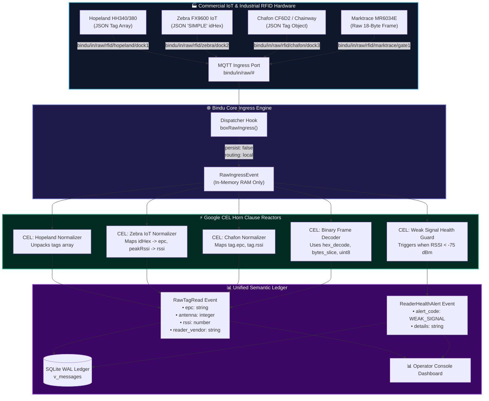

# 📡 Architecture & Engineering Plan: Raw Ingress Event & Dynamic CEL Normalization Tutorial
### Integrating Untyped IoT, RFID & PLC Streams with In-Memory CEL Transformers & Zero SQLite WAL Bloat

---

## 🧭 1. Executive Summary & Engineering Objective

This document defines the architectural design, schema contracts, CEL kinetic expressions, and simulator implementation for the **Raw Ingress Event & Dynamic CEL Normalization Tutorial (`raw-ingress-event-tutorial`)** in Bindu.

The objective of this tutorial is to guide solution creators, IoT platform architects, and hardware engineers through ingesting, arbitrating, and normalizing heterogeneous, untyped MQTT streams produced by commercial third-party hardware (Zebra, Hopeland, Chafon, Chainway, and Marktrace binary PLCs) **without writing custom Go daemon wrappers or installing runtime agents on edge sensors**.

### Core Capabilities Demonstrated in this Tutorial:
1. **Zero-Modification Edge Ingress (`bindu/in/raw/#`)**: Commercial RFID readers, PLCs, and IoT gateways publish untyped JSON, text, or binary frames directly to the Bindu MQTT broker.
2. **Ephemeral In-Memory Contract (`RawIngressEvent`)**: The dispatcher boxes raw traffic into `RawIngressEvent` (`Category: "system"`, `Routing: ["local"]`, `Persist: false`). Untyped telemetry never writes to the SQLite WAL ledger, guaranteeing zero database bloat and zero mesh flooding.
3. **Dynamic CEL Normalization (`CELReactorSet`)**: Declarative in-memory CEL reactors intercept `RawIngressEvent`, evaluate subpaths and content types, and transform disparate vendor formats into a single, strongly-typed semantic message: `RawTagRead`.
4. **Binary CEL Extension Unpacking**: Demonstrates Bindu's binary parsing functions (`hex_decode`, `bytes_slice`, `uint8`, `hex_encode`) by decoding raw byte frames from a Marktrace MR6034E / Modbus gateway directly in CEL in under 15 microseconds.
5. **Universal Multi-Reader Hardware Simulator (`simulate_raw_readers.go`)**: A pure Go simulator that runs all 4 reader profiles by default (or targets a specific reader with `--reader zebra|hopeland|chafon|marktrace`).
6. **Edge Health Monitoring & Weak Signal Alerting**: CEL reactor `weak_signal_health_guard` detects low RSSI (< -75 dBm) and raises semantic `ReaderHealthAlert` events for operational triage.
7. **Live Observability & Dashboards (`DashboardDefinition`)**: Real-time web console visualizations monitoring ingress throughput by vendor, antenna port distributions, and RSSI signal profiles.



---

## 🏷️ 2. The 4 Reader Profiles Specification

| Reader Profile | Format | Incoming Topic | Characteristic Fields / Offsets | Normalization Technique |
|---|---|---|---|---|
| **Hopeland HH340** | JSON (Array) | `bindu/in/raw/rfid/hopeland/dock_door_1` | `device_id`, `antenna`, `tags: [{epc, rssi, read_count}]` | Top-level `payload.antenna`, unpacks `payload.tags[0].epc` and `double(payload.tags[0].rssi)` |
| **Zebra FX9600** | JSON (Single) | `bindu/in/raw/rfid/zebra/dock_north` | `type: "SIMPLE"`, `data.idHex`, `data.antenna`, `data.peakRssi` | Maps `payload.data.idHex` to `epc`, `payload.data.peakRssi` to `rssi` |
| **Chafon CF6D2** | JSON (Object) | `bindu/in/raw/rfid/chafon/gate_01` | `device_id`, `antenna`, `tag: {epc, rssi}` | Maps `payload.tag.epc` to `epc`, `payload.antenna` to `antenna` |
| **Marktrace MR6034E** | Binary (`[]byte`) | `bindu/in/raw/rfid/marktrace/portal_west` | `0xBB` (Header), Byte 4 (`Antenna`), Bytes 5..16 (`EPC` 12B), Byte 17 (`RSSI`) | Uses `hex_decode(payload.raw_data)`, `uint8(..., 4)` for antenna, `hex_encode(bytes_slice(..., 5, 17))` for EPC |

---

## 📦 3. Tutorial Directory Layout

```
public/console/docs/raw-ingress-event-tutorial/
├── tutorial-plan.md                      # Comprehensive technical architecture & specification
├── tutorial_guide.md                     # Step-by-step developer tutorial and hands-on guide
├── poc_message_types.json                # Unified business schema: RawTagRead, ReaderHealthAlert
├── poc_cel_reactor_config.json           # CELReactorSet with 5 reactors (including binary & health guard)
├── poc_dashboards.json                   # Real-time multi-vendor RFID and sensor dashboard
├── raw_ingress_mas_solution.json         # Complete MAS solution pack manifest
├── deploy_mas_solution.sh                # Automated deployment script using bindu-studio
├── simulate_raw_readers.go               # Multi-reader pure Go MQTT simulator
└── simulate_raw_readers.sh               # Execution wrapper for simulator with preset flags
```

---

## 🔬 4. CEL Normalizer Implementations

### Reactor 1: Hopeland Array Normalizer
```json
{
  "reactor_id": "hopeland_rfid_normalizer",
  "input_message_type": "RawIngressEvent",
  "output_message_type": "RawTagRead",
  "trigger_condition": "payload.subpath.startsWith('rfid/hopeland') && payload.content_type == 'json' && has(payload.payload.tags) && size(payload.payload.tags) > 0",
  "transformation_expression": {
    "epc": "string(payload.payload.tags[0].epc)",
    "antenna": "int(payload.payload.antenna)",
    "rssi": "double(payload.payload.tags[0].rssi)",
    "read_count": "int(payload.payload.tags[0].read_count)",
    "reader_vendor": "'Hopeland'",
    "reader_id": "string(payload.payload.device_id)",
    "dock_portal": "string(payload.subpath)"
  }
}
```

### Reactor 2: Zebra IoT Connector Normalizer
```json
{
  "reactor_id": "zebra_rfid_normalizer",
  "input_message_type": "RawIngressEvent",
  "output_message_type": "RawTagRead",
  "trigger_condition": "payload.subpath.startsWith('rfid/zebra') && payload.content_type == 'json' && has(payload.payload.data)",
  "transformation_expression": {
    "epc": "string(payload.payload.data.idHex)",
    "antenna": "int(payload.payload.data.antenna)",
    "rssi": "double(payload.payload.data.peakRssi)",
    "read_count": "int(payload.payload.data.reads)",
    "reader_vendor": "'Zebra'",
    "reader_id": "head['$producer'] != '' ? head['$producer'] : 'Zebra-FX9600'",
    "dock_portal": "string(payload.subpath)"
  }
}
```

### Reactor 3: Chafon / Chainway Normalizer
```json
{
  "reactor_id": "chafon_rfid_normalizer",
  "input_message_type": "RawIngressEvent",
  "output_message_type": "RawTagRead",
  "trigger_condition": "payload.subpath.startsWith('rfid/chafon') && payload.content_type == 'json' && has(payload.payload.tag)",
  "transformation_expression": {
    "epc": "string(payload.payload.tag.epc)",
    "antenna": "int(payload.payload.antenna)",
    "rssi": "double(payload.payload.tag.rssi)",
    "read_count": "1",
    "reader_vendor": "'Chafon'",
    "reader_id": "string(payload.payload.device_id)",
    "dock_portal": "string(payload.subpath)"
  }
}
```

### Reactor 4: Marktrace Binary Protocol Unpacker (CEL Binary Extension)
```json
{
  "reactor_id": "marktrace_binary_rfid_normalizer",
  "input_message_type": "RawIngressEvent",
  "output_message_type": "RawTagRead",
  "trigger_condition": "payload.subpath.startsWith('rfid/marktrace') && payload.content_type == 'binary' && size(hex_decode(payload.raw_data)) >= 18",
  "transformation_expression": {
    "epc": "hex_encode(bytes_slice(hex_decode(payload.raw_data), 5, 17))",
    "antenna": "int(uint8(hex_decode(payload.raw_data), 4))",
    "rssi": "double(uint8(hex_decode(payload.raw_data), 17)) - 256.0",
    "read_count": "1",
    "reader_vendor": "'Marktrace'",
    "reader_id": "'MR6034E-01'",
    "dock_portal": "string(payload.subpath)"
  }
}
```

### Reactor 5: Edge Antenna Weak Signal Health Guard
```json
{
  "reactor_id": "weak_signal_health_guard",
  "input_message_type": "RawTagRead",
  "output_message_type": "ReaderHealthAlert",
  "trigger_condition": "double(payload.rssi) < -75.0",
  "transformation_expression": {
    "reader_vendor": "string(payload.reader_vendor)",
    "dock_portal": "string(payload.dock_portal)",
    "alert_code": "'WEAK_SIGNAL'",
    "details": "'Tag ' + string(payload.epc) + ' read with marginal RSSI: ' + string(payload.rssi) + ' dBm on antenna ' + string(payload.antenna)"
  }
}
```
