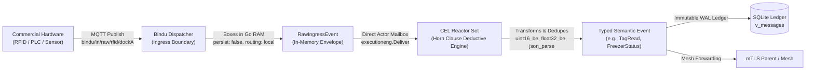

# Raw Ingress & Dynamic CEL Normalization Guide: Integrating Third-Party IoT, RFID & Industrial Hardware

> [!IMPORTANT]
> **Zero-Modification Edge Integration Contract**:
> You do **not** need to install a Bindu agent or node on every third-party RFID reader, PLC gateway, or BLE beacon. Commercial hardware and legacy devices publish raw, untyped MQTT streams (arbitrary JSON, plain text, or binary byte frames) directly to Bindu's raw ingress port `bindu/in/raw/#`. Google CEL reactors normalize those streams in-memory into strongly-typed Bindu semantic events with **zero SQLite WAL write amplification** and **zero mesh flooding**.

---

## 1. Architectural Motivation: Why Hardware Prefers Raw MQTT

In modern Internet of Things (IoT) and Industrial IoT (IIoT) architectures, MQTT is the undisputed standard for field-level connectivity:

- **Ultra-low Footprint (Edge-Native)**: Fixed headers of just 2 bytes allow resource-constrained microcontrollers (ESP32, STM32) and legacy PLCs to publish telemetry without exhausting CPU or RAM.
- **Topological Decoupling (Pub/Sub)**: Devices connect to brokers dynamically without client-server polling loops or tight point-to-point coupling.
- **QoS & State Guarantees**: Configurable delivery semantics (QoS 0, 1, 2) and *Last Will and Testament* (LWT) provide immediate offline awareness.

However, standard commercial hardware (Impinj/Zebra RFID readers, Modbus-to-MQTT edge gateways, barcode scanners) does **not** adhere to Bindu's strict envelope schema (`$type`, `$producer`, `$when`). Forcing these devices to format messages or installing runtime software on proprietary firmware is often impossible.

Bindu solves this with the **Raw Ingress & Dynamic CEL Normalization Pipeline**:



---

## 2. Ingress Boundary & Ephemeral Contract

### Raw Ingress Topics
Bindu listens for raw hardware ingress on:
- `bindu/in/raw`
- `bindu/in/raw/<subpath>` (e.g., `bindu/in/raw/rfid/dock1`, `bindu/in/raw/plc/line2`, `bindu/in/raw/sensor/temperature`)

The subpath after `bindu/in/raw/` is automatically extracted into `fields.subpath` for declarative filtering in CEL reactors.

### Envelope Packaging (`RawIngressEvent`)
The incoming packet payload is automatically inspected and boxed into an ephemeral `RawIngressEvent` without writing to disk:

| Field | Source / Value | Description |
|---|---|---|
| `$type` | `"RawIngressEvent"` | System message type for raw ingress events. |
| `$producer` | MQTT `client_id` (or username) | Hardware identifier of the publisher. |
| `$group` | `"ingress"` | Default group partition for raw ingress. |
| `$when` | RFC3339 UTC timestamp | Exact arrival timestamp. |
| `fields.topic` | Incoming MQTT topic | Complete incoming topic string (e.g., `bindu/in/raw/rfid/dock1`). |
| `fields.subpath` | Sub-topic path | Suffix after `bindu/in/raw/` (e.g., `rfid/dock1`). |
| `fields.content_type` | `"json"` \| `"text"` \| `"binary"` | Auto-detected payload encoding format. |
| `fields.payload` | `map[string]any` | Decoded JSON object (if `content_type == "json"`). |
| `fields.raw_data` | `string` | UTF-8 string or hex-encoded string representation. |
| `fields.raw_bytes` | `[]byte` / `string` | Raw bytes available for binary CEL manipulation. |

### The Two Guardrails: Non-Persistence & Local-Only Routing
1. **Zero SQLite WAL Bloat (`persist: false`)**: `RawIngressEvent` is marked with `persist: false`. Untyped sensor streams never hit the SQLite ledger, preventing WAL bloat from high-frequency raw telemetry.
2. **Zero Mesh Flooding (`routing: ["local"]`)**: `RawIngressEvent` cannot be routed to `"parent"` or `"child"`. Untyped traffic remains strictly within the receiving gateway node. Only normalized semantic messages are eligible for mesh forwarding.

---

## 3. CEL Binary & Parsing Extension Functions

Bindu embeds a high-performance binary parsing suite into all CEL evaluation environments (`pkg/celext`):

| CEL Function | Signature | Description |
|---|---|---|
| `hex_encode(bytes \| string)` | `(bytes) -> string` | Returns lower-case hex string representation of bytes. |
| `hex_decode(string)` | `(string) -> bytes` | Decodes a hex string (with or without `0x` prefix) into bytes. |
| `bytes_slice(bytes \| string, start, end)` | `(bytes, int, int) -> bytes` | Clamped sub-slice of bytes between `start` and `end` indices. |
| `uint8(bytes \| string, offset)` | `(bytes, int) -> uint` | Reads 8-bit unsigned integer at `offset`. |
| `uint16_be(bytes \| string, offset)` | `(bytes, int) -> uint` | Reads 16-bit Big-Endian unsigned integer at `offset`. |
| `uint16_le(bytes \| string, offset)` | `(bytes, int) -> uint` | Reads 16-bit Little-Endian unsigned integer at `offset`. |
| `uint32_be(bytes \| string, offset)` | `(bytes, int) -> uint` | Reads 32-bit Big-Endian unsigned integer at `offset`. |
| `uint32_le(bytes \| string, offset)` | `(bytes, int) -> uint` | Reads 32-bit Little-Endian unsigned integer at `offset`. |
| `float32_be(bytes \| string, offset)` | `(bytes, int) -> double` | Reads 32-bit IEEE 754 Big-Endian float at `offset`. |
| `float32_le(bytes \| string, offset)` | `(bytes, int) -> double` | Reads 32-bit IEEE 754 Little-Endian float at `offset`. |
| `json_parse(string \| bytes)` | `(string) -> dyn` | Dynamically deserializes JSON text/bytes into a CEL map or list. |

---

## 4. Integration Recipes

### Recipe A: Commercial RFID Reader (Untyped JSON)
Commercial readers (e.g., Zebra FX9600, Impinj R700) publish raw JSON tag reads when items cross a dock door:

**Incoming MQTT Topic:** `bindu/in/raw/rfid/dock_north`  
**Raw Payload:**
```json
{
  "tag_epc": "3034257BF400B7800004FB37",
  "read_count": 4,
  "peak_rssi": -52.4,
  "antenna_port": 1
}
```

**Target Bindu MessageType (`TagRead`):**
```json
{
  "name": "TagRead",
  "routing": ["local", "parent"],
  "retentionMode": "count",
  "retentionValue": 50,
  "properties": [
    {"name": "epc", "type": "string", "required": true, "description": "EPC identifier"},
    {"name": "antenna", "type": "integer", "required": true, "description": "Antenna port number"},
    {"name": "rssi", "type": "number", "required": true, "description": "Signal strength in dBm"}
  ]
}
```

**CEL Reactor Configuration:**
```json
{
  "reactor_id": "rfid_dock_normalizer",
  "input_message_type": "RawIngressEvent",
  "output_message_type": "TagRead",
  "trigger_condition": "payload.subpath == 'rfid/dock_north' && payload.content_type == 'json'",
  "transformation_expression": {
    "epc": "payload.payload.tag_epc",
    "antenna": "int(payload.payload.antenna_port)",
    "rssi": "double(payload.payload.peak_rssi)"
  }
}
```

---

### Recipe B: Industrial PLC / Modbus Gateway (Raw Binary Bytes)
An industrial edge computer reads an RS-485 Modbus RTU pressure/temperature transmitter and publishes a 6-byte binary payload:
- Bytes 0..3: IEEE 754 Float32 temperature (Big-Endian)
- Bytes 4..5: UInt16 status code / pressure psi (Big-Endian)

**Incoming MQTT Topic:** `bindu/in/raw/modbus/reactor4`  
**Raw Payload:** `[0x42, 0x28, 0x00, 0x00, 0x00, 0x78]` (42.0 °C, 120 psi)

**Target Bindu MessageType (`ReactorTelemetry`):**
```json
{
  "name": "ReactorTelemetry",
  "routing": ["local", "parent"],
  "retentionMode": "count",
  "retentionValue": 100,
  "properties": [
    {"name": "temperature_c", "type": "number", "required": true, "description": "Temperature in Celsius"},
    {"name": "pressure_psi", "type": "integer", "required": true, "description": "Pressure in PSI"},
    {"name": "alarm", "type": "boolean", "required": true, "description": "Over-pressure alarm flag"}
  ]
}
```

**CEL Reactor Configuration:**
```json
{
  "reactor_id": "modbus_reactor4_normalizer",
  "input_message_type": "RawIngressEvent",
  "output_message_type": "ReactorTelemetry",
  "trigger_condition": "payload.subpath == 'modbus/reactor4' && payload.content_type == 'binary'",
  "transformation_expression": {
    "temperature_c": "float32_be(payload.raw_bytes, 0)",
    "pressure_psi": "int(uint16_be(payload.raw_bytes, 4))",
    "alarm": "uint16_be(payload.raw_bytes, 4) > 100u"
  }
}
```

---

### Recipe C: Legacy Sensor or Webhook Bridge (Plain Text)
A legacy serial adapter or curl bridge sends raw plain text alerts:

**Incoming MQTT Topic:** `bindu/in/raw/gates/north`  
**Raw Payload:** `EMERGENCY_STOP_TRIGGERED`

**Target Bindu MessageType (`SafetyIncident`):**
```json
{
  "name": "SafetyIncident",
  "routing": ["local", "parent"],
  "retentionMode": "count",
  "retentionValue": 20,
  "properties": [
    {"name": "incident_code", "type": "string", "required": true, "description": "Incident alert code"},
    {"name": "gate", "type": "string", "required": true, "description": "Gate identifier"},
    {"name": "critical", "type": "boolean", "required": true, "description": "Critical incident flag"}
  ]
}
```

**CEL Reactor Configuration:**
```json
{
  "reactor_id": "gate_safety_normalizer",
  "input_message_type": "RawIngressEvent",
  "output_message_type": "SafetyIncident",
  "trigger_condition": "payload.subpath.startsWith('gates/') && payload.content_type == 'text'",
  "transformation_expression": {
    "incident_code": "payload.raw_data",
    "gate": "payload.subpath",
    "critical": "payload.raw_data.contains('EMERGENCY')"
  }
}
```

---

## 5. Verification & Testing

### Dry-Run Verification with `bindu-studio`
Verify your CEL normalization expressions before deploying:

```bash
# 1. Test JSON Normalization
go run ./cmd/bindu-studio cel-reactor dry-run \
  --config ./poc_cel_reactor_config.json \
  --reactor rfid_dock_normalizer \
  --payload '{
    "topic": "bindu/in/raw/rfid/dock_north",
    "subpath": "rfid/dock_north",
    "content_type": "json",
    "payload": {"tag_epc": "3034257BF400B7800004FB37", "antenna_port": 1, "peak_rssi": -52.4}
  }'

# 2. Test Binary Normalization
go run ./cmd/bindu-studio cel-reactor dry-run \
  --config ./poc_cel_reactor_config.json \
  --reactor modbus_reactor4_normalizer \
  --payload '{
    "topic": "bindu/in/raw/modbus/reactor4",
    "subpath": "modbus/reactor4",
    "content_type": "binary",
    "raw_bytes": "QiAAAAx4",
    "raw_data": "422800000078"
  }'
```

### Live MQTT Ingress Verification
Publish raw messages using standard command-line tools:

```bash
# Publish untyped JSON from standard MQTT client (e.g. mosquitto_pub)
mosquitto_pub -h localhost -p 1883 -t "bindu/in/raw/rfid/dock_north" \
  -m '{"tag_epc": "3034257BF400B7800004FB37", "antenna_port": 1, "peak_rssi": -52.4}'

# Query the SQLite WAL ledger to confirm TagRead was created and RawIngressEvent was NOT persisted
curl -s -X POST http://localhost:8080/api/v1/messages/sql \
  -H "Content-Type: application/json" \
  -d '{"query": "SELECT \"$type\", \"$producer\", fields FROM v_messages WHERE \"$type\" IN (\x27RawIngressEvent\x27, \x27TagRead\x27) ORDER BY \"$when\" DESC LIMIT 5"}'
```

**Expected Result:**
- `RawIngressEvent` count: **0** (ephemeral RAM delivery).
- `TagRead` count: **1** (persisted typed semantic fact).
