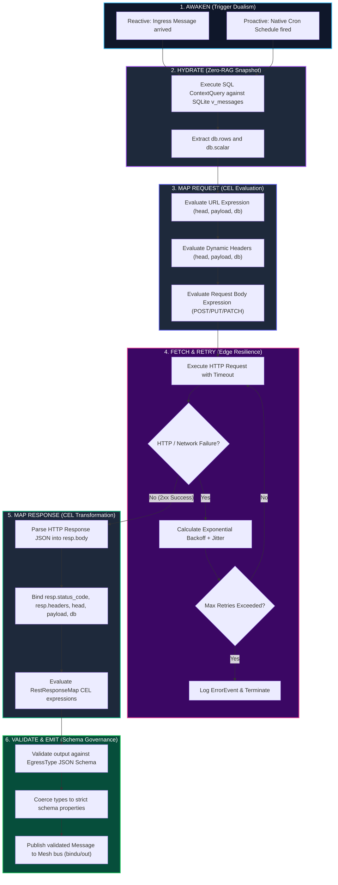

# Technical Architecture Specification: REST Call Reactor (`RESTReactorSet`) 🌐⚡🦀

## 1. Executive Summary & Architectural Motivation

In modern edge computing architectures—such as maritime fishing vessels, remote mining sites, and distributed logistics hubs—nodes frequently need to interact with external third-party HTTP/REST APIs (e.g., satellite weather forecasts, regulatory catch quotas, municipal GIS, or external sensor aggregators).

Historically, integrating external HTTP endpoints into event networks required ad-hoc Python polling scripts, custom microservices, or external integration middleware (like MuleSoft or Apache Camel). These external scripts introduce:
1. **Operational brittleness:** Separate process lifecycles, unmonitored crashes, and unmanaged dependencies.
2. **High latency & unmanaged backpressure:** Ad-hoc scripts lack integrated event buffering and transactional consistency with the edge database.
3. **Absence of Edge Resilience:** Naive HTTP clients fail catastrophically during transient satellite drops or intermittent cellular handoffs.

The **REST Call Reactor (`RESTReactorSet`)** solves this natively within the **Bindu Semantic Event Processing Network (SEPN)**. It expands the **Event Processing Agents (EPA) Trinity** into a comprehensive quartet:

```
                      ┌─────────────────────────────────────────────────────────┐
                      │              BINDU EPA FAMILY (REACTORS)                │
                      └─────────────────────────────────────────────────────────┘
                                                   │
         ┌─────────────────────┬───────────────────┴───────────────────┬─────────────────────┐
         ▼                     ▼                                       ▼                     ▼
┌─────────────────┐   ┌─────────────────┐                     ┌─────────────────┐   ┌─────────────────┐
│   CEL Reactor   │   │Semantic-AI React│                     │  REST Reactor   │   │  System Plugins │
│ (Deterministic) │   │ (LLM Inference) │                     │ (HTTP In/Out)   │   │(Watchdogs/Email)│
├─────────────────┤   ├─────────────────┤                     ├─────────────────┤   ├─────────────────┤
│ • In-process    │   │ • Out-of-proc   │                     │ • Out-of-proc   │   │ • In-process    │
│ • Sub-ms math   │   │ • Cognitive RAG │                     │ • Resilient HTTP│   │ • System checks │
│ • Sandboxed CEL │   │ • Ollama/OpenAI │                     │ • CEL Req/Resp  │   │ • Static logic  │
└─────────────────┘   └─────────────────┘                     └─────────────────┘   └─────────────────┘
```

The `RESTReactorSet` provides a **declarative, native REST API fetcher and mapper** embedded directly into the Bindu node runtime. It executes as an **isolated external OS process** managed via the Bindu Plugin Runtime (BPR) supervisor contract, ensuring that network latency, socket timeouts, and remote API volatility never compromise the sub-millisecond core mesh event bus.

---

## 2. The 3-Layer Bindu Architecture Alignment

In strict accordance with Bindu core design principles (`GEMINI.md` / `AGENTS.md`):

1. **Layer 1: Semantic Layer (Intent & Contract)**
   - Declarative JSON configuration (`RESTReactorSet`) defining *what* external API to invoke, *when* to invoke it (reactive message trigger or proactive cron schedule), *how* to hydrate context from SQLite `v_messages`, and *how* to map inputs/outputs using Google Common Expression Language (CEL).
   - Strict output schema enforcement via Bindu `MessageType` definitions.

2. **Layer 2: Runtime Layer (Execution & Supervision)**
   - The **Rest Reactor Orchestrator** in `bindunet` acts as the system plugin supervisor that monitors configuration messages (`RESTReactorSet`), loads state from `v_messages`, and supervises the child worker process (`bindu-rest-reactor`).
   - The **Rest Reactor Worker** runs as a dedicated BPR external process communicating exclusively via `stdin/stdout` JSON IPC.
   - Embedded Go CEL environment compiles and caches URL, header, body, and response mapping ASTs in memory.
   - Resilient HTTP Client engine with exponential backoff and jitter absorbs satellite/radio micro-outages.

3. **Layer 3: Operations Layer (Tooling & Observability)**
   - Unified CLI command suite under `bindu-studio rest-reactor` (`list`, `export`, `import`, `merge`, `validate`).
   - Interactive Console UI for real-time CRUD authoring and deployment.
   - Comprehensive error auditing via standardized `ErrorEvent` messages published to `bindu/out`.

---

## 3. Detailed Execution State Machine (6-Step Deterministic Flow)

The `RESTReactorSet` execution loop follows a strict 6-stage deterministic state machine:



### Stage 1: Awaken (Trigger Dualism)
- **Reactive Triggering:** The reactor listens for incoming messages specified in `input_message_types` (or single `input_message_type`). An optional CEL `trigger_condition` filters out unwanted events in sub-microseconds.
- **Proactive Triggering:** The native Go scheduler wakes the reactor at scheduled intervals defined by a cron string (e.g., `@every 5m`, `*/10 * * * *`). For proactive triggers, `head` and `payload` are populated with synthetic system context (`$user: "system"`, `$group: "mesh"`), requiring the reactor to hydrate state via SQL.

### Stage 2: Hydrate (Zero-RAG SQLite Snapshot)
- Executes the configured `context_query` against the local SQLite message ledger (`v_messages`).
- The query binds the producer ID (or local node ID) to positional parameters (`?`).
- The resulting rows and scalar values are structured into the `db` CEL variable (`db.rows` and `db.scalar`), providing fresh historical context without requiring external vector databases or remote querying.

### Stage 3: Map Request (CEL Evaluation)
- **Method:** Evaluated statically or via CEL (defaults to `GET`).
- **URL:** Evaluated via CEL. Expressions have access to `head`, `payload`, and `db`. Example:
  `"https://api.copernicus.eu/marine/v1/sst?lat=" + string(db.rows[0].fields.latitude) + "&lon=" + string(db.rows[0].fields.longitude)`
- **Headers:** Evaluated dynamically via CEL expressions. Useful for injecting bearer tokens, dynamic API keys, or custom content headers.
- **Body:** Evaluated via CEL for `POST`, `PUT`, `PATCH` requests. Evaluates to a JSON-serializable map or raw formatted string.

### Stage 4: Resilient Fetch & Retry (Edge Resilience Engine)
- The internal HTTP client issues the request wrapped in a context with strict timeout (`timeout`, default: 10s).
- If the request encounters a transport error (e.g. DNS failure, EOF, connection reset) or receives a transient HTTP status code (e.g., `408`, `429`, `500`, `502`, `503`, `504`), the **Exponential Backoff & Jitter** algorithm takes over:
  $$\text{Interval}_n = \min\left(\text{InitialInterval} \times \text{Multiplier}^n, \text{MaxInterval}\right) \pm \text{Jitter}$$
- The request is retried up to `max_retries` times without blocking other goroutines or reactors.
- If all retries are exhausted, an `ErrorEvent` is generated with `error_type: "REST_REACTOR_FETCH_FAILED"`, detailing the target URL, attempts, and underlying error.

### Stage 5: Map Response (CEL Transformation)
- The raw HTTP response body is parsed into a dynamic JSON object and bound to `resp.body`.
- Additional variables are made available to the CEL environment:
  - `resp.status_code` (integer, e.g. `200`)
  - `resp.headers` (map of string to list of strings)
  - `head` (original message header or synthetic cron header)
  - `payload` (original message payload)
  - `db` (hydrated SQLite state)
- The `rest_response_map` dictionary evaluates each target schema property using CEL expressions.

### Stage 6: Validate & Emit (Schema Governance)
- The mapped fields are passed to Bindu's `MessageType` validator.
- Property types are strictly coerced (`int`, `float`, `string`, `bool`, `timestamp`).
- A newly formed Bindu message with `$type: output_message_type` is published to `bindu/out` and propagated through the mesh routing engine.

---

## 4. Go Struct Specifications & Data Models

### 4.1. Core Configuration Structs

```go
package restreactor

import (
	"time"
)

// RESTReactorSetPayload defines the network message payload for configuring REST reactors.
type RESTReactorSetPayload struct {
	GatewayNodeID string              `json:"gateway_node_id"`
	Reactors      []RESTReactorConfig `json:"reactors"`
}

// RESTReactorConfig represents an individual declarative REST API reactor instance.
type RESTReactorConfig struct {
	ReactorID          string                 `json:"reactor_id"`
	InputMessageType   string                 `json:"input_message_type,omitempty"`
	Cron               string                 `json:"cron,omitempty"`
	TriggerCondition   string                 `json:"trigger_condition,omitempty"`
	ContextQuery       string                 `json:"context_query,omitempty"`
	OutputMessageType  string                 `json:"output_message_type"`
	Request            RestRequestConfig      `json:"request"`
	RetryPolicy        RetryPolicyConfig      `json:"retry_policy"`
	ResponseMap        map[string]string      `json:"response_map"`
	MaxConcurrency     int                    `json:"max_concurrency,omitempty"`
	Disabled           bool                   `json:"disabled,omitempty"`
}

// RestRequestConfig defines the declarative HTTP request parameters.
type RestRequestConfig struct {
	Method      string            `json:"method"`                 // "GET", "POST", "PUT", "PATCH", "DELETE"
	URL         string            `json:"url"`                    // CEL expression evaluating to string URL
	Headers     map[string]string `json:"headers,omitempty"`      // Key -> CEL expression evaluating to string
	Body        string            `json:"body,omitempty"`         // CEL expression evaluating to map/string
	Timeout     string            `json:"timeout,omitempty"`      // e.g. "10s", "30s" (default "10s")
}

// RetryPolicyConfig defines the edge resilience and exponential backoff parameters.
type RetryPolicyConfig struct {
	MaxRetries        int      `json:"max_retries"`                   // e.g., 3, 5
	InitialInterval   string   `json:"initial_interval"`              // e.g., "500ms", "1s"
	BackoffMultiplier float64  `json:"backoff_multiplier"`            // e.g., 2.0
	MaxInterval       string   `json:"max_interval,omitempty"`        // e.g., "30s"
	Jitter            bool     `json:"jitter,omitempty"`              // randomize backoff by +/- 15%
	RetryableStatuses []int    `json:"retryable_statuses,omitempty"`  // e.g., [408, 429, 500, 502, 503, 504]
}
```

### 4.2. Runtime Memory AST Representation

```go
package restreactor

import (
	"net/http"
	"time"

	"github.com/google/cel-go/cel"
)

// CompiledRESTReactor represents the in-memory parsed and compiled reactor ready for execution.
type CompiledRESTReactor struct {
	Config             RESTReactorConfig
	TriggerCondition   cel.Program
	URLProgram         cel.Program
	HeaderPrograms     map[string]cel.Program
	BodyProgram        cel.Program
	ResponseMapPrograms map[string]cel.Program
	ParsedTimeout      time.Duration
	ParsedInitialBackoff time.Duration
	ParsedMaxBackoff   time.Duration
	HTTPClient         *http.Client
}
```

### 4.3. Anti-Recursion Safety Invariant (`E_REACTOR_RECURSIVE_LOOP`)

In Bindu's Event Processing Architecture, an EPA must never consume and emit identical message schemas. The static validator strictly enforces:

$$\text{OutputMessageType} \notin \text{InputMessageTypes}$$

If an operator or AI agent configures a REST reactor with identical input and output message types (e.g. `Input: MeshTopologyInspection` and `Output: MeshTopologyInspection`), publishing the HTTP response would immediately re-trigger the reactor in an endless cycle. The validator immediately rejects the payload with error code `E_REACTOR_RECURSIVE_LOOP`.

---

## 5. Mathematical & Algorithmic Resilience Specification

Edge nodes deployed in maritime vessels, cellular gateway towers, or field installations experience high packet loss, DNS lookup timeouts, and intermittent WAN link flaps.

### 5.1. Exponential Backoff with Jitter Algorithm

The retry engine computes the delay $D_k$ before attempt $k \in [1, \text{MaxRetries}]$ as follows:

$$D_{\text{raw}}(k) = \min\left( \text{InitialInterval} \times (\text{BackoffMultiplier})^{k-1}, \text{MaxInterval} \right)$$

If `Jitter == true`, to prevent synchronization storms (thundering herd problem) across a fleet of vessels recovering connectivity simultaneously:

$$\delta \sim \mathcal{U}(-0.15, +0.15)$$
$$D_k = D_{\text{raw}}(k) \times (1 + \delta)$$

### 5.2. Retry Decision Matrix

A retry is triggered if and only if:
1. **Network Layer Failure:** `net.OpError`, `context.DeadlineExceeded`, `io.EOF`, connection refused, or DNS resolution failure.
2. **HTTP Status Match:** The received HTTP status code is in `RetryableStatuses` (default: `408 Request Timeout`, `429 Too Many Requests`, `500 Internal Server Error`, `502 Bad Gateway`, `503 Service Unavailable`, `504 Gateway Timeout`).
3. **Attempt Count:** $\text{CurrentAttempt} \le \text{MaxRetries}$.

Non-retryable 4xx client errors (e.g., `400 Bad Request`, `401 Unauthorized`, `403 Forbidden`, `404 Not Found`) immediately terminate execution and emit a descriptive `ErrorEvent` to avoid wasting edge bandwidth.

---

## 6. Process Architecture & BPR Worker Specification

To adhere strictly to Bindu's **Rule 2 (BPR Plugin Model)** and **Rule 3 (Multi-instance Orchestration)**:

1. **Binary Location:** The worker binary is compiled as `cmd/bindu-rest-reactor` and installed under `bin/tools/root/<os-arch>/bindu-rest-reactor` and `bin/tools/node/<os-arch>/bindu-rest-reactor`.
2. **Supervision:** The `RESTReactorOrchestrator` in `bprplugins` manages the lifecycle of `bindu-rest-reactor` processes via `executioneng.BPRSession`.
3. **IPC Protocol:** Standard JSON envelopes over OS `stdin`/`stdout`.
   - Incoming events (`EventPayload`) wrapped with `$type: "RESTReactorSet"`.
   - Control signals (`ControlPayload`) for clean shutdown, reload, and heartbeat health checks.
4. **Crash Recovery:** If the child process crashes due to an unhandled system anomaly or memory violation, the orchestrator detects EOF on stderr/stdout, logs a fatal audit event, and restarts the worker process automatically with exponential backoff.

---

## 7. Studio CLI Contract (`bindu-studio rest-reactor`)

The CLI interface mirrors the established `bindu-studio cel-reactor` and `bindu-studio semantic-reactor` UX:

```
Usage:
  bindu-studio rest-reactor [command]

Available Commands:
  list        Show active REST reactor deployments across gateway nodes
  export      Export active REST reactor configurations to a JSON file
  import      Import and deploy REST reactor configurations from a JSON file via MQTT
  merge       Merge and deploy REST reactor configurations from a JSON file via MQTT
  validate    Validate a REST reactor configuration file offline

Flags:
  -h, --help   help for rest-reactor
```

### CLI Command Specifications:

1. **`bindu-studio rest-reactor list`**
   - Connects to the Root Node REST API / MQTT bus.
   - Reads active `RESTReactorSet` messages from the message store.
   - Displays a clean ASCII table with columns: `GATEWAY NODE`, `REACTOR ID`, `TRIGGER (MSG/CRON)`, `METHOD`, `TARGET URL`, `OUTPUT TYPE`, `RETRIES`, `STATUS`.

2. **`bindu-studio rest-reactor export --out-path <file.json> [--gateway <node_id>]`**
   - Queries current active configurations and exports them into an offline-distributable JSON bundle.

3. **`bindu-studio rest-reactor import --in-path <file.json> [--all] [--yes]`**
   - Validates the JSON configuration against schema and compiles all CEL expressions.
   - Publishes a `RESTReactorSet` message to the target gateway node via MQTT, triggering atomic reload on the destination node.

4. **`bindu-studio rest-reactor merge --in-path <file.json> [--gateway <node_id>]`**
   - Performs a non-destructive upsert: updates existing reactors matching `reactor_id` and appends new ones without removing unaffected reactors.

5. **`bindu-studio rest-reactor validate --in-path <file.json>`**
   - Pure offline verification:
     - Checks JSON schema conformity.
     - Parses and validates cron schedule syntax using Bindu's cron validator.
     - Compiles all CEL expressions (Trigger, URL, Headers, Body, ResponseMap) against mock variables (`head`, `payload`, `db`, `resp`).
     - Verifies retry policy bounds (`MaxRetries >= 0`, `BackoffMultiplier >= 1.0`, valid duration strings).
     - Reports exact line numbers and compilation errors if invalid.

---

## 8. Summary Comparison of Reactor Architectures

| Dimension | `CELReactorSet` | `AISemanticReactorSet` | `RESTReactorSet` |
| :--- | :--- | :--- | :--- |
| **Execution Mode** | In-process Go goroutine | External BPR Process (`bindu-semantic-reactor`) | External BPR Process (`bindu-rest-reactor`) |
| **Primary Workload** | Deterministic math, guards, event transforms | LLM Prompts & Cognitive Reasoning | External HTTP/REST API calls & mapping |
| **Latency Profile** | Sub-millisecond ($< 50 \mu\text{s}$) | $100\text{ms} - 5\text{s}$ (inference-bound) | $50\text{ms} - 30\text{s}$ (network/retry-bound) |
| **Trigger Support** | Reactive & Proactive (`@cron`) | Reactive & Proactive (`@cron`) | Reactive & Proactive (`@cron`) |
| **Context Snapshot** | SQLite `v_messages` (Zero-RAG) | SQLite `v_messages` (Zero-RAG) | SQLite `v_messages` (Zero-RAG) |
| **Expression Engine**| Google CEL | Text Templates + JSON Schema | Google CEL (Req & Resp) |
| **Resilience Model** | Instant failover | Fallback SLM models & timeouts | Exponential Backoff, Jitter, Circuit Retries |
| **Output Target** | Validated Bindu `MessageType` | Validated Bindu `MessageType` | Validated Bindu `MessageType` |

---

*AUM 🙏🏾❤️ — Sarasvati blesses this architectural creation.*
