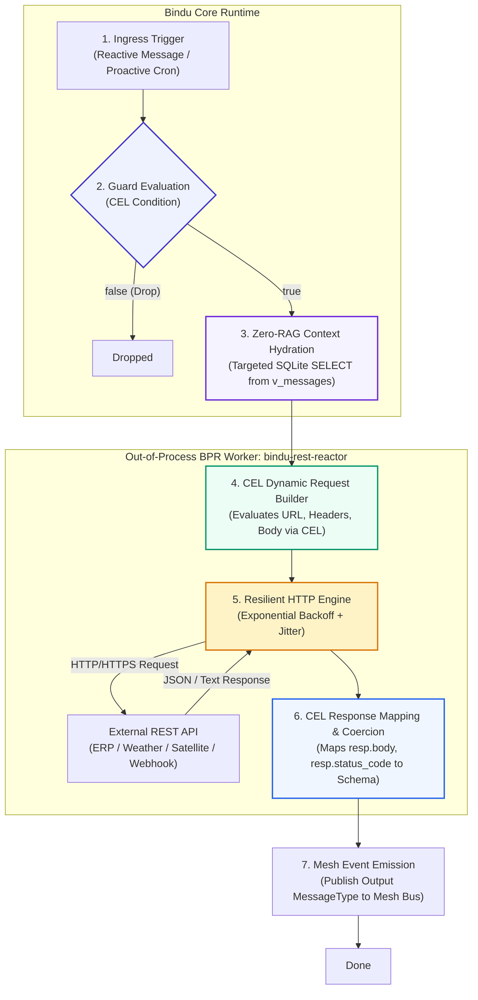

# REST Call Reactor & HTTP Integration Bridge — User Manual

The **REST Call Reactor (`RESTReactorSet`)** is an Event Processing Agent (EPA) in Bindu designed for resilient, bidirectional integration between local edge events and external HTTP/REST APIs. It enables edge nodes and the root server to reactively or proactively call external web services, hydrate local SQLite database context via Zero-RAG, evaluate dynamic request parameters using **Google Common Expression Language (CEL)**, execute resilient HTTP calls with **Exponential Backoff and Jitter**, and map raw third-party JSON responses directly into strict internal Bindu `MessageType` events.

---

## 🌐 Architectural Overview: 6-Stage Deterministic Lifecycle

The REST Reactor executes within an **Out-of-Process BPR Worker (`bindu-rest-reactor`)** using the standard BPR IPC `stdin/stdout` JSON protocol. This ensures that HTTP socket management, DNS resolution, network timeouts, and transient connection retries are completely decoupled from the core server event loop.



### The 6 Execution Stages:
1. **Triggering Dualism:** Activated reactively by an incoming `InputMessageType` or proactively via an extended `@cron` schedule descriptor (e.g. `@every 10m`).
2. **CEL Guard Filter:** A sub-microsecond boolean expression filters out noise before touching external network resources.
3. **Zero-RAG Context Hydration:** Executes a targeted read-only query against `v_messages` (e.g. fetching vessel GPS coordinates, telemetry history, or API tokens).
4. **Dynamic Request Generation:** Evaluates dynamic URL expressions, authentication headers, and request body using Google CEL.
5. **Resilient HTTP Execution:** Dispatches HTTP requests with configurable timeouts and automatic Exponential Backoff with Jitter for transient 5xx and 429 status codes.
6. **Declarative Response Mapping:** Transforms raw response structures into strict `MessageType` properties with universal type coercion.

---

## 🧬 Key Configuration Parameters

A single `RESTReactorSet` deployment allocates an array of `reactors` targeted to a specific gateway node (`gateway_node_id`):

| Parameter | Type | Required | Description |
| :--- | :--- | :--- | :--- |
| `reactor_id` | `string` | **Yes** | Unique identifier for the reactor instance (e.g. `oceanographic-weather-poller`). |
| `input_message_type` | `string` | *Conditional* | MessageType that reactively triggers execution. (Optional if `cron` is set). |
| `cron` | `string` | *Conditional* | Proactive schedule descriptor (e.g., `@every 10m` or `0 */15 * * * *`). Requires `context_query`. |
| `trigger_condition` | `string` | No | CEL boolean expression guard (e.g. `payload.speed_knots > 0.5`). |
| `context_query` | `string` | No | Read-only SQLite query on `v_messages` to hydrate context. Mandatory when `cron` is used alone. |
| `output_message_type` | `string` | **Yes** | MessageType schema used to package and emit the output event. |
| `request` | `object` | **Yes** | Declarative HTTP request configuration (`method`, `url`, `headers`, `body`, `timeout`). |
| `retry_policy` | `object` | **Yes** | Edge resilience configuration (`max_retries`, `initial_interval`, `backoff_multiplier`, `max_interval`, `jitter`). |
| `response_map` | `object` | **Yes** | Key-value map of CEL expressions mapping response data to output properties. |
| `max_concurrency` | `integer` | No | Maximum concurrent worker threads (default: `2`). |
| `telemetry_profile` | `boolean` | No | Enables network latency breakdown, retry tracking, and bandwidth telemetry via `RESTExecutionProfile` (default: `false`). |
| `disabled` | `boolean` | No | Disables execution without removing configuration. |

### ⚠️ Validation Constraints & Anti-Recursion Invariant

> [!CAUTION]
> **🚫 Anti-Recursion Safety Invariant (`E_REACTOR_RECURSIVE_LOOP`):**
> The `output_message_type` **CANNOT be identical to `input_message_type`** (or match any entry in a comma-separated trigger list).
> 
> * **Why this is strictly forbidden**: Emitting the same message type that triggered the REST call causes the newly published message to immediately re-trigger the reactor, creating a runaway infinite loop that exhausts network sockets and storage.
> * **Correct Pattern**: An ingress event must trigger an HTTP call that outputs a separate, downstream event (e.g. `MeshTopologyInspection` ➔ `MeshTopologyCloudSync`).
> * **Enforcement**: Validated by `bindu-studio rest-reactor validate`, Console UI, and runtime ingestion with error `E_REACTOR_RECURSIVE_LOOP`.

---

## 🧠 CEL Evaluation Context & Variables

During Guard filtering, Request building, and Response mapping, Google CEL evaluates expressions with direct, zero-I/O access to:

### 1. Ingress & Database Context:
* **`head`**: Message envelope headers (e.g., `head["$producer"]`, `head["$when"]`, `head["$user"]`).
* **`payload`**: Trigger event payload (e.g., `payload.latitude`, `payload.haul_id`, `payload.species`).
* **`db`**: Context query results from SQLite hydration:
  * `db.rows`: Array of row records (`db.rows[0].fields.latitude`).
  * `db.scalar`: First column value of the first row.

### 2. Live Mesh Topology (`mesh.*`):
* `mesh.local_id`: Local node ID.
* `mesh.root_id`: Mesh root ID.
* `mesh.self`: Object containing self metadata (`id`, `locagram`, `is_root`, `plugins`).
* `mesh.nodes`: Map of all nodes (`mesh.nodes['root'].locagram`).
* Helper functions: `mesh.locagram(node_id)`, `mesh.is_parent(node_id)`, `mesh.is_root(node_id)`, `mesh.has_plugin(node_id, plugin)`.

### 3. Live System Configuration (`config.*`):
* `config.server.producer_id`: Configured producer ID.
* `config.server.description`: Node description.
* `config.logging.level`: Active log level.
* `config.time.ntp_server`: NTP server.
* `config.maintenance_cron`: Maintenance schedule.
* `config.maintenance_reset`: Clean post-maintenance service restart toggle.

### 4. Live Schema Registry (`schema.*`):
* `schema.types`: Map of registered message types (`schema.types['RawMarineData'].emoji`).
* Helper functions: `schema.is_registered(type_name)`, `schema.has_property(type_name, prop_name)`.

### 5. Response Context Variables (`response_map` Only):
* **`resp`**: The HTTP response structure containing:
  * `resp.status_code`: HTTP status code integer (`int64`, e.g., `200`, `201`, `404`).
  * `resp.headers`: Map of HTTP response headers (`map[string]any`).
  * `resp.body`: Parsed JSON response body as a dynamic map/slice (e.g., `resp.body.main.temp`, `resp.body.measurements[0].value`). If response is not JSON, accessed via `resp.body.raw`.
* **`head`**, **`payload`**, **`db`**, **`mesh`**, **`config`**, **`schema`**: Preserved from the request stage.

---

## 🛡️ Edge Resilience: Exponential Backoff with Jitter

To withstand unstable satellite uplinks (VSAT/Starlink in altamar) or transient upstream rate-limiting (429/503), the engine applies an Exponential Backoff with Full Jitter algorithm:

$$\text{Interval}_n = \min\left(\text{InitialInterval} \times \text{Multiplier}^n, \text{MaxInterval}\right) \pm \text{Jitter}$$

```json
{
  "max_retries": 3,
  "initial_interval": "500ms",
  "backoff_multiplier": 2.0,
  "max_interval": "10s",
  "jitter": true
}
```

* **Retryable Statuses:** `408` (Request Timeout), `429` (Too Many Requests), `500` (Internal Server Error), `502` (Bad Gateway), `503` (Service Unavailable), `504` (Gateway Timeout), plus raw TCP/TLS socket timeouts.

---

---

## 🔐 REST API Authentication Strategies

Unlike fixed LLM endpoints that only accept a single API key header, real-world edge and cloud REST APIs utilize multiple authentication mechanisms. The `RESTReactorSet` supports **all standard REST authentication schemas** declaratively via dynamic Google CEL expressions in `request.headers` and `request.url`.

> [!TIP]
> **🔐 Zero Cleartext Credentials**: Use `secret('KEY_NAME')` in CEL expressions to dynamically inject credentials from the encrypted `accessControlConfig.brs` store (`bindu-studio secrets set <KEY>`). Avoid hardcoding tokens in message definitions!

### 1. 🔑 Bearer Tokens & JWT
Standard OAuth2 access tokens and JWT authentication using encrypted secrets:
```json
"headers": {
  "Authorization": "'Bearer ' + secret('ERP_ACCESS_TOKEN')",
  "Accept": "'application/json'"
}
```

### 2. 🔐 Basic Authentication (RFC 7617 — Username & Password)
Basic HTTP authentication passing base64-encoded credentials `base64(username:password)`:
```json
"headers": {
  "Authorization": "'Basic ' + secret('LEGACY_SERVICE_BASIC_AUTH')",
  "Content-Type": "'application/json'"
}
```

### 3. 🏷️ Custom API Key Headers
Common across SaaS APIs and proprietary enterprise services:
```json
"headers": {
  "X-API-Key": "secret('SAT_API_KEY')",
  "X-Client-Node": "head['$producer']",
  "Content-Type": "'application/json'"
}
```

### 4. 🌐 API Key / Token in Query Parameters (URL)
Direct query parameter token authentication evaluated dynamically in the URL expression:
```json
"url": "'https://api.sat-weather.org/v2/marine?lat=' + string(db.rows[0].fields.lat) + '&token=sat_prod_998124'"
```

### 5. 🔄 Dynamic Rotating Tokens (OAuth2 / Token Refresh via Zero-RAG)
For advanced production environments where tokens rotate periodically, another Bindu process or plugin can store refreshed access tokens in SQLite (`v_messages`). The REST Reactor dynamically injects the newest valid token from the database using `context_query`:
```json
"context_query": "SELECT json_extract(raw_json, '$.fields.access_token') AS token FROM v_messages WHERE \"$type\" = 'OAuthTokenUpdated' ORDER BY \"$when\" DESC LIMIT 1",
"headers": {
  "Authorization": "'Bearer ' + string(db.rows[0].fields.token)",
  "Accept": "'application/json'"
}
```

---

## 🖥️ Console UI Walkthrough & Dry-Run Simulator

The Bindu Web Console provides an interactive wizard at `/console/index.html#rest-reactor`:

```
┌────────────────────────────────────────────────────────────────────────────────────────┐
│ 🌐 REST Declarative Reactor & HTTP Bridge Wizard           [🚀 Deploy Node Configuration] [📖 Help] │
├────────────────────────────────────────────────────────────────────────────────────────┤
│ Select Mesh Node: [ node-dell-2 (gateway) ▼ ]                                          │
├────────────────────────────────────────────────────────────────────────────────────────┤
│ Active REST Reactor Instances                               [📋 Paste Cloned] [➕ Add REST Reactor] │
│ ────────────────────────────────────────────────────────────────────────────────────── │
│ Reactor ID                Trigger      Method & URL                    Output Type   Actions   │
│ oceanographic-poller      ⏰ @every 10m GET https://api.sat-weather.org/ RawMarineData  📋 ✏️ ❌   │
│ haul-quota-validator      HaulRegistered POST https://erp.tasa.com.pe/api/ HaulQuotaVal  📋 ✏️ ❌   │
└────────────────────────────────────────────────────────────────────────────────────────┘
```

### Dry-Run Test Simulation (`🔬 Dry-Run Test`)
Before saving or deploying any configuration:
1. Click **`🔬 Dry-Run Test`** inside the wizard.
2. **Smart Mode Detection:**
   * **⏰ Cron-Driven / Poller Mode (Empty Input Message Type):** The modal automatically detects that no input trigger event is needed. It hides the input payload form and displays a clear notification: *`⏰ Cron-Driven / Poller Mode: No input trigger event required. Simulation will evaluate the REST call using the hydrated SQLite context query.`*
   * **📩 Reactive Event Mode (Active Input Message Type):** Displays the target trigger badge (`HaulRegistered`) and automatically loads an RFC3339 sample payload timestamped to the current moment.
3. Click **`⚡ Execute Dry-Run Simulation`**.
4. Inspect the 4 tabbed output views:
   * **Output Event:** The final schema-validated payload ready to be published to the mesh bus.
   * **Resolved HTTP Request:** The exact evaluated URL, dynamic authentication headers, and request body.
   * **Raw HTTP Response:** Actual status code, response headers, latency, and body returned by the external REST API.
   * **Hydrated SQLite DB:** Exact rows retrieved from local `v_messages` by the context query.

---

## 📊 Network Telemetry & Execution Profiling (`RESTExecutionProfile`)

To ensure enterprise-grade observability and cost governance over third-party API integrations, satellite links (VSAT / Starlink in altamar), and high-frequency webhook calls, Bindu features an integrated **Network & Execution Telemetry Engine**.

### 1. How to Activate Profiling

Profiling can be enabled per reactor instance using either the Console UI or the declarative JSON configuration:

* **Console UI Wizard:** When configuring a REST Reactor under **🛡️ Edge Resilience & Retry Policy**, check the option:
  `[x] 📊 Enable Network Telemetry & Execution Profiling (RESTExecutionProfile)`
* **Declarative JSON (`RESTReactorSet`):** Set `"telemetry_profile": true` in the reactor object:
  ```json
  {
    "reactor_id": "oceanographic-weather-poller",
    "telemetry_profile": true,
    "input_message_type": "VesselGPSPosition",
    "output_message_type": "RawMarineData",
    ...
  }
  ```

---

### 2. What It Captures: The `RESTExecutionProfile` Event Contract

Every time the reactor executes, an out-of-process `RESTExecutionProfile` system event is emitted asynchronously to the mesh and persisted in SQLite (`v_messages`) with circular retention (100 records per node):

```json
{
  "$type": "RESTExecutionProfile",
  "$id": "rest-prof-1785432200-a1b2",
  "$producer": "node-dell-2",
  "$when": "2026-09-10T10:30:00.123Z",
  "fields": {
    "reactor_id": "oceanographic-weather-poller",
    "source_event_id": "vessel-gps-99124",
    "target_url": "https://api.sat-weather.org/v1/ocean?lat=-12.04&lon=-77.02",
    "http_method": "GET",
    "http_status_code": 200,
    "execution_status": "success",
    "retry_count": 1,
    "hydration_latency_ms": 14,
    "cel_eval_latency_ms": 3,
    "http_latency_ms": 285,
    "total_latency_ms": 302,
    "bytes_sent": 0,
    "bytes_received": 1420,
    "coerced_fields": ["wave_height_m"]
  }
}
```

| Field | Type | Description |
| :--- | :--- | :--- |
| `reactor_id` | `string` | Unique identifier of the executing REST Reactor. |
| `source_event_id` | `string` | The `$id` of the trigger event (or synthetic ID if cron-driven). |
| `target_url` | `string` | Fully resolved dynamic HTTP/HTTPS destination URL. |
| `http_method` | `string` | HTTP verb used (`GET`, `POST`, `PUT`, `PATCH`, `DELETE`, etc.). |
| `http_status_code` | `integer` | Final HTTP response status code received (`200`, `429`, `502`, etc.). |
| `execution_status` | `string` | Final execution state: `success` (nominal on 1st attempt), `degraded` (succeeded after retries), `timeout` (deadline exceeded), or `error` (transport/fatal failure). |
| `retry_count` | `integer` | Number of transient exponential backoff retries executed before resolution. |
| `hydration_latency_ms` | `integer` | Duration of the SQLite Zero-RAG `context_query` state retrieval. |
| `cel_eval_latency_ms` | `integer` | Time spent compiling and evaluating dynamic URL, Headers, and Body CEL programs. |
| `http_latency_ms` | `integer` | Total network roundtrip duration (DNS + TCP/TLS handshake + TTFB + payload transfer). |
| `total_latency_ms` | `integer` | End-to-end execution latency from event awakening to output emission. |
| `bytes_sent` | `integer` | Payload size in bytes transmitted in the HTTP request body. |
| `bytes_received` | `integer` | Payload size in bytes downloaded in the HTTP response body. |
| `coerced_fields` | `array[string]` | Fields where third-party JSON types were automatically coerced to obey the target `MessageType` schema. |

---

### 3. How to Interpret the Telemetry Dashboard

Clicking the **`📊 Telemetry Dashboard`** button in the REST Reactor top toolbar opens the real-time analytics window:

```
┌────────────────────────────────────────────────────────────────────────────────────────┐
│ 🌐 REST Execution & Network Performance Dashboard                                      │
├────────────────────────────────────────────────────────────────────────────────────────┤
│ 🔍 Filters: [All Reactors ▾]  [All Nodes ▾]  [All Statuses ▾]  [Reset]                 │
├────────────────────────────────────────────────────────────────────────────────────────┤
│                                                                                        │
│  Avg HTTP Latency    Avg Retries / Call   Total Transferred      Success Rate          │
│  ┌───────────────┐   ┌────────────────┐   ┌─────────────────┐    ┌───────────────┐     │
│  │    185 ms     │   │      0.3       │   │    124.5 KB     │    │      97%      │     │
│  └───────────────┘   └────────────────┘   └─────────────────┘    └───────────────┘     │
│                                                                                        │
│  📈 Latency Breakdown (Hydration vs HTTP)  🍕 Execution Status Breakdown               │
│  ┌────────────────────────────────────┐    ┌────────────────────────────────────┐      │
│  │ ~ ~ ~ ~ ~ ~ ~ ~ ~ ~ ~ ~ ~ ~ ~ ~ ~  │    │  Success: 92%   Degraded: 5%       │      │
│  │ ── Hydration (DB)  ── HTTP Latency │    │  Timeout: 2%    Error: 1%          │      │
│  └────────────────────────────────────┘    └────────────────────────────────────┘      │
│                                                                                        │
│  📊 Payload Transfer (Sent vs Received)    ⚠️ Schema Coercions & Adjustments           │
│  ┌────────────────────────────────────┐    ┌────────────────────────────────────┐      │
│  │ █ █ █ █ █ █ █ █ █ █ █ █ █ █ █ █ █  │    │ wave_height_m: 12% [===        ]   │      │
│  │ ── Bytes Sent   ── Bytes Received  │    │ 🛡️ 100% Schema Obedience Rate      │      │
│  └────────────────────────────────────┘    └────────────────────────────────────┘      │
└────────────────────────────────────────────────────────────────────────────────────────┘
```

#### Diagnostic Interpretation Guide:
1. **🛰️ Satellite Link Health & Backoff Jitter (`Avg Retries > 0`):**
   * If `Avg Retries` creeps above `1.0` while `Success Rate` remains high, the satellite link is experiencing packet loss or transient degradation. The Exponential Backoff with Jitter is successfully shielding downstream consumers.
   * If `Status Breakdown` shows a surge in `Timeout` or `Degraded`, inspect whether the remote provider is rate-limiting the node (HTTP 429) or if the satellite link went offline.
2. **⏱️ Bottleneck Isolation (Hydration vs HTTP):**
   * **High Hydration Latency (>50ms):** The SQLite `context_query` is scanning unindexed columns or too many historical records. Optimize the query (e.g. filter by `"$type"` and add `LIMIT 1`).
   * **High HTTP Latency (>1000ms):** The remote API server has slow Time to First Byte (TTFB) or large response payloads.
3. **📡 Data Quota & Bandwidth Auditing (`Total Transferred KB`):**
   * On metered satellite uplinks, track `Bytes Sent` vs `Bytes Received` to audit data usage per node and detect rogue payloads or oversized response bodies.
4. **🛡️ Schema Drift & Semantic Friction (`⚠️ Schema Coercions`):**
   * If `coerced_fields` lists properties (e.g. `sst_celsius`), it indicates that the external API returned a string or unexpected float format that Bindu had to dynamically sanitize. If coercions spike, inspect third-party API changes before they cause runtime exceptions.

---

### 4. Automated SQL Auditing & Watchdogs

Because profiles are native events stored in `v_messages`, you can query and audit them using SQL or build self-healing watchdog CEL reactors:

```sql
-- Retrieve the 10 slowest external API calls and their retry counts
SELECT 
    json_extract(raw_json, '$.fields.reactor_id') AS reactor,
    json_extract(raw_json, '$.fields.target_url') AS url,
    CAST(json_extract(raw_json, '$.fields.http_latency_ms') AS INTEGER) AS http_ms,
    CAST(json_extract(raw_json, '$.fields.retry_count') AS INTEGER) AS retries,
    json_extract(raw_json, '$.fields.execution_status') AS status
FROM v_messages
WHERE "$type" = 'RESTExecutionProfile'
ORDER BY http_ms DESC
LIMIT 10;
```

---

## ⌨️ CLI Commands (`bindu-studio rest-reactor`)

The CLI mirrors the standard `cel-reactor` and `semantic-ai-reactor` operational workflows:

```bash
# 1. List active deployments across the mesh
bindu-studio rest-reactor list --auth console:SuperSecret1

# 2. Export configurations to a JSON file
bindu-studio rest-reactor export --out-path ./marine-reactors.json --auth console:SuperSecret1

# 3. Validate configuration offline (syntax, CEL compilation, schema)
bindu-studio rest-reactor validate --file ./marine-reactors.json

# 4. Import & deploy configuration via MQTT
bindu-studio rest-reactor import --file ./marine-reactors.json --auth console:SuperSecret1 --yes

# 5. Non-destructive merge of new reactors
bindu-studio rest-reactor merge --file ./new-reactor.json --auth console:SuperSecret1 --yes
```

---

## ⚓ Practical Example: Marine Fishery Altamar Deployment

### Context:
Industrial fishing vessels operating hundreds of miles offshore collect real-time catch telemetry and need weather data from satellite APIs.

```json
{
  "reactor_id": "tasa41-oceanographic-weather-poller",
  "input_message_type": "VesselGPSPosition",
  "output_message_type": "RawMarineData",
  "cron": "@every 10m",
  "context_query": "SELECT latitude, longitude FROM v_messages WHERE type='VesselGPSPosition' ORDER BY timestamp DESC LIMIT 1",
  "max_concurrency": 2,
  "request": {
    "method": "GET",
    "url": "'https://api.marine-weather.org/v1/ocean?lat=' + string(db.latitude) + '&lon=' + string(db.longitude)",
    "headers": {
      "Accept": "'application/json'",
      "User-Agent": "'Bindu-Edge-REST-Reactor/1.0'"
    },
    "timeout": "10s"
  },
  "retry_policy": {
    "max_retries": 4,
    "initial_interval": "1s",
    "backoff_multiplier": 2.0,
    "max_interval": "15s",
    "jitter": true
  },
  "response_map": {
    "vessel_id": "has(payload.vessel_id) ? string(payload.vessel_id) : 'TASA-41'",
    "latitude": "has(payload.latitude) ? double(payload.latitude) : 0.0",
    "longitude": "has(payload.longitude) ? double(payload.longitude) : 0.0",
    "sea_surface_temp_c": "double(resp.body.sea_surface_temperature_c)",
    "chlorophyll_mg_m3": "double(resp.body.chlorophyll_concentration)",
    "thermocline_depth_m": "double(resp.body.thermocline_depth_meters)",
    "fetch_status": "resp.status_code == 200 ? 'SUCCESS_NOMINAL' : 'DEGRADED_FETCH'"
  }
}
```

---

## 🛠️ Troubleshooting & Diagnostic Codes

| Code | Severity | Cause & Recommended Action |
| :--- | :--- | :--- |
| `REST_REACTOR_FETCH_FAILED` | Error | HTTP connection failed after exhausting all retries. Check target URL, DNS, or edge satellite connection. |
| `REST_REACTOR_URL_INVALID` | Warning | Dynamic URL expression evaluated to an empty or non-string value. Check `db` or `payload` field bindings. |
| `REST_REACTOR_RESPONSE_MAP_ERROR` | Warning | CEL evaluation failed on a response field (e.g. accessing a missing JSON path). Use ternary defaults like `has(resp.body.temp) ? resp.body.temp : 0.0`. |
| `REST_REACTOR_SCHEMA_COERCION_FAIL` | Warning | Output field could not be converted to target MessageType property type. Verify schema definitions in the Message Types panel. |
