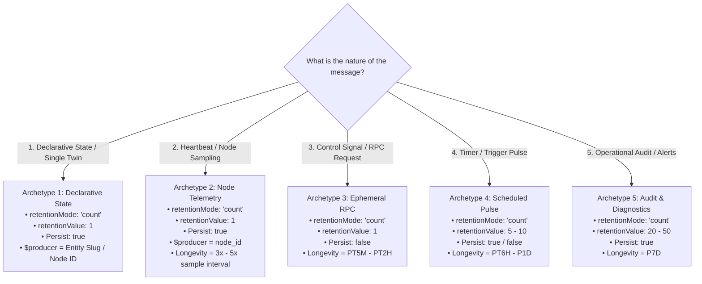

# 🏛️ Bindu Retention Policies & Storage Partition Guide

This document establishes the canonical, deterministic specification for **Message Retention Policies** and **Semantic Partitioning** in BinduNet. It defines how the retention maintenance engine purges historical records, prevents SQLite database bloat on edge nodes, and ensures declarative state isolation.

---

## 1. ⚙️ The Partition Triplet: `($type, $group, $producer)`

In Bindu, the storage layer (`sqlstorage/sqlstore.go`) and the daily retention maintenance scheduler (`maintenance/maintenance.go`) **never perform global deletions across all records of a given type**. Instead, every retention evaluation is isolated by the **Semantic Partition Triplet**:

$$\text{Partition Key} = (\text{\$type}, \text{\$group}, \text{\$producer})$$

```sql
DELETE FROM messages
WHERE id NOT IN (
    SELECT id FROM messages
    WHERE type = ? AND group_id = ? AND producer = ?
    ORDER BY arrive_time DESC, id DESC
    LIMIT ?
) AND type = ? AND group_id = ? AND producer = ?;
```

### 🔑 Architectural Role of `$producer`
`$producer` is the **isolation boundary** for retention pruning:
1. **Node Scope (`$producer = node_id`)**: The retention limit $N$ is enforced independently for each edge node (e.g. `node-1`, `bindu-minis`, `root`).
2. **Entity Scope (`$producer = entity_id`)**: For discrete declarative definitions (e.g. `fields.id` of a dashboard, or `fields.solution_id` of a solution set), each entity maintains its own isolated slot.
3. **Component Scope (`$producer = plugin_id / reactor_id`)**: For execution profiles, each micro-engine keeps its own performance metric window.

> [!WARNING]
> **Anti-Pattern (Generic Producer Collisions)**:
> Never use generic strings like `"root"`, `"bindu-console"`, or `"system"` for discrete declarative entities with `count: 1`. Doing so causes different entity definitions (e.g. two separate dashboards) to share the same partition, causing each newly applied entity to overwrite and delete the other.

---

## 2. 🏛️ The 5 Semantic Archetypes of Messages

Bindu classifies all message types into 5 deterministic archetypes based on their lifecycle and operational role:



---

## 3. 📋 Complete Matrix of System Message Types

Below is the definitive catalog of all 31 system message types in Bindu, their partition keys, persist flags, retention limits, and architectural rationale:

| Message Type | Category | Scope / `$producer` | Persist | Retention | Longevity | Architectural Purpose & Rationale |
| :--- | :--- | :--- | :---: | :--- | :--- | :--- |
| **`DashboardDefinition`** | `system` | `fields.id` | `true` | `count: 1` | `N/A` | **Declarative State**: SQLite acts as key-value store for individual dashboard views. |
| **`MASSolutionSet`** | `system` | `fields.solution_id` | `true` | `count: 1` | `N/A` | **Declarative State**: Holds the latest active deployment bundle per MAS solution. |
| **`CELReactorSet`** | `system` | `gateway_node_id` | `true` | `count: 1` | `N/A` | **Declarative State**: Active CEL business logic and threshold reactors per node. |
| **`AISemanticReactorSet`** | `system` | `gateway_node_id` | `true` | `count: 1` | `N/A` | **Declarative State**: Active multimodal AI vision/NLP reactor configurations per node. |
| **`RESTReactorSet`** | `system` | `gateway_node_id` | `true` | `count: 1` | `N/A` | **Declarative State**: Active outgoing HTTP REST dispatch rules per node. |
| **`MediaStorageSet`** | `system` | `gateway_node_id` | `true` | `count: 1` | `N/A` | **Declarative State**: S3/MinIO bucket endpoints and retention quotas per node. |
| **`NodeGeoLocation`** | `system` | `node_id` | `true` | `count: 1` | `N/A` | **Declarative State**: Current physical latitude/longitude coordinates of the node. |
| **`NodeLocalGeometry`** | `system` | `node_id` | `true` | `count: 1` | `N/A` | **Declarative State**: Active local CAD/coordinate geometry mapping of the node. |
| **`NodeUpdate`** | `system` | `target_node_id` | `true` | `count: 1` | `P30D` | **OTA Staging**: Pending binary delivery package for node maintenance rollout. |
| **`NodeRuntimeUpdate`** | `system` | `target_node_id` | `true` | `count: 1` | `P30D` | **OTA Orchestration**: Active update step execution plan across the mesh. |
| **`MessageState`** | `system` | `node_id` | `true` | `count: 1` | `PT6M` | **Node Telemetry**: Live CPU, RAM, disk, BPR processes, and goroutine metrics. |
| **`SystemVersion`** | `system` | `node_id` | `true` | `count: 1` | `PT6H` | **Node Telemetry**: Inventory of installed binaries, releases, and plugins. |
| **`NodePresence`** | `system` | `node_id` | `true` | `count: 1` | `PT1H30M` | **Mesh Discovery**: Uplink network presence, IP endpoints, and socket priority. |
| **`ParentPresence`** | `system` | `node_id` | `true` | `count: 1` | `PT1H30M` | **Mesh Discovery**: Downlink network presence broadcast from parent to children. |
| **`MessagePing`** | `system` | `src_node_id` | `false` | `count: 1` | `PT2H` | **Ephemeral Control**: Network round-trip latency probe. Not stored long-term. |
| **`MessagePong`** | `system` | `src_node_id` | `false` | `count: 1` | `PT2H` | **Ephemeral Control**: Network round-trip probe response. |
| **`SystemNodeReset`** | `system` | `console`/`studio` | `false` | `count: 1` | `PT2H` | **Ephemeral Command**: Graceful node service restart trigger via `bindu/in`. |
| **`EmitMessageStateRequest`**| `system` | `console`/`studio` | `false` | `count: 1` | `PT5M` | **Ephemeral Trigger**: On-demand request to audit and emit `MessageState`. |
| **`EmitSystemVersionRequest`**| `system` | `console`/`studio` | `false` | `count: 1` | `PT5M` | **Ephemeral Trigger**: On-demand request to audit and emit `SystemVersion`. |
| **`LogsRequest`** | `system` | `console` | `false` | `count: 1` | `PT2H` | **Ephemeral Query**: Request to inspect node systemd journal / log files. |
| **`LogsResponse`** | `system` | `node_id` | `false` | `count: 1` | `PT2H` | **Ephemeral Query**: In-transit log query output payload. |
| **`NodePlatformUpdateEvent`**| `system` | `node_id` | `false` | `count: 1` | `N/A` | **Ephemeral Event**: Internal signal of host OS/architecture change. |
| **`SystemScheduledEvent`** | `system` | `digital_twin_id` | `true` | `count: 10` | `P1D` | **Scheduler Intent**: Recent registered timer intents per digital twin. |
| **`SystemScheduledEventCancel`**| `system`| `digital_twin_id` | `false` | `count: 1` | `PT2H` | **Scheduler Control**: Transient cancellation command for pending timers. |
| **`SystemCronJob`** | `system` | `digital_twin_id` | `true` | `count: 10` | `PT6H` | **Execution Pulse**: Recent timer awakening trigger pulses per twin. |
| **`ErrorEvent`** | `system` | `origin_producer` | `true` | `count: 20` | `P7D` | **Audit & Diagnostics**: Ring buffer of recent error events for root-cause diagnosis. |
| **`SystemAlert`** | `system` | `component` | `true` | `count: 100` | `P7D` | **Audit Log**: Mesh operational lifecycle and hardware watchdog alert stream. |
| **`AICognitiveProfile`** | `system` | `reactor_id` | `true` | `count: 100` | `N/A` | **Performance Metrics**: AI model inference latency, token counts, and hydration time. |
| **`RESTExecutionProfile`** | `system` | `reactor_id` | `true` | `count: 100` | `N/A` | **Performance Metrics**: HTTP connector roundtrip latency, status codes, and bytes. |
| **`SendEmailRequest`** | `system` | `plugin_id` | `true` | `count: 10` | `N/A` | **Service Audit**: Outgoing email queue dispatch buffer. |
| **`SendEmailResult`** | `system` | `plugin_id` | `true` | `count: 10` | `N/A` | **Service Audit**: SMTP delivery confirmation and transaction ID buffer. |

---

## 4. 📐 Deterministic Framework for Custom Message Types

When designing custom domain message types for telemetry, derived inferences, or hardware actuation, apply the following deterministic rules:

### Rule 1: Static / Digital Twin State (`retentionValue: 1`)
- **Condition**: The message represents the latest state of a specific device, sensor, asset, or digital twin.
- **Contract**:
  - `retentionMode: "count"`
  - `retentionValue: 1`
  - `persist: true`
  - `$producer` = Hardware Serial Number, Device ID, or Asset Slug (e.g. `"freezer-01"`, `"conveyor-motor-b"`).

### Rule 2: Continuous Telemetry Stream (`retentionValue: 50 - 100` or `days: 1 - 7`)
- **Condition**: High-frequency time-series measurements (vibration, temperature, power, optical frames).
- **Contract**:
  - `retentionMode: "count"` (for fixed ring buffer) or `"days"` (for time-windowed pruning).
  - `retentionValue`: typically `50` to `100` for edge nodes.
  - `longevity`: ISO-8601 duration matching the retention window (e.g. `P7D`).

### Rule 3: Actuation Commands & RPCs (`persist: false`)
- **Condition**: Control commands sent to physical actuators, PLCs, or external microservices (e.g. `ModbusSet`, `ModbusGet`, `MeshAuditTrigger`, `MASclTrigger`).
- **Contract**:
  - `persist: false`
  - `retentionMode: "count"`, `retentionValue: 1 - 5`
  - `longevity`: `PT5M` (for queries) or `PT2H` (for commands).

### Rule 4: Scheduled Awakening Pulses (`retentionValue: 10`, `longevity: "PT6H"`)
- **Condition**: Time-based awakening events emitted when a digital twin reconditioning timer or cron expires (e.g. `PotatoReconditioningWakeup`, `SystemCronJob`).
- **Contract**:
  - `persist: true`
  - `retentionMode: "count"`, `retentionValue: 10`
  - `longevity`: `PT6H` or `P1D`
  - `$producer` = Digital Twin ID or Asset Slug.

### Rule 5: Compliance Audit, Advisory & AI Inferences (`retentionValue: 20 - 50` or `days: 7 - 30`)
- **Condition**: Risk assessments, optical grading, regulatory quota checks, and formal execution audits (e.g. `StorageRiskAssessment`, `PotatoOpticalAnalysis`, `HaulQuotaValidation`, `MediaPruneAudit`).
- **Contract**:
  - `persist: true`
  - `retentionMode: "count"` (20-50) or `"days"` (7-30)
  - `longevity`: `P7D`, `P14D`, or `P30D`.

---

### 4.1 🏭 Domain-Specific Industrial & Multi-Agent Retention Patterns

#### 1. Industrial PLC & Actuation Protocol (Modbus / Fieldbus)
- **Actuation Commands (`*Set`) & Read Requests (`*Get`)**: Must be configured as **Archetype 3 (`persist: false`, `longevity: PT2H`)**. Actuation signals are ephemeral pulses; storing hundreds of historical write requests bloats edge storage with stale intent.
- **Hardware Telemetry (`*Data`)**: Must be configured as **Archetype 2 (`persist: true`, `count: 50 - 100`, `longevity: P7D`)**.
- **Execution Status / ACKs (`*Status`)**: Configured as **Archetype 5 (`persist: true`, `count: 20`, `longevity: P1D`)** for recent failure triage.

#### 2. Media Storage & Object Lifecycle (S3 / MinIO)
- **Prune Candidate Events (`*Candidate`)**: Must be configured as **Archetype 3 (`persist: false`, `count: 10`, `longevity: PT6H`)**. Once the storage reactor executes the S3 DELETE API, the candidate event has zero operational value.
- **Audit Records (`*Audit`)**: Configured as **Archetype 5 (`persist: true`, `days: 30`, `longevity: P30D`)** to provide a persistent, tamper-evident record of purged media.

#### 3. Multi-Agent Occurrence & Fleet Diagnostics (`MAS*Occurrence`)
- **Isolation Scope**: When multiple autonomous agents (CEL, REST, AI, BPR) emit occurrence events on the same node, `$producer` must be bound to the **Component Scope** (`$producer = agent_name / reactor_id`), never a generic node string.
- **Retention Capacity**: `retentionValue` must be $\ge 20$ to prevent consecutive agent executions from prematurely overwriting each other in the SQLite ring buffer.

---

## 5. 🧹 Retention Maintenance Verification

> [!NOTE]
> During automated scheduled maintenance (`maintenance_cron`), if `maintenance_reset: true` (default in `binduConfig.json`), service-managed Root and Edge nodes perform a clean self-restart immediately after pruning to reclaim CGO memory. Manual CLI triggers (`maintenance run-now`) execute in-process retention pruning and VACUUM without triggering a service restart.

### ⏰ Scheduled Events Lifecycle & Dual-Purge Architecture

In addition to generic triplet limits, the daily maintenance scheduler executes semantic cleanup of time-based state machines:
- **One-shot `SystemScheduledEvent`** records that already completed execution (`SystemCronJob` emitted and verified in the ledger) or expired are automatically pruned during nightly maintenance (with a 24-hour grace window).
- **On-demand immediate purge**: Operators can prune completed/expired timers at any time without waiting for midnight via the Web Console (`🧹 Purge Completed`) or CLI (`bindu-studio schedule-event purge [--older-than=24h] [--node=<id>]`). Active future timers and recurring cron patterns are strictly preserved.

To inspect or manually trigger retention pruning across all active database partitions:

```bash
# Execute immediate retention cleanup on the running node/root
go run ./cmd/bindu-studio maintenance run-now --base-dir .

# Inspect total message counts by type in SQLite
go run ./cmd/bindu-studio query "SELECT \"\$type\", COUNT(1) AS count FROM v_messages GROUP BY \"\$type\" ORDER BY count DESC;"
```
