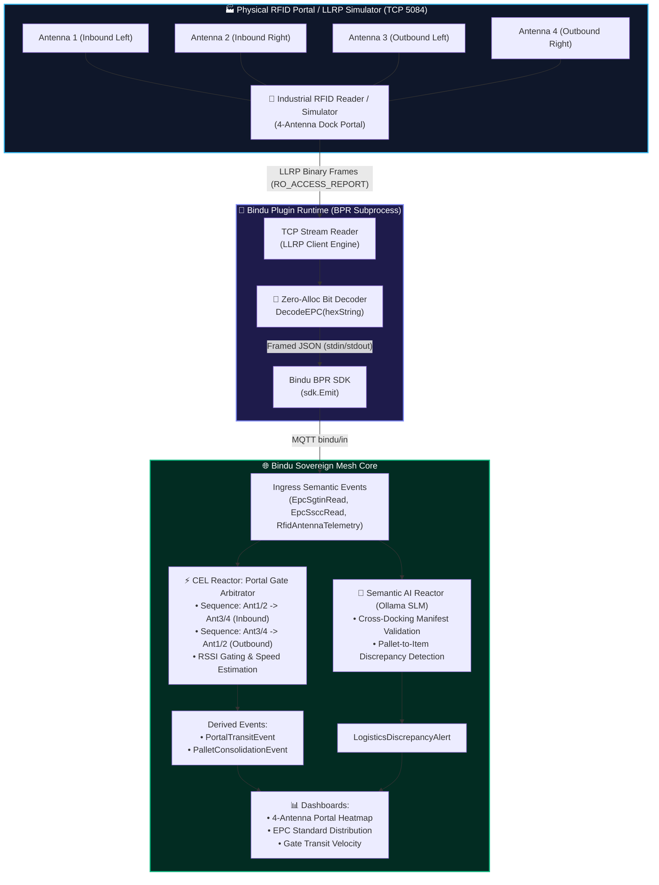
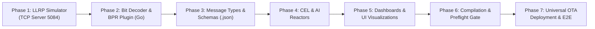

# 📡 Tutorial Plan: Industrial RFID EPC Global Portal & LLRP Protocol Multi-Agent System
### Low Level Reader Protocol (LLRP), 11 EPC Tag Standards, 4-Antenna Portal Directionality & Sovereign Edge Telemetry

---

## 🧭 1. Executive Summary & Engineering Objective

This document defines the definitive architectural specification, bit-level encoding/decoding mechanics, mathematical models, and implementation roadmap for the **Industrial RFID EPC Global Portal & LLRP Protocol Multi-Agent System (MAS)** in Bindu.

The solution enables Bindu to interface natively with enterprise **RAIN RFID (UHF EPC Gen2 / ISO 18000-63)** hardware readers (e.g., Impinj Speedway R420/R700, Zebra FX9600, Alien ALR-F800) over the standardized **Low Level Reader Protocol (LLRP — EPCglobal / ISO/IEC 24730-1)**.

### Core Capabilities Synthesized in this MAS Solution:
1. **Standalone LLRP Mock Reader & RF Simulator (`rfid-reader-simulator`):** High-throughput TCP server on standard port `5084` implementing binary LLRP protocol framing, ROSpec scheduling, keepalive heartbeats, 4-antenna portal geometry, and realistic RF physics (RSSI, Peak RSSI, TxPower, Channel Frequency, Phase Angle, and Doppler Shift).
2. **Comprehensive 11 EPC Standard Tag Generator:** Synthesizes valid 96-bit hex payloads across all 11 EPCglobal Tag Data Standards (TDS 1.11 / 2.0): **SGTIN-96, SSCC-96, SGLN-96, GRAI-96, GIAI-96, GSRN-96, GDTI-96, CPI-96, SGCN-96, ITIP-96, and GID-96**.
3. **Pure Go Native BPR Plugin (`bindu-rfid-epc-plugin`):** Zero-CGo, isolated OS subprocess communicating with Bindu Core strictly via framed JSON over `stdin/stdout`. Implements an asynchronous TCP LLRP client engine and a high-speed, zero-alloc bit-unpacking engine (`DecodeEPC(hexString string)`).
4. **12 Dedicated Semantic Message Types:** Emits strongly-typed, schema-validated events per EPC standard (`EpcSgtinRead`, `EpcSsccRead`, etc.) and real-time antenna RF health diagnostics (`RfidAntennaTelemetry`).
5. **Deterministic In-Process CEL Stream Reactors (`CELReactorSet`):** Evaluates 4-antenna gate portal crossing sequences, computes spatial direction of travel (Dock Inbound vs. Outbound), calculates tag velocity, and arbitrates duplicate tag reads in $< 1\,\mu\text{s}$.
6. **Cognitive AI Reasoning Reactor (`AISemanticReactorSet`):** System One Decision-Native (`TypeSafe AI / jev-latest`) cross-docking reconciliation agent classifying pallet mismatch anomalies (`discrepancy_type`, `severity`) with calibrated RLCD probabilities and deterministic CEL synthesis for `analysis_summary` and `recommended_action`.
7. **Declarative 4-Antenna Portal & Telemetry Dashboards (`DashboardDefinition`):** Real-time web console visualizations showing antenna beam heatmaps, RSSI signal strength distribution, read throughput, and logistics flow.
8. **The Rule of 6 Declarative MAS Artifacts & Universal OTA Triptych:** Fully self-contained `.bundle.json` with Step 0 Preflight Validation Gate deployed via `runtime baseline accept` $\to$ `runtime desired commit` $\to$ `runtime update wizard`.



---

## 🏷️ 2. The 11 EPC Global Standards Bit-Level Specification & Partition Matrix

The Electronic Product Code (EPC) Tag Data Standard (TDS) specifies 96-bit binary encodings. The first 8 bits define the **EPC Header** which identifies the encoding scheme. Bit positions for **Company Prefix** and **Item/Asset Reference** are dynamically allocated based on a 3-bit **Partition Table**.

```
+-----------------------------------------------------------------------------------------+
|                              96-BIT EPC GENERAL MEMORY LAYOUT                            |
+-----------+---------------+--------------------+--------------------------+-------------+
| Header    | Filter Value  | Partition Value    | Company Prefix           | Item / Ref  | Serial Number|
| (8 bits)  | (3 bits)      | (3 bits)           | (20 to 40 bits)          | (24 to 4 b) | (36 to 38 b) |
+-----------+---------------+--------------------+--------------------------+-------------+
```

### 📋 The 11 Supported EPC Standards Matrix

| # | EPC Standard | Header (Hex) | Header (Binary) | Primary Industrial Domain | Decoded Semantic Entity / Fields |
|---|---|---|---|---|---|
| **1** | **SGTIN-96** | `0x30` | `00110000` | Retail, FMCG, Pharmaceuticals | Filter, CompanyPrefix, ItemReference, SerialNumber, GTIN-14, Canonical URN |
| **2** | **SSCC-96** | `0x31` | `00110001` | Logistics, Pallets, Shipping Containers | Filter, CompanyPrefix, ExtensionDigit, SerialReference, SSCC-18 URN |
| **3** | **SGLN-96** | `0x32` | `00110010` | Physical Locations, Docks, Warehouses | Filter, CompanyPrefix, LocationReference, GLNExtension, GLN-13 URN |
| **4** | **GRAI-96** | `0x33` | `00110011` | Returnable Crates, Totes, Kegs, Gas Cylinders | Filter, CompanyPrefix, AssetType, SerialNumber, GRAI URN |
| **5** | **GIAI-96** | `0x34` | `00110100` | Fixed Assets, Industrial Vehicles, Machinery | Filter, CompanyPrefix, IndividualAssetReference, GIAI URN |
| **6** | **GSRN-96** | `0x35` | `00110101` | Hospital Patients, Service Recipients, Drivers | Filter, CompanyPrefix, ServiceReference, GSRN-18 URN |
| **7** | **GDTI-96** | `0x3C` | `00111100` | Customs Docs, Tax Certificates, Lab Reports | Filter, CompanyPrefix, DocumentType, SerialNumber, GDTI URN |
| **8** | **CPI-96** | `0x3D` | `00111101` | Automotive Parts, Aerospace Components | Filter, CompanyPrefix, ComponentPartReference, SerialNumber, CPI URN |
| **9** | **SGCN-96** | `0x3E` | `00111110` | High-Value Vouchers, Coupons, Tickets | Filter, CompanyPrefix, CouponReference, SerialNumber, SGCN URN |
| **10** | **ITIP-96** | `0x38` | `00111000` | Variable Piece Goods (Steel coils, Timber, Textiles)| Filter, CompanyPrefix, PieceItemReference, PieceNumber, ITIP URN |
| **11** | **GID-96** | `0x35`* | `00110101`* | General Industrial Identification (Non-GS1) | GeneralManagerNumber (28b), ObjectClass (24b), SerialNumber (36b) |

*\*Note: GID-96 uses header `0x35` with 0-value filter partition structure or standard `0x35` GID format.*

### 🧩 SGTIN-96 Partition Table Example (GS1 TDS 1.11)

| Partition ($P$) | Company Prefix Bits ($M$) | Company Prefix Digits ($L$) | Item Ref Bits ($N$) | Item Ref Digits ($D$) |
|---|---|---|---|---|
| `0` (`000`) | 40 | 12 | 4 | 1 |
| `1` (`001`) | 37 | 11 | 7 | 2 |
| `2` (`010`) | 34 | 10 | 10 | 3 |
| `3` (`011`) | 30 | 9 | 14 | 4 |
| `4` (`100`) | 27 | 8 | 17 | 5 |
| `5` (`101`) | 24 | 7 | 20 | 6 |
| `6` (`110`) | 20 | 6 | 24 | 7 |

---

## ⚡ 3. Mathematical Models: Portal Directionality, RSSI Gating & RF Physics

### Model A: 4-Antenna Gate Direction of Travel (Spatial Sequence Estimation)
A physical dock door portal employs 4 antennas:
* **Inbound Plane:** Antenna 1 (Left) & Antenna 2 (Right) positioned at the outer dock entrance ($x = 0\,\text{m}$).
* **Outbound Plane:** Antenna 3 (Left) & Antenna 4 (Right) positioned at the inner facility threshold ($x = 2.5\,\text{m}$).

The direction of transit $\vec{D} \in \{\text{INBOUND}, \text{OUTBOUND}, \text{STATIC}\}$ is determined by the temporal difference of maximum RSSI observation between antenna pairs:

$$\bar{t}_{\text{in}} = \frac{t_{\text{peak}}(\text{Ant}_1) + t_{\text{peak}}(\text{Ant}_2)}{2}, \quad \bar{t}_{\text{out}} = \frac{t_{\text{peak}}(\text{Ant}_3) + t_{\text{peak}}(\text{Ant}_4)}{2}$$

$$\Delta t_{\text{transit}} = \bar{t}_{\text{out}} - \bar{t}_{\text{in}}$$

$$\text{Direction} = \begin{cases}
\text{INBOUND (Receiving Dock)}, & \text{if } \Delta t_{\text{transit}} > \tau_{\text{min}} \\
\text{OUTBOUND (Shipping Bay)}, & \text{if } \Delta t_{\text{transit}} < -\tau_{\text{min}} \\
\text{STATIC (Staged Tag / Stray Read)}, & \text{if } |\Delta t_{\text{transit}}| \le \tau_{\text{min}}
\end{cases}$$

Where $\tau_{\text{min}} = 150\,\text{ms}$ is the minimum transit threshold separating forklift transit from stationary reflections.

### Model B: Tag Velocity & Conveyor Speed Estimation
Using the spatial antenna baseline distance $L_{\text{portal}} = 2.5\,\text{m}$:

$$v_{\text{tag}} = \text{ai.clamp}\left( \frac{L_{\text{portal}}}{|\Delta t_{\text{transit}}|}, 0.0, 15.0 \right) \quad (\text{m/s})$$

### Model C: Friis Transmission & RSSI Distance Gating
To eliminate stray reads from adjacent warehouse aisles, the plugin and CEL reactors enforce an RF power budget:

$$\text{RSSI} = P_{\text{tx}} + G_{\text{tx}} + G_{\text{rx}} - 20\log_{10}\left(\frac{4\pi d}{\lambda}\right) - L_{\text{cable}}$$

$$\text{Valid Read Condition: } \text{RSSI}_{\text{peak}} \ge -65.0\,\text{dBm}$$

Reads below $-65.0\,\text{dBm}$ are classified as stray multipath reflections and rejected before entering state machines.

---

## 🏗️ 4. Low Level Reader Protocol (LLRP) Engine Specification

### LLRP Binary Frame Format (Octet-Aligned Stream)

```
 0                   1                   2                   3
 0 1 2 3 4 5 6 7 8 9 0 1 2 3 4 5 6 7 8 9 0 1 2 3 4 5 6 7 8 9 0 1
+-+-+-+-+-+-+-+-+-+-+-+-+-+-+-+-+-+-+-+-+-+-+-+-+-+-+-+-+-+-+-+-+
|Ver| Reserved  |  Type (10b)   |        Message Length (32b)   |
+-+-+-+-+-+-+-+-+-+-+-+-+-+-+-+-+-+-+-+-+-+-+-+-+-+-+-+-+-+-+-+-+
|                       Message ID (32b)                        |
+-+-+-+-+-+-+-+-+-+-+-+-+-+-+-+-+-+-+-+-+-+-+-+-+-+-+-+-+-+-+-+-+
|                      Parameters (TLV / TV)                    |
|                              ...                              |
+-+-+-+-+-+-+-+-+-+-+-+-+-+-+-+-+-+-+-+-+-+-+-+-+-+-+-+-+-+-+-+-+
```

### Essential LLRP Messages Handled by Client & Simulator

| Message Name | Type ID | Direction | Purpose in Pipeline |
|---|---|---|---|
| `GET_READER_CAPABILITIES` | `1` | Client $\to$ Reader | Queries supported frequency bands, antenna count (4), and max power. |
| `GET_READER_CAPABILITIES_RESPONSE`| `11` | Reader $\to$ Client | Returns RF capabilities and antenna status table. |
| `ADD_ROSPEC` | `20` | Client $\to$ Reader | Provisions the Reader Operation Spec with inventory parameters. |
| `ADD_ROSPEC_RESPONSE` | `30` | Reader $\to$ Client | Confirms ROSpec registration. |
| `ENABLE_ROSPEC` | `24` | Client $\to$ Reader | Transitions ROSpec from Inactive to Enabled state. |
| `START_ROSPEC` | `22` | Client $\to$ Reader | Starts RF field emission across Antennas 1–4. |
| `RO_ACCESS_REPORT` | `61` | Reader $\to$ Client | High-throughput stream of `TagReportData` packets. |
| `KEEPALIVE` | `62` | Reader $\to$ Client | Periodic liveness heartbeat (default: every 5 seconds). |
| `KEEPALIVE_ACK` | `72` | Client $\to$ Reader | Client heartbeat acknowledgment preventing TCP connection drops. |

---

## 📦 5. The Rule of 6 Declarative MAS Artifacts for RFID EPC Portal

To comply strictly with Bindu MAS architecture, this tutorial produces all 6 standard declarative artifacts:

### Artifact 1: `poc_message_types.json`
Declares 12 strongly-typed schemas:
* **10 EPC Specific Read Events:** `EpcSgtinRead`, `EpcSsccRead`, `EpcSglnRead`, `EpcGraiRead`, `EpcGiaiRead`, `EpcGsrnRead`, `EpcGdtiRead`, `EpcCpiRead`, `EpcSgcnRead`, `EpcItipRead`, `EpcGidRead`.
* **1 Antenna Diagnostics Event:** `RfidAntennaTelemetry` (Antenna ID, TxPower, RSSI, Phase, Channel, NoiseFloor).
* **1 Portal Aggregation Event:** `PortalTransitEvent` (Direction, Velocity, Pallet SSCC, Item SGTIN count).

### Artifact 2: `poc_semantic_reactor_config.json` (`AISemanticReactorSet`)
* **Zero-Plaintext Vault Binding:** `"api_key_secret": "secret:TYPESAFE_API_KEY"` guarantees cloud LLM credentials reside exclusively inside the encrypted vault (`accessControlConfig.brs`) and are never leaked over the wire, in git, or in message ledgers.
* **Provider & Model:** `provider: "typesafe"`, `model_id: "jev-latest"` (`https://api.typesafe.ai/v1/systemone`).
* **Prompt Template & Questions:** Audits `PortalTransitEvent` manifests (`item_count != 48 || estimated_velocity_mps > 2.5 || mean_transit_rssi_dbm < -68.0`) using parallel System One `choice` primitives for `discrepancy_type` and `severity`.
* **Output Schema & CEL Synthesis:** Emits `LogisticsDiscrepancyAlert` using `resp.confidence` for `confidence_score` and deterministic CEL ternary expressions to synthesize `analysis_summary` and `recommended_action`.

### Artifact 3: `poc_cel_reactor_config.json` (`CELReactorSet`)
* **Rule 1 (`rfid-rssi-filter`):** Gating condition `payload.rssi_dbm >= -65.0`.
* **Rule 2 (`rfid-portal-direction-detector`):** Sliding SQL query against `v_messages` computing $\bar{t}_{\text{out}} - \bar{t}_{\text{in}}$ and emitting `PortalTransitEvent`.
* **Rule 3 (`rfid-antenna-health-guard`):** Alerts on reflection VSWR/noise floor degradation (`payload.noise_floor_dbm > -80.0`).

### Artifact 4: `poc_dashboards.json` (`DashboardDefinition`)
* **Dashboard 1:** *Dock Portal Real-Time Ingress & Velocity* (Gauge + Live event stream).
* **Dashboard 2:** *EPC Standard Breakdown & Distribution* (Pie chart of SGTIN, SSCC, GRAI, GIAI, SGLN).
* **Dashboard 3:** *4-Antenna RF Performance & Heatmap* (Bar chart comparing Antenna 1–4 read counts & mean RSSI).

### Artifact 5: `bindu-rfid-epc-plugin/` (Native Go BPR Plugin)
* `main.go`: LLRP client TCP loop, zero-alloc bit-level EPC decoder, Bindu BPR SDK integration.
* `plugin.json`: Manifest declaring capabilities, dependencies, target OS/arch (`linux/amd64`, `linux/arm64`).
* `go.mod`: Clean module definition dependent on `bindunet/sdk`.

### Artifact 6: `solution.bundle.json` + `deploy_mas_solution.sh`
* Consolidated `MASSolutionSet` bundle with Step 0 Preflight Validation Gate executing the **Universal Runtime OTA Triptych**.

---

## 🛠️ 6. Step-by-Step Implementation Roadmap



### 🗓️ Phase 1: LLRP Reader Simulator (`rfid-reader-simulator`)
1. Implement pure Go TCP listener on port `5084`.
2. Build binary framing handlers for `GET_READER_CAPABILITIES`, `ADD_ROSPEC`, `ENABLE_ROSPEC`, `START_ROSPEC`, and `KEEPALIVE`.
3. Implement synthetic 11-standard EPC tag generator with realistic random seed variations.
4. Implement 4-antenna RF simulation loop emitting `RO_ACCESS_REPORT` packets with configurable tag velocities and RSSI attenuation curves.

### 🗓️ Phase 2: EPC 11-Standard Bit Decoder & BPR Plugin (`bindu-rfid-epc-plugin`)
1. Implement zero-alloc bit stream reader (`bitreader.go`).
2. Build partition tables and header lookups for all 11 EPC standards:
   - SGTIN-96, SSCC-96, SGLN-96, GRAI-96, GIAI-96, GSRN-96, GDTI-96, CPI-96, SGCN-96, ITIP-96, GID-96.
3. Write `DecodeEPC(hexString string)` translating raw hex into structured semantic structs.
4. Implement standard LLRP client TCP reader loop with auto-reconnect and keepalive responses.
5. Wire BPR Plugin `sdk.Connect()` to emit typed JSON events to `stdout`.

### 🗓️ Phase 3: Declarative Message Type Schemas (`poc_message_types.json`)
1. Formulate JSON schemas for all 11 EPC events + `RfidAntennaTelemetry` + `PortalTransitEvent`.
2. Configure `retentionMode`, `retentionValue: 1` on state events, and `"routing": ["local", "child", "parent"]`.

### 🗓️ Phase 4: Deterministic CEL & AI Cognitive Reactors
1. Author `poc_cel_reactor_config.json` with directionality arbitration, speed calculations, and clamping (`ai.clamp`).
2. Author `poc_semantic_reactor_config.json` with local SLM manifest cross-referencing prompt.

### 🗓️ Phase 5: Monitoring Dashboards & Visualizations
1. Formulate SQL queries targeting `v_messages` extracting EPC properties with `json_extract(raw_json, ...)`.
2. Author `poc_dashboards.json` with 4-antenna portal telemetry, transit logs, and error alarms.

### 🗓️ Phase 6: Packaging, Verification & Preflight Gate
1. Bundle solution into `solution.json` and export `solution.bundle.json`.
2. Build standalone simulator runner script (`simulate_dock_portal.sh`).
3. Formulate `deploy_mas_solution.sh` featuring Step 0 Offline Preflight Validation Gate.

### 🗓️ Phase 7: E2E Validation & Certification
1. Execute `bindu-studio plugin certify --source ./bindu-rfid-epc-plugin --dry-run`.
2. Execute `bindu-studio solution validate --file ./solution.bundle.json --strict`.
3. Execute `deploy_mas_solution.sh` verifying live event ingestion in Mesh Monitor and SQLite ledger.

---

## 📊 7. Zero-RAG SQL Verification Queries

```sql
-- 1. Real-Time EPC Reads by Standard & Antenna
SELECT 
    "$when" AS read_time,
    "$type" AS epc_standard,
    "$producer" AS reader_id,
    json_extract(raw_json, '$.fields.antenna_id') AS antenna,
    json_extract(raw_json, '$.fields.epc_hex') AS raw_hex,
    json_extract(raw_json, '$.fields.canonical_urn') AS urn,
    CAST(json_extract(raw_json, '$.fields.peak_rssi_dbm') AS REAL) AS rssi
FROM v_messages 
WHERE "$type" IN ('EpcSgtinRead', 'EpcSsccRead', 'EpcSglnRead', 'EpcGraiRead', 'EpcGiaiRead')
ORDER BY "$when" DESC 
LIMIT 25;

-- 2. Directional Portal Transit Summary
SELECT 
    "$when" AS transit_time,
    json_extract(raw_json, '$.fields.portal_id') AS portal,
    json_extract(raw_json, '$.fields.direction') AS direction,
    json_extract(raw_json, '$.fields.pallet_sscc') AS pallet,
    json_extract(raw_json, '$.fields.item_count') AS items_scanned,
    json_extract(raw_json, '$.fields.estimated_velocity_mps') AS speed_mps
FROM v_messages 
WHERE "$type" = 'PortalTransitEvent'
ORDER BY "$when" DESC;

-- 3. Antenna RF Health & Noise Floor Telemetry
SELECT 
    "$when",
    json_extract(raw_json, '$.fields.antenna_id') AS ant,
    json_extract(raw_json, '$.fields.tx_power_cdbm') / 100.0 AS tx_power_dbm,
    json_extract(raw_json, '$.fields.mean_rssi_dbm') AS mean_rssi,
    json_extract(raw_json, '$.fields.noise_floor_dbm') AS noise_floor,
    json_extract(raw_json, '$.fields.status') AS status
FROM v_messages 
WHERE "$type" = 'RfidAntennaTelemetry'
ORDER BY "$when" DESC 
LIMIT 10;
```

---

*Author: Bindu Core AI Architecture & Edge Robotics Team*
*License: Apache-2.0 / Bindu Industrial Specification*
