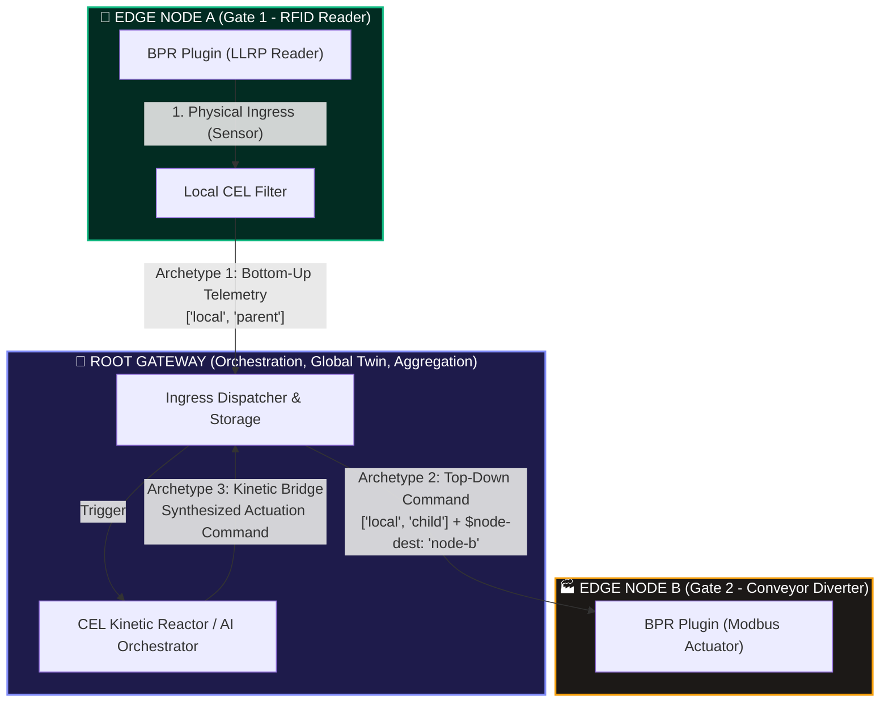
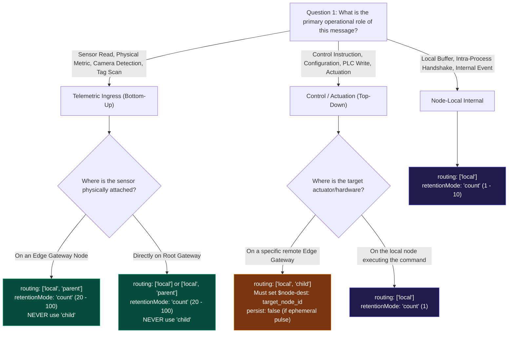

# 🧭 Bindu Routing, Directionality & Mesh Topology Reasoning Guide

This guide establishes the canonical architectural framework for **Message Routing, Flow Directionality, and Hierarchical Mesh Delivery** in BinduNet. It provides autonomous AI agents, solution designers, and platform engineers with a deterministic decision framework for declaring message routing policies in Multi-Agent System (MAS) contracts.

---

## 1. 🏛️ Core Principles of Bindu Routing

Bindu strictly separates **Declarative Intent** from **Physical Transport**:

1. **Intent is Policy (Declared in Schemas)**: When a developer or AI agent defines a Message Type in `poc_message_types.json`, they declare its semantic routing intent via the `"routing"` array:
   - `"local"`: Deliver locally on the executing node (to local plugins, CEL reactors, and SQLite persistence).
   - `"parent"`: Forward upstream toward the mesh parent (toward Root).
   - `"child"`: Forward downstream toward child nodes in the mesh hierarchy.
2. **Delivery is Mechanics (Executed by the Mesh Engine)**: The routing engine resolves physical endpoints (IP, TLS, mTLS sockets), enforces per-endpoint ordering, manages backoff/retries, and isolates failures without modifying the business payload.
3. **The Enforcer Boundary**: Messages entering via `bindu/in` are stamped with governance headers (`$node-origin`, `$node-exec`, `$producer`). Terminal canonical topics (`MessageX/<group>/<producer>`) are strictly for subscriber observation and **must never re-enter the routing engine**.

---

## 2. 🌊 The 4 Canonical Flow Archetypes

In a hierarchical tree mesh, every message belongs to exactly one of four topological flow archetypes:



---

### Archetype 1: Bottom-Up Physical Ingress & Sensor Telemetry
* **Domain Role:** Raw observations, sensor reads, physical antenna telemetry, barcode/RFID scans, camera frame detections, and environmental telemetry.
* **Examples:** `RfidAntennaTelemetry`, `EpcSgtinRead`, `FreezerTelemetry`, `AppearedClass`, `PotatoBatchIngress`.
* **Direction:** **Ascending (Bottom-Up)**: Sensor $\rightarrow$ Local Gateway $\rightarrow$ Parent $\rightarrow$ Root.
* **Routing Contract:**
  ```json
  "routing": ["local", "parent"]
  ```
  *(Or `["local"]` if the sensor is physically connected directly to the Root Gateway and requires no network transit).*
* **The Iron Law of Telemetry:** **NEVER include `"child"` in telemetry schemas.**
  - **Why:** Physical observations belong strictly to the executing node and its upstream supervisors. Child nodes or sibling edge gateways have zero operational interest in the raw antenna reflection or tag scan of another gate.
  - **The Broadcast Catastrophe:** Adding `"child"` to a high-frequency telemetry stream causes Root to multicast every packet to *all* child nodes in the mesh. Any child node that lacks the specific domain plugin or schema will reject the packet with `UNKNOWN_TYPE` and emit an `ErrorEvent` back to Root, triggering a self-reinforcing error storm.

---

### Archetype 2: Top-Down Downstream Commands & Actuation
* **Domain Role:** Administrative reconfiguration, physical actuator commands, motor setpoints, camera Pan-Tilt-Zoom signals, and node maintenance resets.
* **Examples:** `EdgeCVSet`, `RfidReaderConfig`, `ModbusSet`, `SystemNodeReset`, `PotatoThermodynamicSetpoints`.
* **Direction:** **Descending (Top-Down)**: Operator / Root / Central Orchestrator $\rightarrow$ Specific Child Edge Gateway.
* **Routing Contract:**
  ```json
  "routing": ["local", "child"]
  ```
* **Targeting Contract (`$node-dest`):**
  - Downstream commands should **always specify the intended recipient** using the `$node-dest` header (e.g., `"$node-dest": "node-conveyor-01"`).
  - When `$node-dest` is present, the routing engine narrows forwarding strictly to the branch leading to that destination node, preventing blind cluster-wide broadcasts.

---

### Archetype 3: Cross-Node Peer Coordination via Kinetic Intermediaries
* **The Problem:** *What happens when an event captured at Edge Node A must trigger a physical reaction at Edge Node B?* (e.g., An RFID tag read at Inbound Gate A must trigger a diverter arm at Conveyor Gate B).
* **The Anti-Pattern:** Setting `"routing": ["child"]` on Node A's raw tag read so that Node B receives it directly. This violates isolation, floods all non-participating nodes in the mesh, and couples distinct hardware domains.
* **The Architectural Contract:**
  1. **Phase 1 (Ingress to Root):** Node A emits its tag read using standard **Archetype 1** (`"routing": ["local", "parent"]`).
  2. **Phase 2 (Arbitration):** A designated arbitrator (a Google CEL Reactor or Semantic AI Orchestrator running on Root) consumes the ingress event, joins it against state or expected manifests, and makes the business decision.
  3. **Phase 3 (Targeted Dispatch):** The arbitrator synthesizes a **brand-new, dedicated actuation command** using **Archetype 2** (`"routing": ["local", "child"]`) with `"$node-dest": "node-b"`.
* **Conclusion:** **Raw telemetry never bridges horizontally across edge nodes. Intelligence bridges horizontally through declarative reactors.**

---

### Archetype 4: Node-Local Micro-Loop & Ephemeral Staging
* **Domain Role:** Node-internal state transitions, ephemeral handshake signals, localized ring buffers, and internal microservice metrics that require no mesh propagation.
* **Examples:** Local watchdog pings, in-memory feature caches, intra-process diagnostics.
* **Direction:** **Stationary (Node-Local)**: Node $\rightarrow$ Local Engine $\rightarrow$ Termination.
* **Routing Contract:**
  ```json
  "routing": ["local"]
  ```
* **Lifecycle:** The message is delivered to local plugins and evaluators, persisted in local SQLite if `persist: true`, and never forwarded over network links.

---

## 3. 🎯 Decision Tree: How an AI Agent Must Determine Routing

Before writing or modifying any message type schema, evaluate the following deterministic flowchart:



---

## 4. ⚠️ Solution Scope (`mesh_nodes`) vs Mesh-Wide Flooding

A Multi-Agent System (MAS) solution defines its participating nodes in `solution.json`:

```json
{
  "fields": {
    "solution_id": "rfid-dock-portal-solution",
    "artifacts": {
      "mesh_nodes": [
        "root"
      ]
    }
  }
}
```

### The Non-Target Node Rejection Vulnerability
1. **Mesh Nodes Scope**: If a solution declares `"mesh_nodes": ["root"]`, its plugins, message types, and reactors belong **strictly to Root**. Edge nodes such as `bindu-minis` or `dell-debian1` will NOT have these schemas loaded in their runtime registry.
2. **The Hazard of Unscoped `"child"`**: If an application message type belonging to a Root-only solution defines `"routing": ["child"]` without specifying `$node-dest`, the Root router attempts to forward that message to **every single connected child node in the cluster topology**, regardless of whether that node is part of `mesh_nodes`.
3. **The Consequence**: Every non-participating node rejects the message as `UNKNOWN_TYPE` and emits an `ErrorEvent` back to Root, creating severe operational noise.
4. **The Rule**: **Never declare `"child"` on a message type unless the solution manifest assigns participating edge gateways to `mesh_nodes` and the message is an explicit downstream command.**

---

## 5. ⚡ Asynchronous OTA Delivery vs Synchronous In-Memory Reload

When deploying solutions using the **Universal Runtime OTA Triptych** (`baseline accept` $\rightarrow$ `desired commit` $\rightarrow$ `update wizard`), developers must understand the temporal lifecycle and transport decoupling:

### 🌐 Dual-Plane Architecture: MQTT Control Plane vs HTTPS Data Plane
Bindu strictly separates control signaling from bulk binary transfer:
1. **Control Plane (MQTT via mTLS)**: Root dispatches a lightweight orchestration message (`NodeUpdate` or `NodeRuntimeUpdate`) across the mesh. This payload contains only metadata: the execution plan, expected SHA-256 hash, and root's secure endpoint (`delivery.base_url`, e.g., `https://<root-ip>:8443`).
2. **Data Plane (HTTPS via mTLS)**: The edge node agent (`node_update_agent.go`) receives the MQTT trigger, initializes an authenticated mTLS HTTP client with its node credentials, and downloads the binary bundle via `GET /artifacts/...` with automatic chunk resume and retry policies. **Large binaries (25–50 MB) NEVER travel through the MQTT broker**, protecting mesh telemetry throughput from saturation.

| Component | Synchronization Speed | Mechanism | Operational State |
| :--- | :--- | :--- | :--- |
| **Root Gateway** | **Instantaneous** (Microseconds) | `bindu-studio message-types merge` calls `/api/v1/message-types/reload` | Live in-memory schema registry refreshed with **zero downtime**. Immediate readiness. |
| **Remote Edge Nodes** | **Asynchronous** (Seconds to Minutes) | `runtime update wizard` enqueues release packages (`enqueued=5, delivered_now=0`). Edge launchers pull the bundle, verify SHA256, and stage binaries. | Nodos physically update only when their background launcher reloads. |

> [!CAUTION]
> **Temporal Race Condition**: If a plugin running on Root begins emitting messages with `"routing": ["child"]` the instant a script finishes, it transmits packets to edge gateways **before those gateways have downloaded and activated the new release bundle**. The edge nodes will reject the messages during the transition window. Keeping telemetry strictly `"local"` or `["local", "parent"]` eliminates this race condition entirely.

---

## 6. 🚫 The 4 Routing Anti-Patterns

### Anti-Pattern 1: The "Add Child to Everything" Blunder
* **Mistake**: Assigning `"routing": ["local", "child", "parent"]` to raw telemetry streams (`RfidAntennaTelemetry`, `FreezerTelemetry`).
* **Symptom**: Massive storms of `ErrorEvent` with `reason: "Unknown message type: ..."`.
* **Fix**: Remove `"child"`. Set `"routing": ["local", "parent"]`.

### Anti-Pattern 2: Downstream Broadcast without `$node-dest`
* **Mistake**: Emitting a control command (e.g. `RfidReaderConfig` with txPower) with `"routing": ["child"]` but omitting `$node-dest`.
* **Symptom**: Every reader across every warehouse gate receives the command simultaneously, overwriting local tuning.
* **Fix**: Always specify `"$node-dest": "<target_gateway_id>"` on downstream control signals.

### Anti-Pattern 3: Treating Canonical Topics as Ingress
* **Mistake**: Publishing new events directly to `EpcSgtinRead/defaultGroup/root` instead of `bindu/in`.
* **Symptom**: The message bypasses the Enforcer, misses reactor evaluation, and fails to persist.
* **Fix**: `bindu/in` is the **only ingress entrypoint**. Canonical topics are read-only terminal outputs.

### Anti-Pattern 4: Plugin Duplicate Forwarding
* **Mistake**: A Go BPR plugin receives an upstream event and manually calls `ctx.Emit()` to forward it to another node.
* **Symptom**: Duplicate message IDs in SQLite ledger; infinite bounce-back loops.
* **Fix**: Plugins only process local events. The routing engine owns all inter-node forwarding.

---

## 7. 📋 Comprehensive Routing Matrix by Functional Archetype

| Functional Classification | Archetype | Direction | Canonical Routing | Example Message Types |
| :--- | :---: | :---: | :---: | :--- |
| **Physical RFID / Barcode Tag Reads** | 1 (Telemetry) | Bottom-Up | `["local", "parent"]` | `EpcSgtinRead`, `EpcSsccRead`, `BarcodeScan` |
| **RF / Sensor Physical Telemetry** | 1 (Telemetry) | Bottom-Up | `["local", "parent"]` | `RfidAntennaTelemetry`, `AntennaVswrReading` |
| **Camera Detections & Computer Vision** | 1 (Telemetry) | Bottom-Up | `["local", "parent"]` | `AppearedClass`, `DisappearedClass` |
| **Environmental Telemetry (Temp/Vibe)**| 1 (Telemetry) | Bottom-Up | `["local", "parent"]` | `FreezerTelemetry`, `VibrationSample` |
| **Hardware Actuator Configuration** | 2 (Command) | Top-Down | `["local", "child"]` + `$node-dest` | `RfidReaderConfig`, `EdgeCVSet` |
| **PLC Fieldbus Actuation Pulse** | 2 (Command) | Top-Down | `["local", "child"]` + `$node-dest` | `ModbusSet`, `RelayTriggerPulse` |
| **System Node Restart / Reset** | 2 (Command) | Top-Down | `["local", "child"]` + `$node-dest` | `SystemNodeReset` |
| **Spatial / Kinetic Synthesized Events** | 3 (Synthesized) | Bottom-Up | `["local", "parent"]` | `PortalTransitEvent`, `PalletConsolidatedEvent` |
| **Cognitive SLM / Anomaly Alert** | 3 (Alert) | Bottom-Up | `["local", "parent"]` | `LogisticsDiscrepancyAlert`, `DefrostAnomalyAlert` |
| **Intra-Gateway State / Local Cache** | 4 (Local) | Stationary | `["local"]` | `LocalFeatureVector`, `ReaderBufferSlot` |

---

*Authored for autonomous AI agents, multi-agent architects, and distributed systems engineers building on the Bindu Platform.*
