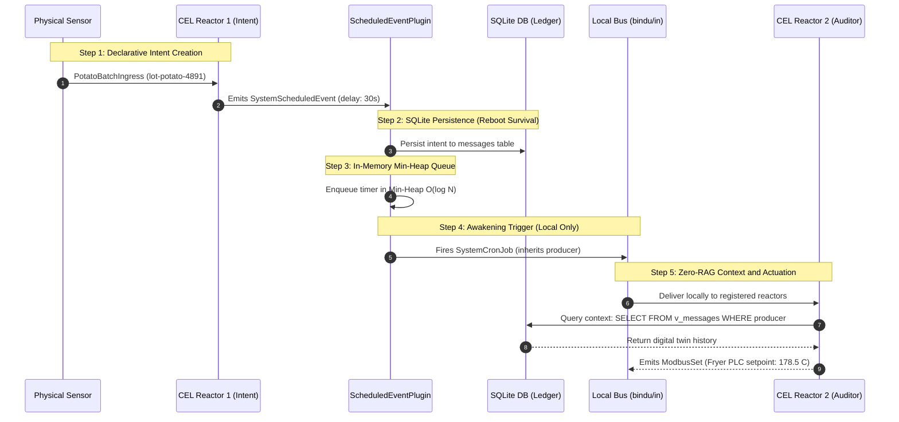
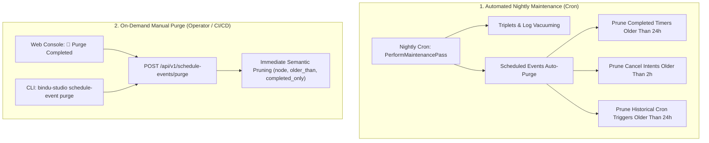

# ⏰ Scheduled Events & Digital Twin Awakening Guide
### Distributed Time-Based State Machine & Scheduled Intent Engine for Bindu

Welcome to the **Bindu Scheduled Events Guide**.

This guide explains how to use Bindu's built-in **Distributed Time-Based State Machine** ("El Despertador del Gemelo Digital") to schedule future intentions, trigger delayed actions, and awaken downstream CEL and AI Reactors to inspect digital twin states with **Zero-RAG database hydration**.

---

## 🧭 The Core Problem: Time in Edge Multi-Agent Systems

In traditional reactive architectures, edge reactors only execute when a new sensory event arrives (`input_message_type`). However, industrial physical processes require **temporal futures**:

* 🥔 **Cold Storage & Agriculture:** *"When a batch of potatoes is loaded into a reconditioning silo, wake me up in 30 seconds (or 11 days) to adjust the frying setpoints based on reducing sugar concentration."*
* 🧪 **Chemical Sanitization:** *"When sanitizing agent is injected into tank 2, schedule a 45-minute timer to audit if the rinse cycle completed."*
* 🚢 **Maritime & Logistics:** *"When a vessel departs harbor, schedule an hourly satellite weather poll and catch quota audit."*

Bindu provides native, fault-tolerant scheduling that survives power outages and edge node reboots with zero loss of state.

---

## 🏛️ The 5-Step Awakening Architecture



---

## 📜 Semantic Message Contracts

### 1. `SystemScheduledEvent` (Scheduling Intent)
Emitted by CEL Reactors, AI Reactors, plugins, CLI, or operators to register a future trigger.

* **Routing Policy:** `["local", "child"]` — Allows `root` to schedule timers on itself or delegate execution downstream to an edge gateway node via `$node-dest`.

| Field | Type | Required | Description |
| :--- | :--- | :--- | :--- |
| **`$id`** | `string` | Yes | Unique scheduled event identifier. |
| **`$group`** | `string` | Yes | Domain group of the Digital Twin (e.g. `coldchain`, `marine`). |
| **`$producer`** | `string` | Yes | **Digital Twin Identifier** (e.g. `lot-potato-4891`, `tank-02`). |
| **`$node-dest`** | `string` | No | Target gateway node ID where the timer will be managed (e.g. `node-dell-1`, `root`). |
| **`action`** | `string` | Yes | Logical action tag (e.g. `recondition_wakeup`). |
| **`schedule_type`** | `string` | Yes | `"delay"` (relative seconds), `"at"` (RFC3339 timestamp), or `"cron"` (cron expression). |
| **`delay_seconds`** | `integer` | No | Relative delay in seconds from `$when` (used with `schedule_type: "delay"`). |
| **`trigger_time`** | `string` | No | Absolute RFC3339 timestamp (used with `schedule_type: "at"`). |
| **`cron_expression`** | `string` | No | Standard cron string (used with `schedule_type: "cron"`). |
| **`repeat`** | `boolean` | No | If `true`, repeats indefinitely or until `max_runs` is reached. |
| **`max_runs`** | `integer` | No | Maximum number of executions for repeating schedules (0 for unlimited). |
| **`missed_policy`** | `string` | No | Action if expired during downtime: `"run_immediately"` (default), `"skip"`, or `"abort"`. |
| **`custom_payload`** | `json` | No | Arbitrary metadata forwarded into the awakening trigger message. |

---

### 2. `SystemScheduledEventCancel` (Dynamic Cancellation)
Allows cancelling a pending timer if the physical condition resolves before expiration (e.g. *potatoes removed early* or *manual operator release*).

* **Routing Policy:** `["local", "child"]` — Propagated to the target edge node.

| Field | Type | Description |
| :--- | :--- | :--- |
| **`target_event_id`** | `string` | Specific `$id` of `SystemScheduledEvent` to cancel. |
| **`action`** | `string` | Cancels all timers matching this action for the given `$producer`. |
| **`reason`** | `string` | Human/audit reason for cancellation. |

---

### 3. `SystemCronJob` (The Awakening Trigger)
Emitted by `ScheduledEventPlugin` on the target node when the scheduled moment arrives.

> [!IMPORTANT]
> **The Strict Local Routing Policy (`routing: ["local"]`):**
> `SystemCronJob` is strictly local to the node where the timer was registered. It **never travels across the mesh to `root`**, guaranteeing that CEL Reactors on `root` or other nodes will never execute phantom duplicate actions or collide with edge hardware.
>
> **Digital Twin Identity Preservation:**
> `SystemCronJob` automatically inherits the exact **`$group`** and **`$producer`** of the original Digital Twin entity. This allows downstream CEL Reactors to perform direct **Zero-RAG context queries** using `'{{head.$producer}}'`.

| Field | Type | Description |
| :--- | :--- | :--- |
| **`$producer`** | `string` | Preserved Digital Twin ID (e.g. `lot-potato-4891`). |
| **`$group`** | `string` | Preserved domain group (e.g. `coldchain`). |
| **`action`** | `string` | Logical action tag (e.g. `recondition_wakeup`). |
| **`scheduled_time`** | `string` | Scheduled trigger time (RFC3339). |
| **`actual_time`** | `string` | Actual firing time (RFC3339). |
| **`latency_ms`** | `number` | Jitter / delay between scheduled time and actual firing time in ms. |
| **`run_count`** | `integer` | Iteration count (1 for first run, increments for repeat timers). |
| **`missed_during_downtime`** | `boolean` | `true` if this event was executed retroactively during node reboot recovery. |
| **`custom_payload`** | `json` | Forwarded metadata from the original scheduling intent. |

---

## 🛠️ CLI Operations: `bindu-studio schedule-event`

The `bindu-studio schedule-event` CLI provides full programmatic management for scheduling, cancelling, and inspecting timers from terminal scripts or CI/CD pipelines.

### 1. Schedule a Future Intent
```bash
# Relative Delay (30 seconds) on edge node
bindu-studio schedule-event schedule \
  --node node-dell-1 \
  --id silo-quarantine-batch-001 \
  --action recondition_wakeup \
  --producer lot-potato-4891 \
  --group coldchain \
  --delay-sec 30 \
  --payload '{"batch_id":"BATCH-4891","target_fryer_temp":178.5}'

# Recurring Cron Expression on root
bindu-studio schedule-event schedule \
  --node root \
  --id hourly-audit-timer \
  --action run_hourly_audit \
  --schedule-type cron \
  --cron "0 * * * *" \
  --group agro_processing
```

### 2. Cancel a Pending Timer
```bash
# Cancel by Target Event ID
bindu-studio schedule-event cancel \
  --node node-dell-1 \
  --id silo-quarantine-batch-001 \
  --reason "Batch released manually by operator"

# Cancel by Action Tag and Producer
bindu-studio schedule-event cancel \
  --node node-dell-1 \
  --action recondition_wakeup \
  --producer lot-potato-4891
```

### 3. Inspect Active Events & Awakening History
```bash
# Table format with reconciled status (Completed, Expired, Scheduled, Cancelled)
bindu-studio schedule-event list --node node-dell-1

# JSON format for automated pipelines
bindu-studio schedule-event list --node node-dell-1 --json
```

### 4. Purge Completed & Expired Timers
```bash
# 1. Purge completed/expired events older than 24h across all nodes (default)
bindu-studio schedule-event purge

# 2. Purge completed events on a specific node older than 1 hour
bindu-studio schedule-event purge --node node-dell-1 --older-than 1h

# 3. Immediate cleanup of all completed/expired events right now (0s age)
bindu-studio schedule-event purge --older-than 0s
```

> [!TIP]
> The purge command securely cleans completed one-shot timers (`SystemScheduledEvent`), reached `max_runs`, historical trigger pulses (`SystemCronJob`), and transient cancellation intents (`SystemScheduledEventCancel`), while **strictly preserving all active future schedules and recurring cron loops**.

---

## 🖥️ Web Console Operations: `⏰ Schedule Events`

The Web Console (`/console/schedule-events`) provides a rich interactive control center for time-based digital twin orchestration:

1. **Mesh Node Scope Selector:**
   * Filter visualization by global mesh or select a specific edge gateway node (`root`, `node-dell-1`, `bindu-pi3-uno`, `bindu-minis`).
2. **Intelligent State Reconciliation:**
   * The console dynamically reconciles raw ledger records against execution pulses:
     * `✅ Completed` (Green): One-shot timers that fired successfully (`SystemCronJob` emitted). Action button `🚫 Cancel` is automatically disabled.
     * `⚠️ Expired` (Gray): Past one-shot timers whose trigger time has passed without execution.
     * `🚫 Cancelled` (Red): Timers revoked by an operator.
     * `⏰ Scheduled` (Yellow): Active pending timers with operational `🚫 Cancel` button.
3. **Filter Tabs:**
   * Instant filtering between `All`, `⏰ Scheduled`, `✅ Completed`, `🔔 Awakened`, and `🚫 Cancelled`.
4. **Manual Ledger Purge:**
   * Toolbar button `🧹 Purge Completed` opens an interactive confirmation modal to prune completed/expired events on demand by scope and minimum age (`0s`, `1h`, `24h`, `7d`).
5. **Schedule New Event Wizard:**
   * Interactive modal with tabbed schedule modes:
     * ⏳ **Delay (Seconds):** Simple relative duration from now.
     * 📅 **Absolute Timestamp:** Calendar date-time picker (RFC3339).
     * 🔁 **Cron Expression:** 5- or 6-field standard cron pattern.
   * Settings for recursive repeats, maximum iteration counts (`max_runs`), and missed downtime policies (`run_immediately`, `skip`, `abort`).
   * Embedded JSON payload editor with syntax highlighting.

---

## 🧹 Automated Data Ledger Hygiene & Retention

Bindu operates under a **Dual-Purge Strategy** to prevent unbounded SQLite disk growth on resource-constrained edge gateways (Raspberry Pi, industrial DIN-rail IPCs):



1. **Automated Zero-Touch Engine Maintenance:**
   * Handled inside `maintenance.PerformMaintenancePass` during nightly scheduled maintenance.
   * Runs with a default 24-hour grace period for completed events, keeping recent executions available for audit while automatically discarding stale history.
2. **On-Demand Operator Control:**
   * Exposed via `POST /api/v1/schedule-events/purge` and the CLI `bindu-studio schedule-event purge` for bench testing, staging resets, or maintenance windows without waiting for midnight.
3. **Safety Invariants:**
   * Neither automated nor manual purge will ever delete an active future timer, a recurring cron schedule, or an unfinished repeating task.

---

## 🥔 End-to-End Example: Cold-Induced Sweetening (CIS) Mitigation

### Step 1: Upstream CEL Reactor (Perception to Temporal Intent)
When `PotatoBatchIngress` arrives with high sugar content ($C_{RS} > 0.20$), CEL Reactor Model A emits `SystemScheduledEvent`:

```json
{
  "reactor_id": "model_a_schedule_silo_reconditioning",
  "input_message_type": "PotatoBatchIngress",
  "trigger_condition": "double(payload.reducing_sugar_index_crs) > 0.20",
  "output_message_type": "SystemScheduledEvent",
  "transformation_expression": {
    "action": "'recondition_wakeup'",
    "schedule_type": "'delay'",
    "delay_seconds": "30",
    "missed_policy": "'run_immediately'",
    "custom_payload": "{ 'batch_id': payload.batch_id, 'reducing_sugar_index_crs': payload.reducing_sugar_index_crs, 'target_fryer_temp': 178.5 }"
  }
}
```

### Step 2: Thirty Seconds Later... The Awakening Pulse
The Go Core `ScheduledEventPlugin` fires `SystemCronJob` locally:
```json
{
  "$type": "SystemCronJob",
  "$id": "trigger-sched-batch-001-928172",
  "$when": "2026-10-05T12:00:30Z",
  "$producer": "lot-potato-cold-001",
  "$group": "potato_processing_pipeline",
  "$node-dest": "node-dell-1",
  "fields": {
    "scheduled_event_id": "sched-batch-001",
    "action": "recondition_wakeup",
    "scheduled_time": "2026-10-05T12:00:30Z",
    "actual_time": "2026-10-05T12:00:30Z",
    "latency_ms": 0.42,
    "run_count": 1,
    "missed_during_downtime": false,
    "custom_payload": {
      "batch_id": "lot-potato-cold-001",
      "reducing_sugar_index_crs": 0.41,
      "target_fryer_temp": 178.5
    }
  }
}
```

### Step 3: Downstream CEL Reactor (Zero-RAG Audit & Hardware Actuation)
The downstream CEL Reactor intercepts `SystemCronJob` and issues the final `ModbusSet` command to configure the Fryer PLC registers:

```json
{
  "reactor_id": "model_c_fryer_actuation_awakening",
  "input_message_type": "SystemCronJob",
  "trigger_condition": "payload.action == 'recondition_wakeup'",
  "output_message_type": "ModbusSet",
  "transformation_expression": {
    "unit_id": "2",
    "register_type": "'holding'",
    "address": "200",
    "value": "int(double(payload.custom_payload.target_fryer_temp) * 10.0)"
  }
}
```

---

## 🛡️ Resilience & Reboot Recovery

1. **Deterministic Persistence:** Every `SystemScheduledEvent` is written to SQLite before being queued in memory.
2. **Crash & Power Outage Survival:** When `bindu-node` boots, `ScheduledEventPlugin` queries SQLite `v_messages` for active events from the last 7 days and repopulates the Min-Heap.
3. **Missed Event Policies:**
   * `"run_immediately"`: If an event expired while the edge node was offline, it triggers immediately upon startup with `missed_during_downtime: true`.
   * `"skip"`: The missed event is discarded without executing.
   * `"abort"`: Cancels the event and records an audit log.
