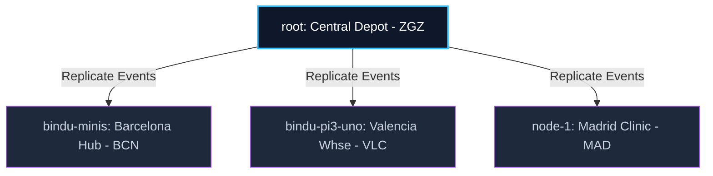

# Implementation Plan: Predictive Cold Chain Smart Cooling Demo & Tutorial 🌡️❄️🧠

This document outlines a production-ready, step-by-step implementation plan for a **Predictive Cold Chain Smart Cooling Demo**. 

The goal of this tutorial and demo is to showcase how **Bindu's Unified AI-Pushing Architecture** acts as a decentralized autonomous nervous system—intercepting local telemetry anomalies, hydrating historical trends from SQLite (`Zero-RAG`), and executing parallel calibrated decisions via **TypeSafe AI (`Jev` System One API at `/v1/systemone`)** (or offline edge SLMs via Ollama) to propagate predictive risk assessments across a multi-node warehouse mesh.

---

## 1. Cold Chain Warehouse Mesh Topology Design 🗺️

To simulate a real-world pharmaceutical logistics network, we map the **4 active deployment nodes** (3 gateways + 1 root) to geographically distributed vaccine and medicine storage facilities. 



### 📍 Facility Geolocation & Profiles

| Node ID | Facility Name | Location | Coordinates (Lat, Lon) | Cold Chamber Profile |
| :--- | :--- | :--- | :--- | :--- |
| **`root`** | Zaragoza Central Depot (HQ) | Zaragoza, Spain | `41.6488, -0.8891` | Ultra-cold vault (`-80°C`) for bulk mRNA storage. |
| **`bindu-minis`** | Barcelona Distribution Hub | Barcelona, Spain | `41.3851, 2.1734` | Large walk-in vaccine freezer (`-20°C`). |
| **`bindu-pi3-uno`** | Valencia Regional Warehouse | Valencia, Spain | `39.4699, -0.3763` | Medium walk-in vaccine freezer (`-20°C`). |
| **`node-1`** | Madrid Pharmacy Vault | Madrid, Spain | `40.4168, -3.7038` | Medical cabinet refrigerator (`+2°C`) at a clinic. |

---

## 2. Ingress Telemetry Simulation Script 🧪

To test and demonstrate the AI's ability to recognize patterns over time, the simulation replicates a **prolonged door open event** resulting in a progressive temperature spike. 

We utilize `bindu-studio message-samples import` to publish these messages sequentially into the mesh. This method is incredibly robust because it leverages core Go server bindings directly, removing the need for external network utilities like `mosquitto_pub` or `curl`.

### 📂 Simulation Script: `public/console/docs/semantic-ai-reactor-tutorial/simulate_cold_chain_anomaly.sh`

Create a highly detailed script that auto-generates the chronological sequence of message events and injects them into the chosen facility:

```bash
#!/usr/bin/env bash
# public/console/docs/semantic-ai-reactor-tutorial/simulate_cold_chain_anomaly.sh
# Simulates a progressive cold-chain failure at a regional facility to trigger AI reasoning.

set -e

# Target facility node
FACILITY="bindu-minis"
PRODUCER="freezer_la_02"
WHERE="la_hub.aisle4.vault2"

echo "=== Cold Chain Anomaly Sim: Facility: $FACILITY | Producer: $PRODUCER ==="

# 1. Create a temporary message samples JSON
TEMP_SAMPLES_FILE="/tmp/cold_chain_samples.json"

cat <<EOF > "$TEMP_SAMPLES_FILE"
{
  "exported_at": "$(date -u +"%Y-%m-%dT%H:%M:%SZ")",
  "message_types": ["FreezerTelemetry"],
  "messages": [
    {
      "\$type": "FreezerTelemetry",
      "\$group": "mesh",
      "\$user": "admin",
      "\$producer": "$PRODUCER",
      "\$when": "$(date -u -d "3 minutes ago" +"%Y-%m-%dT%H:%M:%SZ")",
      "\$where": {
        "locagram": "$WHERE"
      },
      "fields": {
        "temperature": -18.2,
        "door_open": false,
        "compressor_current_amps": 8.1
      }
    },
    {
      "\$type": "FreezerTelemetry",
      "\$group": "mesh",
      "\$user": "admin",
      "\$producer": "$PRODUCER",
      "\$when": "$(date -u -d "2 minutes ago" +"%Y-%m-%dT%H:%M:%SZ")",
      "\$where": {
        "locagram": "$WHERE"
      },
      "fields": {
        "temperature": -16.4,
        "door_open": true,
        "compressor_current_amps": 12.4
      }
    },
    {
      "\$type": "FreezerTelemetry",
      "\$group": "mesh",
      "\$user": "admin",
      "\$producer": "$PRODUCER",
      "\$when": "$(date -u -d "1 minute ago" +"%Y-%m-%dT%H:%M:%SZ")",
      "\$where": {
        "locagram": "$WHERE"
      },
      "fields": {
        "temperature": -14.2,
        "door_open": true,
        "compressor_current_amps": 14.1
      }
    },
    {
      "\$type": "FreezerTelemetry",
      "\$group": "mesh",
      "\$user": "admin",
      "\$producer": "$PRODUCER",
      "\$when": "$(date -u +"%Y-%m-%dT%H:%M:%SZ")",
      "\$where": {
        "locagram": "$WHERE"
      },
      "fields": {
        "temperature": -11.9,
        "door_open": true,
        "compressor_current_amps": 14.8
      }
    }
  ]
}
EOF

echo "✓ Staged 4 chronologically structured FreezerTelemetry events."

# 2. Replay the samples through bindu-studio
echo "🚀 Importing events into the mesh..."
./.e2e-root/current/bin/bindu-studio message-samples import \
  --auth console:StrongPass123 \
  --in-path "$TEMP_SAMPLES_FILE"

echo "✓ Telemetry replayed. AI Reactor is now processing offline..."
```

---

## 3. Real-Time Operational Map & Incident SQL Queries 📊

To present anomalies beautifully in the Console UI (and to let Leaflet paint real-time incident pins on our Operational Map), we design four analytical SQL queries to execute against the SQLite view `v_messages`.

### 🗺️ Query A: Console Operational Map (map) Incident Feed
This query joins live AI `StorageRiskAssessment` messages with our spatial facility catalog, compiling coordinates and risk markers on the fly for the dashboard:

```sql
WITH LatestTelemetry AS (
    SELECT 
        "$producer" AS freezer_id,
        json_extract("$where", '$.locagram') AS locagram,
        ROW_NUMBER() OVER (PARTITION BY "$producer" ORDER BY datetime("$when") DESC) as rn
    FROM v_messages
    WHERE "$type" = 'FreezerTelemetry'
),
FreezerLocations AS (
    SELECT 
        freezer_id,
        locagram,
        CASE 
            WHEN instr(substr(locagram, 2), '/') > 0 
            THEN substr(locagram, 2, instr(substr(locagram, 2), '/') - 1)
            ELSE substr(locagram, 2)
        END AS parent_node_id
    FROM LatestTelemetry
    WHERE rn = 1
),
LatestGeoLocations AS (
    SELECT 
        "$producer" AS node_id,
        json_extract("$where", '$.geojson') AS geojson,
        ROW_NUMBER() OVER (PARTITION BY "$producer" ORDER BY datetime("$when") DESC) as rn
    FROM v_messages
    WHERE "$type" = 'NodeGeoLocation'
),
ActiveGeoLocations AS (
    SELECT node_id, geojson
    FROM LatestGeoLocations
    WHERE rn = 1
),
LatestAssessments AS (
    SELECT 
        json_extract(raw_json, '$.fields.target_producer') AS target_producer,
        json_extract(raw_json, '$.fields.risk_level') AS risk_level,
        json_extract(raw_json, '$.fields.estimated_minutes_to_spoilage') AS minutes_to_spoilage,
        json_extract(raw_json, '$.fields.root_cause_prediction') AS root_cause,
        json_extract(raw_json, '$.fields.recommended_action_code') AS action_code,
        "$when" AS assessed_at,
        ROW_NUMBER() OVER (PARTITION BY json_extract(raw_json, '$.fields.target_producer') ORDER BY datetime("$when") DESC) as rn
    FROM v_messages
    WHERE "$type" = 'StorageRiskAssessment'
)
SELECT 
    fl.parent_node_id AS name,
    gl.geojson AS geometry,
    la.risk_level,
    la.minutes_to_spoilage,
    la.root_cause AS anomaly_reason,
    la.action_code AS recommended_action,
    la.assessed_at AS timestamp
FROM LatestAssessments la
JOIN FreezerLocations fl ON la.target_producer = fl.freezer_id
LEFT JOIN ActiveGeoLocations gl ON fl.parent_node_id = gl.node_id
WHERE la.rn = 1;
```

#### 📊 Dashboard Integration Metadata
*   **Suggested Dashboard Name:** `Operational Map & Incident Tracker`
*   **Chart Title:** `Real-Time Cold Chain Incident Map`
*   **Chart Type:** `Operational Map (map)`
*   **Data Mapping:**
    *   **Entity ID Column:** `name`
    *   **Geometry Column (optional):** `geometry`
    *   **Latitude Column:** None
    *   **Longitude Column:** None
    *   **Tooltip Properties / Info Fields:**
        *   `risk_level` (Label: "Risk Level")
        *   `minutes_to_spoilage` (Label: "Minutes to Spoilage")
        *   `anomaly_reason` (Label: "AI Anomaly Analysis")
        *   `recommended_action` (Label: "Action Code")
        *   `timestamp` (Label: "Last Checked")
*   **Chart Attributes:**
    *   **Tile Size:** `Full Width` (Take full row width)
    *   **Default Map Zoom:** `6`
    *   **Marker Logic:** Color-coded pin/polygon markers (Red for `CRITICAL`, Orange for `HIGH`, Yellow for `WARNING` / `MEDIUM`, Green for `NOMINAL`).

---

### 🚨 Query B: Active High-Alert Anomaly Feed
Retrieves all warnings classified under `HIGH` or `CRITICAL` risk for operator dashboards:

```sql
SELECT 
    "$when" AS timestamp,
    "$where" AS location,
    json_extract(raw_json, '$.fields.risk_level') AS risk_level,
    json_extract(raw_json, '$.fields.estimated_minutes_to_spoilage') AS minutes_to_spoilage,
    json_extract(raw_json, '$.fields.root_cause_prediction') AS predicted_cause,
    json_extract(raw_json, '$.fields.recommended_action_code') AS recommended_action
FROM v_messages
WHERE "$type" = 'StorageRiskAssessment'
ORDER BY "$when" DESC
LIMIT 20;
```

#### 📊 Dashboard Integration Metadata
*   **Suggested Dashboard Name:** `Active Incident Logs`
*   **Chart Title:** `Active High-Alert Anomaly Feed`
*   **Chart Type:** `Data Table`
*   **Data Mapping:**
    *   **Columns to Display:**
        *   `timestamp` (Label: "Timestamp")
        *   `location` (Label: "Cold Chamber Locagram")
        *   `risk_level` (Label: "Severity")
        *   `minutes_to_spoilage` (Label: "Min to Spoilage")
        *   `predicted_cause` (Label: "AI Diagnosed Cause")
        *   `recommended_action` (Label: "Action Code")
*   **Chart Attributes:**
    *   **Tile Size:** `Standard Width` (1/2 row width)
    *   **Maximum Rows:** `20`
    *   **Conditional Formatting:** Red color highlight on rows with `CRITICAL` severity, Orange/Amber on `HIGH`.

---

### ⏳ Query C: Spoilage Time Horizon Risk Ranking
Sorts facility cold chambers by the lowest estimated remaining minutes before active spoilage begins, sorting priority queues for maintenance engineers:

```sql
WITH RankedAssessments AS (
    SELECT 
        json_extract("$where", '$.locagram') AS location,
        "$producer" AS reactor_id,
        json_extract(raw_json, '$.fields.estimated_minutes_to_spoilage') AS minutes_left,
        json_extract(raw_json, '$.fields.root_cause_prediction') AS root_cause,
        json_extract(raw_json, '$.fields.risk_level') AS risk_level,
        ROW_NUMBER() OVER (PARTITION BY "$producer" ORDER BY datetime("$when") DESC) as rn
    FROM v_messages
    WHERE "$type" = 'StorageRiskAssessment'
)
SELECT 
    location,
    reactor_id,
    minutes_left,
    root_cause
FROM RankedAssessments
WHERE rn = 1
ORDER BY minutes_left ASC;
```

#### 📊 Dashboard Integration Metadata
*   **Suggested Dashboard Name:** `Urgency Risk Ranking`
*   **Chart Title:** `Spoilage Time Horizon Risk Ranking (Minutes)`
*   **Chart Type:** `Bar Chart` (Horizontal Comparison)
*   **Data Mapping:**
    *   **Category Axis (X-Axis):** `location` (Label: "Storage Room")
    *   **Value Axis (Y-Axis):** `minutes_left` (Label: "Minutes Left")
    *   **Series Column:** `minutes_left`
    *   **Tooltip Fields:** `root_cause`
*   **Chart Attributes:**
    *   **Tile Size:** `Standard Width` (1/2 row width)
    *   **Sorting Order:** `Ascending` (places facilities requiring urgent attention at the top of the chart)
    *   **Y-Axis Label:** `Minutes Remaining`
    *   **X-Axis Label:** `Facility Compartment`

---

### 🎛️ Query D: Combined Asset Integrity & Vaccine Risk Cockpit
This query retrieves the latest StorageRiskAssessment (vaccine risk) and MachineryHealthAssessment (compressor risk) side-by-side for each active freezer across the mesh:

```sql
WITH LatestRisk AS (
  SELECT 
    "$producer" AS gateway_node,
    json_extract(raw_json, '$.fields.target_producer') AS target_producer,
    json_extract(raw_json, '$.fields.risk_level') AS vaccine_risk,
    CAST(json_extract(raw_json, '$.fields.estimated_minutes_to_spoilage') AS INTEGER) AS minutes_spoilage,
    json_extract(raw_json, '$.fields.root_cause_prediction') AS spoilage_reason,
    "$when" AS risk_assessed_at,
    ROW_NUMBER() OVER (PARTITION BY "$producer" ORDER BY datetime("$when") DESC) as rn
  FROM v_messages
  WHERE "$type" = 'StorageRiskAssessment'
),
LatestMechanical AS (
  SELECT 
    "$producer" AS gateway_node,
    COALESCE(json_extract(raw_json, '$.fields.target_producer'), "$producer") AS target_producer,
    json_extract(raw_json, '$.fields.health_status') AS compressor_health,
    CAST(json_extract(raw_json, '$.fields.predicted_days_to_failure') AS INTEGER) AS days_to_failure,
    json_extract(raw_json, '$.fields.fault_prediction') AS machinery_fault,
    json_extract(raw_json, '$.fields.action_priority') AS repair_priority,
    "$when" AS mechanical_assessed_at,
    ROW_NUMBER() OVER (PARTITION BY "$producer" ORDER BY datetime("$when") DESC) as rn
  FROM v_messages
  WHERE "$type" = 'MachineryHealthAssessment'
),
FilteredRisk AS (
  SELECT * FROM LatestRisk WHERE rn = 1
),
FilteredMechanical AS (
  SELECT * FROM LatestMechanical WHERE rn = 1
)
SELECT * FROM (
  SELECT 
    COALESCE(r.target_producer, m.target_producer, r.gateway_node) AS asset_id,
    COALESCE(r.vaccine_risk, 'NOMINAL') AS vaccine_risk_status,
    r.minutes_spoilage AS minutes_spoilage,
    r.spoilage_reason AS spoilage_reason,
    COALESCE(m.compressor_health, 'NOMINAL') AS compressor_health_status,
    m.days_to_failure AS compressor_days_to_failure,
    m.machinery_fault AS mechanical_fault_details,
    m.repair_priority AS technician_dispatch_priority,
    CASE 
      WHEN r.risk_assessed_at IS NULL THEN m.mechanical_assessed_at
      WHEN m.mechanical_assessed_at IS NULL THEN r.risk_assessed_at
      WHEN r.risk_assessed_at > m.mechanical_assessed_at THEN r.risk_assessed_at
      ELSE m.mechanical_assessed_at
    END AS last_updated
  FROM FilteredRisk r
  LEFT JOIN FilteredMechanical m ON r.gateway_node = m.gateway_node
  UNION
  SELECT 
    COALESCE(r.target_producer, m.target_producer, m.gateway_node) AS asset_id,
    COALESCE(r.vaccine_risk, 'NOMINAL') AS vaccine_risk_status,
    r.minutes_spoilage AS minutes_spoilage,
    r.spoilage_reason AS spoilage_reason,
    COALESCE(m.compressor_health, 'NOMINAL') AS compressor_health_status,
    m.days_to_failure AS compressor_days_to_failure,
    m.machinery_fault AS mechanical_fault_details,
    m.repair_priority AS technician_dispatch_priority,
    CASE 
      WHEN r.risk_assessed_at IS NULL THEN m.mechanical_assessed_at
      WHEN m.mechanical_assessed_at IS NULL THEN r.risk_assessed_at
      WHEN r.risk_assessed_at > m.mechanical_assessed_at THEN r.risk_assessed_at
      ELSE m.mechanical_assessed_at
    END AS last_updated
  FROM FilteredMechanical m
  LEFT JOIN FilteredRisk r ON m.gateway_node = r.gateway_node
)
ORDER BY 
  CASE 
    WHEN vaccine_risk_status = 'CRITICAL' OR compressor_health_status = 'FAILURE_IMMINENT' THEN 0 
    WHEN vaccine_risk_status = 'HIGH' OR compressor_health_status = 'CRITICAL' THEN 1
    ELSE 2 
  END,
  asset_id;
```

#### 📊 Dashboard Integration Metadata
*   **Suggested Dashboard Name:** `Cold Chain Unified Cockpit`
*   **Chart Title:** `Combined Asset Integrity & Vaccine Risk status`
*   **Chart Type:** `Data Table`
*   **Data Mapping:**
    *   **Columns to Display:**
        *   `asset_id` (Label: "Asset / Freezer ID")
        *   `vaccine_risk_status` (Label: "Vaccine Risk")
        *   `minutes_spoilage` (Label: "Min to Spoilage")
        *   `spoilage_reason` (Label: "AI Spoilage Diagnostic")
        *   `compressor_health_status` (Label: "Compressor Health")
        *   `compressor_days_to_failure` (Label: "Days to Mech Failure")
        *   `mechanical_fault_details` (Label: "AI Mechanical Diagnostic")
        *   `technician_dispatch_priority` (Label: "Tech Dispatch Priority")
        *   `last_updated` (Label: "Last Updated")
*   **Chart Attributes:**
    *   **Tile Size:** `Full Width` (Take full row width)
    *   **Conditional Formatting:** Highlight rows with `CRITICAL` or `FAILURE_IMMINENT` values in Red, and rows with `HIGH` or `DEGRADED` in Orange/Yellow.

---

### 📈 Query E: Recurring Root Cause Pattern Distribution
Aggregates predicted AI root causes over the last 24 hours to find systemic issues (e.g. failing compressors or bad operational practices like leaving doors open) across the entire mesh:

```sql
SELECT 
    json_extract(raw_json, '$.fields.root_cause_prediction') AS predicted_pattern,
    COUNT(*) AS occurrence_count,
    MAX("$when") AS latest_occurrence
FROM v_messages
WHERE "$type" = 'StorageRiskAssessment'
  AND datetime("$when") >= datetime('now', '-1 day')
GROUP BY predicted_pattern
ORDER BY occurrence_count DESC;
```

#### 📊 Dashboard Integration Metadata
*   **Suggested Dashboard Name:** `Systemic Failure Analysis`
*   **Chart Title:** `Recurring Root Cause Pattern Distribution (24h)`
*   **Chart Type:** `Doughnut Chart` (Composition Analysis)
*   **Data Mapping:**
    *   **Labels (Slices):** `predicted_pattern`
    *   **Values (Sizes):** `occurrence_count`
    *   **Tooltip Details:** `latest_occurrence`
*   **Chart Attributes:**
    *   **Tile Size:** `Standard Width` (1/2 row width)
    *   **Legend Position:** `Right`
    *   **Labels Mode:** Show percentage (`%`) and counts on hover.

---

## 4. Operational Flow & Demo Walkthrough Guide 🚀

To execute the PoC during a presentation, follow these simple operational phases:

### Phase A: Setup the Mesh Contracts & Cloud Secrets
First, ensure that the cloud API key is provisioned into the vault, and that target message types and the cognitive orchestrator are active:

```bash
# 1. Provision TypeSafe AI secret into encrypted vault (Zero-Plaintext Wire Guarantee)
./.e2e-root/current/bin/bindu-studio access-control secrets set TYPESAFE_API_KEY \
  --value "YOUR_ACTUAL_TYPESAFE_API_KEY" \
  --yes

# 2. Register FreezerTelemetry and StorageRiskAssessment schemas
./.e2e-root/current/bin/bindu-studio message-types import \
  --in-path ./public/console/docs/semantic-ai-reactor-tutorial/poc_message_types.json \
  --auth console:StrongPass123

# 3. Merge and deploy the AI Semantic Reactor configurations across gateways via MQTT
./.e2e-root/current/bin/bindu-studio semantic-ai-reactor merge \
  --in-path ./public/console/docs/semantic-ai-reactor-tutorial/poc_semantic_reactor_config.json \
  --all \
  --auth console:StrongPass123
```

### Phase B: Launch Anomaly Simulation
Run the automated simulation script:
```bash
bash public/console/docs/semantic-ai-reactor-tutorial/simulate_cold_chain_anomaly.sh
```

### Phase C: Observe Real-Time AI Inference
Execute the Operational Map query in the Bindu console. You will immediately see:
1. The **Barcelona Distribution Hub** marker color-code to **CRITICAL RED**.
2. Hovering/clicking the marker reveals the AI reason: `"Thermal runaway due to prolonged door open state under load"`.
3. The recommended action code advises: `"ACTUATE_CLOSE_VALVE_OR_ALERT_FLOOR"`.
