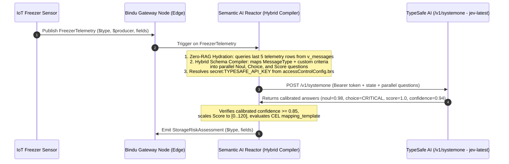

# Cold Chain Smart Cooling — TypeSafe AI (`Jev`) System One PoC Walkthrough

Welcome to the step-by-step guide for setting up and demonstrating the **Cold Chain Smart Cooling** Proof of Concept (PoC) using the **Semantic AI Reactor** powered by **TypeSafe AI (`Jev` System One API)** in Bindu.

In this PoC, we simulate a pharmaceutical vaccine storage facility where a prolonged door-open state and temperature escalation are intercepted at the Edge. Using Bindu's **Hybrid Semantic Compiler**, the reactor hydrates historical context from SQLite (`Zero-RAG`) and evaluates parallel typed decisions (`noul`, `choice`, `score`) via **TypeSafe AI (`/v1/systemone`, model `jev-latest`)**—returning mathematically calibrated probabilities and immediately emitting a structured `StorageRiskAssessment` event into the mesh.

---

## 📋 Table of Contents
1. [Core Design Concept (Hybrid System One Compiler)](#-core-design-concept-hybrid-system-one-compiler)
2. [Step 0: Provisioning Centralized Cloud API Secrets (Zero-Plaintext Wire Guarantee)](#-step-0-provisioning-centralized-cloud-api-secrets-zero-plaintext-wire-guarantee)
3. [Step 1: Importing the Application Message Types](#-step-1-importing-the-application-message-types)
4. [Step 2: Staging, Dry-Running & Merging the TypeSafe AI Reactor Configuration](#-step-2-staging-dry-running--merging-the-typesafe-ai-reactor-configuration)
5. [Step 3: Simulating Ingress Events](#-step-3-simulating-ingress-events)
6. [Step 4: System One Parallel Evaluation & Egress Events](#-step-4-system-one-parallel-evaluation--egress-events)

---

## 💡 Core Design Concept (Hybrid System One Compiler)



---

## 🔐 Step 0: Provisioning Centralized Cloud API Secrets (Zero-Plaintext Wire Guarantee)

Under the Bindu Multi-Agent System (MAS) architecture, secrets like cloud LLM API tokens must **never** be hardcoded in plaintext within distributed deployment manifests or JSON configuration files. Staging or replicating plaintext keys exposes credentials across edge gateways, SQLite message ledgers (`v_messages`), and git commits.

Instead, Bindu employs the **Zero-Plaintext Wire Guarantee**:
1. Cloud credentials are encrypted locally in the node's AES-GCM vault (`accessControlConfig.brs`) using the `bindu-studio access-control secrets` CLI.
2. Deployment manifests store only the reference URI: `"api_key_secret": "secret:TYPESAFE_API_KEY"`.
3. The running BPR plugin worker dynamically resolves `secret:TYPESAFE_API_KEY` at runtime directly from the encrypted vault.

### 1. Check if the secret already exists:
```bash
go run ./cmd/bindu-studio access-control secrets exists TYPESAFE_API_KEY
```

### 2. Store the API key in the encrypted vault:
```bash
go run ./cmd/bindu-studio access-control secrets set TYPESAFE_API_KEY \
  --value "YOUR_ACTUAL_TYPESAFE_API_KEY" \
  --yes
```

### 3. Verify vault status:
```bash
go run ./cmd/bindu-studio access-control secrets validate
```

---

## 🔌 Step 1: Importing the Application Message Types

First, register the custom physical telemetry and System One risk assessment schemas with the Bindu mesh:

📂 **[poc_message_types.json](./poc_message_types.json)**

### How to Validate & Import
Run the `bindu-studio` command-line utility from the repository root:

```bash
# 1. Offline schema compilation check
go run ./cmd/bindu-studio message-types validate \
  --config ./public/console/docs/semantic-ai-reactor-tutorial/poc_message_types.json

# 2. Import into active configuration
go run ./cmd/bindu-studio message-types import \
  --in-path ./public/console/docs/semantic-ai-reactor-tutorial/poc_message_types.json \
  --dest-path ./config/messageTypesConfiguration.json
```

This registers two message contracts:
* **`FreezerTelemetry`**: Captures `temperature` (°C), `door_open` (`boolean`), and `compressor_current_amps` (`number`).
* **`StorageRiskAssessment`**: Designed to showcase all **3 System One decision primitives** plus CEL synthesis:
  * `is_thermal_runaway` (`boolean`) $\rightarrow$ Auto-compiled by Bindu into a **`noul`** yes/no probability question.
  * `risk_level` (`string` with `enum`) $\rightarrow$ Compiled into a **`choice`** classification question (`NOMINAL`, `LOW`, `MEDIUM`, `HIGH`, `CRITICAL`).
  * `estimated_minutes_to_spoilage` (`integer`, `minimum: 0`, `maximum: 120`) $\rightarrow$ Compiled into a 5-level **`score`** rubric and automatically scaled to `0..120` minutes.
  * `recommended_action_code` (`string` with `enum`) $\rightarrow$ Auto-compiled by Bindu into a **`choice`** question.
  * `root_cause_prediction` (`string`) $\rightarrow$ Synthesized deterministically via Google CEL in `mapping_template` from Jev's `is_thermal_runaway` decision.

---

## ⚙️ Step 2: Staging, Dry-Running & Merging the TypeSafe AI Reactor Configuration

Next, we declare the `freezer-cold-chain-guard` instance inside `AISemanticReactorSet`:

📂 **[poc_semantic_reactor_config.json](./poc_semantic_reactor_config.json)**

### Key Hybrid Capabilities Staged:
* **Zero-Plaintext Vault Binding**: `"api_key_secret": "secret:TYPESAFE_API_KEY"` guarantees that the secret is securely looked up from `accessControlConfig.brs` and never transmitted in plaintext.
* **Provider & Endpoint**: `"provider": "typesafe"`, `"api_endpoint": "https://api.typesafe.ai/v1/systemone"`, `"model_id": "jev-latest"`.
* **Zero-Config Auto-Compilation + Explicit `questions` Override**:
  * `is_thermal_runaway` and `recommended_action_code` are compiled **automatically** from `StorageRiskAssessment` without writing any manual question definition.
  * `risk_level` and `estimated_minutes_to_spoilage` use the optional `"questions"` block to provide domain-specific pharmaceutical cold-chain `criteria` rubrics.
* **Calibrated Confidence Gate**: `"confidence_threshold": 0.85` ensures only mathematically calibrated high-certainty decisions are emitted onto the mesh.
* **Offline Validation & Live Dry-Run**:
  ```bash
  # Validate reactor AST, CEL expressions, and System One question rubrics offline
  go run ./cmd/bindu-studio semantic-ai-reactor validate \
    --file ./public/console/docs/semantic-ai-reactor-tutorial/poc_semantic_reactor_config.json

  # In-process simulation: hydrates state and verifies question compilation with vault secret
  go run ./cmd/bindu-studio semantic-ai-reactor dry-run \
    --file ./public/console/docs/semantic-ai-reactor-tutorial/poc_semantic_reactor_config.json \
    --reactor-id freezer-cold-chain-guard \
    --payload '{"$producer":"freezer_z4_01","$where":{"locagram":"/med-warehouse/zone4/rack1"},"fields":{"temperature":-12.4,"door_open":true,"compressor_current_amps":14.8}}'
  ```

* **Deploy to Mesh Gateways (`merge`)**:
  Once dry-run passes, merge and publish the reactor configurations across all target edge gateways (`bindu-minis`, `node-1`, `bindu-pi3-uno`) via MQTT:
  ```bash
  go run ./cmd/bindu-studio semantic-ai-reactor merge \
    --in-path ./public/console/docs/semantic-ai-reactor-tutorial/poc_semantic_reactor_config.json \
    --all \
    --auth console:StrongPass123
  ```

> [!TIP]
> **Switching Between Cloud System One (`Jev`) and Air-Gapped Local System Two (`Ollama`):**
> Because both protocols are unified inside `bindu-semantic-reactor`, switching an edge gateway to an air-gapped local LLM requires changing only `"provider": "openai"`, `"api_endpoint": "http://127.0.0.1:11434/v1/chat/completions"`, and `"model_id": "qwen2.5-coder:0.5b"`.

---

## 🌡️ Step 3: Simulating Ingress Events

To test the temporal trend evaluation, simulate a telemetry feed where a freezer door has been left open:

### Event 1 (11:37:00Z) - Nominal
```json
{
  "$type": "FreezerTelemetry",
  "$producer": "freezer_z4_01",
  "$group": "mesh",
  "$user": "admin",
  "$when": "2026-05-18T11:37:00Z",
  "$where": {
    "locagram": "/med-warehouse/zone4/rack1"
  },
  "fields": {
    "temperature": -18.0,
    "door_open": false,
    "compressor_current_amps": 8.2
  }
}
```

### Event 2 (11:38:00Z) - Door Opened
```json
{
  "$type": "FreezerTelemetry",
  "$producer": "freezer_z4_01",
  "$group": "mesh",
  "$user": "admin",
  "$when": "2026-05-18T11:38:00Z",
  "$where": {
    "locagram": "/med-warehouse/zone4/rack1"
  },
  "fields": {
    "temperature": -16.5,
    "door_open": true,
    "compressor_current_amps": 12.1
  }
}
```

### Event 3 (11:39:00Z) - Temperature Rising
```json
{
  "$type": "FreezerTelemetry",
  "$producer": "freezer_z4_01",
  "$group": "mesh",
  "$user": "admin",
  "$when": "2026-05-18T11:39:00Z",
  "$where": {
    "locagram": "/med-warehouse/zone4/rack1"
  },
  "fields": {
    "temperature": -14.1,
    "door_open": true,
    "compressor_current_amps": 14.2
  }
}
```

### Event 4 (11:40:00Z) - Trigger Event (Critical State)
```json
{
  "$type": "FreezerTelemetry",
  "$producer": "freezer_z4_01",
  "$group": "mesh",
  "$user": "admin",
  "$when": "2026-05-18T11:40:00Z",
  "$where": {
    "locagram": "/med-warehouse/zone4/rack1"
  },
  "fields": {
    "temperature": -12.4,
    "door_open": true,
    "compressor_current_amps": 14.8
  }
}
```

---

## 🧠 Step 4: System One Parallel Evaluation & Egress Events

When the trigger event at `11:40:00Z` arrives at the node:
1. The **Semantic AI Reactor** intercepts it and queries `v_messages` for the last 5 telemetry events of `freezer_z4_01`.
2. It compiles the hydrated state and the 4 System One questions (`is_thermal_runaway` [`noul`], `risk_level` [`choice`], `estimated_minutes_to_spoilage` [`score`], `recommended_action_code` [`choice`]) and sends a single parallel request to `POST https://api.typesafe.ai/v1/systemone`.
3. **Jev (`jev-latest`)** evaluates all questions in parallel (~100ms) and returns calibrated answers:
   ```json
   {
     "model": "jev-1.14.0",
     "answers": {
       "is_thermal_runaway": { "type": "noul", "noul": 0.98 },
       "risk_level": { "type": "choice", "choice": "CRITICAL", "confidence": 0.95 },
       "estimated_minutes_to_spoilage": { "type": "score", "score": 0.75, "confidence": 0.91 },
       "recommended_action_code": { "type": "choice", "choice": "ACTUATE_CLOSE_VALVE_OR_ALERT_FLOOR", "confidence": 0.94 }
     }
   }
   ```
4. Bindu verifies that the aggregate calibrated confidence (`0.945`) exceeds `confidence_threshold` (`0.85`), scales the `score` (`0.75` on `[0..4]` $\rightarrow$ `23` minutes on `[0..120]`), evaluates the CEL `mapping_template`, and emits the validated `StorageRiskAssessment` event onto the mesh:
   ```json
   {
     "$type": "StorageRiskAssessment",
     "$producer": "freezer-cold-chain-guard",
     "$group": "mesh",
     "$user": "admin",
     "$when": "2026-10-22T15:40:01Z",
     "$where": {
       "locagram": "/med-warehouse/zone4/rack1"
     },
     "fields": {
       "is_thermal_runaway": true,
       "risk_level": "CRITICAL",
       "estimated_minutes_to_spoilage": 23,
       "root_cause_prediction": "Thermal runaway due to prolonged door open state under load",
       "recommended_action_code": "ACTUATE_CLOSE_VALVE_OR_ALERT_FLOOR",
       "target_producer": "freezer_z4_01"
     }
   }
   ```
