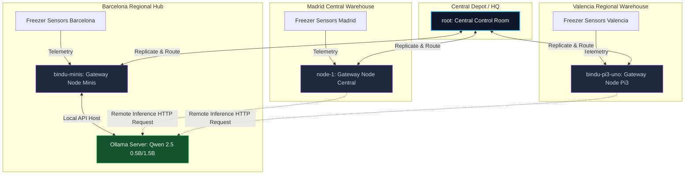
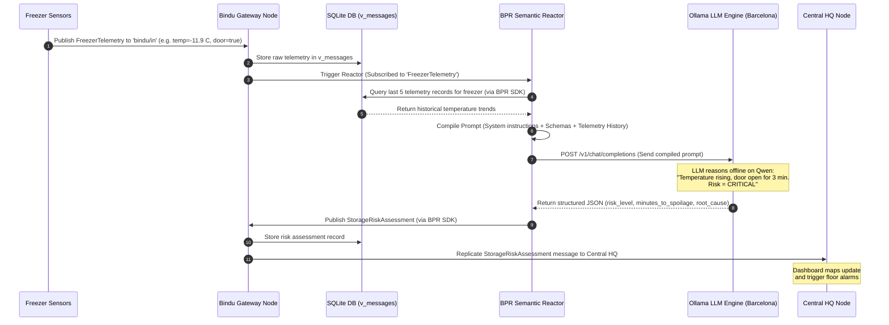

# Deployment & Architecture: Semantic AI Reactor Cold Chain Demo 🧠🛰️❄_

This document provides a highly detailed architectural blueprint and message-flow guide for the **Predictive Cold Chain Smart Cooling Demo**. It is divided into 3 pages/sections to easily incorporate into project documentation or presentation slides.

---

## 📄 Page 1: Mesh Topology & Physical Computing Nodes Layout

The cold chain logistics network is modeled as a hierarchical mesh deployment of Bindu nodes spanning multiple regional facilities in Spain. In this model, we separate physical computation nodes (gateways) from organizational structures (reference nodes).

### 🗺️ Geographical & Network Deployment
*   **Root Node (Central Control Room):** Located centrally, acting as the global coordinator and consolidator.
*   **Madrid Central Warehouse (Gateway `node-1`):** Monitors storage chambers and aisle sensors.
*   **Barcelona Regional Warehouse (Gateway `bindu-minis` | IP `192.168.12.160`):** Monitors walk-in vaccine freezers and executes local Zero-RAG SQLite hydration.
*   **Valencia Regional Warehouse (Gateway `bindu-pi3-uno` | IP `192.168.12.108`):** Monitors local warehouse compartments.
*   **TypeSafe AI System One Engine (`https://api.typesafe.ai/v1/systemone` — `jev-latest`):** Evaluates hydrated node states against parallel `noul`, `choice`, and `score` primitives (can also be switched to a local Ollama server at `192.168.12.160:11434` for air-gapped operation).



> [!NOTE]
> While Ollama is physically centralized at the regional node `bindu-minis` (sharing its GPU/CPU resources via IP `192.168.12.160:11434`), each warehouse gateway runs its own autonomous **Semantic Reactor Orchestrator** plugin. This isolates data collection and prompt assembly to the local edge node, only sending compiled inference prompts over the network.

---

## 📄 Page 2: Local AI Reactor Node Component Stack

Each physical gateway node runs the same modular software stack that handles sensor ingress, message routing, history persistence, and plugin sandboxing.

### 🏗️ Internal Node Stack & Sandbox Architecture

```mermaid
graph LR
    subgraph Physical Gateway Node
        %% Core Process
        subgraph Bindu Node Process [Bindu Core Runner]
            Broker[MQTT Broker / bindu/in]
            Router[Routing Engine]
            DB[(SQLite DB: v_messages)]
        end
        
        %% Sandboxed Plugin Subprocess
        subgraph BPR Sandbox [BPR Plugin Sandbox]
            SDK[Go BPR SDK Context]
            Reactor[bindu-semantic-reactor Subprocess]
            SDK <--> Reactor
        end
    end

    %% Remote LLM
    OllamaEndpoint[Ollama API Server: 192.168.12.160]

    %% Local Connections
    Broker -->|Telemetry Event| Router
    Router -->|Store Message| DB
    Router -->|Republish / Trigger| SDK
    SDK -->|Read History SQL Queries| DB
    Reactor -->|Send Compiled Prompt HTTP POST| OllamaEndpoint
    OllamaEndpoint -->|Return Structured JSON| Reactor
    Reactor -->|Emit Risk Assessment| SDK
    SDK -->|Publish Egress Event| Router

    classDef core fill:#0f172a,stroke:#3b82f6,stroke-width:2px,color:#fff;
    classDef sandbox fill:#1e1b4b,stroke:#8b5cf6,stroke-width:1.5px,color:#e0e7ff;
    classDef external fill:#14532d,stroke:#22c55e,stroke-width:1px,color:#f0fdf4;

    class Bindu Node Process core;
    class BPR Sandbox sandbox;
    class OllamaEndpoint external;
```

### 📦 Key Architecture Components:
1.  **Bindu Core Runner:** Operates the local MQTT broker, manages message replication, and maintains the `v_messages` SQLite view.
2.  **BPR Plugin Sandbox:** Executes the `bindu-semantic-reactor` binary in a secure, isolated OS subprocess.
3.  **Go BPR SDK Context:** The secure communication bridge between the plugin and the core. It provides APIs to query history using SQL and publish outbound messages back to the mesh.
4.  **Local SQLite View (`v_messages`):** Enables the reactor plugin to query historical trends on-demand (e.g., retrieving the last 5 telemetry logs for a specific freezer).

---

## 📄 Page 3: Telemetry Ingress, AI Reasoning & Egress Flow

The end-to-end messaging lifecycle represents a complete loop: from raw sensor readings, through temporal reasoning by the LLM, to a structured predictive risk alert.

### 🔄 Message Sequence & Processing Lifecycle



### 📝 Summary of Semantic Messages:
*   **`FreezerTelemetry` (Ingress):** Contains raw metrics from physical sensors (`temperature`, `door_open`, `compressor_current_amps`).
*   **`StorageRiskAssessment` (Egress):** Contains the cognitive output computed by the AI Reactor (`risk_level`, `estimated_minutes_to_spoilage`, `root_cause_prediction`, `recommended_action_code`).
