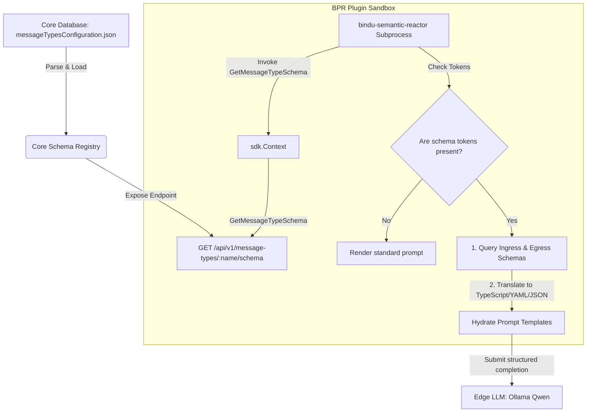

# Implementation Plan: Phase 3 – The Semantic-Self-Aware AI Engine 🧠🛰️

This document outlines the detailed architectural blueprint and implementation path for **Phase 3: The Semantic-Self-Aware Engine** inside Bindu. 

By integrating auto-conscious schema awareness, Bindu shifts from a broker that pushes raw text prompts to a **cognitive-aware Edge fabric**—injecting formal schema contracts (properties, data types, constraints, and descriptions) dynamically into the offline reasoning pipeline.

---

## 🎯 Objectives & Design Philosophy

1. **Zero-Configuration Prompting**: Operators do not need to manually describe JSON keys, data types, or validation constraints inside prompt templates. The system retrieves this directly from Bindu's schema registry.
2. **Deterministic Structured Edge Execution**: Provide tiny offline models (such as `Qwen 2.5 0.5B / 1.5B`) with ultra-compact Pseudo-TypeScript schema interfaces to reduce alucinaciones and achieve 99%+ schema format compliance.
3. **Lazy Schema Resolution (Zero Overhead)**: The orchestrator only queries schemas if the template specifically utilizes token parameters (`{{.trigger_schema}}` or `{{.response_schema}}`), preserving performance.
4. **Decoupled Evolution**: Schema changes made in the Core dynamically propagate to prompt hydration on the next trigger, preventing out-of-sync failures.

---

## 🏗️ Phase 3 Component Architecture



---

## 🛠️ Implementation Layers & Deliverables

### Capa A: Core Schema API Endpoint (`bindunet/core`)
Exposes a lightweight, highly cached REST API endpoint in the Core's HTTP router to retrieve registered message type metadata.

* **Target File**: `bindurestapi/message_types_handler.go` (or equivalent registry package).
* **Endpoint**: `GET /api/v1/message-types/{name}/schema`
* **Response Contract (JSON)**:
  ```json
  {
    "success": true,
    "details": {
      "name": "StorageRiskAssessment",
      "description": "Risk assessment generated by AI reactors",
      "properties": [
        {
          "name": "risk_level",
          "type": "string",
          "required": true,
          "description": "Operational risk level",
          "enum": ["NOMINAL", "LOW", "MEDIUM", "HIGH", "CRITICAL"]
        }
      ]
    }
  }
  ```

---

### Capa B: BPR Go SDK Extensions (`sdk/`)
Extend the BPR Go SDK to allow isolated plugin subprocesses to resolve message definitions directly over standard transport boundaries.

* **Target File**: `sdk/query_rest.go`
* **Deliverable**: Add the formal schema query API wrapper inside the SDK context:
  ```go
  // GetMessageTypeSchema resolves a registered message type schema from the Bindu Core registry.
  func (c *Context) GetMessageTypeSchema(ctx context.Context, typeName string) (map[string]any, error) {
      // 1. Resolve URL from Env: BINDU_QUERY_API_URL -> replace "/messages/sql" with "/message-types/{name}/schema"
      // 2. Perform authenticated GET request
      // 3. Return decoded schema payload map
  }
  ```

---

### Capa C: Subprocess Prompt Hydration Engine (`bindu-semantic-reactor`)
Refactor the prompt assembly logic to support lazy schema loading and multi-format schema translation.

* **Target File**: `cmd/bindu-semantic-reactor/main.go`
* **Key Enhancements**:

#### 1. Configurable Schema Format
Extend the `ReactorConfig` structure under `cmd/bindu-semantic-reactor/main.go` to support `"schema_format"`:
```go
type ReactorConfig struct {
    // ... Phase 2 configs ...
    SchemaFormat string `json:"schema_format"` // "typescript" (default), "json_schema", "yaml"
}
```

#### 2. Lazy Loading Schema Detection
Parse `SemanticPromptTemplate` and `SystemInstruction` before execution:
```go
hasTriggerSchema := strings.Contains(promptTemplate, "{{.trigger_schema}}") || strings.Contains(systemInstruction, "{{.trigger_schema}}")
hasResponseSchema := strings.Contains(promptTemplate, "{{.response_schema}}") || strings.Contains(systemInstruction, "{{.response_schema}}")
```

#### 3. Schema Translators
Implement deterministic translators converting Bindu JSON schemas into highly compact formats:

* **Pseudo-TypeScript Converter**:
  Converts properties to `interface { ... }` declarations with comment annotations:
  ```go
  func translateToTypeScript(schema map[string]any) string {
      // Iterate properties and format:
      // name: type; /** description */
      // If enum present, format: name: "val1" | "val2";
  }
  ```
* **YAML-Schema Converter**:
  Converts to minimalist indented blocks:
  ```go
  func translateToYAML(schema map[string]any) string {
      // Format: property: type (enum values) # description
  }
  ```

#### 4. Prompt Template Injection
Hydrate the newly resolved schemas into the system instructions:
```go
if hasTriggerSchema {
    triggerSchemaStr := translateSchema(triggerSchemaData, cfg.SchemaFormat)
    prompt = strings.ReplaceAll(prompt, "{{.trigger_schema}}", triggerSchemaStr)
}
if hasResponseSchema {
    responseSchemaStr := translateSchema(responseSchemaData, cfg.SchemaFormat)
    prompt = strings.ReplaceAll(prompt, "{{.response_schema}}", responseSchemaStr)
}
```

---

## 📝 Upgraded Cognitive Configuration Example

With Phase 3 active, `poc_semantic_reactor_config.json` transitions to a fully autoconscious layout:

```json
{
  "reactor_id": "freezer-cold-chain-guard",
  "trigger_message_types": ["FreezerTelemetry"],
  "response_message_type": "StorageRiskAssessment",
  "schema_format": "typescript",
  "system_instruction": "You are a cold chain monitoring AI. Read the incoming structured event matching the FreezerTelemetry schema. You must analyze trends and output a single valid JSON object strictly complying with this target TypeScript interface:\n\n{{.response_schema}}\n\nDo not include preambles, explanations, or markdown codeblocks.",
  "semantic_prompt_template": "Analyze the risk for Freezer '{{index .trigger_event \"$producer\"}}' at locagram '{{index .trigger_event \"$where\"}}'.\n\nIncoming event structure:\n{{.trigger_schema}}\n\nTrigger Event details:\nTemperature: {{index .trigger_event \"fields\" \"temperature\"}} C\nDoor Open: {{index .trigger_event \"fields\" \"door_open\"}}\n\nHistorical trend (newest first):\n{{range .history}}\n- Temp: {{index . \"fields\" \"temperature\"}} C, Door: {{index . \"fields\" \"door_open\"}}\n{{end}}"
}
```

---

## 📈 Verification Checklist (Fase 3 Validation)

- [ ] Expose REST Endpoint in Core and test returns 200 OK.
- [ ] Implement `GetMessageTypeSchema` inside Go SDK and run integration test queries.
- [ ] Add Pseudo-TypeScript translation unit tests ensuring 100% correct type mappings.
- [ ] Run end-to-end sandbox updates demonstrating that small models (`Qwen-0.5B`) consume ~50% fewer tokens during schema representation while matching format structures perfectly.
