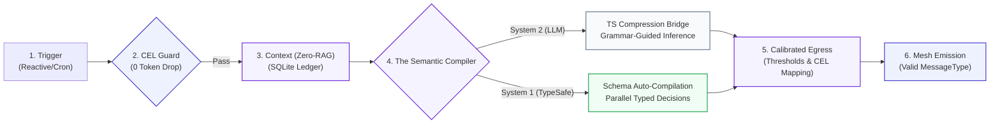
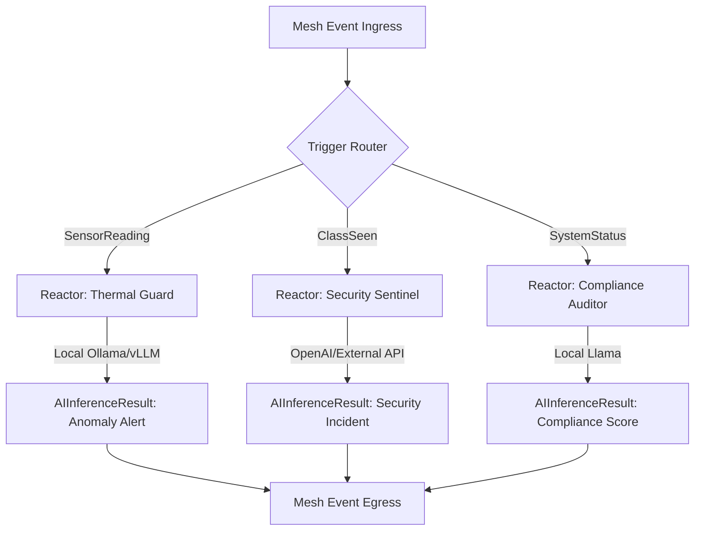
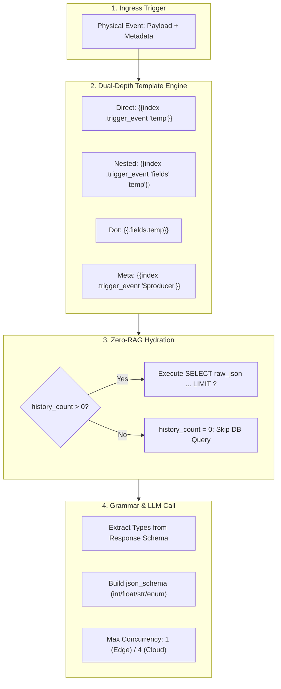

# Operator & Developer Guide — Semantic AI Reactor 🧠🚀

The **Semantic AI Reactor (`AISemanticReactorSet`)** is an autonomous edge intelligence core embedded within the Bindu mesh. It acts as a **Universal Semantic Adapter** and context-aware reasoning bridge between raw physical telemetry (events) and two complementary cognitive AI architectures:

* **System 2 Models (Generative SLMs/LLMs like Llama, Qwen, DeepSeek, GPT):** Utilized for deep abstract reasoning, unstructured text analysis, multimodal vision, and open-ended cognitive tasks (`"provider": "openai"`).
* **System 1 Models (Decision-Native Models like TypeSafe AI's Jev):** Utilized for ultra-fast, strictly typed operational decisions (booleans, enums, scores) natively trained via *Reinforcement Learning for Calibrated Decisions* (RLCD) to provide mathematically calibrated confidence probabilities with zero structural hallucinations (`"provider": "typesafe"`).

Operators and autonomous agents can switch between a generative LLM and a System 1 decision engine simply by changing `"provider": "typesafe"`, without modifying a single line of the underlying business `MessageType` contracts.

---

## 🏛️ Universal Cognitive Synthesis: Why Bindu's Ingress & Egress Architecture is Indispensable

It might seem that because a System 1 model (trained with RLCD) never breaks output syntax, an application could simply call it directly. In real-world cyber-physical operations, the exact opposite is true: **a pure mathematical decision model would collapse in production without the deterministic ingress hydration and egress synthesis pipeline of the Semantic AI Reactor.**



### 1. On the Ingress / Call Side: Guardrails, Zero-RAG Hydration & Hybrid Auto-Compilation
A System 1 model evaluates decisions over a snapshot of state (`state`), but on its own it has no historical memory and no awareness of your domain schemas:
* **Deterministic Pre-Filtering (`CEL Guardrail`):** Before invoking any model, Bindu evaluates physical or spatial conditions (`trigger_condition`) in sub-microseconds. Routine noise (~90% of telemetry) is dropped at **zero token cost**.
* **Context Hydration (`Zero-RAG SQLite`):** An isolated temperature reading (`-12 °C`) does not tell a model whether a freezer is recovering from a defrost cycle or has been in thermal runaway for 10 minutes. Bindu's `context_query` extracts the historical window from SQLite (`v_messages`) in milliseconds and hydrates the exact temporal narrative (`state`) the model needs to judge trends accurately.
* **The Hybrid Semantic Compiler:** Instead of forcing developers to write proprietary API calls to `/v1/systemone`, Bindu introspects the output `MessageType` and automatically compiles its properties into parallel System 1 questions (`boolean` $\rightarrow$ **`noul`**, `enum` $\rightarrow$ **`choice`**, bounded `integer`/`number` $\rightarrow$ **`score`**), while allowing optional explicit overrides in `questions` for custom domain rubrics.

### 2. On the Egress / Response Side: Where the Model Does NOT Generate Text, Bindu Synthesizes the Meaning
System 1 models **do not generate free-form text**: they do not write explanations, diagnostics, or root-cause summaries; they strictly return mathematical primitives (`noul` probabilities, `choice` selections, and `score` values from `0..N` along with their calibrated confidence). Bindu's egress stage completes the cognitive loop:
* **Calibrated Confidence Gate (`confidence_threshold`):** Bindu evaluates the true mathematical probability returned by the model and immediately discards low-confidence decisions before they can trigger alarms or physical actuators.
* **Domain Rescaling & Google CEL Synthesis (`mapping_template`):** Because the model does not emit text, Bindu evaluates deterministic **CEL** expressions in `mapping_template` to fuse raw numeric/boolean decisions and per-field confidences (`resp.<field>_confidence`, `resp.<field>_noul`) into human-readable diagnostics, root-cause predictions, and domain-rescaled metrics (e.g., rescaling an abstract `0..4` rubric score into `18 minutes` remaining before cargo spoilage).
* **Strict Schema Coercion & Mesh Emission:** Finally, Bindu guarantees 100% compliance against the target `MessageType` contract before publishing the event back into `bindu/in`.

### 3. Semantics as the Foundation of the "Magic"
What feels like "magic"—switching between a generative LLM and a mathematical System 1 decision engine without touching application code, with zero hallucinations and millisecond latency—rests on a single architectural law: **in Bindu, Semantics (`MessageType`) governs AI, never the reverse.** While the semantic contract remains the single source of truth, Bindu automatically compresses it into TypeScript for a System 2 LLM or compiles it into parallel probabilistic primitives for a System 1 model.

---

## 🌟 Multi-Instance Architecture

Unlike traditional monolithic AI integrations, Bindu's **Semantic AI Reactor** is fully **multi-instance**. A single physical gateway or root node can orchestrate multiple isolated reactor tasks in parallel.



### Typical Use Case Allocations:
*   **`thermal-guard`**: Triggered by `SensorReading` events; uses a local `qwen2.5:0.5b` model to evaluate telemetry curves and flags anomalies.
*   **`security-sentinel`**: Triggered by `ClassSeen` (YOLO) events; uses a `llama3:8b` model to evaluate physical zone presence and flags unauthorized personnel.
*   **`compliance-auditor`**: Triggered by `MessageState` updates; audits current system parameters against operational guidelines.

---

## 🧭 Screen-by-Screen Field Reference & UI Wizard

The Console contains an integrated premium wizard under **AI Reactor** designed to manage all node configurations from a single CRUD dashboard.

---

### Step 1: Targets & Reactor List View

This screen provides the master overview and entry point for node orchestration:

1.  **Select Target Node (Dropdown)**: A dynamically populated dropdown list of all active gateways and root nodes discovered in the active mesh.
2.  **Reactor Registry Table**: Displays a spreadsheet-style overview of all reactor configurations currently staged or active on the selected node:
    *   **Reactor ID**: The unique alphanumeric identifier of the reactor.
    *   **Model ID**: The assigned AI model (e.g. `llama3:8b`, `qwen2.5:0.5b`).
    *   **Triggers**: List of event types that activate the reactor.
    *   **Response Type**: The message type published after LLM reasoning.
    *   **Actions**:
        *   `✏️ Edit`: Opens the isolated CRUD slide-out wizard for that instance.
        *   `❌ Delete`: Removes the instance from the node's configuration array.
3.  **➕ Create AI Reactor (Button)**: Opens the creation slide-out form to define a new instance from scratch.
4.  **🚀 Deploy Node Configuration (Master Button)**: Packages the entire local reactor list for the selected node into a single atomic `AISemanticReactorSet` message and publishes it to the mesh to instantly configure the target node in real-time.

---

### Step 2: Configuration Fields Deep-Dive

When creating or editing a reactor instance, the configuration panel is divided into three key panels:

#### A. Identity & LLM API Connectivity

This section defines how the reactor connects to its reasoning engine (whether a local lightweight LLM on the edge or a powerful cloud endpoint):

| Field Name | HTML ID | Data Type | Required | Default Value | Description / Constraints |
| :--- | :--- | :--- | :--- | :--- | :--- |
| **Reactor ID** | `reactor-id` | String | **Yes** | *None* | Alphanumeric unique key (e.g. `thermal-guard-1`). Spaces and special characters are forbidden. Immutable once saved. |
| **API Endpoint** | `reactor-endpoint` | URL | **Yes** | `http://localhost:11434/v1/chat/completions` | Standard OpenAI-compatible HTTP endpoint (Ollama, vLLM, OpenAI) OR TypeSafe AI System One endpoint (`https://api.typesafe.ai/v1/systemone`). |
| **API Key Secret** | `reactor-api-key` | String | No | `sk-not-needed-for-local` | Authentication token or encrypted secret reference. For cloud LLMs (TypeSafe, OpenAI, Groq), use encrypted references matching `secret:KEY_NAME` (managed via `bindu-studio secrets set <KEY_NAME>`). For local unauthenticated engines (Ollama, llama.cpp), use a placeholder like `ollama-local` or `sk-not-needed-for-local`. The console UI provides dynamic badges (🔐 Active Secret, 💻 Local Engine, ⚠️ Plaintext Warning) and resolves references during connection tests. |
| **Model ID** | `reactor-model` | String | **Yes** | `qwen2.5:0.5b` | The specific model name (e.g. `qwen2.5:0.5b`, `llama3:8b`, `gpt-4o`, or `jev-latest` / `jev-1.14.0` for TypeSafe System One). |
| **Provider (Optional)** | `provider` | String | No | *Auto* | Protocol engine (`"openai"` for System-2 chat/completions or `"typesafe"` for System-1 `/v1/systemone` calibrated decisions). Auto-detected from `api_endpoint` / `model_id` when omitted. |
| **Questions (Optional)** | `questions` | JSON Object | No | *Auto-Compiled* | Optional System One question overrides (`noul`, `choice`, `score` with custom `criteria`) merged on top of automatic `MessageType` schema compilation. |
| **Max Concurrency** | `reactor-concurrency` | Number | **Yes** | `1` | Max number of simultaneous asynchronous reasoning tasks spawned on the node. For Raspberry Pi/Edge nodes, set to `1` or `2` to preserve CPU/RAM. |
| **Confidence Threshold**| `reactor-confidence`| Number | **Yes** | `0.70` | Numeric floating-point limit between `0.0` and `1.0`. Only inferences scoring above this value will be packaged and published to the mesh. |
| **Inference Timeout (s)** | `reactor-timeout` | Number | No | `90` | Optional maximum execution time in seconds allowed for a single inference transaction (LLM reasoning and S3 media retrieval). Increase this value (e.g. to 180s) to prevent timeouts when loading heavy models on slow CPU/Edge hardware. |

---

#### B. Ingress Triggers & Mesh Context Routing

This section defines what events or schedules wake up the reactor, and how the reactor gathers background context before invoking the LLM:

| Field Name | HTML ID | Data Type | Required | Default Value | Description / Constraints |
| :--- | :--- | :--- | :--- | :--- | :--- |
| **Trigger Message Types**| `reactor-trigger-types`| Multi-select | No | *None* | Selects one or multiple message types (e.g., `SensorReading`, `ClassSeen`) that activate this reactor. (Optional if Cron is configured). |
| **Cron Trigger Schedule** | `reactor-cron` | String | No | *None* | Optional cron schedule expression (e.g., `*/10 * * * * *` or `@every 1m`) to trigger the reactor periodically. (Optional if Trigger Message Types is configured). See [Plugin Dev — Cron Strings](Cron_Job_Strings_user_guide.md) for syntax rules. |
| **Trigger Condition** | `reactor-condition-editor` | CEL String | No | *None* | Optional Google Common Expression Language (CEL) filter. Evaluated against the trigger message. If the expression evaluates to `false`, the message is ignored, avoiding BPR startup and LLM calls. |
| **Response Type** | `reactor-response-type`| Dropdown | **Yes** | `AIInferenceResult` | The message type that the LLM's response will be packaged into when published to the mesh. Typically resolves to `AIInferenceResult`. |
| **History Count** | `reactor-history-count`| Number | **Yes** | `5` | Number of previously received messages of the **Trigger Type** to pull from the local database and supply as conversational memory / context. |
| **Context Query** | `reactor-context-query` | SQL Text | No | *None* | Read-only SQL select query against `v_messages` to gather advanced custom context. **Mandatory if only Cron Trigger Schedule is set**, as no triggering event payload exists. |

### ⚠️ Trigger Validation Constraints & Anti-Recursion Invariant

> [!CAUTION]
> **🚫 Anti-Recursion Safety Invariant (`E_REACTOR_RECURSIVE_LOOP`):**
> The `response_message_type` (Response Type) **CANNOT match any message type declared in `trigger_message_types`**.
> 
> * **Why this is strictly forbidden**: In Multi-Agent Systems, an AI reactor triggered by event $T$ emitting an inference of type $T$ causes runaway recursive loops ($T \to \text{LLM} \to T \to \text{LLM} \to \dots$). This triggers continuous LLM token consumption, high inference costs, and system instability.
> * **Correct Pattern**: An AI reactor must consume trigger events (e.g. `FreezerTelemetry`, `SensorReading`, `ClassSeen`) and emit a distinct semantic inference event (e.g. `StorageRiskAssessment`, `AIInferenceResult`, `AnomalyAlert`).
> * **Enforcement**: Validated by `bindu-studio semantic-ai-reactor validate`, the Console UI modal, and runtime config ingestion with error `E_REACTOR_RECURSIVE_LOOP`.

> [!WARNING]
> **At least one trigger is required**
> A reactor configuration must declare either `trigger_message_types` (minimum of one type selected) or a `cron` schedule trigger (or both).
>
> **Cron triggers require Context Queries**
> When a reactor is triggered periodically by a `cron` schedule, there is no physical triggering message. As a result, the `payload` and `head` prompt variables are empty maps. A `context_query` (SQLite SELECT query) is **mandatory** to retrieve database state to evaluate templates and expressions.

---

## 🧠 Conditional Triggering with Google CEL (Common Expression Language)

To maximize performance at the edge and prevent unnecessary LLM token expenses, Bindu supports **Conditional Triggering** via Google CEL (Common Expression Language).

### What is Google CEL?
**Common Expression Language (CEL)** is a non-Turing-complete, fast, and safe expression evaluation language developed by Google. It is designed to be embedded in systems (like Kubernetes Admission Webhooks or Firebase Security Rules) to evaluate user-defined rules safely in microsecond timescales, without the risk of infinite loops, memory leaks, or execution panics.

For more details on CEL, refer to:
*   [Google CEL Language Definition](https://github.com/google/cel-spec/blob/master/doc/langdef.md)
*   [Google CEL Specifications & Design](https://github.com/google/cel-spec)
*   [CEL Go Engine Repository](https://github.com/google/cel-go)

---

### Why Use CEL Pre-Filtering?
Before the introduction of CEL filters, any event matching the **Trigger Message Type** would directly wake up the reactor process and invoke the LLM inference. In busy networks (e.g., a temperature sensor sending readings every second), this is extremely expensive and CPU-intensive.

By defining a **Trigger Condition**, the node executes an ultra-lightweight CEL check *locally in CPU cache* before doing anything else. If the expression evaluates to `false`, the message is silently ignored, completely bypassing:
1. Spawning or waking up the BPR external reactor plug-in process.
2. Generating historical query context from SQLite.
3. Making costly HTTP calls to remote or local LLMs.

---

### Evaluation Context & Available Variables
The CEL expression has access to two variables extracted from the incoming message:
*   `head`: A dictionary/map containing message metadata headers.
    *   `head.origin` (string): The node ID that produced the message.
    *   `head.when` (string): RFC3339 timestamp.
*   `payload`: A dictionary/map containing the message fields (the core payload).

---

### Practical Examples of CEL Filters

| Use Case | CEL Expression | Description |
| :--- | :--- | :--- |
| **High Temperature Alert** | `payload.temperature > 45.0` | Reactor only wakes up if the reported temperature is strictly above 45.0. |
| **Filtered Restricted Zone Presence** | `payload.zone == "restricted-vault" && payload.class_count > 0` | Triggers security guard reactor only when an object detection event occurs specifically in the restricted vault. |
| **Targeted Telemetry Origin** | `head.origin == "node-pi-3" && payload.humidity < 20.0` | Activates reactor only for messages originating from "node-pi-3" when humidity drops below 20%. |
| **Logical Combinations** | `payload.status != "nominal" && !(payload.sensor_id in ["sensor-0", "sensor-1"])` | Wakes up reactor for warning/critical status codes, ignoring sensors designated as test units. |

---

### 🔀 Designing for Polymorphic Triggers (Multiple Message Types)

If you configure your reactor to subscribe to multiple different message types (e.g. `["CountFlowersByColor", "ManualGardenSurvey"]`), the event schemas will be different. To prevent errors during execution:

#### 1. Polymorphic CEL Pre-Filtering
Since some fields might not exist in all message schemas, use type checks (`head["$type"]`) and the CEL **`has()`** macro to perform safe navigation:
```cel
// Safe checks preventing evaluation errors on mismatched fields
(head["$type"] == "CountFlowersByColor" && has(payload.yellow_flowers) && payload.yellow_flowers > 5) ||
(head["$type"] == "ManualGardenSurvey" && has(payload.yellow_count) && payload.yellow_count > 5)
```

#### 2. Conditional Prompt and Mapping Templates
In the `semantic_prompt_template` and `mapping_template` fields, use Go template `if/else` conditions to dynamically extract properties depending on the incoming event type:
* **Prompt conditional block:**
  ```text
  {{if eq (index .trigger_event "$type") "CountFlowersByColor"}}
    The vision model counted {{.fields.yellow_flowers}} yellow flowers.
  {{else}}
    The human survey counted {{.fields.yellow_count}} yellow flowers.
  {{end}}
  ```
* **Mapping template fallback:**
  ```json
  {
    "yellow_flowers": "{{if .trigger_event.fields.yellow_flowers}}{{.trigger_event.fields.yellow_flowers}}{{else if .trigger_event.fields.yellow_count}}{{.trigger_event.fields.yellow_count}}{{else}}0{{end}}"
  }
  ```

---

### Real-Time Validation in the Wizard
The **Trigger Condition** field is powered by a Monaco Editor in the console. 
*   **Syntax Checking:** As you type, the expression is sent to the server's validation endpoint (`/api/v1/validate/cel`). If there is an invalid syntax (e.g., unbalanced parenthesis or typos like `payload.temp >`), Monaco displays a **red squiggly line** under the code showing the compiler error details.
*   **Configuration Safeguard:** The server validates all reactor configurations upon deployment. An invalid CEL expression is rejected, protecting the mesh node from applying faulty rules.

---

#### C. Monaco Advanced Prompting Engines

The prompt templates are configured using full-featured **Monaco Editors** providing syntax highlighting, auto-formatting, and autocomplete out of the box:

##### 1. System Instruction Editor
*   **Purpose**: Sets the system "persona", reasoning rules, output guidelines, and behavioral boundaries for the LLM.
*   **Best Practices**:
    *   Explicitly define who the AI is (e.g., *"You are a safety guard"*).
    *   Define exactly what the AI must check for.
    *   Instruct the AI on the exact format expected (e.g., *"Respond ONLY with a valid JSON object"*).
    *   Define negative bounds (e.g., *"Never assume an anomaly is normal unless all values are below 30"*).

##### 2. Semantic Prompt Template Editor
*   **Purpose**: The prompt layout containing placeholders injected with local context before the LLM call.
*   **Placeholders Available**:
    *   `{{.trigger_event}}`: The raw JSON of the incoming event that woke up the reactor.
    *   `{{.history}}`: The array of historical messages loaded based on the **History Count** configuration.
    *   `{{.context_query_results}}`: The output array of the **Context Query** if defined.
*   **Format**: Can include arbitrary markdown, plain text, and Go/Handlebars template selectors to arrange parameters.

##### 3. Field Mapping Template (`mapping_template`)
*   **Purpose**: Controls how fields from the LLM output (or trigger event context) are mapped into the output response message payload.
*   **Operational Modes**:
    *   **Modo Directo / Pass-Through (Cuando es `{}`):** Se usa cuando el prompt del modelo de IA (ej: `moondream:latest`) ya le ordena retornar un objeto JSON cuyas claves coinciden 1 a 1 con el esquema del mensaje de salida (ej. `yellow_flowers`, `orange_light_flowers`, `orange_dark_flowers`, `total_flowers`, `analysis_summary`). Bindu toma el JSON de la IA y lo emite directamente sin transformar nada.
    *   **Modo Transformación / Plantilla (Cuando NO es `{}`):** Se usa cuando las claves que devuelve el LLM tienen nombres diferentes o cuando quieres extraer información del evento que disparó el reactor utilizando plantillas Go. Por ejemplo:
        ```json
        "mapping_template": {
          "estimated_minutes_to_spoilage": "{{.fields.estimated_minutes_to_spoilage}}",
          "risk_level": "{{.fields.risk_level}}"
        }
        ```

---

## 🤖 Grammar-Guided Decoding & In-Memory Semantic Sanitization

To ensure zero-error schema compliance across diverse AI models (from 1B parameter edge vision models to cloud 70B LLMs), Bindu implements a multi-layered enforcement pipeline in the reactor worker (`bprplugins/semantic_reactor_worker.go`):

### 1. In-Inference Constrained Decoding (`response_format` with `json_schema`)
When sending requests to OpenAI, Ollama, or vLLM endpoints, Bindu dynamically builds a strict `json_schema` payload:
```json
"response_format": {
  "type": "json_schema",
  "json_schema": {
    "name": "ResponseMessageType",
    "strict": true,
    "schema": {
      "type": "object",
      "properties": { ... },
      "required": [ ... ],
      "additionalProperties": false
    }
  }
}
```
* **Neural Token Constraint:** Constrains token sampling at the inference level, forcing the model to generate exact keys.
* **Automatic Fallback:** If an older LLM provider returns HTTP 400 for `json_schema`, the worker automatically falls back to `"type": "json_object"` and relies on in-memory sanitization.

### 2. In-Memory Key Normalization & Dynamic Smart Aliases
Before validating or emitting the payload:
* **Whitespace & Character Normalization:** Trims leading/trailing whitespace and converts spaces (` `) or hyphens (`-`) into underscores (`_`) (e.g. `" total_flowers "` ➔ `"total_flowers"`).
* **Dynamic Smart Alias Resolution:** Instead of relying on hardcoded alias maps, Bindu dynamically queries the target `ResponseMessageType` schema's properties at runtime. It performs fuzzy and substring matching against LLM response keys to resolve abbreviations or variations into exact schema property keys (e.g., mapping `"yellow"` or `"yellows"` ➔ `"yellow_flowers"`, or `"orange_light"` ➔ `"orange_light_flowers"`).
* **Fuzzy Matching Rules:**
  1. *Sub-string Containment*: If the expected schema key contains the key returned by the LLM (or vice-versa) with a minimum length of 4 characters.
  2. *Prefix Overlap*: If the keys share a common root prefix of at least 4 characters.
* **Alias Key Cleanup:** Once matched and mapped, the unmapped/abbreviated LLM keys are automatically cleaned up from payload memory to prevent schema validation failures due to unexpected `additionalProperties`.

### 3. Universal Schema-Driven Coercion & Sanitization
Bindu executes generic, schema-driven coercion and boundary sanitization across all properties defined in the target JSON Schema:
* **`integer` Coercion & Clamping:** Converts floats, integers, boolean flags, and numeric strings (e.g. `"123"` ➔ `123`). If `minimum` or `maximum` boundaries are defined in the schema, values are clamped to the allowed range (e.g., clamping `5` to a minimum of `10` ➔ `10`).
* **`number` Coercion & Clamping:** Converts floats, integers, boolean flags, and float strings (e.g. `"45.67"` ➔ `45.67`). Bounds are clamped to `minimum`/`maximum` boundaries if defined.
* **`boolean` Coercion:** Converts boolean strings (`"true"`, `"false"`), booleans, and numeric flags (`0` ➔ `false`, `1` ➔ `true`).
* **`string` Coercion:** Converts integers, floats, booleans, and JSON structures into string format (e.g. `75` ➔ `"75"`).
* **`date-time` Normalization:** Normalizes timestamp strings to valid RFC3339 format by parsing common layout variants. If the value is empty, `"now"`, or an unparseable placeholder, it gracefully defaults to the current system time to protect schema validity.
* **`enum` Smart Matching:** If an exact string match fails on an enum constraint, a case-insensitive substring search and a 4-letter prefix check are executed (e.g., mapping `"ADEQUAL_OR_ANOMALY"` containing `"ANOM"` ➔ `"ANOMALOUS"`). Falls back safely to the first allowed enum value if all matching heuristics fail.
* **`object` / `json` Recursion:** Automatically parses stringified JSON structures and recursively coerces nested keys according to the sub-properties schema.
* **`array` Recursion:** Parses JSON array strings, wraps single values into slices if needed, and recursively coerces each item according to the items schema definition.
* **Friction Telemetry:** Any field requiring modification, boundary clamping, or fallback values during this process is automatically appended to the `coerced_fields` telemetry list in `AICognitiveProfile` for dashboard auditing.

### 4. Declarative `MappingTemplate` Expression Evaluation
`mapping_template` supports Go template expressions with built-in math and fallback helpers (`add`, `sub`, `mul`, `or`):
```json
"mapping_template": {
  "yellow_flowers": "{{.fields.yellow_flowers}}",
  "orange_light_flowers": "{{.fields.orange_light_flowers}}",
  "orange_dark_flowers": "{{.fields.orange_dark_flowers}}",
  "total_flowers": "{{or .fields.total_flowers (add .fields.yellow_flowers .fields.orange_light_flowers .fields.orange_dark_flowers)}}",
  "analysis_summary": "{{.fields.analysis_summary}}"
}
```
* **Zero Hardcoding:** Field transformations and missing value fallbacks are declared 100% in the `AISemanticReactorSet` configuration.

---

## 🛠️ Step-by-Step Operations Guide

### A. Creating a New Reactor
1. Navigate to the **AI Reactor** section in the Console.
2. Select the mesh node (e.g. `node-1`) from the **Target Node** dropdown.
3. Click the `➕ Create AI Reactor` button.
4. Fill in the Form Fields:
    * Enter a unique **Reactor ID** (e.g. `safety-monitor`).
    * Set your connection details (Ollama, local vLLM, etc.).
    * Select your trigger types (e.g., `SensorReading`) and response type (`AIInferenceResult`).
5. Compose your **System Instruction** and **Prompt Template** inside the Monaco editors.
6. Click `💾 Save Instance` at the bottom of the form. The new reactor will appear in the Step 1 Registry Table.

### B. Editing an Existing Reactor
1. Locate the reactor in the Step 1 Registry Table.
2. Click the `✏️ Edit` button in the **Actions** column.
3. The wizard form slides open populated with the current parameters.
4. Modify the values or edit the prompts in the Monaco editor.
5. Click `💾 Save Instance` to update the configuration list.

### C. Deleting a Reactor
1. Locate the reactor in the Step 1 Registry Table.
2. Click the `❌ Delete` button in the **Actions** column.
3. Confirm the deletion prompt. The reactor is removed from the local workspace list.

### D. Master Deployment to the Mesh
> [!IMPORTANT]
> Clicking `💾 Save Instance` or `❌ Delete` only modifies your local workspace configuration list. **To make these configurations take effect on the actual hardware gateway node, you must click `🚀 Deploy Node Configuration`.**
>
> When clicked, a single atomic `AISemanticReactorSet` transaction containing all registered reactors is published to the mesh, and the node instantly boots/reconfigures the instances.

---

## 💡 Authoritative Real-World Examples

Here are three complete, production-ready examples that illustrate the versatility of the multi-instance AI Reactor. You can copy and paste these prompts directly into your Monaco editors.

---

### Example A: Predictive Thermal Anomaly Reactor
This reactor monitors temperature streams, evaluates past readings, and flags anomalies before hardware fails.

#### 🔧 Form Configuration
*   **Reactor ID**: `thermal-analyzer`
*   **API Endpoint**: `http://localhost:11434/v1/chat/completions`
*   **Model ID**: `qwen2.5:0.5b`
*   **Max Concurrency**: `1`
*   **Confidence Threshold**: `0.80`
*   **Trigger Message Types**: `SensorReading`
*   **Response Type**: `AIInferenceResult`
*   **History Count**: `3`
*   **Context Query**: *None*

#### 📝 Monaco: System Instruction
```markdown
You are a predictive maintenance AI engine operating on a Bindu Edge Node. 
Your task is to analyze incoming temperature events and compare them with historical readings to detect progressive anomalies (such as gradual overheating, sudden spikes, or sensor drift).

RULES:
1. Compare the temperature in the 'trigger_event' with the values in the 'history' array.
2. If the temperature increases by more than 5 degrees celsius steadily across history, or exceeds 80 degrees, flag it as an anomaly.
3. Your output MUST be a JSON object containing EXACTLY these keys:
   - "status": string ("nominal" or "warning" or "critical")
   - "confidence": float (0.0 to 1.0)
   - "summary": string (concise explanation of your reasoning)
   - "risk_score": float (0.0 to 1.0)
4. Do NOT output any markdown tags, wrappers, or conversational filler. Output ONLY the raw JSON.
```

#### 📝 Monaco: Semantic Prompt Template
```handlebars
Analyze this thermal data stream:

[CURRENT EVENT]
{{.trigger_event}}

[HISTORICAL CONTEXT]
{{.history}}

Provide your analysis in raw JSON format.
```

---

### Example B: Edge Security Person/Object Guard
This reactor triggers on camera analytics (YOLO) and alerts when humans are spotted inside restricted industrial zones during off-hours.

#### 🔧 Form Configuration
*   **Reactor ID**: `security-sentinel`
*   **API Endpoint**: `http://localhost:11434/v1/chat/completions`
*   **Model ID**: `llama3:8b`
*   **Max Concurrency**: `1`
*   **Confidence Threshold**: `0.85`
*   **Trigger Message Types**: `ClassSeen`
*   **Response Type**: `AIInferenceResult`
*   **History Count**: `5`
*   **Context Query**: *None*

#### 📝 Monaco: System Instruction
```markdown
You are the autonomous security supervisor for an industrial facility.
You receive visual detection logs ('ClassSeen' messages) indicating objects or classes detected by local cameras.

RULES:
1. Examine the 'trigger_event' objects.
2. If the class 'person' is detected in a restricted zone (e.g. 'zone_warehouse_restricted') with high detection confidence, classify the event as a critical intrusion.
3. Compare with recent 'history' events to verify if the person is moving across cameras or if it is a transient false positive.
4. Your response MUST be a JSON object with this exact schema:
   - "intrusion_detected": boolean
   - "summary": string (brief description of who/what was seen and where)
   - "confidence": float (0.0 to 1.0)
   - "alarm_trigger": boolean (true if intrusion_detected is true)
5. Respond ONLY with the JSON. Do not include introductory text.
```

#### 📝 Monaco: Semantic Prompt Template
```handlebars
Verify this detection alert:

[NEW DETECTION]
{{.trigger_event}}

[RECENT DETECTIONS HISTORY]
{{.history}}

Intrusion analysis:
```

---

### Example C: Operations Auditor & Config Validator
This reactor monitors system state configurations and validates that nodes do not breach company operational safety limits.

#### 🔧 Form Configuration
*   **Reactor ID**: `compliance-auditor`
*   **API Endpoint**: `http://localhost:11434/v1/chat/completions`
*   **Model ID**: `qwen2.5:0.5b`
*   **Max Concurrency**: `1`
*   **Confidence Threshold**: `0.70`
*   **Trigger Message Types**: `MessageState`
*   **Response Type**: `AIInferenceResult`
*   **History Count**: `1`
*   **Context Query**: *None*

#### 📝 Monaco: System Instruction
```markdown
You are a compliance and safety audit agent running on the Bindu mesh.
Your task is to inspect local state updates ('MessageState') and verify that the system configuration parameters do not violate regulatory compliance (such as unauthorized port settings, outdated runtime builds, or disabled TLS).

RULES:
1. Inspect 'trigger_event' and check 'fields.storage.config'.
2. If 'tls_enabled' is false, or 'port' is set to a privileged port below 1024, flag it as a violation.
3. Your output MUST be a JSON object:
   - "compliant": boolean
   - "violations": array of strings (list of violations found)
   - "confidence": float (0.0 to 1.0)
   - "recommendation": string (how to resolve the issues)
4. Output ONLY the JSON. No wrappers.
```

#### 📝 Monaco: Semantic Prompt Template
```handlebars
Audit this state configuration update:

[STATE UPDATE]
{{.trigger_event}}

Compliance audit result:
```

---

## ⚡ Edge Optimization & Tuning Guidelines

Running LLMs on edge hardware can be challenging. Follow these operational guidelines to guarantee high availability and low latency:

1.  **Reduce Token Count**: Keep `history_count` to `3` or fewer for lightweight models. Processing excessive historical text slows down time-to-first-token (TTFT) significantly on CPU-only nodes.
2.  **Use Quantized Models**: Deploy heavily quantized GGUF models (e.g. Q4_K_M or Q2_K) on edge nodes to fit the model entirely within local RAM.
3.  **Strict Concurrency Restraints**: Always keep `max_concurrency` set to `1` on gateways like Raspberry Pi devices. Allowing concurrent LLM calls will trigger memory thrashing, locking up physical assets on site.
4.  **Endpoint Redundancy**: If local edge reasoning fails, set the `API Endpoint` to a local fall-back gateway or a resilient cloud route to maintain operational continuity.

---

## 🕒 Deep-Dive: Inference Timeouts, Concurrency Queuing, and Ollama `keep_alive`

When orchestrating local LLM inferences (such as image analysis using vision models on edge nodes), managing request execution timing is critical to preventing pipeline failures.

### 1. How the `Inference Timeout` is Measured
The `inference_timeout` (configured per reactor in the Console) is **not** just a timeout for the HTTP request to the LLM. 
* **Cumulative Measure:** It is an overall context timeout that starts the moment the trigger event is received by the node's engine.
* **Queuing Overhead Included:** This timeout covers both the time spent waiting in the queue to acquire the concurrency slot **and** the actual HTTP request execution.

```
Trigger Event Received
   │
   ├─► [ 1. Concurrency Queue (waiting for slot) ] ───┐
   │                                                 │   Timeout starts here
   ├─► [ 2. Context Hydration (SQLite read) ]        ├─► and monitors the total
   │                                                 │   elapsed time.
   └─► [ 3. LLM API HTTP Post Call ] ─────────────────┘
```

### 2. The Concurrency Queue & Timeout Interaction
If multiple trigger events arrive at the same time (e.g. three cameras capture images simultaneously), and `max_concurrency` is set to `1`:
* **Task 1** acquires the slot immediately and executes. If the model is slow and takes **120 seconds**, Task 1 succeeds.
* **Task 2** waits in queue. When Task 1 finishes, Task 2 has already spent **120 seconds** of its overall context lifetime just waiting.
* **Task 3** also waits. If the total `inference_timeout` is too small (e.g., the default 90 seconds), the context for Task 2 and Task 3 will expire *before* they can finish their LLM call, resulting in `context deadline exceeded` (`LLM_CALL_FAILED`) errors.
* **Guideline:** When setting `max_concurrency: 1` on slow hardware, increase `inference_timeout` proportionally (e.g. `380` or `600` seconds) to give queued tasks enough room to wait and run.

### 3. Ollama Cold Starts & `keep_alive` Optimization
By default, Ollama unloads a model from RAM/GPU memory after **5 minutes** of inactivity to save resources. When a new event arrives after this window:
* **Cold Start Delay:** Ollama must reload the model weights from disk to memory, which can add minutes (sometimes 2-6 minutes depending on disk speed and model size) to the first inference transaction.
* **Pre-loading Solution:** To avoid cold-start delays, configure Ollama on the target host to keep the model loaded indefinitely:
  * **Systemd (Linux):** Run `sudo systemctl edit ollama.service` and add the environment variable under the service section:
    ```ini
    [Service]
    Environment="OLLAMA_KEEP_ALIVE=-1"
    ```
    Then restart the service:
    ```bash
    sudo systemctl daemon-reload && sudo systemctl restart ollama
    ```
  * **Docker:** Add the environment variable when running the container: `-e OLLAMA_KEEP_ALIVE=-1`.
  * **Warm-up Call:** Trigger a manual model pre-load by executing an empty completion request beforehand:
    ```bash
    curl http://<ollama-ip>:11434/api/generate -d '{"model": "llava-phi3:latest", "keep_alive": -1}'
    ```

---

## 🔍 Mesh State & Error Monitoring (Structured ErrorEvents)

To ensure the high availability of cognitive pipelines across cloud and edge, the **Semantic AI Reactor** has a structured error-reporting framework. Every critical execution, hydration, or model communication failure is automatically captured and published to the mesh as a standard `ErrorEvent`.

This allows operations teams to monitor and diagnose LLM endpoint failures (e.g. HTTP 404, invalid model names, or network timeouts) directly from the Console UI or via MQTT in real-time.

### Thread-Safe Execution SDK
The reactor worker processes inference tasks asynchronously using localized goroutines. The BPR communication transport is protected by a write-synchronization mutex to ensure that concurrent model responses, errors, or logs never corrupt the `stdout` frame boundaries, maintaining a stable parent-child process channel.

### Captured Error Codes
The reactor translates internal exceptions into structured envelopes with the following distinct error codes:

| Error Code | Severity | Description / Diagnostic Check |
| :--- | :--- | :--- |
| **`CONFIG_QUERY_FAILED`** | `error` | Failed to retrieve the configuration from the local SQLite database. |
| **`CONFIG_UNMARSHAL_FAILED`** | `error` | The configuration JSON payload was malformed and could not be parsed. |
| **`HYDRATION_FAILED`** | `error` | The custom `context_query` SELECT statement failed syntax checks or execution. |
| **`LLM_CALL_FAILED`** | `error` | Network connection error or timeout occurred while contacting the LLM endpoint. |
| **`LLM_HTTP_ERROR`** | `error` | The LLM endpoint returned an HTTP error status code (e.g. `404 Not Found` due to an invalid model ID or path, or `401 Unauthorized`). |
| **`LLM_DECODE_FAILED`** | `error` | The LLM response could not be parsed, or the response returned an empty completions list. |
| **`LLM_INVALID_JSON`** | `error` | The model executed successfully but returned malformed JSON that did not comply with the requested schema. |
| **`EMIT_RESPONSE_FAILED`** | `error` | The reactor was unable to publish the final egress event back to the local mesh bus. |

### How to Monitor ErrorEvents
When any of the errors above occur, the orchestrator instantly converts them into a `semantics.ErrorEvent` message. This event is:
1.  **Saved to SQLite**: Persisted locally in `v_messages` (with `"$type" = 'ErrorEvent'`) for historical audit trails.
2.  **Broadcasted over MQTT**: Sent to the mesh topic `bindu/reactor/<reactor-id>` to trigger real-time alerts in the Console UI and monitoring tools.

---

## 🎛️ Console Wizard vs. CLI Import (bindu-studio)

When applying an `AISemanticReactorSet` configuration to the mesh, operators can choose between the visual **Console Wizard** and the **`bindu-studio` CLI tool**. Understanding the differences in validation rigor and use cases is critical for clean operation.

### Feature & Validation Matrix

| Capabilities / Validation | Console UI (Wizard) | CLI (`bindu-studio semantic-ai-reactor import`) |
| :--- | :---: | :---: |
| **Google CEL Syntax Check** | **Yes** (Validates expression compilation before saving) | No (Directly replays JSON payload) |
| **SQL Syntax Check** | **Yes** (Tests `context_query` read-only prepare checks) | No (Directly replays JSON payload) |
| **LLM Connection Handshake** | **Yes** (Runs standard OpenAI completions check on Save) | No (Directly replays JSON payload) |
| **Remote Loopback Tolerant** | **Yes** (Warns on connection failure, allowing edge bypass) | N/A (Skips verification checks) |
| **Interactive Selector** | **Yes** (Visual form edits per reactor instance) | **Yes** (Prompts user to select from exported JSON lists) |
| **Automation / CI Friendly** | No (Requires browser click operations) | **Yes** (Can run non-interactively with `--all`) |

### When to Use Which:

*   **Console UI (Wizard):** Recommended for **creation, editing, and troubleshooting**. The wizard performs active checks:
    1.  **CEL Validation:** Compiles trigger conditions and reports typing or syntax mismatch in real-time.
    2.  **SQL Validation:** Compiles `context_query` statements against the SQLite schema to reject bad SQL.
    3.  **LLM Handshake:** Executes a test request to `/v1/chat/completions` to check API credentials and Model ID, preventing bad model names from propagating. If the model is a local edge target (e.g. `localhost:11434`), it displays a warning prompt but allows bypassing.
*   **`bindu-studio` CLI:** Recommended for **CI/CD pipeline promotion, backups, and script automation**. It bypasses interactive validation under the assumption that the imported JSON file is already a known-good configuration previously exported from a working environment.

---

## 🧠 View Cognitive Profile & Dashboard Analytics

To audit, monitor, and optimize the cost-efficiency of edge intelligence pipelines, Bindu Console includes an interactive **Cognitive Performance Dashboard**. Clicking the `🧠 View Cognitive Profile` button next to the deployment button launches a real-time analytics window pulling execution telemetry directly from the mesh's SQLite database.

```
┌───────────────────────────────────────────────────────────────────────────┐
│ 🧠 Cognitive Performance Dashboard                                        │
├───────────────────────────────────────────────────────────────────────────┤
│ Filters: [Reactor ID ▾]  [Mesh Node ▾]  [Target Model ▾]  [Reset]        │
├───────────────────────────────────────────────────────────────────────────┤
│                                                                           │
│  Avg Hydration       Avg Inference      Total Tokens       Success Rate   │
│  ┌───────────┐      ┌───────────┐      ┌───────────┐      ┌───────────┐   │
│  │   45 ms   │      │  1820 ms  │      │   1,280   │      │    98%    │   │
│  └───────────┘      └───────────┘      └───────────┘      └───────────┘   │
│                                                                           │
│  📈 Latency Trend Line (ms)            🍕 Execution Status Breakdown      │
│  ┌─────────────────────────┐          ┌─────────────────────────┐         │
│  │ ~ ~ ~ ~ ~ ~ ~ ~ ~ ~ ~ ~ │          │   Success: 98%          │         │
│  │                         │          │   Timeout: 1%           │         │
│  │ ── Hydration ── Inference│          │   Error: 1%             │         │
│  └─────────────────────────┘          └─────────────────────────┘         │
│                                                                           │
│  📊 Token Utilization (Prompt vs. Comp) ⚠️ Semantic Friction & Coerced    │
│  ┌─────────────────────────┐          ┌─────────────────────────┐         │
│  │ █ █ █ █ █ █ █           │          │ audit_status: 30% [=== ]│         │
│  │ ▒ ▒ ▒ ▒ ▒ ▒ ▒           │          │ avg_latency_ms: 10% [= ]│         │
│  │ ── Prompt  ── Comp      │          │ 🛡️ 100% Obedience Rate  │         │
│  └─────────────────────────┘          └─────────────────────────┘         │
└───────────────────────────────────────────────────────────────────────────┘
```

### 1. Key Performance Indicators (KPIs)
The top stats row aggregates and averages four telemetry parameters:
*   **Avg Hydration**: The time taken to pull conversational history context from local SQLite and render template variables. It measures context hydration latency in isolation, excluding any queue waiting time.
*   **Avg Inference**: The total network and computation time taken by the LLM to process the request and stream back the response.
*   **Total Tokens**: The sum of all prompt and completion tokens processed by the LLM.
*   **Success Rate**: The percentage of successfully resolved reasoning cycles (yielding a `"success"` status).

### 2. Multi-Dimensional Charts & Friction Observability
*   **Latency Trend (Line Chart)**: Maps the time-series profile of hydration and inference latency across chronological executions. Useful for spotting resource bottlenecks, local database fragmentation, or API network congestion.
*   **Status Breakdown (Doughnut Chart)**: Visualizes the proportion of successful vs. failed cycles, categorizing errors into `success`, `timeout` (exceeding custom timeout limits), `error` (LLM HTTP failures or JSON decoding issues), and `cancelled` (manual process aborts).
*   **Token Allocation (Bar Chart)**: Compares the prompt (input context) token footprint against completion (output response) tokens. A high prompt-to-completion ratio indicates efficient context compression.
*   **⚠️ Semantic Friction & Coerced Fields (Friction Metrics)**: Tracks structural compliance and obedience rate of LLM outputs against message schemas. If the model alucinates slightly invalid types (like formatting date-times incorrectly, breaching integer range constraints, or outputs outside defined enums) that are automatically corrected/coerced by the Go backend, they are listed here sorted by frequency. Use this to audit prompt friction and fine-tune your instructions to achieve 100% compliance.

### 3. Dynamic Client-Side Filtering
Filters at the top allow operators to slice the telemetry by:
1.  **Reactor ID**: Audit the workload of a specific task (e.g. `thermal-guard` vs `security-sentinel`).
2.  **Mesh Node**: Compare performance between different physical hardware nodes (e.g. comparing low-power Raspberry Pi edge gates against debian servers).
3.  **Target Model**: Audit resource consumption and latency differences across models (e.g. local lightweight `qwen2.5:0.5b` vs. larger models like `llama3:8b`).

All charts and KPI stat cards update instantly in the browser without making redundant database calls, ensuring a fluid user experience.

---

## 🎓 Developer & AI Model Handbook: Zero-Defect Prompt Engineering & Template Taxonomy

This authoritative chapter serves as the master contract for software developers, operators, and generative AI agents designing Bindu Semantic AI Reactors. Follow these precise rules to guarantee zero latency penalties, prevent grammar sampling deadlocks in local LLMs, and avoid template evaluation failures.



---

### 1. 🏷️ Canonical Placeholder & Variable Reference

Bindu's template engine employs **Dual-Depth Resolution**. This guarantees that whether your triggering event is received with flat attributes or wrapped in a nested `"fields"` dictionary, the prompt variables will resolve cleanly without generating `<no value>`.

| Data Target | Canonical Syntax (Recommended) | Tolerated Aliases (Zero-Friction) | Example Value |
| :--- | :--- | :--- | :--- |
| **Payload Property** | `{{index .trigger_event "vessel_id"}}` | `{{.fields.vessel_id}}`, `{{index .trigger_event "fields" "vessel_id"}}` | `"NUNEGAL-77"` |
| **Numeric Telemetry** | `{{index .trigger_event "sea_surface_temp_c"}}` | `{{.fields.sea_surface_temp_c}}` | `18.4` |
| **Event Producer (Node/Sensor)** | `{{index .trigger_event "$producer"}}` | `{{.producer}}` | `"node-dell-2"` |
| **Event Location (Locagram)** | `{{index .trigger_event "$where"}}` | `{{.where}}` | `"locagram://galicia/shelf"` |
| **Event Timestamp (RFC3339)** | `{{index .trigger_event "$when"}}` | `{{.when}}` | `"2026-09-13T15:30:00Z"` |
| **Dynamic Trigger Schema** | `{{.trigger_schema}}` | *None* | TypeScript Interface string |
| **Dynamic Response Schema** | `{{.response_schema}}` | *None* | TypeScript Interface string |
| **Historical Events Array** | `{{range .history}} ... {{end}}` | *None* | List of historical JSON rows |

> [!TIP]
> **Dynamic Schema Injection (`{{.trigger_schema}}` & `{{.response_schema}}`):**
> Instead of manually writing TypeScript interface definitions in your `system_instruction`, simply place the token `{{.response_schema}}`. Bindu automatically compiles the active `MessageType` JSON schema into an ultra-compact TypeScript interface and injects it into the prompt before sending it to the LLM.

---

### 2. 🧠 Grammar-Guided Decoding (`json_schema`) & Type Alignment

Local LLMs (via Ollama, llama.cpp, or vLLM) utilize BNF Grammar Samplers to enforce valid JSON. If there is a contradiction between the expected data types and the prompt instructions, **the grammar sampler will reject candidate tokens, forcing token backtracking loops, severe generation delays (10s–30s), or context deadline timeouts.**

#### Rules for Type-Safe Grammar Generation:
1. **Numeric Coordinates and Probabilities**: If the `ResponseMessageType` defines a field as `type: "number"` (e.g. `optimal_lat: 43.4350`, `biomass_score: 0.94`), **never wrap example values in quotes** in your prompt template.
2. **Schema-Driven Schema Emission**: Bindu inspects the `ResponseMessageType` schema in the global registry. It emits `"type": "number"` or `"type": "integer"` directly in the grammar schema.
3. **Enumerated Values**: If a field has an enum constraint (e.g., `["NOMINAL", "WARNING", "CRITICAL"]`), declare it explicitly in the prompt and schema so the grammar parser restricts generation to those exact tokens.

---

### 3. ⚡ Local Hardware vs. Cloud Concurrency Matrix

Local edge gateways (Raspberry Pi, industrial Debian nodes, Jetson, Minis) have finite GPU/VRAM and RAM. Misconfiguring concurrency can cause model unloading or severe request queuing.

| Deployment Target | Recommended `max_concurrency` | Rationale & Safety Policy |
| :--- | :---: | :--- |
| **Local Ollama / Llama.cpp / Edge** | **`1`** | Local endpoints typically run single-stream inference (`OLLAMA_NUM_PARALLEL=1`). Setting `concurrency > 1` causes HTTP requests to queue up, triggering `context deadline exceeded` (timeout) errors. |
| **Multi-GPU / High-VRAM Local vLLM** | **`2` to `4`** | High-throughput local servers with continuous batching enabled. |
| **Cloud APIs (Gemini, OpenAI, Anthropic)** | **`4` to `8`** | Cloud providers handle parallel streams easily. Maximizes throughput for bursty workloads. |

---

### 4. 🗄️ Zero-RAG Context Queries & SQLite Contracts

When a reactor requires historical trend analysis:
1. **Omit if Unused**: If your prompt template does not contain `{{range .history}}...{{end}}`, set:
   ```json
   "history_count": 0,
   "context_query": ""
   ```
   This skips the local SQLite roundtrip entirely, saving 10ms–40ms of latency per event.
2. **Positional Parameter Contract**: When executing `context_query`, Bindu always passes two positional parameters: `producer` (`$producer` of the trigger event) and `history_count`.
   * **Correct Query Syntax**:
     ```sql
     SELECT raw_json FROM v_messages WHERE "$type" = 'RawMarineData' AND "$producer" = ? ORDER BY "$when" DESC LIMIT ?
     ```
   * **Do NOT hardcode `LIMIT 5`** with a single `?` placeholder, as this causes parameter count mismatches.

---

### 5. ⚡ CEL-Powered Response Mapping (`mapping_template`)

Bindu features a **Dual-Engine Response Mapper**. While legacy Go Mustache templates (`{{.fields.x}}`) remain fully supported, you can write **Google CEL expressions** directly in `mapping_template` to perform type conversions, mathematical bounding, and fallback routing with sub-microsecond latency.

#### Variables Available in CEL Mapping:
* **`resp`**: Decoded JSON map from LLM output (e.g. `resp.optimal_lat`, `resp.biomass_probability_score`).
* **`payload`**: Triggering event payload (e.g. `payload.vessel_id`, `payload.latitude`).
* **`head`**: Triggering event metadata (`head['$producer']`, `head['$when']`, `head['$type']`).
* **`db`**: Zero-RAG database hydrated rows (`db.rows`).
* **`mesh`**: Live mesh topology snapshot (`mesh.local_id`, `mesh.self.locagram`).
* **`schema`**: MessageType catalog introspection (`schema.is_registered(...)`).

#### Best Practice CEL Mapping Recipes:
```json
"mapping_template": {
  "vessel_id": "has(resp.vessel_id) && resp.vessel_id != '' ? string(resp.vessel_id) : string(payload.vessel_id)",
  "optimal_lat": "double(resp.optimal_lat)",
  "optimal_lon": "double(resp.optimal_lon)",
  "zone_status": "string(resp.zone_status)",
  "target_species": "string(resp.target_species)",
  "biomass_probability_score": "ai.clamp(double(resp.biomass_probability_score), 0.0, 1.0)",
  "recommendation": "string(resp.recommendation)"
}
```

---

### 6. 📋 The Golden System 2 (Generative LLM) Reactor JSON Template

Use this canonical template when generating Semantic AI Reactors backed by OpenAI-compatible generative LLMs/SLMs (`Ollama`, `vLLM`, `OpenAI`):

```json
{
  "$type": "AISemanticReactorSet",
  "$node-dest": "node-dell-2",
  "$group": "mesh",
  "$producer": "node-dell-2",
  "$user": "admin",
  "$when": "2026-09-13T12:00:00Z",
  "fields": {
    "gateway_node_id": "node-dell-2",
    "reactors": [
      {
        "reactor_id": "oceanographic-ai-brain",
        "provider": "openai",
        "api_endpoint": "http://192.168.12.160:11434/v1/chat/completions",
        "api_key_secret": "ollama-local",
        "model_id": "qwen2.5-coder:0.5b",
        "max_concurrency": 1,
        "trigger_message_types": [
          "RawMarineData"
        ],
        "history_count": 0,
        "context_query": "",
        "response_message_type": "PredictedFishingZone",
        "confidence_threshold": 0.80,
        "mapping_template": {
          "vessel_id": "has(resp.vessel_id) && resp.vessel_id != '' ? string(resp.vessel_id) : string(payload.vessel_id)",
          "optimal_lat": "double(resp.optimal_lat)",
          "optimal_lon": "double(resp.optimal_lon)",
          "zone_status": "string(resp.zone_status)",
          "target_species": "string(resp.target_species)",
          "biomass_probability_score": "ai.clamp(double(resp.biomass_probability_score), 0.0, 1.0)",
          "recommendation": "string(resp.recommendation)"
        },
        "system_instruction": "You are a senior oceanographer advising the fishing fleet. Output strictly valid JSON conforming to the PredictedFishingZone schema.",
        "semantic_prompt_template": "Analyze conditions for vessel '{{index .trigger_event \"vessel_id\"}}' at ({{index .trigger_event \"latitude\"}}, {{index .trigger_event \"longitude\"}}).\n\nTelemetry:\n- SST: {{index .trigger_event \"sea_surface_temp_c\"}} °C\n- Wave Height: {{index .trigger_event \"wave_height_meters\"}} m\n- Current Velocity: {{index .trigger_event \"ocean_current_knots\"}} kts\n\nOutput strictly valid JSON matching:\n{\n  \"vessel_id\": \"NUNEGAL-77\",\n  \"optimal_lat\": 43.4350,\n  \"optimal_lon\": -8.4550,\n  \"zone_status\": \"OPTIMAL_THERMAL_FRONT\",\n  \"target_species\": \"Merluza Europea (Merluccius merluccius)\",\n  \"biomass_probability_score\": 0.94,\n  \"recommendation\": \"Thermal gradient detected at continental shelf break. Deploy longline/trawl gear at optimal coordinates.\"\n}"
      }
    ]
  }
}
```

---

### 7. ⚡ The Golden System 1 (TypeSafe AI / Jev) Reactor JSON Template

Use this canonical template when configuring System 1 calibrated decision reactors (`POST https://api.typesafe.ai/v1/systemone`) using Bindu's **Auto-Compilation Hybrid Design** + **CEL Text Synthesis**:

```json
{
  "$type": "AISemanticReactorSet",
  "$node-dest": "bindu-minis",
  "$group": "mesh",
  "$producer": "bindu-minis",
  "$user": "admin",
  "$when": "2026-10-22T15:00:00Z",
  "fields": {
    "gateway_node_id": "bindu-minis",
    "reactors": [
      {
        "reactor_id": "freezer-cold-chain-guard",
        "provider": "typesafe",
        "api_endpoint": "https://api.typesafe.ai/v1/systemone",
        "api_key_secret": "secret:TYPESAFE_API_KEY",
        "model_id": "jev-latest",
        "max_concurrency": 4,
        "trigger_message_types": [
          "FreezerTelemetry"
        ],
        "history_count": 5,
        "context_query": "SELECT raw_json FROM v_messages WHERE \"$type\" = 'FreezerTelemetry' AND \"$producer\" = ? ORDER BY \"$when\" DESC LIMIT 5",
        "response_message_type": "StorageRiskAssessment",
        "confidence_threshold": 0.85,
        "questions": {
          "risk_level": {
            "type": "choice",
            "instructions": "Classify the cold-chain operational risk level for this pharmaceutical vaccine freezer.",
            "criteria": {
              "NOMINAL": "Temperature at or below -18.0 C with door closed and normal compressor current (~8A)",
              "LOW": "Minor transient fluctuation between -18.0 C and -16.5 C",
              "MEDIUM": "Door open or temperature warming between -16.5 C and -15.0 C",
              "HIGH": "Sustained warming trend approaching -15.0 C with high compressor load (>12A)",
              "CRITICAL": "Temperature above -15.0 C or prolonged door open state under high compressor load (>14A)"
            }
          },
          "estimated_minutes_to_spoilage": {
            "type": "score",
            "instructions": "Estimate the remaining time cushion before vaccine spoilage occurs (scaled 0 to 120 minutes).",
            "criteria": [
              "0 minutes remaining: imminent or active thermal spoilage (> -10 C)",
              "15-30 minutes remaining: rapid thermal runaway with open door (-14 C to -11 C)",
              "45-60 minutes remaining: moderate warming trend (-16 C to -14 C)",
              "75-90 minutes remaining: early drift below critical threshold (-17.5 C to -16 C)",
              "120 minutes remaining: stable deep-freeze operation (<= -18 C)"
            ]
          }
        },
        "mapping_template": {
          "is_thermal_runaway": "resp.is_thermal_runaway",
          "risk_level": "resp.risk_level",
          "estimated_minutes_to_spoilage": "resp.estimated_minutes_to_spoilage",
          "recommended_action_code": "resp.recommended_action_code",
          "root_cause_prediction": "resp.is_thermal_runaway ? 'Thermal runaway due to prolonged door open state under load' : 'Nominal thermal envelope'",
          "target_producer": "{{index .trigger_event \"$producer\"}}"
        },
        "system_instruction": "You are a pharmaceutical cold-chain System One decision evaluator protecting mRNA and vaccine storage chambers.",
        "semantic_prompt_template": "Evaluate Freezer '{{index .trigger_event \"$producer\"}}' at locagram '{{index .trigger_event \"$where\"}}'.\n\nLatest Trigger Event:\n- Temperature: {{index .trigger_event \"fields\" \"temperature\"}} C\n- Door Open: {{index .trigger_event \"fields\" \"door_open\"}}\n- Compressor Current: {{index .trigger_event \"fields\" \"compressor_current_amps\"}} Amps\n\nHistorical trend of FreezerTelemetry events (newest first):\n{{range .history}}\n- At {{index . \"$when\"}}: Temp: {{index . \"fields\" \"temperature\"}} C, Door Open: {{index . \"fields\" \"door_open\"}}, Compressor: {{index . \"fields\" \"compressor_current_amps\"}} Amps\n{{end}}"
      }
    ]
  }
}
```
