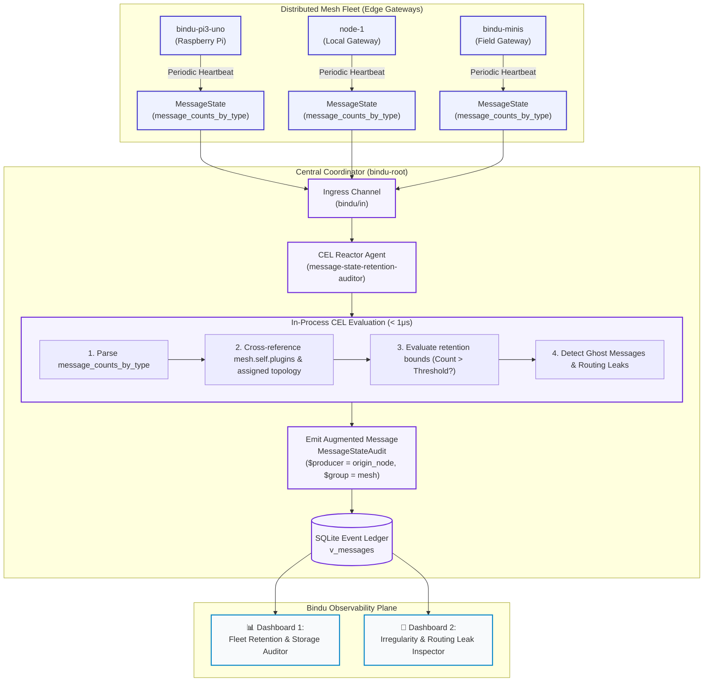
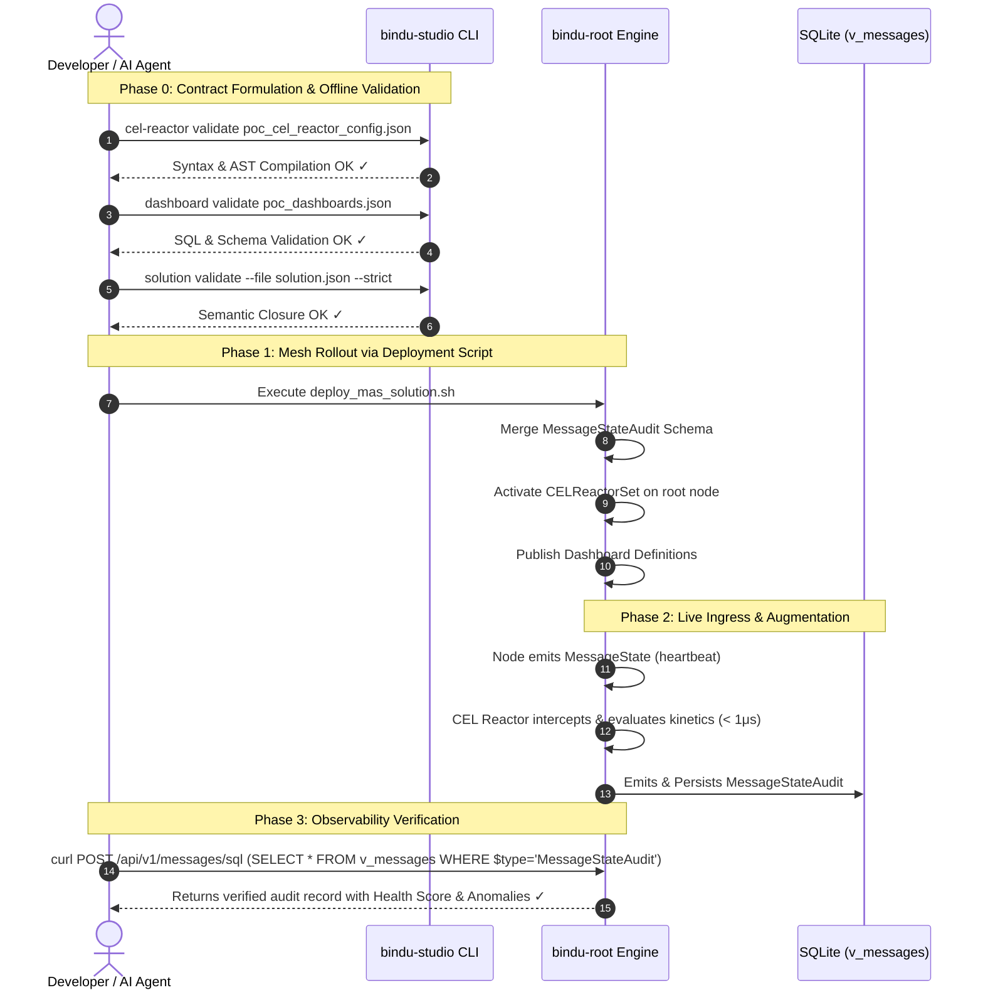

# Master Tutorial Plan: Auditing Mesh Routing & Retention with System Message Types (`MessageState`) 📡⚙️

> **Audience**: Multi-Agent System (MAS) Solution Creators, Enterprise Solution Architects, and Autonomous AI System Agents.  
> **Scope**: Canonical Architecture & Implementation Plan for building an in-process **Mesh Retention & Routing Auditor** by augmenting built-in system telemetry (`MessageState`) via a single declarative Google CEL Reactor and specialized operational dashboards.  
> **Governance**: Fully compliant with [`public/console/docs/AGENTS.md`](../AGENTS.md) (The 3-Layer Invariants, Level 0 DAG, Rule of Artifact Compilation, and Native REST SQL Observability).

---

## 1. Executive Summary & Educational Objectives

### The Operational Challenge in Multi-Solution Deployments
In a production Bindu deployment, multiple autonomous Multi-Agent Systems (e.g. 15 distinct business solutions across Cold Chain, RFID, Computer Vision, BLE Presence, and Modbus telemetry) continuously route messages across edge gateway nodes (`root`, `node-1`, `bindu-minis`, `bindu-pi3-uno`).

Every node periodically broadcasts a built-in infrastructure heartbeat: **`MessageState`**. This message contains critical low-level telemetry, including CPU/RAM/Disk metrics, running plugin processes, and crucially, **`fields.storage.message_counts_by_type`** (the inventory of all messages stored in the node's local SQLite ledger).

However, in large distributed meshes, platform operators face serious silent degradation risks:
1. **Retention Mismatches & Edge Storage Bloat:** High-frequency telemetry streams (e.g., `FreezerTelemetry`, `RfidAntennaTelemetry`) that accidentally omit retention policies or use calendar days (`retentionMode: "days"`) instead of sliding count windows (`count: 50..100`), risking flash disk exhaustion on constrained edge devices like Raspberry Pis.
2. **Directionality & Routing Leaks:** Telemetry messages incorrectly declared with `"child"` routing, causing high-frequency sensor readings to flood downstream child nodes and generate cascade rejection loops (`UNKNOWN_TYPE` $\rightarrow$ `ErrorEvent`).
3. **Orphaned / Unassigned Solution Traffic:** Nodes storing significant counts of message types belonging to plugins or reactors that are **not assigned or running on that node**, exposing misconfigured mesh broadcast paths.
4. **Reactor Churn & Loop Cascades:** Message types whose counts grow at rates orders of magnitude higher than their configured trigger crons (e.g., `@every 1m` producing 1,000 messages/min due to infinite re-broadcast loops).

### The Pedagogical & Architectural Mission
This tutorial demonstrates how to solve this enterprise governance challenge without writing low-level code, without external background daemons, and without adding heavy AI overhead. 

By employing **In-Process Google CEL Kinetics**, we configure a single declarative reactor that:
- Wakes up reactively whenever a node's `MessageState` arrives at the root.
- Evaluates `fields.storage.message_counts_by_type` in sub-microseconds.
- Cross-references the node's assigned plugins, active solution topologies, and retention thresholds.
- Emits an **augmented governance message** (`MessageStateAudit`), preserving the original `$group` and origin `$producer` identity.
- Populates two real-time visual dashboards in the Bindu Web Console for immediate fleet inspection and anomaly triage.



---

## 2. Key Feasibility Investigation & Architectural Findings

### ❓ Key Question
> *"Is it possible from a CEL reactor to create a MessageType that is an augmentation of `MessageState` (specifically the `message_counts_by_type` field) with routing, retention, and frequency bounds, triggered when `MessageState` arrives, while maintaining its `$group` and `$producer` so that it can drive an analytical dashboard?"*

### ✅ Architectural Answer: YES, and Here is How
1. **Triggering on Built-In System Telemetry:**
   `MessageState` is a native system message type emitted by every node's runtime state monitor. In Bindu, CEL reactors are first-class subscribers on `bindu/in`. By setting `"input_message_type": "MessageState"`, the reactor wakes up reactively on every node heartbeat.
2. **Accessing the Counts in CEL:**
   In the CEL evaluation context, the envelope is exposed in `head` and the body in `payload`. The storage inventory is accessible as:
   ```javascript
   payload.storage.message_counts_by_type  // list of {"total": int, "type": string}
   payload.storage.message_total           // total int count
   payload.identity.node_id                // originating node id
   payload.lifecycle.plugins_assigned      // list of assigned plugins
   ```
3. **Preserving Identity & Envelope Coordinates (`$group`, `$producer`):**
   When the CEL reactor emits `output_message_type: "MessageStateAudit"`, Bindu automatically:
   - Inherits `$group` from the incoming message (`head["$group"]`, typically `"mesh"`).
   - Records the source node via `head["$producer"]` and assigns `origin_producer: head["$producer"]` in `fields`.
   - Tags the spatial locagram path from `head["$where"]`.
4. **Context Hydration via Zero-RAG SQLite Query:**
   The reactor leverages a lightweight `context_query` to extract historical deltas:
   ```sql
   SELECT 
       COALESCE(json_extract(raw_json, '$.fields.total_stored_messages'), 0) AS prev_total,
       "$when" AS prev_timestamp
   FROM v_messages 
   WHERE "$type" = 'MessageStateAudit' 
     AND "$producer" = ? 
   ORDER BY "$when" DESC LIMIT 1
   ```
   This enables computing **storage growth velocity** ($\Delta\text{messages} / \Delta\text{time}$) without external state engines!

---

## 3. The Augmented Message Contract: `MessageStateAudit`

The solution introduces one declarative contract in `poc_message_types.json`: **`MessageStateAudit`**.

### Semantic Contract Specification
- **Directionality:** Bottom-Up (`"routing": ["local", "parent"]`).
- **Retention Semantics:** Sliding window (`"retentionMode": "count"`, `"retentionValue": 30`).
- **Partition Triplet:** `($type = "MessageStateAudit", $group = "mesh", $producer = "<gateway_node_id>")`.

```json
{
  "name": "MessageStateAudit",
  "version": "1.0.0",
  "emoji": "🛡️",
  "category": "system",
  "description": "Augmented operational audit of node message storage, retention health, and routing anomalies.",
  "routing": ["local", "parent"],
  "persist": true,
  "retentionMode": "count",
  "retentionValue": 30,
  "schema": {
    "type": "object",
    "required": [
      "node_id",
      "node_role",
      "total_stored_messages",
      "storage_growth_rate",
      "health_score",
      "irregularities_detected",
      "irregularity_count",
      "top_accumulating_types"
    ],
    "properties": {
      "node_id": { "type": "string", "description": "Origin gateway node ID being audited" },
      "node_role": { "type": "string", "enum": ["root", "node"], "description": "Cluster topology role" },
      "total_stored_messages": { "type": "integer", "description": "Total messages stored on node disk" },
      "storage_growth_rate": { "type": "number", "description": "Messages accumulated per minute since last heartbeat" },
      "health_score": { "type": "integer", "minimum": 0, "maximum": 100, "description": "Overall retention and routing health score" },
      "irregularity_count": { "type": "integer", "description": "Number of flagged routing or retention anomalies" },
      "irregularities_detected": {
        "type": "array",
        "items": {
          "type": "object",
          "required": ["type_name", "category", "severity", "detail", "recommendation"],
          "properties": {
            "type_name": { "type": "string" },
            "category": { "type": "string", "enum": ["RETENTION_BLOAT", "ROUTING_LEAK", "FREQUENCY_SURGE", "PLUGIN_CRASH_STALE"] },
            "severity": { "type": "string", "enum": ["INFO", "WARNING", "CRITICAL"] },
            "detail": { "type": "string" },
            "recommendation": { "type": "string" }
          }
        }
      },
      "top_accumulating_types": {
        "type": "array",
        "items": {
          "type": "object",
          "required": ["type", "count"],
          "properties": {
            "type": { "type": "string" },
            "count": { "type": "integer" }
          }
        }
      }
    }
  }
}
```

---

## 4. The Anomaly Detection & Scoring Heuristics

The CEL Reactor computes deterministic irregularity checks across four operational dimensions:

| Irregularity Category | Detection Logic in CEL | Severity | Remediation Recommendation |
| :--- | :--- | :---: | :--- |
| **`RETENTION_BLOAT`** | `m.total > 100` on high-frequency telemetry (e.g., `FreezerTelemetry`, `RfidAntennaTelemetry`) or discrete definitions (`retention: 1`) accumulating $> 5$ records. | **CRITICAL** | Set `"retentionMode": "count"`, `"retentionValue": 50` in message schema to protect edge flash memory. |
| **`ROUTING_LEAK`** | Telemetry types appearing on edge nodes that do not run the associated solution or plugin (e.g. `RfidAntennaTelemetry` on `bindu-minis` when only `hello-world-plugin` is assigned). | **WARNING** | Check `"routing"` in schema; ensure telemetry uses `["local", "parent"]` and never `["child"]`. |
| **`FREQUENCY_SURGE`** | Rapid accumulation of messages ($> 50$ msgs between 60s heartbeats) on crons scheduled for low frequency (`@every 5m`). | **WARNING** | Check reactor trigger conditions for recursive rebroadcast feedback loops. |
| **`PLUGIN_CRASH_STALE`** | Plugin is in `error` status (e.g., `last_error: EOF`), yet message counts remain high and active. | **WARNING** | Restart failed plugin via `bindu-studio plugin apply` or check host hardware controller permissions (`/dev/tty*`, `hci0`). |

### Deterministic Health Score Formula (0 to 100)
$$\text{HealthScore} = \text{clamp}\Big(100 - (20 \times N_{\text{critical}}) - (10 \times N_{\text{warning}}),\, 0,\, 100\Big)$$

---

## 5. Visual Observability Plane: The 2 Dashboards

To make this audit immediately useful to operations and DevOps, the solution provides two dedicated dashboards in `poc_dashboards.json`:

### 📊 Dashboard 1: Mesh Retention & Storage Fleet Auditor (`mesh-storage-auditor`)
* **Role**: Fleet-wide high-level health monitoring.
* **Widgets**:
  1. **Fleet Health Score (Metric Card / Gauge):** Average health score across all nodes.
  2. **Total Stored Ledger Messages (Metric Card):** Combined volume of messages on disk across gateways.
  3. **Node Storage & Irregularity Leaderboard (Table):**
     - Columns: `Node ID`, `Role`, `Total Messages`, `Anomalies Detected`, `Health Score`, `Last Audit`.
     - SQL Query: `SELECT "$producer" AS node_id, json_extract(fields, '$.node_role') AS role, json_extract(fields, '$.total_stored_messages') AS total_msgs, json_extract(fields, '$.irregularity_count') AS anomalies, json_extract(fields, '$.health_score') AS score, "$when" AS audited_at FROM v_messages WHERE "$type" = 'MessageStateAudit' GROUP BY "$producer" HAVING MAX("$when") ORDER BY score ASC`
  4. **Top Accumulating Types Fleet-Wide (Bar Chart):** Visual comparison of which schemas occupy the most SQLite rows.

### 🚨 Dashboard 2: Irregularity & Routing Leak Inspector (`mesh-routing-leak-inspector`)
* **Role**: Deep-dive triage for engineers and AI agents to fix schemas and routing tables.
* **Widgets**:
  1. **Active Critical Alerts (Badge Grid):** Highlighting specific nodes with storage bloat or leaks.
  2. **Detailed Anomaly Investigation Feed (Table):**
     - Columns: `Node`, `Message Type`, `Category`, `Severity`, `Diagnostic Detail`, `Actionable Recommendation`.
     - SQL Query: Extracted via SQLite `json_each` over `fields.irregularities_detected`.

---

## 6. Complete Artifact Inventory (The Rule of 6 Compliance)

According to [`public/console/docs/AGENTS.md`](../AGENTS.md), every complete MAS solution or tutorial must contain all required declarative artifacts:

```text
public/console/docs/using-system-message-types/
├── tutorial-plan.md                      # This canonical architecture and execution specification
├── tutorial_guide.md                     # Step-by-step developer tutorial walk-through
├── poc_message_types.json                # Schema contract for MessageStateAudit
├── poc_cel_reactor_config.json           # Declarative CEL ReactorSet auditing MessageState
├── poc_dashboards.json                   # The 2 Web Console dashboards
├── solution.json                         # Solution manifest definition
├── solution.bundle.json                  # Compiled, standalone deployable MAS bundle
└── deploy_mas_solution.sh                # End-to-end 5-phase rollout script with Preflight Gate
```

*(Note: In accordance with the 3-layer architecture, this MAS solution is pure semantic event processing. It does not require a custom Go BPR hardware plugin because it intercepts and analyzes Bindu's built-in OS runtime telemetry directly via native CEL kinetics).*

---

## 7. Step-by-Step Implementation & Verification Cadence



### Verification & Observability Strategy
Verification is performed strictly via Bindu's native REST SQL Query endpoint (`/api/v1/messages/sql` using `curl`), never touching raw database files on disk:

```bash
# Verify live MessageStateAudit emission
curl -s -u console:StrongPass123 -X POST http://127.0.0.1:38080/api/v1/messages/sql \
  -H "Content-Type: application/json" \
  -d '{"sql": "SELECT \"$id\", \"$type\", \"$producer\", json_extract(fields, '\''$.health_score'\'') as health, json_extract(fields, '\''$.irregularity_count'\'') as anomalies, json_extract(fields, '\''$.total_stored_messages'\'') as total_msgs FROM v_messages WHERE \"$type\" = '\''MessageStateAudit'\'' ORDER BY \"$when\" DESC LIMIT 5"}' | jq .
```

---

## 8. Summary of Benefits & Expected Impact

1. **Zero-Code Operational Governance:** Eliminates the need for external Prometheus, Telegraf, or custom Python log triage scripts; Bindu governs itself using its own native semantic fabric.
2. **Deterministic Edge Safety:** Prevents memory exhaustion on resource-constrained Raspberry Pis and industrial IoT gateways before disk crashes occur.
3. **Sub-Microsecond Speed & 0 Token Cost:** The audit runs entirely in-process within Google CEL ASTs, evaluating complex nested JSON payloads with zero cloud API latency and zero LLM billing.
4. **Actionable Feedback Loop:** Provides immediate, clear recommendations for solution creators to tune retention policies and clean up broadcast routing arrays.
